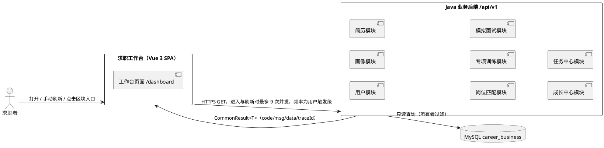
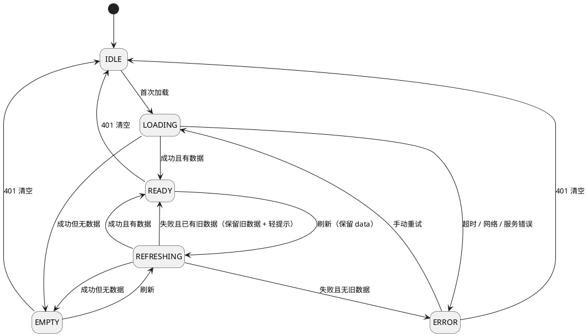
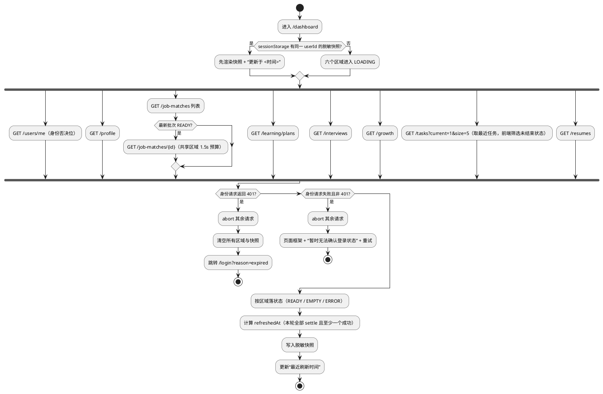
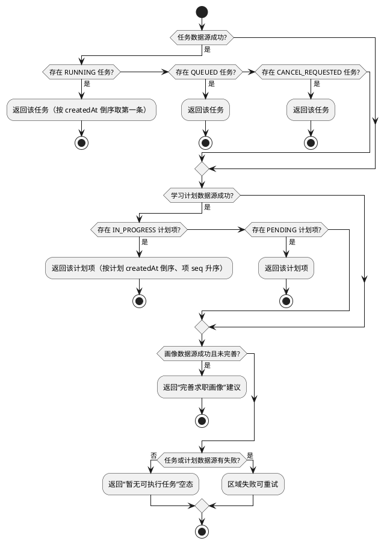
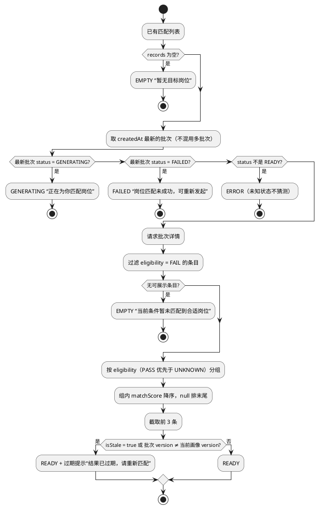
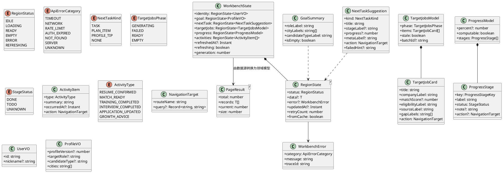

# 求职工作台 - 技术设计文档

> 需求来源：`.codeartsdoer/specs/job_workbench/spec.md`
> 关联资料：`docs/项目架构.md`、`docs/迭代计划.md`、`docs/功能资料/02-求职工作台/求职工作台后端接口示例.md`、`docs/功能资料/业务后端接口文档.md`、`docs/功能资料/数据说明.md`
> 代码基线：`project/frontend`（Vue 3 + TypeScript + Vite + Element Plus）、`project/backend`（Spring Boot 4 + MyBatis + MySQL 8）
> 设计范围：仅技术设计，不包含业务代码实现。

---

# 一、需求与存量功能关系分析

## 1.1 需求功能与存量功能对比

### 1.1.1 已实现功能

| 需求功能 | 存量功能 | 代码位置 | 匹配度 |
|---------|---------|---------|--------|
| 默认进入工作台 | 根路径 `/` 重定向 `/dashboard`，`dashboard` 路由已注册 | `project/frontend/src/router/routes.ts:19-24` | 100% |
| 页面外壳与两栏总览布局 | `MainLayout + Sidebar + Header`，`DashboardView` 使用 `grid-template-columns: 1.37fr 1fr`，1050px 断点降为单列 | `project/frontend/src/layouts/MainLayout.vue`、`project/frontend/src/views/dashboard/DashboardView.vue:44-67` | 75% |
| 六个区域的视觉占位与固定顺序 | 欢迎区（含目标摘要行）、下一项任务、近期目标岗位、求职进度、最新动态已按顺序排布 | `project/frontend/src/views/dashboard/DashboardView.vue:5-41` | 75% |
| 空状态文案与入口 | 硬编码“暂无训练任务 / 暂无目标岗位 / 暂无求职进度 / 暂无动态记录”，含“完善求职画像”“查看岗位匹配”链接 | `project/frontend/src/views/dashboard/DashboardView.vue:21-40` | 50% |
| 统一响应体约定 | `CommonResult<T>` 具备 `code/msg/data/traceId` 字段与 `success/notFound` 工厂 | `project/backend/src/main/java/com/aijob/backend/common/CommonResult.java:7-30` | 100%（后端已有，前端未消费） |
| 用户查询能力 | `GET /api/v1/users`、`GET /api/v1/users/{id}` demo 查询 | `project/backend/src/main/java/com/aijob/backend/user/controller/AppUserController.java:28-37` | 25% |
| 数据表结构基础 | Flyway `V1` 已创建画像、匹配批次/条目、学习计划/计划项、面试会话、成长建议、任务、简历版本等 31 张表 | `project/backend/src/main/resources/db/migration/V1__init_business_schema.sql` | 100%（表结构层面） |
| 请求层能力 | 仅注释预留，未安装 axios，未实现任何请求 | `project/frontend/src/api/request.ts:1-30` | 0% |
| 登录态与当前用户 | 路由守卫为空实现；无 `/api/v1/users/me` 实现；后端 `SecurityConfig` 全量 `permitAll` | `project/frontend/src/router/index.ts:10-18`、`project/backend/src/main/java/com/aijob/backend/config/SecurityConfig.java:17-23` | 0% |

> 结论：工作台页面**只有静态视觉骨架**，全部数据获取、聚合规则、独立加载/失败/重试、刷新与缓存、登录态联动均无存量实现；底层数据接口仅有**设计契约**（文档），代码层面除用户 demo 外均未实现。

### 1.1.2 需要扩展的功能

| 需求功能 | 存量功能 | 差异说明 | 扩展方向 |
|---------|---------|---------|---------|
| 六个区域的数据驱动渲染 | `DashboardView` 为纯静态模板，无 `<script>` 状态与请求 | 输入：由无入参变为依赖登录用户与九个只读数据源；输出：由固定文案变为真实数据 + 空态/失败态；边界：需处理局部失败与数据过期 | 保留现有 DOM 顺序与 SCSS 布局，将静态块替换为独立子组件，状态由组合式函数统一编排 |
| 求职目标摘要 | 欢迎区内静态展示“未设置” | 需读取画像、翻译枚举、城市码转名称、最多 5 个城市、点击跳转画像页；需独立失败态 | 从欢迎区中拆出独立语义区域（视觉仍相邻），新增 `GoalSummary` 组件与 `buildGoalSummary` 纯函数 |
| 空状态与引导 | 单一硬编码空态，无加载/失败区分 | 需求要求“加载中 / 空数据 / 失败可重试 / 已过期”四类状态互斥 | 新增统一 `RegionState` 展示组件与区域状态机，空态与错误态分别配置文案与动作 |
| 请求层 | `request.ts` 仅注释，未安装 axios | 需 CommonResult 解包、超时中止、traceId 提取、401 统一处理 | 以原生 `fetch` 实现类型化 `apiGet`，避免新增依赖；保留 `request.ts` 作为唯一出口 |
| 布局兼容性 | 已具备 1050px 单列断点，无 700px 横向滚动校验 | 需求增加 1280–1920 两栏、<700 无横向滚动约束 | 保留现有断点，新增 1280px 与 700px 的验收用例；组件内部采用可收缩布局 |

### 1.1.3 需要新增的功能或接口

**模块 A：数据访问层**
- A1. 工作台领域类型定义：用户、画像、匹配批次/条目、学习计划/计划项、面试摘要、成长摘要、任务、简历摘要、分页结构、统一响应结构。
  - 输入：接口文档中的 VO 字段；输出：强类型只读模型；核心逻辑：字段可空性与枚举字面量联合类型。
- A2. HTTP 基础能力：`GET` 请求、`CommonResult` 解包、超时中止、HTTP 状态与业务码映射、`traceId` 提取、401 分类。
  - 输入：路径、查询参数、外部 `AbortSignal`；输出：`{ data, traceId }` 或类型化 `ApiError`。
- A3. 工作台数据源函数：九个只读接口的类型化封装（含条件调用的匹配批次详情）。
- A4. 开发期 Mock 适配器（仅 `DEV` 且环境变量显式开启），用于后端接口未实现时验证 UI 与规则。

**模块 B：聚合规则（纯函数，无副作用）**
- B1. 问候语：昵称存在用昵称，缺失用“同学”。
- B2. 目标摘要：枚举翻译、城市码翻译、最多 5 个城市、空值展示“未设置”。
- B3. 下一项任务：按“进行中任务 → 排队中任务 → 取消请求中任务 → 未完成计划项 → 画像完善建议”选取唯一一条。
- B4. 目标岗位：批次状态机、资格过滤、排序、截取 3 条、过期判定、来源核验标注。
- B5. 求职进度：六阶段判定、向下取整百分比、失败阶段“待确认”、投递未启用处理。
- B6. 最新动态：多来源事件归一化、去重、倒序、取 5 条、时间缺失置末。
- B7. 相对时间与本地时区格式化。

**模块 C：编排与状态**
- C1. 身份否决：`/users/me` 与各业务数据源并行发起；401 时中止全部请求并清空个人数据；身份服务不可用时全页阻断，不展示已返回的业务数据。
- C2. 独立区域状态：`idle/loading/ready/empty/error`，刷新时保留旧数据。
- C3. 区域级超时与重试：单区域预算 1.5 秒，手动重试不自动无限重试。
- C4. 刷新合并：同一数据源同一时刻仅一个在途请求；刷新代次防止旧响应覆盖新数据。
- C5. 缓存：`sessionStorage` 脱敏快照，按用户隔离，401 清理。
- C6. 排障标识：响应 `traceId`，缺失时生成客户端 requestId，不展示堆栈。

**模块 D：展示组件**
- D1. `WelcomeHero`（欢迎语与刷新工具条）。
- D2. `GoalSummary`（目标方向/城市/阶段）。
- D3. `NextTaskCard`（唯一任务 + 失败提示条 + 继续入口）。
- D4. `TargetJobsPanel`（岗位卡片、生成中/失败/过期/空态）。
- D5. `ProgressPanel`（环形或条形百分比 + 六阶段清单 + 跳转）。
- D6. `ActivityFeed`（动态列表 + 跳转）。
- D7. `RegionState`（加载骨架、失败重试、空态、排障标识）。

**模块 E：后端**
- E1. **不新增任何工作台聚合接口、不新增数据表、不改变既有业务契约**（`spec.md` 1.4-5）。工作台所需数据全部复用既有 `/api/v1` 只读接口，由对应业务模块实现。
- E2. 后端需补齐的前置接口（工作台的外部依赖，不属于本模块代码变更）：`GET /api/v1/users/me`、`GET /api/v1/profile`、`GET /api/v1/job-matches`、`GET /api/v1/job-matches/{id}`、`GET /api/v1/learning/plans`、`GET /api/v1/interviews`、`GET /api/v1/growth`、`GET /api/v1/tasks`、`GET /api/v1/resumes`。
- E3. 公共层需补齐 `traceId` 填充机制（当前 `CommonResult.success()` 未写入 `traceId`），否则前端只能展示本地 requestId。

## 1.2 存量功能详细分析

### 1.2.1 `DashboardView` 静态骨架

- **接口契约**：无 `props`、无 `emits`、无对外方法，纯展示组件；仅依赖 `vue-router` 的 `router-link` 与全局注册的 Element Plus 图标。
- **业务规则**：无动态规则，所有文案与数值硬编码；四个空态块分别固定展示。
- **扩展点**：模板已按“欢迎区 / 两栏 / 进度 / 动态”分块，`<style scoped>` 中的类名可按区域复用；`@media (max-width: 1050px)` 已实现单列降级。
- **约束**：
  1. 样式依赖 `vite.config.ts` 注入的 `@/styles/variables.scss` 与 `sass`，新增组件需沿用同一注入方式。
  2. Element Plus 图标在 `main.ts` 中全量注册，新增图标可直接使用。
  3. 页面无滚动容器，滚动由 `MainLayout` 的 `.main-layout__right` 承担，新增内容不得引入嵌套 `overflow` 导致横向滚动。

### 1.2.2 请求层与用户状态

- **接口契约**：`request.ts` 与 `stores/user.ts` 均为注释占位，导出空对象；`package.json` 未声明 `axios`。
- **约束**：
  1. 不得引入与现有技术栈重复且非必要的网络库；原生 `fetch` 已具备 `AbortController`，满足 1.5 秒超时与请求中止要求。
  2. `vite.config.ts` 已将 `/api` 代理到 `http://localhost:8080`，前端请求统一使用相对路径 `/api/v1/...`，不得硬编码服务地址。
  3. 登录页尚未对接登录接口，工作台无法在本期获得真实令牌；鉴权落地前需要开发期 Mock 或后端临时放行。

### 1.2.3 路由与布局

- **接口契约**：`/dashboard` 为工作台唯一入口；`/` 重定向 `/dashboard`；未匹配路径同样重定向 `/dashboard`。目标模块路由已注册：`/profile`、`/resume`、`/job-match`、`/training`、`/interview`、`/growth`、`/application`。
- **约束**：
  1. **任务中心没有前端路由**（`config/menu.ts` 无任务中心项，`routes.ts` 无 `/tasks`）。`spec.md` 5.3.1-5 要求“任务详情入口进入任务中心”，本期需以“关联资源页”降级，或由任务中心模块补齐路由后再启用。
  2. `/application` 为“方案预览”占位页，投递数据源在 P0 未建表（`数据说明.md:1781`），工作台不得调用不存在的投递接口。
  3. 路由守卫为空实现，工作台需自行处理 401，而不能依赖守卫。

### 1.2.4 后端与数据库约束

- **已就绪**：`V1__init_business_schema.sql` 中 `user_profile`、`job_match_batch`、`job_match_item`、`learning_plan`、`learning_plan_item`、`interview_session`、`growth_advice`、`ai_task`、`resume_version` 等表可直接支撑工作台只读查询；`ai_task.status` 覆盖 `QUEUED/RUNNING/CANCEL_REQUESTED/SUCCEEDED/FAILED/CANCELLED/EXPIRED`；`job_match_item.eligibility_status` 覆盖 `PASS/FAIL/UNKNOWN`；`learning_plan_item.status` 覆盖 `PENDING/IN_PROGRESS/COMPLETED`。
- **未就绪**：
  1. 除 `AppUserController` 的 demo 接口外，其余业务接口均未实现。
  2. `SecurityConfig` 对所有请求 `permitAll`，无法验证“仅本人数据”；工作台必须在鉴权完成后才能生产上线。
  3. `CommonResult` 无错误工厂与 `traceId` 注入，前端需兼容 `traceId` 缺失。
  4. P0 **没有 `application_record` 表**，也没有投递接口，投递阶段与投递动态没有客观数据源。

### 1.2.5 既有接口契约的字段缺口

以下缺口直接影响需求的字段展示，设计需明确降级，不得臆造字段：

| 需求字段 | 契约现状 | 设计处理 |
|---------|---------|---------|
| 目标岗位“公司名称” | `MatchItemVO` 无公司字段，仅有 `title`、`source.name`、`sourceUrl` | 读取可选的 `companyName`（前端忽略未知字段，后端未来新增即为兼容）；当前缺失时固定展示“公司信息待补充” |
| 简历确认时间 | `ResumeVersionVO` 无 `confirmedAt`，仅有 `status=CONFIRMED` 与 `createdAt` | 以 `status=CONFIRMED` 判定阶段；动态时间使用 `createdAt` 并标注为版本创建时间，或按“时间未知”置末 |
| 训练完成时间 | `PlanItemVO` 无 `completedAt` | 动态时间优先取成长证据 `recentEvidence[].createdAt`（`sourceType=LEARNING_ANSWER`），否则“时间未知”置末 |
| 面试完成时间 | `InterviewVO` 无 `endedAt`/`updatedAt`，仅有 `createdAt` | 以 `status=COMPLETED` 判定阶段；动态时间使用 `createdAt` 或“时间未知” |
| 成长建议时间 | `GrowthVO` 无更新时间，仅 `skills[].updatedAt` | 取 `skills[].updatedAt` 最大值作为建议时间，缺失则“时间未知” |
| 投递进度 | 无接口、无表 | 阶段标记“未启用”，不计完成；不生成投递动态；不展示录用类结论 |
| 画像不存在 | 契约未定义 HTTP 状态 | `200 + 空数据` 与 `404` 均按“无画像”空态处理，其他错误按失败处理 |

# 二、增量设计方案

## 2.1 实现模型

### 2.1.1 上下文视图

工作台是**前端只读聚合页**：不新增后端聚合接口，由浏览器并行调用既有 `/api/v1` 只读接口，在浏览器内完成筛选、排序、过期判定与降级。后端只承担单资源查询与所有者校验。

**交互契约说明**

1. 前端与后端通过 Vite 代理同源访问，路径固定 `/api/v1/**`；不硬编码主机与端口。
2. 工作台为纯只读：不产生任何写请求，因此重复刷新不会产生业务副作用（对应 `spec.md` 4.2-4）。
3. 不调用投递接口（P0 未注册），不订阅 SSE，不调用 Agent 内部接口。
4. 单次进入或刷新最多发起 9 个 GET；其中任务列表带状态过滤，只取未结束任务。
5. 后端所有资源必须按令牌识别用户并校验所有者；工作台不传 `userId`，避免越权（对应 `spec.md` 4.3-1）。

### 2.1.2 服务/组件总体架构

```plantuml
@startuml
top to bottom direction
skinparam packageStyle rectangle

package "展示层 views/dashboard" {
  [DashboardView]
  [WelcomeHero]
  [GoalSummary]
  [NextTaskCard]
  [TargetJobsPanel]
  [ProgressPanel]
  [ActivityFeed]
  [RegionState]
}

package "编排层 composables" {
  [useWorkbench]
}

package "规则层 features/workbench/model" {
  [greeting]
  [goalSummary]
  [nextTask]
  [targetJobs]
  [progress]
  [activities]
  [timeFormat]
  [dictionaries]
}

package "数据访问层 api/workbench" {
  [workbenchApi]
  [http]
  [mockAdapter]
  [types]
}

package "外部依赖（既有契约）" {
  [GET /users/me]
  [GET /profile]
  [GET /job-matches]
  [GET /job-matches/{id}]
  [GET /learning/plans]
  [GET /interviews]
  [GET /growth]
  [GET /tasks]
  [GET /resumes]
}

DashboardView --> useWorkbench
DashboardView --> WelcomeHero
DashboardView --> GoalSummary
DashboardView --> NextTaskCard
DashboardView --> TargetJobsPanel
DashboardView --> ProgressPanel
DashboardView --> ActivityFeed
WelcomeHero --> RegionState
GoalSummary --> RegionState
NextTaskCard --> RegionState
TargetJobsPanel --> RegionState
ProgressPanel --> RegionState
ActivityFeed --> RegionState
useWorkbench --> workbenchApi
useWorkbench --> greeting
useWorkbench --> goalSummary
useWorkbench --> nextTask
useWorkbench --> targetJobs
useWorkbench --> progress
useWorkbench --> activities
workbenchApi --> http
workbenchApi --> types
workbenchApi ..> mockAdapter : DEV 且开关开启
workbenchApi --> "GET /users/me" : 1 次/进入
workbenchApi --> "GET /profile" : 1 次/进入
workbenchApi --> "GET /job-matches" : 1 次/进入
workbenchApi --> "GET /job-matches/{id}" : 0~1 次/进入（仅 READY）
workbenchApi --> "GET /learning/plans" : 1 次/进入
workbenchApi --> "GET /interviews" : 1 次/进入
workbenchApi --> "GET /growth" : 1 次/进入
workbenchApi --> "GET /tasks" : 1 次/进入
workbenchApi --> "GET /resumes" : 1 次/进入
@enduml
```

**职责说明**

| 组件 | 职责 | 不承担 |
|------|------|--------|
| `DashboardView` | 页面布局、区域顺序、刷新入口、滚动与响应式 | 业务规则、请求 |
| `WelcomeHero` | 问候语、阶段说明、最近刷新时间、刷新按钮 | 画像读取 |
| `GoalSummary` | 三项摘要、城市截断、点击跳转 | 画像编辑 |
| `NextTaskCard` | 唯一建议、阶段/进度展示、继续入口、失败提示条 | 启动任务、重试任务 |
| `TargetJobsPanel` | 生成中/失败/过期/空态、岗位卡片、查看全部 | 岗位计算、资格核验 |
| `ProgressPanel` | 百分比、六阶段清单、未完成阶段跳转 | 能力分推算 |
| `ActivityFeed` | 动态列表、相对时间、来源跳转 | 全量记录查询 |
| `RegionState` | 加载骨架、失败重试、空态、排障标识 | 数据获取 |
| `useWorkbench` | 并发编排、状态机、超时、重试、刷新合并、缓存、401 处理 | 展示细节 |
| `workbenchApi` | 九个只读接口的类型化封装与参数约定（含条件调用） | 业务排序 |
| 规则层纯函数 | 问候、目标、下一项任务、岗位、进度、动态、时间 | 网络与 DOM |
| `mockAdapter` | 仅开发期的契约一致样例，覆盖空/正常/部分异常 | 生产逻辑 |

**目录与文件清单（实现阶段落地目标）**

| 类型 | 路径 | 说明 |
|------|------|------|
| 修改 | `project/frontend/src/views/dashboard/DashboardView.vue` | 保留布局与样式，改为数据驱动并组合子组件 |
| 修改 | `project/frontend/src/api/request.ts` | 由注释占位替换为基于 `fetch` 的类型化 GET 封装 |
| 新增 | `project/frontend/src/api/workbench.ts` | 工作台数据源函数 |
| 新增 | `project/frontend/src/api/mock/workbench.mock.ts` | 开发期 Mock 适配器 |
| 新增 | `project/frontend/src/types/workbench.ts` | VO、领域模型、枚举、错误类型 |
| 新增 | `project/frontend/src/features/workbench/model/*.ts` | 六个聚合规则与时间/字典工具 |
| 新增 | `project/frontend/src/features/workbench/useWorkbench.ts` | 编排、状态机、缓存、重试 |
| 新增 | `project/frontend/src/views/dashboard/components/*.vue` | 七个展示组件 |
| 修改 | `project/frontend/env.d.ts` | 声明 `VITE_WORKBENCH_MOCK` 环境变量类型 |
| 不改 | `project/frontend/src/router/routes.ts` | `/dashboard` 已注册，根路径已重定向 |
| 不改 | `project/frontend/src/layouts/MainLayout.vue` | 布局与滚动已满足要求 |
| 不改 | `project/backend/**` | 工作台不新增接口、表或契约 |

### 2.1.3 实现设计文档

#### （1）区域状态机

每个区域维护独立状态；刷新时保留旧数据，避免空白闪烁（`spec.md` 4.1-4）。

状态语义：

| 状态 | 页面表现 | 是否保留旧数据 |
|------|---------|---------------|
| `IDLE` | 不渲染业务内容 | 否 |
| `LOADING` | 区域骨架屏 | 否 |
| `READY` | 业务内容 | — |
| `EMPTY` | 空态文案 + 引导入口 | 否 |
| `ERROR` | 失败文案 + 重试 + 排障标识 | 否 |
| `REFRESHING` | 旧数据 + 顶部细进度条 | 是 |

**约束**：`LOADING` 不得展示空态（`spec.md` 5.7.1-4）；`EMPTY` 不得展示“重试失败”类文案（5.7.1-1）；`READY` 的数据过期只由目标岗位区域的过期提示表达，不影响状态。

#### （2）进入与刷新主流程

**设计要点**

1. **身份请求拥有否决权**：与业务请求并行以控制首屏时延；一旦 401 或身份服务不可用，立即 `abort` 其余请求并清空已返回数据。这样既满足 2 秒目标，也满足 4.3-2 与 5.1.3-3。
2. **区域隔离**：除身份外，任一区域失败不影响其他区域；各区域独立 `Promise` 与独立状态。
3. **匹配区域二次请求**：列表与详情属于同一区域，共享 1.5 秒区域预算；列表耗时过长时不再发起详情，直接进入失败可重试。
4. **刷新合并**：`useWorkbench` 维护 `generation` 与每数据源 `inFlight`。刷新时若同一数据源仍在途，则复用其 `Promise`；旧代次响应返回后丢弃，防止覆盖新代次结果。
5. **时间更新规则**：只有本轮所有请求 `settle` 且至少一个成功时才更新 `refreshedAt`；全部失败时保留上一次成功时间。
6. **卸载清理**：`onBeforeUnmount` 中止全部在途请求，避免路由切换后写状态。

#### （3）下一项任务优先级

**规则补充**

1. 任务状态不在 `QUEUED/RUNNING/CANCEL_REQUESTED` 内（含 `SUCCEEDED/FAILED/CANCELLED/EXPIRED` 与未知值）不参与推荐。
2. 任务进度仅在接口返回 0–100 的整数时展示百分比；`null` 只展示阶段文案，**禁止补 0**。
3. 计划项类型 `READING/PRACTICE/INTERVIEW` 均属于可推荐对象；展示标题、类型文案、预计时长。
4. “任务数据源失败但计划可用”时降级展示计划项（`spec.md` 5.3.3-3），不暴露任务服务错误。
5. 任务列表一次请求 `size=5`，前端同时完成两件事：筛出 `QUEUED/RUNNING/CANCEL_REQUESTED` 参与推荐；把 `records[0]`（最近任务）为 `FAILED` 时作为失败提示条来源。提示条不改变唯一推荐，文案“最近一次任务未完成，可前往任务中心查看”，不自动重试（5.3.1-6、5.3.3-4）。
6. 任务中心路由缺失时，提示条的动作降级为关联资源页（见 2.4-D10）；无可用目标则隐藏动作，仅保留文字说明。

#### （4）目标岗位批次判定与过期

**过期判定细则**

1. `batch.isStale === true` → 过期。
2. `profile.profileVersion` 为合法非负整数且 `batch.profileVersion` 为合法整数且两者不等 → 过期。
3. 画像版本缺失、非数字、负数 → **不判定过期**，也不展示过期提示（对应 `spec.md` 5.2.3-3）。
4. 过期时仍展示岗位条目，但必须有醒目提示；不得出现“匹配指数有效”类措辞。
5. 展示排序不依赖后端返回顺序（后端虽已按资格分组排序，前端仍按需求重排，避免契约漂移）。

#### （5）求职进度计算

| 阶段 | 判定依据（客观数据） | 数据源 | 未启用/失败处理 |
|------|---------------------|--------|----------------|
| 完善求职画像 | `targetRole` 与 `candidateType` 均非空 | `/profile` | 失败 → `UNKNOWN` |
| 确认简历 | 任一简历 `latestVersion.status === CONFIRMED` | `/resumes` | 失败 → `UNKNOWN` |
| 完成一次岗位匹配 | 存在 `status=READY` 且未过期的批次 | `/job-matches` + `/profile` | 失败 → `UNKNOWN` |
| 完成一次专项训练 | 存在 `status=COMPLETED` 的计划项；否则成长证据含 `sourceType=LEARNING_ANSWER` | `/learning/plans`、`/growth` | 两源均失败 → `UNKNOWN` |
| 完成一次模拟面试 | 存在 `status=COMPLETED` 的面试 | `/interviews` | 失败 → `UNKNOWN` |
| 产生一条投递记录 | **P0 未启用**，无数据源 | 无 | 固定 `UNKNOWN`，并标注“投递进度功能未开放” |

计算规则：

1. `percent = floor(doneCount / 6 × 100)`，仅使用 `DONE` 计入分子，`TODO` 与 `UNKNOWN` 均不计入。
2. 任一阶段为 `UNKNOWN` 时，`percent = null`，页面展示“暂无法计算”（`spec.md` 5.5.3-1）。
3. **例外**：投递阶段属于“功能未启用”而非“数据源失败”。若仅投递为 `UNKNOWN`，其余五阶段均可判定，则按 5 个可判定阶段计算百分比，并在清单中标注“投递进度功能未开放”。理由：P0 未建表，如果按失败处理，所有用户进度将永久无法计算，与 5.5.1-6“新用户展示 0%”冲突。此例外只适用于投递阶段，且不影响“录用率/成功率”禁止项。
4. 数据不一致（画像声称已确认简历但简历服务无 `CONFIRMED` 版本）时，以简历服务为准（5.5.3-2），画像阶段仍只看画像自身字段。
5. 阶段顺序固定为上述六项；未完成阶段按“画像 → 简历 → 匹配 → 训练 → 面试 → 投递”排序，首位未完成阶段加“优先”标识。

#### （6）最新动态聚合

| 动态类型 | 来源 | 判定 | 时间字段 | 跳转 |
|---------|------|------|---------|------|
| 简历确认 | `/resumes` | `latestVersion.status=CONFIRMED` | `latestVersion.createdAt`（无 `confirmedAt`，按版本创建时间展示并标注“版本创建于”） | `/resume?versionId=` |
| 匹配完成 | `/job-matches` | 最新批次 `READY` | 批次 `createdAt` | `/job-match?batchId=` |
| 训练完成 | `/growth.recentEvidence` | `sourceType=LEARNING_ANSWER` | 证据 `createdAt`；无则“时间未知” | `/training` |
| 面试完成 | `/interviews` | `status=COMPLETED` | 会话 `createdAt`（无结束时间） | `/interview?interviewId=` |
| 投递更新 | 无（P0） | 永不产生 | — | — |
| 成长建议 | `/growth` | `suggestions` 非空 | `skills[].updatedAt` 最大值；无则“时间未知” | `/growth` |

聚合规则：

1. 事件统一为 `ActivityItem`，按 `occurredAt` 倒序；`occurredAt` 缺失的排末尾并展示“时间未知”。
2. 时间相同按来源稳定排序：简历 → 匹配 → 训练 → 面试 → 成长（固定次序）。
3. 训练证据按 `sourceId` 去重，避免同一回答重复成条。
4. 最多 5 条；摘要不超过 100 字符，禁止包含回答全文、简历原文、邮箱。
5. 部分来源失败仍展示其余来源；全部来源失败才进入 `ERROR`（5.6.3-1、5.6.3-3）。
6. 不展示他人事件；数据源返回内容按当前令牌用户查询，前端不做跨用户合并。

#### （7）降级矩阵

| 区域 | 主数据源 | 降级顺序 | 无可用降级 |
|------|---------|---------|-----------|
| 欢迎区 | `/users/me` | 无（身份否决） | 全页身份错误 + 重试 |
| 求职目标摘要 | `/profile` | 无 | 区域失败可重试 |
| 下一项任务 | `/tasks` | `/learning/plans` → `/profile` | 空态或失败（见流程图） |
| 近期目标岗位 | `/job-matches` + 详情 | 无（不混用旧批次） | 区域失败可重试 |
| 求职进度 | 六个阶段数据源 | 逐阶段 `UNKNOWN` | 百分比“暂无法计算” + 重试 |
| 最新动态 | 五个事件来源 | 部分来源可用即展示 | 全部失败才区域失败 |

#### （8）刷新、重试与缓存

| 机制 | 设计 |
|------|------|
| 手动刷新 | 顶部按钮触发 `refresh()`；六区域进入 `REFRESHING`，保留旧数据 |
| 请求合并 | 每个数据源维护 `inFlight`；1 秒内多次点击最多产生 1 个在途请求（5.8.1-5） |
| 代次控制 | `generation` 自增；响应代次落后则丢弃 |
| 超时 | 单请求 1.5s；匹配详情使用区域剩余预算；超时 → `TIMEOUT` |
| 重试 | 仅手动；第 3 次失败后文案升级为“仍无法加载，请稍后重试或前往对应模块查看”；按钮保持可用（4.2-3） |
| 自动重试 | 不实现（5.8.3-2 限流不自动重试） |
| 缓存键 | `aijob.workbench.snapshot.v1` + 当前 `userId` 校验 |
| 缓存内容 | 仅派生后的展示模型与 `savedAt`，不含邮箱、简历事实、回答正文、来源 URL 等敏感内容 |
| 缓存恢复 | 进入页面先渲染，标注“更新于”；随后立即刷新 |
| 缓存清理 | 登录态 401、身份失败、用户切换、手动退出时清除 |
| 排障标识 | 优先响应 `traceId`；缺失生成 `wb-<时间戳>-<随机短串>`；只展示编号，不展示堆栈或服务地址 |

## 2.2 接口设计

### 2.2.1 总体设计

**结论：不新增后端接口。** 工作台对后端的依赖全部为既有只读契约；前端新增的是一层类型化数据访问与聚合编排。接口稳定性分为“契约稳定（文档已定义）”与“实现状态（代码未就绪）”。

| 序号 | 接口 | 方法 | 使用区域 | 调用次数/进入 | 稳定性 | 代码实现状态 | 超时 |
|------|------|------|---------|--------------|--------|-------------|------|
| 1 | `/api/v1/users/me` | GET | 欢迎区（身份否决） | 1 | 契约稳定 | 未实现（仅用户 demo） | 1.5s |
| 2 | `/api/v1/profile` | GET | 目标摘要、下一项任务、进度、过期判定 | 1 | 契约稳定 | 未实现 | 1.5s |
| 3 | `/api/v1/job-matches` | GET | 目标岗位、进度、动态 | 1 | 契约稳定 | 未实现 | 1.5s（区域共享） |
| 4 | `/api/v1/job-matches/{matchId}` | GET | 目标岗位 | 0~1（仅最新 READY） | 契约稳定 | 未实现 | 区域剩余预算 |
| 5 | `/api/v1/learning/plans` | GET | 下一项任务、进度、动态 | 1 | 契约稳定 | 未实现 | 1.5s |
| 6 | `/api/v1/interviews` | GET | 下一项任务、进度、动态 | 1 | 契约稳定 | 未实现 | 1.5s |
| 7 | `/api/v1/growth` | GET | 进度、动态 | 1 | 契约稳定 | 未实现 | 1.5s |
| 8 | `/api/v1/tasks` | GET | 下一项任务、任务失败提示 | 1 | 契约稳定 | 未实现 | 1.5s |
| 9 | `/api/v1/resumes` | GET | 进度、动态 | 1 | 契约稳定 | 未实现 | 1.5s |
| — | `/api/v1/applications` | — | 投递阶段 | 0 | **未注册** | 未实现 | 不调用 |

**前端模块内契约**

| 契约 | 签名 | 说明 |
|------|------|------|
| `WorkbenchController` | `state: Readonly<WorkbenchState>`、`refresh(): Promise<void>`、`retryRegion(key: RegionKey): Promise<void>` | `useWorkbench` 唯一对外契约 |
| `RegionKey` | `'identity' \| 'goal' \| 'nextTask' \| 'targetJobs' \| 'progress' \| 'activities'` | 区域标识，固定顺序常量同源 |
| `ApiResult<T>` | `{ data: T; traceId?: string }` | 成功结果 |
| `ApiError` | `{ category: ApiErrorCategory; httpStatus?: number; businessCode?: number; traceId?: string }` | 失败结果，不含服务地址与堆栈 |
| `apiGet<T>` | `(path: string, query?: Record<string, string \| number>, signal?: AbortSignal) => Promise<ApiResult<T>>` | 统一 GET；超时与解包在实现内部完成 |

**版本与兼容策略**

1. 路径带 `/v1`，不新增工作台私有版本。
2. 前端只读取已知字段，响应中新增字段被忽略；缺失字段按可空处理，不抛解析异常（4.5-2）。
3. 后端字段若要补充（如 `MatchItemVO.companyName`、`InterviewVO.endedAt`），属于对应模块的兼容性新增，不改变工作台调用方式。

### 2.2.2 接口清单

> 以下均为**消费契约**，工作台不实现服务端。响应字段以 `docs/功能资料/业务后端接口文档.md` 为准，此处只列出工作台实际读取的字段与异常处理。

#### （1）获取当前用户

- **HTTP**：`GET /api/v1/users/me`（文档 348–411 行）
- **前端签名**：`getCurrentUser(signal?: AbortSignal): Promise<ApiResult<UserVO>>`
- **读取字段**：`id`、`nickname`
- **业务说明**：欢迎语与身份否决位；不接受前端传入用户 ID。
- **前置条件**：请求携带有效访问令牌；工作台不读取本地缓存中的用户身份作为权威来源。
- **后置条件**：只读，无副作用。
- **异常映射**：
  - `401` → `AuthExpiredError`：中止全部请求、清空区域与快照、跳转 `/login?reason=expired`。
  - 超时/网络/5xx → 全页身份错误“暂时无法确认登录状态，请稍后重试”。
  - 昵称为空或全空格 → 展示“同学”，不出现占位符。
- **调用时机**：进入页面与每次刷新；与其他数据源并行。

#### （2）获取求职画像

- **HTTP**：`GET /api/v1/profile`（文档 482–575 行）
- **前端签名**：`getProfile(signal?: AbortSignal): Promise<ApiResult<ProfileVO | null>>`
- **读取字段**：`profileVersion`、`targetRole`、`candidateType`、`cities`、`activeResumeVersionId`
- **业务说明**：目标摘要、画像完善判定、匹配过期判定、下一项任务兜底建议。
- **前置条件**：登录态有效。
- **后置条件**：只读。
- **异常映射**：`404` 或 `200 + 空对象` → 视为“无画像”空态；`401` → 登录过期；其余 → 目标摘要区域失败。
- **调用时机**：进入/刷新；结果被多个区域复用，只请求一次。

#### （3）查询历史匹配（批次列表）

- **HTTP**：`GET /api/v1/job-matches?current=1&size=20`（文档 2100–2241 行）
- **前端签名**：`getMatchBatches(signal?: AbortSignal): Promise<ApiResult<PageResult<MatchBatchVO>>>`
- **读取字段**：`records[].id`、`status`、`profileVersion`、`isStale`、`createdAt`
- **业务说明**：选择最新批次；列表接口的 `items` 不作为权威条目来源。
- **前置条件**：登录态有效。
- **后置条件**：只读。
- **异常映射**：`401` → 登录过期；其他 → 目标岗位区域失败（进度阶段标记 `UNKNOWN`）。
- **调用时机**：进入/刷新；`size=20` 足够覆盖最近批次，不做全量历史统计。

#### （4）获取匹配批次详情

- **HTTP**：`GET /api/v1/job-matches/{matchId}`（文档 1963–2098 行）
- **前端签名**：`getMatchBatchDetail(matchId: string, signal?: AbortSignal): Promise<ApiResult<MatchBatchVO>>`
- **读取字段**：`status`、`isStale`、`profileVersion`、`items[].title`、`companyName?`、`eligibility.status`、`matchScore`、`gaps[].skillCode`、`source.verificationStatus`
- **业务说明**：仅在最新批次 `READY` 时调用；用于目标岗位条目。
- **前置条件**：`matchId` 来自本人批次列表；后端校验所有者。
- **后置条件**：只读。
- **异常映射**：`404`/`403` → 区域失败，不猜测数据；超时 → 区域失败可重试。
- **调用时机**：`batch.status === 'READY'` 时；与列表共享 1.5s 区域预算。

#### （5）查询我的学习计划

- **HTTP**：`GET /api/v1/learning/plans?current=1&size=50`（文档 2412–2494 行）
- **前端签名**：`getLearningPlans(signal?: AbortSignal): Promise<ApiResult<PageResult<LearningPlanVO>>>`
- **读取字段**：`records[].id`、`status`、`title`、`createdAt?`、`items[].id`、`title`、`kind`、`estimatedMinutes`、`status`
- **业务说明**：下一项任务的计划项来源、训练完成阶段判定。
- **前置条件**：登录态有效。
- **后置条件**：只读。
- **异常映射**：`401` → 登录过期；其他 → 该来源失败，下一项任务降级到画像建议，进度阶段 `UNKNOWN`，动态来源缺失但不清空其他来源。
- **调用时机**：进入/刷新；`size=50` 覆盖近期计划。

#### （6）查询面试记录

- **HTTP**：`GET /api/v1/interviews?current=1&size=50`（文档 3263–3348 行）
- **前端签名**：`getInterviews(signal?: AbortSignal): Promise<ApiResult<PageResult<InterviewVO>>>`
- **读取字段**：`records[].id`、`status`、`createdAt`
- **业务说明**：进行中面试可作为下一项任务；`COMPLETED` 用于进度阶段与动态。
- **前置条件**：登录态有效。
- **后置条件**：只读。
- **异常映射**：同（5）。
- **调用时机**：进入/刷新。

#### （7）查询成长摘要

- **HTTP**：`GET /api/v1/growth`（文档 3648–3734 行）
- **前端签名**：`getGrowthSummary(signal?: AbortSignal): Promise<ApiResult<GrowthVO>>`
- **读取字段**：`skills[].updatedAt`、`recentEvidence[].sourceType`、`recentEvidence[].sourceId`、`recentEvidence[].createdAt`、`suggestions`
- **业务说明**：训练完成阶段兜底判定、训练/成长动态时间与摘要。
- **前置条件**：登录态有效。
- **后置条件**：只读，不修改能力分。
- **异常映射**：失败 → 训练阶段可回退到学习计划判定；成长动态来源缺失；不影响其他来源。
- **调用时机**：进入/刷新；只读取最近 10 条证据，够工作台展示，不做全量统计。

#### （8）查询我的任务

- **HTTP**：`GET /api/v1/tasks?current=1&size=5`（文档 3902–3985 行）
- **前端签名**：`getRecentTasks(signal?: AbortSignal): Promise<ApiResult<PageResult<TaskVO>>>`
- **读取字段**：`id`、`type`、`status`、`stage`、`progress`、`resourceId`、`error`、`createdAt`
- **业务说明**：一次请求同时服务两个规则：从最近 5 条中筛出 `QUEUED/RUNNING/CANCEL_REQUESTED` 参与下一项任务推荐；`records[0]` 为最近任务，其状态为 `FAILED` 时生成失败提示条。
- **前置条件**：登录态有效；服务端仅返回本人任务。
- **后置条件**：只读。
- **异常映射**：失败 → 降级到计划项；不向用户暴露任务服务错误。
- **调用时机**：进入/刷新；服务端默认 `createdAt DESC, id DESC`。

> 失败任务提示的落地说明：不额外请求 `FAILED` 状态，而是利用“最近 5 条”中的第一条判定“最近任务是否失败”。若最近任务为成功/进行中，则不展示失败提示；`size=5` 不足以覆盖用户极高频任务时，只影响提示条，不影响唯一推荐与区域可用性。

#### （9）查询我的简历

- **HTTP**：`GET /api/v1/resumes?current=1&size=20`（文档 828–924 行）
- **前端签名**：`getResumes(signal?: AbortSignal): Promise<ApiResult<PageResult<ResumeVO>>>`
- **读取字段**：`records[].id`、`latestVersion.id`、`latestVersion.status`、`latestVersion.createdAt`
- **业务说明**：简历确认阶段判定与简历确认动态。
- **前置条件**：登录态有效。
- **后置条件**：只读；不读取 `facts` 中的技能自述、quote、location 等敏感明细。
- **异常映射**：失败 → 阶段 `UNKNOWN`、动态来源缺失；不展示失败来源错误。
- **调用时机**：进入/刷新；只取最新版本摘要。

#### （10）投递进度（不调用）

- **现状**：P0 无 `application_record` 表、无接口（`数据说明.md` 1781 行、接口文档 4745 行）。
- **设计**：不发起请求；阶段按“功能未启用”处理；入口 `/application` 仍可跳转至方案预览页，按钮文案标注“方案预览”，避免“点击无响应”。

## 2.3 数据模型

### 2.3.1 设计目标

1. **只读领域模型**：模型只服务展示与跳转，不承载写操作，不复制后端实体。
2. **敏感最小化**：只保留展示必需字段；不保留邮箱、简历事实、回答正文、JD 原文。
3. **区域独立**：每个区域的状态与数据独立封装，任一区域失败不影响其他区域。
4. **类型安全**：所有接口响应经统一泛型收敛；枚举使用联合字面量；不使用 `any`。
5. **可缓存**：派生后的模型可安全序列化到 `sessionStorage`，并可按用户隔离与失效。
6. **后端零变更**：不新增表、不新增字段、不修改既有 VO。

### 2.3.2 模型实现

**模型约束**

1. `RegionState.data` 与 `status` 必须一致：`READY` 时存在数据，`EMPTY`/`ERROR` 时不保留可渲染业务数据（`REFRESHING` 例外）。
2. `NextTaskSuggestion.progress`：只有接口给出 0–100 整数时赋值；缺失保持 `undefined`，渲染层不得显示 0%。
3. `TargetJobCard.matchScore`：仅 0–100 数值；`null` 不展示分数，排序置末。
4. `TargetJobsModel.stale` 为真时必须渲染过期提示；`stale` 与 `phase` 正交，`READY + stale` 合法。
5. `ProgressModel.percent` 为 `undefined` 时展示“暂无法计算”，不得展示 0%。
6. `ActivityItem.occurredAt` 缺失合法，排序置末并展示“时间未知”。
7. 类图中的 `id` 均为业务跳转标识（任务、计划项、面试、批次），不作为技术主键暴露到文案。

**创建与生命周期**

- 模型由 `useWorkbench` 在每次数据源返回后创建，纯函数生成，不可变（渲染层只读）。
- 刷新成功时以新对象替换旧对象，避免就地修改导致状态追踪失效。
- 用户切换或 401 时整体重置为初始 `IDLE` 状态。

**持久化策略**

| 项 | 策略 |
|----|------|
| 存储位置 | `sessionStorage`（关闭标签页即失效，不跨标签共享） |
| 键 | `aijob.workbench.snapshot.v1` |
| 值 | `{ userId, savedAt, state: 脱敏后的六区域数据 }` |
| 写入时机 | 一轮加载全部 `settle` 且至少一个成功 |
| 读取时机 | 页面进入且 `userId` 可从快照/会话确认时；先渲染后刷新 |
| 失效 | 401、身份失败、用户切换、结构版本升级、手动退出 |
| 禁止项 | 不存令牌、邮箱、简历事实、回答正文、JD 原文、来源 baseUrl |

## 2.4 关键设计决策与取舍

| 编号 | 决策 | 结论与理由 | 代价/风险 |
|------|------|-----------|----------|
| D1 | 聚合位置 | **前端聚合，不新增后端聚合接口**。`spec.md` 1.4-5 明确禁止新增聚合接口与改契约，且接口示例已声明“工作台没有单独聚合接口”。 | 首屏最多 9 个请求，依赖网络并发；通过区域共享预算与请求合并控制。 |
| D2 | 网络库 | **原生 `fetch` + `AbortController`**。项目未安装 axios，新增依赖无必要；原生能力满足超时、中止、JSON 解析与状态码处理。 | 需自行实现查询串拼接与错误分类；封装在 `request.ts`，对上层透明。 |
| D3 | 身份加载方式 | **并行 + 身份否决权**，而非串行门禁。串行会让首屏多一个 RTT，难以稳定满足 2 秒 P95；并行时 401 立即中止其余请求，仍满足“登录态失效不展示个人数据”。 | 401 场景会浪费少量已发出请求；通过 `AbortController` 降低消耗。 |
| D4 | 缓存 | **使用 `sessionStorage` 脱敏快照**。满足“再次进入优先展示上次数据 + 标注时间”，同时避免持久化敏感内容；`localStorage` 跨会话风险更高，不采用。 | 刷新与缓存合并可能展示短暂旧值；通过 Old data + Refreshing 标识降低误解。 |
| D5 | 投递阶段 | **“未启用”独立于“失败”**：阶段 `UNKNOWN`，但仅此阶段时不阻断整体百分比，并展示“功能未开放”。理由：P0 无表无接口，若按失败处理会让所有用户永久“暂无法计算”，与 5.5.1-6 冲突。 | 与 5.5.3-1 字面存在偏差；已在设计中显式说明，只对投递生效。 |
| D6 | 开发期数据 | **Mock 适配器默认关闭，仅 `DEV` + `VITE_WORKBENCH_MOCK=true` 启用**。当前后端除用户 demo 外无接口，缺少可验收数据；Mock 覆盖空/正常/部分失败三套场景，生产构建不得启用。 | 存在 Mock 与真实契约漂移风险；Mock 类型直接复用 `types/workbench.ts`，并用契约样例校验。 |
| D7 | 公司名称 | 契约无 `companyName`，**缺失时固定展示“公司信息待补充”**，不拿来源名称冒充公司名。 | 当前所有岗位都会显示补充提示；需后续由岗位匹配模块补充字段。 |
| D8 | 动态时间 | 契约缺少 `confirmedAt/endedAt/completedAt`，**优先取可用时间，缺失则“时间未知”并置末**（5.6.3-2 明确允许）；简历动态显式标注“版本创建于”，不伪装为确认时间。 | 时间精度不足；不编造时间。 |
| D9 | 任务失败提示 | 不改变唯一推荐；**一次请求最近 5 条任务**，用 `records[0]` 判定失败提示条，前端筛出未结束任务参与推荐。 | `size=5` 对极高频用户可能不足；仅影响提示条，不影响推荐与区域可用性。 |
| D10 | 任务中心入口 | `/tasks` 路由未注册。**统一通过 `resolveRoute` 做可达性校验**：可达则进入任务中心，不可达则降级为任务关联资源页，仍不可达则隐藏按钮。 | 与 5.3.1-5 的“任务中心”入口存在阶段性缺口；需任务中心模块补齐路由。 |
| D11 | 视觉实现 | **复用现有 `DashboardView` 的视觉与 SCSS 变量**，不引入新 UI 框架或图表库；进度用 CSS 实现。 | 视觉细节受现有原型约束；减少体积与首屏成本。 |
| D12 | 训练完成判定 | **学习计划项 `COMPLETED` 为主，成长证据 `LEARNING_ANSWER` 为兜底**。接口没有“训练会话列表”，两条客观数据组合最接近“已完成会话”。 | 存在计划项已完成但证据缺失的边界；兜底保证不误判。 |

## 2.5 非功能设计与验证

### 2.5.1 性能

| 指标 | 设计手段 | 目标 |
|------|---------|------|
| 首屏可交互 | 缓存快照秒开；九个请求并行；骨架屏无布局位移 | ≤ 2s（P95） |
| 单区域耗时 | 单请求 1.5s 超时；匹配详情共享区域预算 | ≤ 1.5s，超时进入可重试 |
| 区域独立 | 独立 Promise、独立状态、独立重试 | 单区域失败不阻塞其他区域 |
| 刷新不闪烁 | `REFRESHING` 保留旧数据 | 无整页空白 |
| 重复请求 | `inFlight` 复用 + `generation` 丢弃旧响应 | 1 秒内 3 次点击最多 1 个在途请求 |
| 渲染成本 | 列表最多 3 岗位、5 动态、6 阶段；不引入图表库 | 首屏 DOM 规模可控 |
| 请求体积 | 分页只取首页（20/50），只读必要资源 | 避免全量历史 |

### 2.5.2 可靠性

1. 任一业务区域失败只影响自身；进度区域按阶段标记 `UNKNOWN`，不整区报错。
2. 身份失败是唯一的全局阻断：不展示任何业务数据，保留框架与重试。
3. 超时、限流、网络中断、5xx 分别映射为不同用户文案；限流不自动重试。
4. 工作台无写操作，重复刷新不产生业务副作用。
5. 成功但空数组按空态处理，不按失败处理。
6. 重试为纯手动；第 3 次失败升级提示，但保留重试入口。

### 2.5.3 安全性

1. 所有请求依赖后端按令牌识别用户并校验所有者；前端不传 `userId`，不使用 demo 用户列表接口取身份。
2. 401 时立即中止请求、清空六个区域与缓存、跳转登录页并提示“登录已过期，请重新登录”。
3. 页面不展示简历原文、邮箱、回答全文；动态摘要只含标题级描述，且截断到 100 字符。
4. 错误提示只展示用户文案与排障编号，不展示堆栈、服务地址、模型信息。
5. 缓存白名单写入，禁止持久化令牌与敏感原文；`sessionStorage` 关闭标签即清除。
6. 岗位文案禁止出现录用率、通过率、成功率、保 offer 等结论。

### 2.5.4 可维护性

1. 六个区域固定顺序常量集中在 `features/workbench/constants.ts`，模板按常量渲染，数据为空不改变顺序。
2. 每次加载记录 `traceId` 或本地 requestId，错误态可复制给客服。
3. `refreshedAt` 在每次成功刷新后更新，并在欢迎区展示“更新于 HH:mm”。
4. 规则层为纯函数，输入输出类型明确，可独立单测；组件不包含排序/判定逻辑。
5. 枚举文案集中维护，新增枚举值时只改字典与类型联合，不散落在模板。

### 2.5.5 兼容性

| 断点 | 行为 |
|------|------|
| 1280–1920px | 两栏总览（下一项任务 / 目标岗位） |
| 1050–1279px | 保持两栏但压缩间距，文本可换行 |
| < 1050px | 总览降为单列 |
| < 700px | 侧边栏图标化，页面无横向滚动；长文本省略号 |

响应字段兼容：只读已知字段，新增字段忽略；缺失字段按可空处理，不抛异常。

### 2.5.6 验证策略

**静态验证**

1. `npm run type-check`：要求零错误，禁止 `any`。
2. `npm run build`：生产构建通过，确认 Mock 适配器未被生产入口引用。
3. 后端无改动，`mvn test` 不受影响（可选回归）。

**单元测试（建议新增 Vitest + @vue/test-utils）**

| 用例组 | 覆盖点 |
|--------|--------|
| 问候 | 昵称存在/为空/全空格 |
| 目标摘要 | 三项映射、城市最多 5 个、未知城市码降级、空值“未设置” |
| 下一项任务 | 五级优先级、未知状态忽略、进度缺失不显示 0%、任务失败降级 |
| 目标岗位 | 最新批次选择、GENERATING/FAILED、FAIL 过滤、PASS 优先、分数降序、null 置末、截取 3 条、过期判定、版本非法不判过期 |
| 进度 | 0%、33%、66%、100%、向下取整、阶段失败“暂无法计算”、投递未启用例外 |
| 动态 | 倒序、同时间稳定排序、5 条截断、时间缺失置末、训练证据去重 |
| 时间 | 24 小时内相对时间、超过 24 小时日期、UTC → 本地时区 |
| 状态机 | 六状态迁移、刷新保留旧数据、401 清空 |
| 请求层 | 1.5s 超时、CommonResult 解包、业务码非 200、traceId 提取、401 分类 |

**手工验收（对照 `spec.md`）**

1. 5.1：昵称/“同学”、默认入口、六区域顺序、空区域保留标题。
2. 5.2：三项摘要、5 城市截断、枚举翻译、点击跳转、禁止就地编辑。
3. 5.3：唯一推荐、五级优先级、进度缺失不显示 0%、画像建议、跳转准确、无自动操作。
4. 5.4：最新批次、生成中/失败/空态、资格过滤、排序、3 条、公司缺失文案、来源未核验、过期提示、禁止录用类文案。
5. 5.5：六阶段、百分比向下取整、客观判定、优先阶段、跳转、0% 空态、禁止结果预测。
6. 5.6：事件范围、倒序、5 条、摘要脱敏、相对时间、跳转、空态保留、仅本人。
7. 5.7：空/失败区分、空态可执行、三处画像引导一致、加载中不显示空态、连续失败文案。
8. 5.8：独立加载、刷新、降级、缓存时间、合并请求、排障标识、超时/限流/断网/部分失败。
9. 4.3：401 清空与跳转、无敏感全文、错误无堆栈。
10. 4.5：1280/1050/700 三档布局与无横向滚动。

### 2.5.7 风险与依赖

| 风险 | 影响 | 应对 |
|------|------|------|
| 后端业务接口未实现（当前仅用户 demo） | 真实联调无法完成，只能验证空/失败态 | 先以 Mock 开关完成 UI 与规则验收；接口就绪后切换真实数据源，不改组件 |
| 鉴权未落地（`permitAll`） | 无法验证“仅本人数据”，生产不可上线 | 登录模块完成 JWT 后联调 401/403；工作台已实现 401 处理 |
| `/api/v1/users/me` 未实现 | 欢迎语与身份否决不可用 | 依赖用户模块按契约补齐；Mock 覆盖 |
| 契约字段缺口（公司名、结束时间、确认时间） | 部分展示只能用降级文案 | 已明确降级规则，不臆造字段；后续由对应模块兼容性新增 |
| `/tasks` 前端路由缺失 | 任务中心入口无法直达 | `resolveRoute` 可达性校验 + 关联资源页降级；任务中心模块补齐后自动生效 |
| `CommonResult.traceId` 未填充 | 排障编号只能前端生成 | 前端兼容缺失并生成 requestId；公共层补拦截器后自动优先使用响应 traceId |
| 首屏 9 个请求 | 网络差时区域失败率上升 | 1.5s 超时 + 区域重试 + 缓存快照；后端可后续加只读聚合接口（需另立需求） |