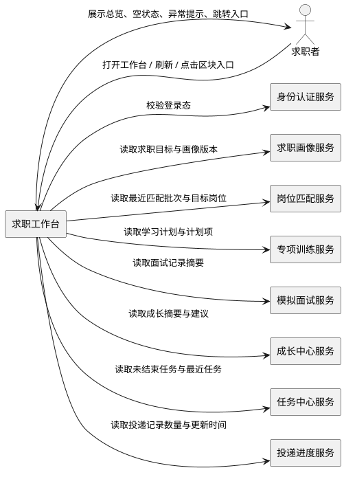
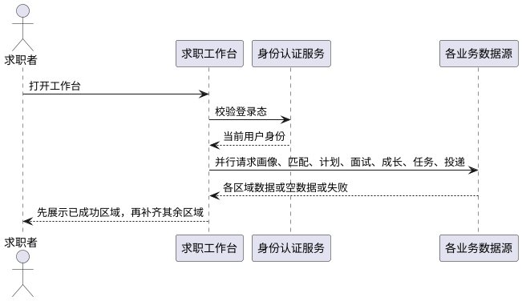
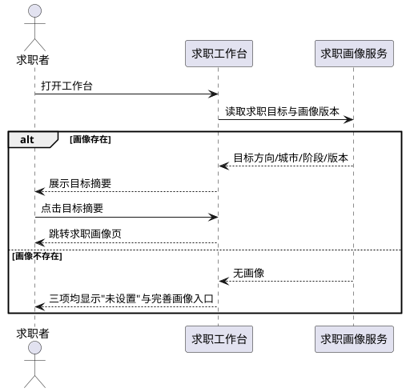
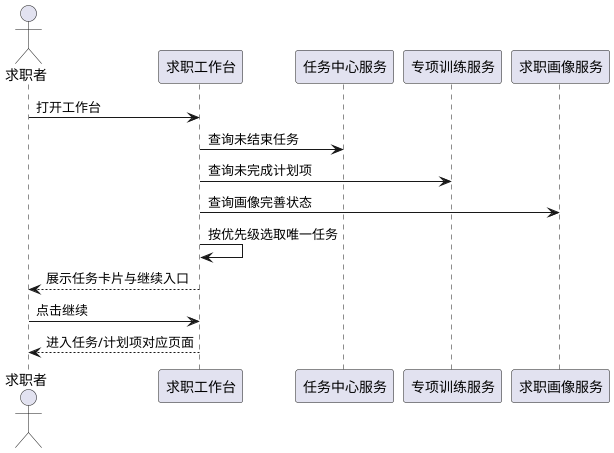
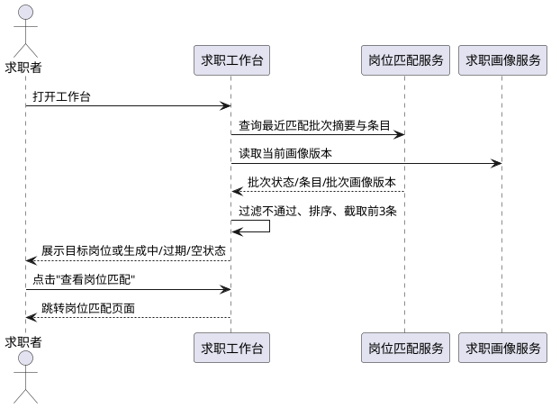
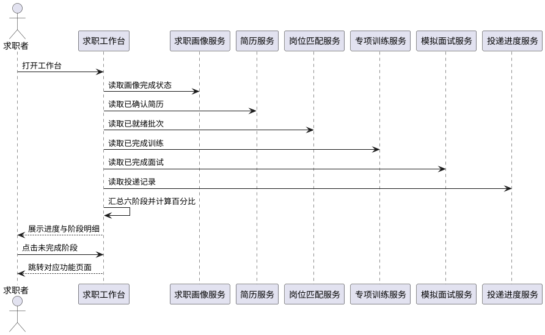
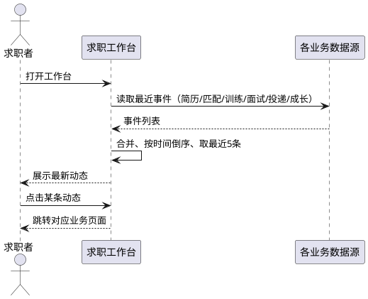
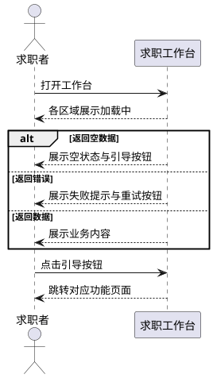
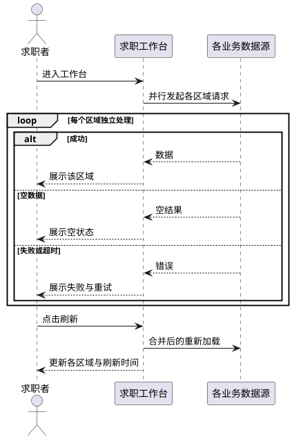

# 求职工作台 - 需求规格说明

> 本文件仅描述"做什么"，不包含技术实现方案。
> 关联原型：`docs/功能资料/02-求职工作台/02-求职工作台.png`
> 关联接口资料：`docs/功能资料/02-求职工作台/求职工作台后端接口示例.md`
> 说明：用户口述的"求助工作台"按项目文档统一为"求职工作台"。

---

# 1. 组件定位

## 1.1 核心职责

本组件负责聚合展示用户的求职目标、下一项任务、目标岗位、求职进度与最新动态，实现"一屏掌握求职状态并快速进入下一步行动"。

## 1.2 核心输入

1. **页面访问请求**：来源为已登录求职者，携带当前登录身份，用于确定展示哪个用户的数据。
2. **求职画像数据**：来源为求职画像服务，内容包含目标方向、目标城市、求职阶段、画像版本、已确认事实（学历、毕业年份、经验月数、专业、技能）与生效简历版本。
3. **岗位匹配数据**：来源为岗位匹配服务，内容包含匹配批次摘要（状态、是否过期、创建时间）与条目（岗位标题、资格状态、匹配指数、差距技能、来源可信状态）。
4. **学习计划数据**：来源为专项训练服务，内容包含计划标题、计划状态、计划项（标题、类型、预计时长、完成状态）。
5. **面试记录数据**：来源为模拟面试服务，内容包含面试状态、题目上限、已产生消息数、创建时间。
6. **成长摘要数据**：来源为成长中心服务，内容包含技能能力估计、样本数量、证据状态、改进建议。
7. **任务列表数据**：来源为任务中心服务，内容包含任务类型、状态、展示阶段、进度、关联资源、失败原因。
8. **投递进度数据**：来源为投递进度服务，内容包含投递记录数量与最近更新时间（用于进度阶段判定）。

## 1.3 核心输出

1. **工作台总览视图**：面向当前登录用户，展示欢迎区、求职目标摘要、下一项任务、近期目标岗位、求职进度、最新动态六个区域。
2. **空状态与引导**：当某区域无数据时，输出明确的空状态文案与下一步操作入口（如"完善求职画像""查看岗位匹配""开始训练"）。
3. **加载与异常反馈**：输出各区域的加载中、加载失败可重试、数据已过期等提示。
4. **导航跳转入口**：输出指向求职画像、简历中心、岗位匹配、专项训练、模拟面试、成长中心、投递进度、任务中心的跳转入口。

## 1.4 职责边界

本组件**不负责**以下事项：

1. 不负责求职画像的创建与编辑、简历的上传与解析确认。
2. 不负责岗位匹配的计算、资格核验、匹配指数与排序算法。
3. 不负责训练出题、答题评价、面试对话与面试报告生成。
4. 不负责投递记录的创建与状态维护。
5. 不定义新的后端聚合接口，不改变既有业务接口契约。
6. 不自行推算能力分、录用概率或"求职成功率"。
7. 不承担任务中心的全量任务管理职责，仅展示与跳转。
8. 不处理账号设置、通知配置、权限管理。

---

# 2. 领域术语

**求职工作台**
: 登录用户进入系统后的默认首页，聚合展示求职目标、任务、岗位、进度与动态，并提供下一步行动入口。

**求职目标**
: 用户希望从事的岗位方向、目标城市与求职阶段的组合，来源于求职画像。

**求职阶段**
: 用户当前所处的求职身份分类，取值为实习、校招、社招之一。

**下一项任务**
: 工作台根据未结束任务、未完成计划项与画像完善情况推荐给用户的唯一一条优先行动建议。

**目标岗位**
: 来自最近一次有效岗位匹配结果、用于展示的推荐岗位条目；资格核验不通过的岗位不属于目标岗位。

**匹配批次**
: 一次岗位匹配产生的固定结果快照，批次内条目的资格与分数不随后续画像变化而改写。

**匹配指数**
: 岗位匹配结果的辅助排序分数，取值 0 到 100，仅用于辅助排序，不代表录用概率。

**资格状态**
: 岗位资格核验结论，取值为通过、未知、不通过；不通过的岗位不进入目标岗位展示。

**能力证据**
: 由训练回答或面试回答产生的可追溯评分记录，是成长进度展示的依据；简历自述不构成能力分。

**求职进度**
: 由若干既定阶段完成情况汇总得到的整体进度百分比，用于让用户感知距离"准备就绪"的差距。

**最新动态**
: 按发生时间倒序排列的关键事件摘要，包括简历确认、匹配生成、训练完成、面试完成、投递更新。

**画像版本**
: 求职画像每次变更时递增的版本标识，用于判断工作台展示的匹配结果是否已过期。

**数据过期**
: 目标岗位所属匹配批次的输入画像版本与当前画像版本不一致，或该批次已被标记为过期。

**空状态**
: 某区域无任何可展示数据时呈现的明确说明与引导操作，不等同于加载失败。

**未结束任务**
: 状态为排队中、执行中或取消请求中的任务，用户刷新或更换设备后仍可在工作台找到。

---

# 3. 角色与边界

## 3.1 核心角色

**求职者**：已完成登录的普通用户，进入工作台查看个人求职状态并跳转至各功能模块。

## 3.2 外部系统

**身份认证服务**：提供当前登录用户身份与登录态校验结果。

**求职画像服务**：提供目标方向、目标城市、求职阶段、画像版本与已确认事实。

**岗位匹配服务**：提供最近匹配批次摘要、岗位条目、资格状态、匹配指数与差距信息。

**专项训练服务**：提供学习计划与计划项状态。

**模拟面试服务**：提供面试会话摘要与状态。

**成长中心服务**：提供技能能力摘要、证据状态与改进建议。

**任务中心服务**：提供用户任务列表、任务状态、阶段、进度与失败原因。

**投递进度服务**：提供投递记录数量与最近更新时间。

## 3.3 交互上下文

---

# 4. DFX约束

## 4.1 性能

1. 在演示环境、单用户正常数据量下，工作台首屏可交互时间（页面进入至六个区域均结束加载或进入可重试状态）不超过 2 秒，取第 95 百分位。
2. 任一单区域数据加载耗时应不超过 1.5 秒，超时后该区域必须进入失败可重试状态，不得无限等待。
3. 各区域必须独立加载，单个区域加载不得阻塞其他区域先完成展示。
4. 用户手动刷新时，页面整体不得出现空白闪烁，已加载区域应保留旧数据直至新数据返回。

## 4.2 可靠性

1. 工作台可用性目标为 99.5%（按月统计，仅统计工作台页面可打开且至少主要区域有响应的请求）。
2. 任一区域数据源不可用时，其余区域必须正常展示，不得导致整页空白或整页报错。
3. 区域失败后必须提供手动重试入口，重试次数不得少于 3 次且不自动无限重试。
4. 同一用户重复刷新或重复点击刷新时，不得产生重复的业务副作用（工作台为只读展示，不写业务数据）。
5. 数据源返回空数据时，必须按空状态处理，不得按失败处理。

## 4.3 安全性

1. 工作台所有数据必须限定为当前登录用户本人，禁止展示其他用户的任务、岗位、面试、投递或成长数据。
2. 登录态失效时，工作台必须停止数据加载并引导用户重新登录，不得继续展示缓存中的敏感数据。
3. 页面不得展示简历原文、邮箱、回答全文等敏感内容的完整文本；动态与任务摘要只展示必要描述。
4. 错误提示不得暴露内部堆栈、服务地址或模型信息，只允许展示用户可理解的提示与排障标识。

## 4.4 可维护性

1. 六个展示区域必须可独立加载、独立失败、独立重试、独立空状态。
2. 每次数据加载必须记录可关联的排障标识，便于按用户与时间定位问题。
3. 工作台必须提供"最近刷新时间"展示，刷新后更新。
4. 区域的展示顺序与标题必须固定，不得因数据为空而改变布局顺序。

## 4.5 兼容性

1. 页面在 1280 像素至 1920 像素宽度下必须保持两栏总览布局；小于 1050 像素时总览区必须降为单列；小于 700 像素时不得出现横向滚动。
2. 工作台不得改变既有业务数据契约；后端字段新增时工作台应忽略未知字段而非报错。
3. 工作台必须兼容已登录用户首次进入（无画像、无匹配、无训练、无面试、无投递）的完整空数据场景。

---

# 5. 核心能力

## 5.1 工作台概览与欢迎区

### 5.1.1 业务规则

1. **身份问候规则**：当用户进入工作台时，系统应当展示针对当前用户的欢迎语；昵称存在时展示昵称，昵称缺失时展示通用称呼"同学"。
   a. 验收条件：当已登录用户进入工作台且昵称存在时 → 欢迎语包含该昵称；当昵称缺失时 → 欢迎语使用"同学"，且不出现空白或占位符。
2. **价值说明规则**：欢迎区应当展示一句当前阶段的行动说明，引导用户继续求职准备。
   a. 验收条件：当用户进入工作台时 → 欢迎区必须包含标题与一句说明文案，且文案不包含技术术语。
3. **默认入口规则**：当已登录用户访问系统根路径时，系统应当默认进入工作台。
   a. 验收条件：当已登录用户访问根路径时 → 页面必须跳转至工作台而非登录页或其他功能页。
4. **区域固定规则**：工作台应当按固定顺序展示欢迎区、求职目标摘要、下一项任务、近期目标岗位、求职进度、最新动态。
   a. 验收条件：当工作台加载完成时 → 六个区域按上述顺序出现，任一区域为空时仍保留其标题与占位区域。

### 5.1.2 交互流程

### 5.1.3 异常场景

1. **未登录访问**
   a. 触发条件：用户未携带有效登录态访问工作台。
   b. 系统行为：停止业务数据加载，清除页面上的个人数据展示。
   c. 用户感知：跳转至登录页，并提示"请先登录"。

2. **登录态过期**
   a. 触发条件：加载过程中身份校验返回登录态失效。
   b. 系统行为：中止未完成请求，清空已展示的个人数据。
   c. 用户感知：跳转至登录页，并提示"登录已过期，请重新登录"。

3. **身份服务不可用**
   a. 触发条件：身份认证服务无响应或返回服务不可用。
   b. 系统行为：不展示任何业务数据，保留页面框架并提供重试入口。
   c. 用户感知：展示"暂时无法确认登录状态，请稍后重试"。

## 5.2 求职目标摘要

### 5.2.1 业务规则

1. **目标展示规则**：系统应当展示求职方向、目标城市、求职阶段三项摘要，每项必须包含名称与当前值。
   a. 验收条件：当画像数据存在时 → 三项摘要均展示对应值；当某项为空时 → 该项展示"未设置"。
2. **城市展示规则**：当目标城市存在多个时，系统应当按用户设置顺序展示，最多展示 5 个城市；超出部分不展示但不得截断为错误文本。
   a. 验收条件：当画像包含 3 个城市时 → 依序展示 3 个；当画像包含超过 5 个城市时 → 仅展示前 5 个。
3. **枚举翻译规则**：系统应当将岗位方向、求职阶段的内部枚举值翻译为用户可读文案，不得直接展示枚举编码。
   a. 验收条件：当求职阶段为校招时 → 页面展示"校招"而非内部编码。
4. **进入编辑规则**：当用户点击目标摘要区域或"完善求职画像"入口时，系统应当跳转至求职画像页面。
   a. 验收条件：当用户点击目标城市摘要时 → 跳转至求职画像页面的对应编辑位置。
5. **禁止项**：工作台禁止直接修改求职目标。
   a. 验收条件：当用户在工作台点击目标摘要时 → 只发生页面跳转，不出现就地编辑表单，也不产生画像写入。

### 5.2.2 交互流程

### 5.2.3 异常场景

1. **画像不存在**
   a. 触发条件：当前用户尚未建立求职画像。
   b. 系统行为：三项摘要均以"未设置"展示，不视为加载失败。
   c. 用户感知：展示"完善求职画像"按钮与说明"完善画像后可获得个性化任务与岗位推荐"。

2. **画像加载失败**
   a. 触发条件：画像服务超时或返回错误。
   b. 系统行为：仅该区域进入失败状态，其他区域不受影响。
   c. 用户感知：展示"求职目标加载失败，点击重试"。

3. **画像版本异常**
   a. 触发条件：画像版本缺失或为非法值。
   b. 系统行为：目标摘要可继续展示，但系统不得据此判定匹配结果是否过期。
   c. 用户感知：不展示过期提示，仅正常展示目标值。

## 5.3 下一项任务

### 5.3.1 业务规则

1. **唯一推荐规则**：工作台应当只推荐 1 条"下一项任务"，不得同时展示多条同优先级建议。
   a. 验收条件：当存在多条可推荐内容时 → 页面仅展示优先级最高的一条，其余通过入口进入对应模块查看。
2. **优先级规则**：下一项任务应当按以下顺序选取：进行中的任务、排队中的任务、取消请求中的任务、未完成的学习计划项、画像完善建议。
   a. 验收条件：当同时存在执行中任务与未完成计划项时 → 展示执行中任务。
3. **任务信息规则**：当展示未结束任务时，系统应当展示任务类型、当前阶段、进度（可获取时）与继续入口。
   a. 验收条件：当任务进度可获取时 → 展示进度百分比；当进度不可获取时 → 只展示阶段文案，不得展示 0% 或估算值。
4. **画像优先规则**：当用户无任何任务与计划项，且画像未完善时，系统应当推荐"完善求职画像"作为下一项任务。
   a. 验收条件：当新用户无画像、无任务、无计划时 → 展示"完善求职画像"卡片与跳转按钮。
5. **跳转准确规则**：当用户点击继续时，系统应当进入该任务或计划项对应的业务页面；任务详情入口应当进入任务中心。
   a. 验收条件：当下一项任务为训练计划项时 → 点击后进入专项训练；当为进行中面试时 → 点击后进入该面试会话。
6. **禁止项**：工作台禁止自动启动任务、自动重试失败任务或自动提交任何业务操作。
   a. 验收条件：当用户停留在工作台时 → 不得产生任务创建、任务重试或答题提交。

### 5.3.2 交互流程

### 5.3.3 异常场景

1. **无任何任务**
   a. 触发条件：用户无未结束任务、无未完成计划项，且画像已完善。
   b. 系统行为：展示"暂无可执行任务"，并推荐进入岗位匹配或专项训练。
   c. 用户感知：展示空状态与"查看岗位匹配"按钮。

2. **任务状态未知**
   a. 触发条件：任务返回的状态不在系统可识别范围内。
   b. 系统行为：该任务不参与下一项任务推荐。
   c. 用户感知：不展示该任务，不出现错误提示。

3. **任务数据加载失败**
   a. 触发条件：任务中心服务超时或错误。
   b. 系统行为：降级为使用未完成计划项或画像建议作为下一项任务。
   c. 用户感知：正常展示降级后的建议，不暴露服务错误。

4. **任务失败**
   a. 触发条件：最近任务状态为失败。
   b. 系统行为：展示失败状态与失败原因摘要，不自动重试。
   c. 用户感知：展示"任务未完成，可前往任务中心查看并重试"。

## 5.4 近期目标岗位

### 5.4.1 业务规则

1. **数据来源规则**：系统应当使用最近一次已就绪的岗位匹配批次作为目标岗位来源，不得混用多个批次。
   a. 验收条件：当存在多个已就绪批次时 → 仅展示创建时间最新的批次条目。
2. **批次状态规则**：当最近批次仍在生成中时，系统应当展示"匹配生成中"，不得展示空状态。
   a. 验收条件：当批次状态为生成中时 → 展示生成中提示与进入岗位匹配入口。
3. **资格过滤规则**：资格状态为不通过的岗位禁止展示；资格状态为未知的岗位可以展示但必须标注"资格待确认"。
   a. 验收条件：当批次包含 5 条且其中 1 条不通过时 → 展示不超过 4 条，且不通过条目不得出现。
4. **排序规则**：展示条目应当先按资格状态（通过优先于未知）分组，再按匹配指数降序排列；匹配指数为空时排在有效分数之后。
   a. 验收条件：当两条岗位分别为通过且分数 80、未知且分数 95 时 → 通过岗位排在未知岗位之前。
5. **数量规则**：系统应当最多展示 3 条目标岗位，并提供"查看岗位匹配"入口查看全部。
   a. 验收条件：当批次包含 10 条可展示岗位时 → 工作台只展示前 3 条，其余通过入口查看。
6. **信息规则**：每条目标岗位必须展示岗位标题、公司名称与匹配指数；公司名称缺失时展示"公司信息待补充"。
   a. 验收条件：当公司名称缺失时 → 展示"公司信息待补充"，不得留空。
7. **来源规则**：当岗位来源未核验时，系统应当标注"来源未核验"，不得展示为已核验来源。
   a. 验收条件：当岗位来源核验状态为未核验时 → 展示未核验标识。
8. **过期规则**：当批次输入画像版本与当前画像版本不一致，或批次已被标记过期时，系统应当展示"结果已过期，请重新匹配"。
   a. 验收条件：当画像版本由 3 变为 4 时 → 旧批次岗位仍可查看，但必须显示过期提示且不展示"匹配指数有效"字样。
9. **禁止项**：工作台禁止展示录用概率、薪资承诺或"保offer"类结论。
   a. 验收条件：当展示岗位时 → 文案中不得出现录用率、通过率、成功率等表述。

### 5.4.2 交互流程

### 5.4.3 异常场景

1. **无匹配记录**
   a. 触发条件：用户从未进行岗位匹配，或所有批次均失败。
   b. 系统行为：展示空状态，不推断岗位。
   c. 用户感知：展示"暂无目标岗位"与"去岗位匹配"按钮。

2. **批次生成失败**
   a. 触发条件：最近批次状态为失败。
   b. 系统行为：不展示任何岗位条目，展示失败说明与重新匹配入口。
   c. 用户感知：展示"岗位匹配未成功，可前往岗位匹配重新发起"。

3. **批次生成中**
   a. 触发条件：最近批次状态为生成中。
   b. 系统行为：展示生成中状态，不展示旧批次数据。
   c. 用户感知：展示"正在为你匹配岗位"及进入岗位匹配的入口。

4. **全部岗位资格不通过**
   a. 触发条件：批次条目均不通过资格核验。
   b. 系统行为：按空状态处理，不展示不通过条目。
   c. 用户感知：展示"当前条件暂未匹配到合适岗位"与前往岗位匹配查看原因的入口。

5. **岗位数据加载失败**
   a. 触发条件：岗位匹配服务超时或错误。
   b. 系统行为：仅该区域失败，不影响其他区域。
   c. 用户感知：展示"目标岗位加载失败，点击重试"。

## 5.5 求职进度

### 5.5.1 业务规则

1. **阶段构成规则**：求职进度应当由六个阶段构成：完善求职画像、确认简历、完成一次岗位匹配、完成一次专项训练、完成一次模拟面试、产生一条投递记录。
   a. 验收条件：当六个阶段均完成时 → 进度必须为 100%；当仅完成前两项时 → 进度必须为 33%。
2. **计算规则**：进度应当等于已完成阶段数除以阶段总数后向下取整的百分比，不得使用加权分或估算分。
   a. 验收条件：当完成 4 个阶段时 → 进度展示为 66%；不得展示为 67% 或 70%。
3. **阶段判定规则**：每个阶段必须依据客观数据判定：画像需具备目标方向与求职阶段；简历需存在已确认版本；匹配需存在已就绪且未过期的批次；训练需存在已完成会话；面试需存在已完成会话；投递需存在至少一条记录。
   a. 验收条件：当仅有简历上传但未确认时 → 简历阶段不得计为完成。
4. **未完成提示规则**：系统应当展示阶段名称与完成状态，并突出当前应优先完成的阶段。
   a. 验收条件：当画像未完善时 → 画像阶段标记为未完成并排在首位。
5. **跳转规则**：当用户点击未完成阶段时，系统应当跳转至对应功能页面。
   a. 验收条件：当用户点击"完成一次模拟面试"时 → 跳转至模拟面试页面。
6. **空状态规则**：当六个阶段均未完成时，系统应当展示进度 0% 与引导说明，不得展示为加载失败。
   a. 验收条件：当新用户进入时 → 展示 0% 且附"完善画像即可开始"的说明。
7. **禁止项**：系统禁止展示录用率、offer 概率或对求职结果的预测性结论。
   a. 验收条件：当展示进度时 → 文案只描述已完成阶段，不出现结果预测。

### 5.5.2 交互流程

### 5.5.3 异常场景

1. **部分数据源失败**
   a. 触发条件：四个及以上进度数据源中任一失败。
   b. 系统行为：失败阶段标记为"待确认"，不按未完成计算，也不按完成计算。
   c. 用户感知：整体进度展示为"暂无法计算"，并展示已确认阶段明细与重试入口。

2. **数据不一致**
   a. 触发条件：画像显示简历已确认，但简历服务无已确认版本。
   b. 系统行为：以简历服务的客观状态为准，画像阶段仍按画像自身状态判定。
   c. 用户感知：无错误提示，阶段状态以可核查数据为准。

3. **新用户无任何数据**
   a. 触发条件：六个阶段数据源均返回空。
   b. 系统行为：进度记为 0%，不报错。
   c. 用户感知：展示 0% 与"完善求职画像"引导。

## 5.6 最新动态

### 5.6.1 业务规则

1. **事件范围规则**：最新动态应当聚合以下事件：简历确认、岗位匹配生成完成、专项训练完成、模拟面试完成、投递记录更新、成长建议生成。
   a. 验收条件：当发生训练完成与匹配生成时 → 两条动态均可展示。
2. **排序规则**：动态应当按事件发生时间倒序排列，时间相同时按事件来源稳定排序。
   a. 验收条件：当 A 事件时间晚于 B 事件时 → A 排在 B 之前。
3. **数量规则**：系统应当最多展示 5 条动态，并提供"查看全部记录"入口。
   a. 验收条件：当存在 12 条动态时 → 工作台展示最近 5 条。
4. **摘要规则**：每条动态必须包含事件类型文案、事件摘要与发生时间；摘要不得包含用户回答全文或简历原文。
   a. 验收条件：当动态为训练完成时 → 展示"完成专项训练：<计划项标题>"，不展示回答内容。
5. **时间展示规则**：时间应当按用户所在时区展示；24 小时内展示相对时间（如"2 小时前"），超过 24 小时展示日期时间。
   a. 验收条件：当事件发生在 3 小时前时 → 展示"3 小时前"。
6. **跳转规则**：当用户点击动态时，系统应当跳转至产生该事件的模块页面。
   a. 验收条件：当点击面试完成动态时 → 跳转至对应面试记录。
7. **空状态规则**：当无任何动态时，系统应当展示"暂无动态记录"，不得隐去区域。
   a. 验收条件：当新用户无动态时 → 区域保留并展示空状态文案。
8. **禁止项**：动态禁止展示他人的活动记录或与当前用户无关的系统公告。
   a. 验收条件：当数据源包含其他用户事件时 → 不得展示。

### 5.6.2 交互流程

### 5.6.3 异常场景

1. **部分事件源失败**
   a. 触发条件：某一事件来源加载失败。
   b. 系统行为：其余来源的动态正常展示，不因单一来源缺失而清空列表。
   c. 用户感知：展示已获取动态，不显示失败来源的错误。

2. **时间字段缺失**
   a. 触发条件：事件缺少发生时间或时间非法。
   b. 系统行为：该事件不参与排序，排在列表末尾并标注"时间未知"。
   c. 用户感知：展示"时间未知"，不展示错误时间。

3. **全部来源失败**
   a. 触发条件：所有动态来源均不可用。
   b. 系统行为：区域进入失败可重试状态。
   c. 用户感知：展示"最新动态加载失败，点击重试"。

## 5.7 空状态与引导

### 5.7.1 业务规则

1. **区分规则**：系统必须区分"无数据"与"加载失败"：无数据展示空状态与引导，加载失败展示失败提示与重试。
   a. 验收条件：当数据源成功返回空数组时 → 展示空状态文案，不展示"重试"以外的错误提示。
2. **引导可执行规则**：每个空状态必须提供至少一个可点击的下一步入口。
   a. 验收条件：当下一项任务为空时 → 至少提供"查看岗位匹配"或"开始专项训练"其中一个入口。
3. **新用户引导规则**：当用户画像未完善时，工作台应当在欢迎区、下一项任务与求职进度三处提供一致的"完善求职画像"引导。
   a. 验收条件：当画像未完善时 → 三处入口均跳转至求职画像页面。
4. **加载中规则**：系统应当在区域加载期间展示骨架或加载提示，不得直接展示空状态。
   a. 验收条件：当请求尚未返回时 → 展示加载提示；请求返回空后才切换为空状态。

### 5.7.2 交互流程

### 5.7.3 异常场景

1. **连续重试失败**
   a. 触发条件：同一区域连续重试 3 次仍失败。
   b. 系统行为：停止自动重试，保留手动重试入口。
   c. 用户感知：展示"仍无法加载，请稍后重试或前往对应模块查看"。

2. **跳转目标不可用**
   a. 触发条件：引导按钮对应的功能页面未启用或不存在。
   b. 系统行为：隐藏该入口，改用其他可用入口。
   c. 用户感知：不出现点击后无响应的按钮。

## 5.8 数据加载、刷新与异常降级

### 5.8.1 业务规则

1. **独立加载规则**：六个区域应当独立发起数据加载，任一区域完成即应当立即展示，不得等待全部完成。
   a. 验收条件：当画像先返回而岗位后返回时 → 求职目标优先展示，岗位区域保持加载中。
2. **刷新规则**：系统应当提供手动刷新入口，刷新时必须重新获取所有区域数据并更新"最近刷新时间"。
   a. 验收条件：当用户点击刷新时 → 六个区域重新进入加载状态，完成后刷新时间更新为当前时间。
3. **降级规则**：当某区域依赖的主数据源失败时，系统应当按降级顺序使用可选数据源；无可用降级时展示失败提示。
   a. 验收条件：当任务中心失败但学习计划可用时 → 下一项任务降级展示未完成计划项。
4. **缓存展示规则**：当用户在本次会话内已成功加载过工作台并再次进入时，系统可以优先展示上次数据并同时刷新，但必须标注数据时间。
   a. 验收条件：当展示缓存数据时 → 页面展示"更新于 <时间>"，刷新完成后更新该时间。
5. **重复请求规则**：当用户快速重复点击刷新时，系统应当合并请求，保证同一区域同一时刻只有一个进行中的加载。
   a. 验收条件：当用户在 1 秒内点击刷新 3 次时 → 该区域最多产生 1 个进行中的请求。
6. **错误标识规则**：当区域加载失败时，系统应当记录并展示可提供给客服的排障标识，但不得展示技术堆栈。
   a. 验收条件：当加载失败时 → 页面可获取到排障标识，展示文案中不包含堆栈与内部地址。

### 5.8.2 交互流程

### 5.8.3 异常场景

1. **请求超时**
   a. 触发条件：单区域请求超过 1.5 秒未返回。
   b. 系统行为：中止等待，将该区域置为失败可重试。
   c. 用户感知：展示"加载超时，点击重试"。

2. **限流**
   a. 触发条件：数据源返回限流错误。
   b. 系统行为：不立即自动重试，展示可重试提示。
   c. 用户感知：展示"请求过于频繁，请稍后重试"。

3. **网络中断**
   a. 触发条件：用户网络不可用。
   b. 系统行为：保留已加载数据，未完成区域标记失败。
   c. 用户感知：展示"网络连接异常，已展示上次内容"。

4. **部分区域持续失败**
   a. 触发条件：单个区域连续失败且其他区域正常。
   b. 系统行为：页面整体不进入全屏错误，只在失败区域提示。
   c. 用户感知：可正常使用其他区域并跳转对应模块。

---

# 6. 数据约束

## 6.1 工作台视图

1. **昵称**：可空；为空时展示"同学"；长度不得超过 30 个字符。
2. **目标方向**：可空；取值必须属于岗位方向枚举，展示时翻译为中文文案。
3. **目标城市**：可空；数组，最多 5 个行政区划编码；展示顺序与用户设置顺序一致。
4. **求职阶段**：可空；取值必须属于实习、校招、社招之一，展示时翻译为中文文案。
5. **画像版本**：非负整数；用于判定匹配结果是否过期。
6. **下一项任务**：最多 1 条；允许为空。
7. **目标岗位**：最多 3 条；允许为空。
8. **求职进度**：0 至 100 的整数；允许展示为"暂无法计算"。
9. **最新动态**：最多 5 条；允许为空数组。
10. **最近刷新时间**：时间戳；必须为用户最近一次成功加载完成的时间。

## 6.2 任务摘要与计划项

1. **任务标识**：必填；同一用户范围内唯一。
2. **任务类型**：必填；取值必须属于系统已定义的任务类型集合。
3. **任务状态**：必填；取值必须属于排队中、执行中、取消请求中、成功、失败、取消、过期之一。
4. **展示阶段**：可空；长度不超过 20 个字符。
5. **进度**：可空；为整数时必须处于 0 至 100 之间；不可获取时必须为空，不得填 0。
6. **关联资源**：可空；用于跳转至对应业务详情。
7. **失败原因**：任务失败时必填；仅展示用户可理解的摘要，不展示内部错误码堆栈。
8. **计划项标题**：必填；长度不超过 200 个字符。
9. **计划项类型**：必填；取值必须属于阅读、练习、面试之一。
10. **预计时长**：必填；整数，范围 5 至 120 分钟。
11. **计划项状态**：必填；取值必须属于待开始、进行中、已完成之一。

## 6.3 目标岗位条目

1. **岗位标题**：必填；展示时不得为空。
2. **公司名称**：可空；为空时展示"公司信息待补充"。
3. **资格状态**：必填；取值为通过、未知、不通过；不通过条目禁止展示。
4. **匹配指数**：可空；为数值时必须处于 0 至 100 之间，展示为整数。
5. **来源核验状态**：必填；取值为已核验、未核验、已停用；未核验时必须标注。
6. **差距技能**：可空数组；仅用于展示技能名称，不展示推算分数。
7. **批次版本**：必填；用于与当前画像版本比较判定过期。
8. **批次过期标记**：必填；为真时必须展示过期提示。
9. **发布时间或校验时间**：可空；展示时按用户时区格式化。

## 6.4 求职进度与动态

1. **阶段名称**：必填；固定为六个阶段名称之一，不得展示内部编码。
2. **阶段完成状态**：必填；取值为已完成、未完成、待确认。
3. **阶段跳转目标**：未完成阶段必填；必须指向可用功能页面。
4. **进度百分比**：0 至 100 的整数；由已完成阶段数除以阶段总数向下取整得到。
5. **动态类型**：必填；取值为简历确认、匹配完成、训练完成、面试完成、投递更新、成长建议之一。
6. **动态摘要**：必填；长度不超过 100 个字符；不得包含回答全文、简历原文或邮箱。
7. **动态时间**：可空；缺失时展示"时间未知"并排在末尾。
8. **动态跳转目标**：可空；存在时必须指向当前用户有权访问的页面。