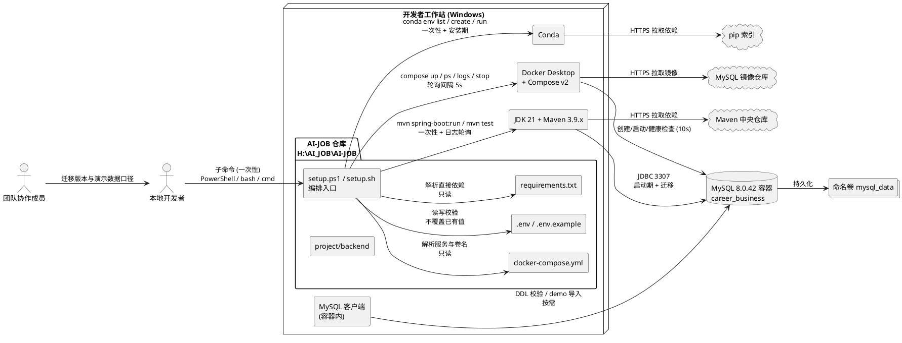
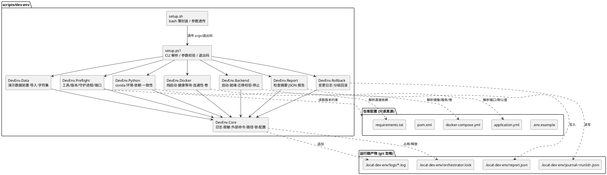
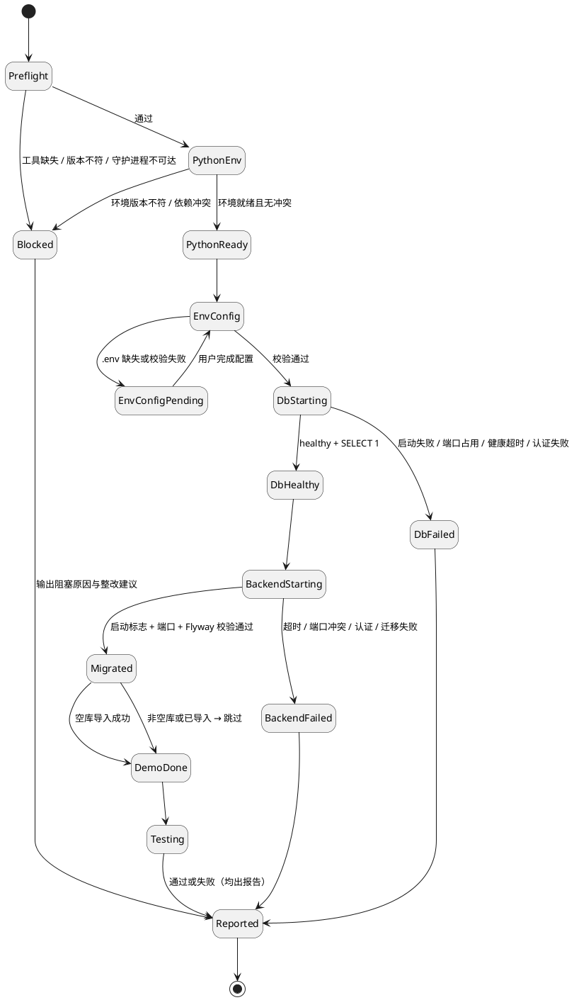
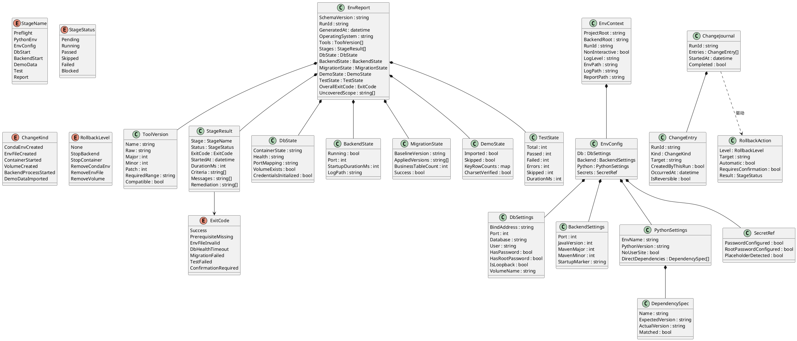
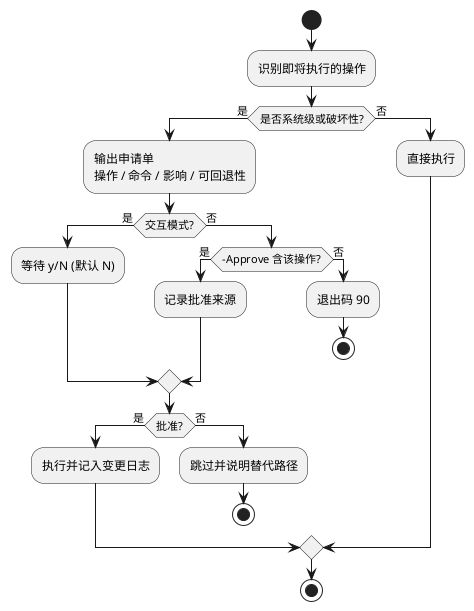

# 一、需求与存量功能关系分析

## 1.0 分析范围与方法

本设计以 `spec.md` 的 7 项核心能力（前置核验、Conda 环境、Docker MySQL、后端启动与建表、演示数据、后端测试、环境回收）为需求基线，逐项对照仓库内已有的配置、脚本、代码与文档。判定依据为：**是否已存在可执行的载体**、**是否满足 spec 的可验收条件**、**是否需要改造才能复用**。仅"文档里写了命令"不计为已实现；仅"依赖已声明"不计为已实现。

分析覆盖的存量资产：

| 资产 | 路径 | 性质 |
| --- | --- | --- |
| 环境配置说明 | `readme.md` | 文档型流程 |
| MySQL 编排 | `docker-compose.yml` | 可执行配置 |
| 环境变量模板 | `.env.example` | 配置模板 |
| Python 依赖清单 | `requirements.txt` | 版本约束 |
| Java 依赖与 JDK 约束 | `project/backend/pom.xml` | 构建配置 |
| Spring 运行配置 | `project/backend/src/main/resources/application.yml` | 运行时配置 |
| 建表迁移 | `project/backend/src/main/resources/db/migration/V1__init_business_schema.sql` | Flyway 迁移 |
| 演示数据 | `project/backend/src/main/resources/db/demo/demo_data.sql` | 手工脚本 |
| 启动测试 | `BackendApplicationTest.java`、`DatabaseQueryTest.java` | 测试代码 |
| 业务骨架 | 控制器、服务、Mapper、实体、`CommonResult` | 演示代码 |
| 版本库忽略规则 | `.gitignore`、`project/backend/.gitignore` | 安全约束 |

## 1.1 需求功能与存量功能对比

### 1.1.1 已实现功能

| 需求功能 | 存量功能 | 代码位置 | 匹配度 |
| --- | --- | --- | --- |
| MySQL 8.0.42 容器、`career_business` 库、命名卷 `mysql_data` | Compose 已完整定义镜像、库名、卷、端口映射、重启策略 | `docker-compose.yml:1-25` | 100% |
| 容器健康检查参数（10s/5s/12 次/40s） | healthcheck 已按 spec 精确配置 | `docker-compose.yml:17-22` | 100% |
| 仅本机绑定、默认宿主端口 3307 | `127.0.0.1:${MYSQL_PORT:-3307}:3306` | `docker-compose.yml:13-14` | 100% |
| `.env` 模板与占位密码 | 5 个键齐全，占位值明确 | `.env.example:1-7` | 100% |
| `.env` 不被版本库跟踪 | 根 `.gitignore` 忽略 `.env` 且保留模板 | `.gitignore:1-3` | 100% |
| Python 3.11 环境与依赖版本清单 | 直接依赖全部 `==` 固定，注释说明流程 | `requirements.txt:11-32` | 100% |
| JDK 21 编译目标 | `java.version=21` 已声明 | `project/backend/pom.xml:20-23` | 100% |
| Spring Boot + MyBatis + MySQL + Redis + Flyway 依赖 | 依赖完整，测试含 H2 | `project/backend/pom.xml:25-79` | 100% |
| Flyway 版本化建表 | V1 脚本含 31 张业务表，注释声明不回改 | `V1__init_business_schema.sql:1-679` | 100% |
| 演示数据内容与禁用账号 | 2 个禁用账号、虚构岗位/公司、事务包裹 | `demo_data.sql:1-57` | 100% |
| H2 启动测试（关闭 Flyway） | 属性内联 H2 + `spring.flyway.enabled=false` | `BackendApplicationTest.java:6-16` | 100% |
| 后端基础骨架可启动 | Spring Boot 入口类 | `BackendApplication.java:7-13` | 100% |
| 用户查询接口可用于启动后连通性验证 | 列表与按 ID 查询，放行规则已配置 | `AppUserController.java:18-38`、`SecurityConfig.java:14-26` | 100% |
| 停止数据库的日常命令与"不要 down -v"提示 | 文档给出 stop/up/logs 三条命令与数据卷警示 | `readme.md:79-89` | 100% |

> 结论：**基础设施"零件"基本齐备，缺的是可执行的编排、校验与回收外壳**。存量能力集中在"配置文件 + 文档"，不具备自动判定、防误操作与失败恢复能力。

### 1.1.2 需要扩展的功能

| 需求功能 | 存量功能 | 差异说明 | 扩展方向 |
| --- | --- | --- | --- |
| 前置条件核验（工具存在、版本匹配、Docker 运行态、工作目录） | 仅在 `readme.md:5-14` 以文字描述前置条件；`pom.xml` 只声明编译目标 | 输入输出差异：需要机器可读的版本号与缺失项；业务逻辑差异：无"任一缺失即中止""JDK 必须为 21 且与 Maven 一致"的判定；边界差异：未处理 PATH 中多版本 JDK 并存、Docker 客户端在但守护进程未起 | 新增只读核验层，解析 `conda --version`、`java -version`、`mvn -version`、`docker compose version`、`docker info` 输出；统一以退出码中止，禁止副作用 |
| Conda 环境配置的幂等执行 | `readme.md:22-32` 提供手工命令序列 | 差异：手工执行无法判断"环境已存在且版本不符"；`PYTHONNOUSERSITE` 设置后未重新激活会失效；无依赖版本比对与冲突判定 | 封装为幂等阶段：`conda env list --json` 探测 → 复用或创建 → 配置变量 → 用 `conda run` 保证变量生效 → 安装 → `pip check` → 直接依赖版本比对 |
| `.env` 初始化与合规校验 | `readme.md:42-54` 手工复制；`.env.example:6-7` 占位值 | 差异：无占位值拦截、无两密码不同校验、无端口/绑定地址合法性校验、无"已有 `.env` 保留"的强制语义；无编码约束（BOM 会导致首个键名污染） | 新增 `.env` 管理器：存在即保留；缺失时生成并进入"待配置"状态；校验键、占位值、密码差异、端口范围、回环地址、Git 忽略状态；以 UTF-8 无 BOM 写入 |
| 后端读取项目根 `.env` | `application.yml:4-5` 已设计双路径导入 | **存量缺陷**：导入串被污染为 `optional:fmvn spring-boot:runile:./.env[.properties]`，第二个候选路径失效，且首段 `../../.env` 仅覆盖 `project/backend` 启动场景；无凭据时以空密码连接，错误信息不可区分 | 修正导入串为 `../../.env` 与 `./.env` 两个合法候选；启动前置校验 `.env` 存在；连接失败按认证/网络/迁移分类输出 |
| 后端启动与 Flyway 建表的一次性验证 | `readme.md:91-104` 手工 `mvn spring-boot:run`；Flyway starter 已引入 | 差异：无启动完成判定、无超时上限、无迁移记录与表数量校验、无端口占用预检、无后台进程句柄管理 | 新增启动器：预检端口 → 后台启动并重定向日志 → 轮询启动标志与端口 → 校验 `flyway_schema_history` 与 31 张表 → 记录 PID 供回收 |
| 容器健康等待 | Compose healthcheck 已定义 | 差异：`docker compose up -d` 立即返回，脚本未等待 `healthy`；无首次拉镜像与二次启动的超时区分；`mysqladmin ping` 无凭据可能因认证失败产生非零退出 | 新增健康轮询（首次 900s / 二次 90s），以 Compose 健康状态为主判据、以 `SELECT 1` 为副判据；超时输出日志尾部与原因分类 |
| 演示数据导入 | `demo_data.sql` 完整；`readme.md:108-114` 手工 `mysql ... -e "source ..."` | 差异：无"表已建、库为空"前置校验；`source` 命令在 Windows 路径含空格/中文时易失败；无重复导入识别；本机可能没有 mysql 客户端 | 新增导入器：前置查询表与行数 → 经容器内 mysql 客户端以 stdin 导入 → 校验字符集与关键行 → 已导入则跳过而非失败 |
| 后端测试的隔离与执行 | `BackendApplicationTest` 已用 H2；`DatabaseQueryTest.java:19` 仅关闭 Flyway，仍使用真实 MySQL 数据源 | **存量缺陷**：默认 `mvn test` 会连接本机 MySQL，违反 spec 5.6.2"测试不得依赖本机 MySQL"；无 MySQL 容器时测试必失败 | 将真实库查询测试改为显式开启（系统属性开关）的集成测试；默认 `mvn test` 只执行 H2 用例；测试执行器解析 Surefire 报告并分类失败 |
| 环境回收 | `readme.md:79-89` 文字约定 | 差异：无进程句柄、无"停止但不删数据"的可执行路径、无删除数据卷的二次确认 | 新增 stop/rollback/purge 子命令：默认只停进程与容器；删除卷需双重确认；变更日志支撑回滚 |
| Windows 双 Shell 兼容 | `readme.md` 全部为 PowerShell 命令 | 差异：git-bash/cmd 下无等效命令；路径含空格/中文时的引号策略未约定 | 主入口 PowerShell，提供 bash 薄封装与 cmd 调用示例；外部命令一律以参数数组调用 |
| 环境检查摘要 | `readme.md` 分散描述验收标志 | 差异：无聚合报告、无版本/状态/结论的一处输出 | 新增报告器：stdout 摘要 + `.local-dev-env/report.json`（不写仓库跟踪路径） |

### 1.1.3 需要新增的功能或接口

按业务模块分组，均为存量中完全没有可执行载体的部分：

**A. 编排与编排状态**

1. `setup` 主入口：按阶段顺序执行，支持单阶段与全流程；输入为子命令、项目根、超时、交互开关；输出为阶段结果集合与进程退出码。
2. 阶段状态机与断点续跑：记录已通过阶段，重复执行时探测实际状态而非信任记录；失败后可从失败阶段重入。
3. 单实例锁：防止两个终端同时启动容器/后端造成端口与卷竞争。

**B. 前置核验**

4. `check` 只读核验器：输出工具版本、缺失项、版本不兼容项、Docker 守护进程状态、端口占用、工作目录与必需文件清单。
5. 版本解析适配器：将 `java -version`（stderr）、`mvn -version`、`conda --version`、`docker compose version` 的非结构化输出转换为强类型版本对象。

**C. 配置与凭据**

6. `.env` 校验器：占位值、密码差异、端口、绑定地址、Git 忽略五类规则。
7. 凭据脱敏器：所有外部命令输出、异常、报告中替换已知敏感值。
8. 配置真源解析器：从 `.env`、`docker-compose.yml`、`application.yml`、`requirements.txt` 读取，不重复硬编码端口/库名/账号/版本。

**D. 数据与验证**

9. 迁移验证器：查询 `flyway_schema_history` 成功记录与业务表数量。
10. 演示数据导入器：空库判定、stdin 导入、字符集抽样校验、重复导入跳过。
11. 测试执行器：默认 H2 用例，显式开启真实库集成用例；Surefire 结果解析与失败分类。

**E. 运维与恢复**

12. 变更日志（Change Journal）：记录本次运行创建/修改/启动的资源，作为回滚依据。
13. 回滚器：分级回滚（停进程 → 停容器 → 还原文件 → 删除本次新建环境 → 删除卷）。
14. 报告器：聚合工具版本、容器、后端、迁移、演示数据、测试与未覆盖范围。
15. 权限申请器：在系统级或破坏性操作前输出"操作—影响—可回退性"申请单并等待确认。

**F. 交付物与文档**

16. `readme.md` 增量章节：一键脚本用法、git-bash/cmd 等效命令、权限申请清单、回滚路径。
17. 仓库忽略规则增量：`.local-dev-env/`（日志、报告、变更日志、锁文件）。

## 1.2 存量功能详细分析

### 1.2.1 Compose MySQL 服务

- **接口契约**：`docker compose up -d mysql` 启动单服务；必需环境变量 `MYSQL_USER`、`MYSQL_PASSWORD`、`MYSQL_ROOT_PASSWORD`，缺失时 Compose 以 `:?` 直接失败（`docker-compose.yml:9-11`）。宿主端口与绑定地址可覆盖（`:14`）。
- **业务规则**：库名固定为 `career_business`（`:8`）；时区固定 UTC（`:12`）；数据落于命名卷 `mysql_data`（`:16`、`:24-25`）。
- **初始化语义约束**：官方镜像仅在**空数据卷首次初始化**时创建用户与库；已有卷下修改 `.env` 不会改密。这是 spec 5.3.1-6 要求"判定为预期行为"的根因，脚本必须能识别卷是否已存在。
- **健康检查约束**：`mysqladmin ping -h 127.0.0.1 --silent` 不携带凭据（`:18`）。服务器存活时通常可返回成功，但在认证策略较严或初始化未完成时存在非零退出风险。设计上不能把该检查作为唯一判据，需叠加应用账号的 `SELECT 1`。
- **扩展点**：Compose 变量全部来自同目录 `.env`，脚本无需注入额外变量即可与手工流程共用同一份配置，这是"单点真源"的关键。
- **资源约束**：spec 要求容器内存不超过 2GB，但 Compose 未设置 `mem_limit`。当前镜像默认无上限，脚本只能在报告中提示实际占用，不擅自限制（限制会影响 MySQL 性能，需产品决策）。

### 1.2.2 `.env` 模板与加载链

- **契约**：5 个键，全部标量；注释明确"复制后设置强密码"（`.env.example:1-2`）。
- **加载链**：Compose 自动读取同目录 `.env`；Spring 通过 `spring.config.import` 将 `.env` 当 properties 文件导入（`application.yml:4-5`）。
- **关键约束（编码）**：`.env` 被当作 Java properties 解析。若文件带 UTF-8 BOM，第一个键会解析为 `\ufeffMYSQL_BIND_ADDRESS`，导致绑定地址回退默认值且难以定位；若密码含未转义的 `\`，会被当作转义序列。因此写入必须为 **UTF-8 无 BOM**，且密码字符集需受限或转义。
- **关键约束（路径）**：从 `project/backend` 启动时 `../../.env` 指向项目根；从项目根启动时 `./.env` 指向同一文件。两个候选路径缺一不可。
- **存量缺陷**：实际导入串为 `optional:file:../../.env[.properties],optional:fmvn spring-boot:runile:./.env[.properties]`。第二个候选路径被污染，`./.env` 场景失效；`optional:` 语义使缺失被静默吞掉，最终表现为空密码连接失败，与 spec 5.4.3-1 要求的"提示核对配置导入路径"不匹配。**必须修正**。

### 1.2.3 Conda 与 Python 依赖

- **契约**：环境名 `ai-job`、Python 3.11、`PYTHONNOUSERSITE=1`、直接依赖固定版本（`requirements.txt:1-32`）。
- **业务规则**：`conda env config vars set` 写入的环境变量只在新激活时注入；在已激活状态下设置不会立即生效（`readme.md:32` 已提示）。
- **扩展点**：`conda run -n ai-job` 可在不激活当前 shell 的情况下以目标环境执行命令并注入环境变量，适合脚本化；手工流程仍可保留 `conda activate`。
- **约束**：依赖清单只锁定直接依赖，间接依赖浮动（`requirements.txt:9`）；因此"安装成功"与"无冲突"必须分别验证，不能用安装退出码代替 `pip check`。
- **风险**：`pip` 默认缓存与用户级配置可能影响解析；`PYTHONNOUSERSITE=1` 只隔离用户 site-packages，不隔离 `PIP_*` 环境变量。

### 1.2.4 JDK 21 与 Maven

- **契约**：编译目标 21（`pom.xml:20-23`）；Spring Boot 4.0.4 父工程；MyBatis 4.0.0。
- **业务规则**：`mvn -version` 同时输出 Maven 版本与实际使用的 Java 版本，是判断"二者一致"的唯一可信来源；`java -version` 只反映 PATH 首选 JDK。
- **约束**：仅校验 `java -version` 不足以保证 Maven 使用同一 JDK；必须校验 `JAVA_HOME/bin/java` 与 `mvn -version` 一致。主版本高于 21 也按 spec 判定不兼容，不得"向上兼容"放行。
- **约束**：Maven 本地仓库缓存影响首次构建时长；首次执行 `mvn test` 可能触发大量下载，不能套用"5 分钟"上限。

### 1.2.5 Flyway 迁移

- **契约**：启动时自动执行 `classpath:db/migration`；V1 创建 31 张业务表（`V1__init_business_schema.sql:7-679`），Flyway 另建 `flyway_schema_history`。
- **业务规则**：已执行版本的校验和不可变；版本号唯一且单调；失败即中止后续迁移。
- **约束**：MySQL DDL 隐式提交，单条 `CREATE TABLE` 失败后无法整体回滚；因此"迁移失败"的恢复手段只能是修正脚本后重试、或经确认重建空库，不能承诺自动回滚。
- **扩展点**：Flyway 自带 `repair`/`clean`，但 `clean` 会清空 schema，属于破坏性操作，设计明确**不自动调用**。
- **验证依据**：启动成功后 `flyway_schema_history` 至少存在 `version=1` 且 `success=1` 的记录；业务表数量为 31（排除历史表）。

### 1.2.6 演示数据

- **契约**：手工执行、仅空开发库、`utf8mb4`、非迁移脚本、不可重复（`demo_data.sql:1-3`）。
- **业务规则**：`START TRANSACTION` 至 `COMMIT`（`:6`、`:57`），全部为 DML，失败可随连接关闭回滚；数据含 2 个禁用账号、4 条技能、1 个私有岗位、1 道题目、1 篇知识文档。
- **约束**：脚本无幂等键与"已导入"标记，重复执行必然主键冲突；空库判定只能用关键表行数近似（`app_user`、`job`、`skill_catalog`、`question` 均为 0）。
- **约束**：Windows 下 `mysql -e "source <路径>"` 对含空格/中文的路径、以及未安装客户端的主机不可用；容器内客户端是更稳定的通道。

### 1.2.7 后端启动

- **契约**：`mvn spring-boot:run`；端口 `${SERVER_PORT:8080}`；数据源 `${DB_URL}` 优先，其次由 `MYSQL_*` 拼装（`application.yml:6-14`）；Redis 默认本机不阻塞启动。
- **约束**：从 `project/backend` 或项目根启动时工作目录不同，`.env` 候选路径依赖相对路径解析；`spring-boot:run` 的前台进程需由脚本托管才能回收。
- **约束**：现有 `SecurityConfig` 全量放行并提供 HTTP Basic（`SecurityConfig.java:17-24`），这属于演示配置；环境验证可以通过 `GET /api/v1/users` 判断应用是否真正可服务，但设计不得把该接口当作安全能力。
- **风险**：`run.log` 当前为空（`project/backend/run.log`），说明尚无稳定的后台日志通道；需由启动器统一重定向。

### 1.2.8 测试

- **契约**：`BackendApplicationTest` 使用 H2 内存库、关闭 Flyway（`BackendApplicationTest.java:6-10`）；`DatabaseQueryTest` 只关闭 Flyway，仍走 `application.yml` 的真实 MySQL（`DatabaseQueryTest.java:19`）。
- **冲突**：spec 5.6.1-2 明确"启动测试必须使用内存数据库并关闭迁移，不得依赖本机 MySQL"。当前默认 `mvn test` 在无容器环境下必然失败，与 spec 4.5/5.6 的验收冲突。
- **扩展点**：JUnit 5 支持类级条件执行；可在不引入新依赖的前提下，用系统属性开关把真实库用例从默认测试集中摘出。
- **约束**：若直接删除 `DatabaseQueryTest` 会丢失"31 张表可查询"的验证能力；应保留为显式集成验证，而不是删除。

### 1.2.9 文档与安全约束

- **契约**：`readme.md` 是手工流程的单点说明；`.gitignore` 已覆盖 `.env` 与模板例外。
- **约束**：文档只给 PowerShell，未给 git-bash/cmd 等效命令；spec 4.5.1 要求二者可用。
- **约束**：任何脚本输出、异常、报告都不得包含密码明文；`docker compose config` 会展开变量并打印密码，**禁止**在日志中直接输出该命令结果。

## 1.3 存量约束与设计必须处理的风险

| 编号 | 风险/约束 | 影响 | 设计处置 |
| --- | --- | --- | --- |
| R1 | `application.yml` 导入串被污染 | 从项目根启动无法读取 `.env`，表现为认证失败 | 修正为两个合法候选路径；启动前显式校验 `.env` 存在 |
| R2 | `DatabaseQueryTest` 依赖真实 MySQL | 默认 `mvn test` 在无容器时失败，违反 spec | 默认跳过真实库用例，显式开关执行 |
| R3 | `.env` BOM/转义 | 键名污染、密码解析异常，且难以定位 | 强制 UTF-8 无 BOM；密码字符集白名单；启动前 schema 校验 |
| R4 | healthcheck 无凭据 | 可能出现"服务可用但永不 healthy" | 双判据：Compose health + 应用账号 `SELECT 1`；超时给出修复建议，不自动改配置 |
| R5 | 已有数据卷 + 新 `.env` | 改密不生效，用户误判为故障 | 探测卷是否已存在，报告中标注"凭据沿用库内值" |
| R6 | MySQL DDL 不可回滚 | 迁移中途失败留下半成品结构 | 不自动 clean；保留现场与日志；重建需显式确认 |
| R7 | 首次镜像/依赖下载耗时 | 固定超时会误判失败 | 区分首次与二次超时；超时可覆盖 |
| R8 | 端口/路径/编码差异 | 含空格或中文路径、3307/8080 被占用 | 参数数组调用、路径引号、端口预检、编码统一 UTF-8 |
| R9 | 演示脚本不可重复 | 二次导入主键冲突 | 导入前行数判定，已导入则跳过并说明 |
| R10 | 密码可能进入日志 | 凭据泄露 | 统一脱敏器；禁止 `docker compose config` 输出；报告只记录"已配置" |

# 二、增量设计方案

## 2.1 实现模型

### 2.1.1 上下文视图

设计采用"**仓库内可执行编排层**"补齐存量缺口：以 PowerShell 为主入口，bash/cmd 为等效外壳，编排层只调用现有工具链与仓库配置，不引入新的运行时组件、不改变应用架构。



**交互边界说明**

1. 编排层与被管理系统之间全部通过命令行契约交互，不嵌入 Java/Python 进程内部；因此应用代码改动最小。
2. 上游调用方只有开发者本人；团队协作通过 Git 共享配置与迁移，不共享本地 Docker 数据。
3. 所有轮询均有上限；不存在"永久等待"的交互。
4. 数据库侧读取统一走容器内客户端，避免要求开发者额外安装 mysql CLI。

### 2.1.2 服务/组件总体架构



**组件职责**

| 组件 | 单一职责 | 明确不负责 |
| --- | --- | --- |
| `Cli`（`setup.ps1`） | 子命令与参数解析、阶段调度、退出码映射、单实例锁 | 具体工具调用、业务判定 |
| `setup.sh` | 检测 `pwsh`/`powershell` 并透传参数与退出码 | 复制业务逻辑（避免双份实现漂移） |
| `Core` | 结构化日志、密码脱敏、外部命令超时执行、路径归一化、UTF-8 无 BOM 写入、配置解析、变更日志 | 任何环境判定规则 |
| `Preflight` | 工具可用性、版本解析、JDK/Maven 一致性、Docker 守护进程、工作目录与必需文件、端口预检 | 安装任何软件、修改系统环境变量 |
| `Python` | 环境探测/复用/创建、`PYTHONNOUSERSITE`、依赖安装、`pip check`、直接依赖版本比对 | 删除已有环境（除非显式确认） |
| `DockerMgr` | Compose 启动、健康等待、应用账号连通性、端口映射与卷状态、日志采集 | 修改 Compose；删除卷 |
| `BackendMgr` | 端口预检、后台启动与日志重定向、就绪轮询、迁移记录与表数校验、进程停止 | 修复业务代码；执行 `flyway clean` |
| `DataMgr` | 表存在与空库判定、容器内导入、字符集抽样、重复导入跳过 | 建表；在非开发库执行 |
| `Report` | 聚合阶段结果、输出摘要、写 JSON 报告、标注未覆盖范围 | 输出任何敏感值 |
| `Rollback` | 记录本次创建/修改的资源、分级回滚、手工恢复指引 | 自动删除数据卷、自动清理数据库 |

**目录与交付物布局**

```text
scripts/dev-env/
  setup.ps1                 # 唯一业务入口（PowerShell 5.1+）
  setup.sh                  # git-bash 薄封装
  lib/
    DevEnv.Core.psm1        # 基础能力与类型定义
    DevEnv.Preflight.psm1
    DevEnv.Python.psm1
    DevEnv.Docker.psm1
    DevEnv.Backend.psm1
    DevEnv.Data.psm1
    DevEnv.Report.psm1
    DevEnv.Rollback.psm1
  README.md                 # 脚本用法、权限清单、回滚说明
```

**配置真源（满足 spec 4.4.3 单点说明）**

| 配置项 | 唯一真源 | 编排层行为 |
| --- | --- | --- |
| 镜像版本、库名、卷名、健康检查、端口映射 | `docker-compose.yml` | 只解析不硬编码 |
| 绑定地址、端口、用户、密码 | `.env`（模板 `.env.example`） | 只读取；不写死任何值 |
| Python 版本与环境名 | `readme.md` + `requirements.txt` 注释 | 脚本常量仅作默认值，且与文档一致 |
| 直接依赖版本 | `requirements.txt` | 解析比对，不复制清单 |
| JDK 编译版本 | `project/backend/pom.xml` | 读取 `java.version` 作为期望值 |
| 后端默认端口 | `application.yml` 的 `${SERVER_PORT:8080}` | 通过环境变量覆盖，不重复定义 |
| 演示数据路径 | `project/backend/src/main/resources/db/demo/demo_data.sql` | 固定相对仓库路径 |

### 2.1.3 实现设计文档

#### 2.1.3.1 阶段状态机



状态机约束：

1. 任一 `*Failed` 状态进入前，自动执行 **L1（停本次启动的后端进程）+ L2（停容器，保留卷）**；不执行更高级别回滚。
2. `EnvConfigPending` 是唯一需要人工介入的阻断态；非交互模式下直接以退出码 30 结束。
3. `Reported` 保证任何路径都有报告；报告区分"未执行"与"失败"。

#### 2.1.3.2 主流程活动图

```plantuml
@startuml
start
:解析子命令与参数;
:获取单实例锁;
if (锁被占用?) then (是)
  :退出码 99\n提示已有编排在运行;
  stop
endif
:加载运行上下文\n(项目根/真源配置/日志路径);
if (子命令 = check?) then (是)
  :只读核验;
  :输出报告;
  stop
endif
if (子命令 = status/report?) then (是)
  :只读采集现状;
  :输出报告;
  stop
endif
:前置核验;
if (核验失败?) then (是)
  :记录阻塞原因;
  :输出报告与整改建议;
  stop
endif
if (需要 Python 阶段?) then (是)
  :Conda 环境探测/创建;
  :安装依赖 + pip check + 版本比对;
  if (环境未就绪?) then (是)
    :输出冲突/失败包;
    stop
  endif
endif
if (.env 不存在?) then (是)
  :由模板生成 .env;
  :标记"待配置"并提示设置密码;
  stop
endif
:校验 .env 规则;
if (不合规?) then (是)
  :输出规则编号与整改项\n(不回显值);
  stop
endif
if (子命令包含 db OR 后续阶段需要?) then (是)
  :端口与卷状态探测;
  :compose up -d mysql;
  :轮询健康 (上限按首次/二次);
  if (未健康?) then (是)
    :采集日志尾部;
    :L2 停止容器(保卷);
    :输出分类原因;
    stop
  endif
  :应用账号 SELECT 1;
endif
if (子命令包含 backend?) then (是)
  :端口预检;
  :后台启动 + 日志重定向;
  :轮询启动标志与端口;
  if (未就绪?) then (是)
    :L1 停进程;
    :输出分类原因;
    stop
  endif
  :校验 flyway_schema_history 与 31 表;
endif
if (子命令包含 demo 且未跳过?) then (是)
  :表存在 + 空库判定;
  if (已导入?) then (是)
    :标记跳过;
  else (否)
    :容器内 utf8mb4 导入;
    :抽样校验;
  endif
endif
if (子命令包含 test?) then (是)
  :mvn test (默认 H2 隔离);
  :解析 Surefire 并分类;
endif
:生成检查摘要与 JSON 报告;
:释放锁;
stop
@enduml
```



#### 2.1.3.3 前置核验子流程

| 核验项 | 判定方法 | 失败分类 | 处置 |
| --- | --- | --- | --- |
| 必需文件 | 检查 `.env.example`、`docker-compose.yml`、`requirements.txt`、`project/backend/pom.xml` | 工作目录错误（11） | 仅提示正确根目录，不创建文件 |
| Conda | `Get-Command conda` + `conda --version` | 缺失（20） | 给出安装与 PATH 指引，停止后续 |
| Java | `java -version`（stderr）+ `$env:JAVA_HOME/bin/java` 存在性 | 缺失/不兼容（12） | 要求主版本等于 `pom.xml` 的 `java.version`（21），高于也拒绝 |
| Maven | `mvn -version` 解析 Maven 版本与 "Java version" | 缺失/不兼容（13） | Maven 主版本 3、次版本 ≥ 9；Java 版本必须与 `java -version` 一致 |
| Docker 客户端 | `docker --version`、`docker compose version` | 缺失（14） | 提示安装 Docker Desktop 与 Compose v2 |
| Docker 守护进程 | `docker info --format` 带 30s 超时 | 未运行（14） | 提示启动 Docker Desktop；可选经确认后尝试启动 |
| 端口 | `Get-NetTCPConnection`（不存在时回退 `netstat`） | 占用（42） | 3307 被非本项目容器占用 → 建议改端口；8080 被占用 → 建议 `SERVER_PORT` |
| `.env` 忽略 | `git check-ignore -q .env` | 不合规（30/31） | 严重告警并拒绝继续启动容器 |

**强类型约束**：版本解析结果统一为 `ToolVersion { Name, Raw, Major, Minor, Patch, Compatible, RequiredRange }`，禁止在后续阶段重复解析字符串。

#### 2.1.3.4 Conda 环境子流程

1. `conda env list --json` 获取环境绝对路径；不存在则 `conda create -n ai-job python=3.11 -y`，并记入变更日志（`CreatedCondaEnv=true`）。
2. 已存在时用 `conda run -n ai-job python -c` 读取 `sys.version_info`；非 3.11 → 退出 21，提示"需人工确认迁移或重建"，仅在显式 `-RecreatePython` 时执行删除。
3. `conda env config vars set -n ai-job PYTHONNOUSERSITE=1`（幂等，重复执行覆盖同值）。
4. 统一使用 `conda run -n ai-job --no-capture-output` 执行 pip，避免"设置后未重新激活"的陷阱；隔离生效判据为 `site.ENABLE_USER_SITE is False`。
5. 安装：`python -m pip install -r requirements.txt`（继承代理配置，不打印完整命令行中的 URL 凭据）。
6. 校验：`pip check` 必须输出 `No broken requirements found.`；再以 `pip list --format=json` 与 `requirements.txt` 的直接依赖逐项比对（包名规范化：小写、`-`/`_` 等价）。
7. 失败语义：安装失败保留已装包与失败包名，退出 22；冲突输出冲突链路，退出 23，环境标记"未就绪"。

**设计决策**：脚本使用 `conda run` 而非 `conda activate`。理由：非交互 PowerShell 中 `conda activate` 依赖 shell hook，在 `cmd`/`git-bash` 下行为不一致；`conda run` 可稳定注入环境变量。`readme.md` 的手工流程保持 `activate`，两者共用同一环境。

#### 2.1.3.5 `.env` 初始化与校验

| 规则编号 | 规则 | 失败退出码 | 输出要求 |
| --- | --- | --- | --- |
| E1 | 文件存在性与位置（项目根） | 30 | 提示运行 `env` 子命令 |
| E2 | 5 个键齐全且非空 | 31 | 只报键名，不报值 |
| E3 | 两个密码不得等于模板占位值（含 `replace_with`） | 31 | 提示"仍为占位值" |
| E4 | 两个密码必须不同 | 31 | 不显示任一密码 |
| E5 | `MYSQL_USER` 不得为 `root` | 31 | 明确要求普通账号 |
| E6 | `MYSQL_PORT` 为 1–65535 且未被占用 | 31/42 | 提示当前端口是否被占用 |
| E7 | `MYSQL_BIND_ADDRESS` 为回环地址；非回环需 `-AllowNonLoopback` | 31 | 说明公网暴露风险 |
| E8 | 文件为 UTF-8 无 BOM，无重复键 | 32 | 说明 BOM 会导致键名污染 |
| E9 | 已被 Git 忽略 | 30 | 判定严重违规并拒绝启动容器 |
| E10 | 密码字符集限定 `A-Za-z0-9-_@.` 且长度 ≥ 12 | 31 | 避免 properties 转义歧义 |

**写入策略**：`init` 时复制模板并做占位值替换提示；交互模式下用 `Read-Host -AsSecureString` 读取两个密码，转为明文后写入，**不回显、不记录命令历史、不写入日志**；写文件使用 UTF-8 无 BOM（`UTF8Encoding(false)`）与 LF 换行。已存在 `.env` 一律不覆盖。

#### 2.1.3.6 Docker MySQL 子流程

1. 解析 Compose：`docker compose config --services` 只取服务名；**禁止**把 `docker compose config` 的完整展开结果写入日志（会泄露密码）。
2. 端口预检：读取 `.env` 的 `MYSQL_PORT`（缺省 3307）；若被占用，区分"本项目已有容器"与"其他进程"。
3. 启动：`docker compose up -d mysql`，记录启动时间。
4. 健康等待：每 5s 读取 `docker compose ps --format json`，要求 `State=running` 且 `Health=healthy`；超时阈值：首次（卷不存在或无镜像）900s，二次 90s，可用 `-DbTimeoutSeconds` 覆盖。
5. 双判据：健康后以应用账号执行 `SELECT 1`（经 `docker compose exec -T -e MYSQL_PWD` 传入，避免命令行参数与日志泄露）；失败按认证（44）/连接（43）分类。
6. 失败处理：采集 `docker compose logs --tail=200 mysql`，按"镜像拉取失败 / 初始化慢 / 资源不足 / 配置错误 / 端口冲突"分类；自动执行 L2 停止容器，**不删卷**。
7. 卷语义：检测 `mysql_data` 是否存在；存在时在报告中标注"账号密码沿用库内已初始化值，修改 `.env` 不会改密"。

**设计决策**：保留现有 healthcheck 定义，不自动改为带密码版本。理由：把密码放入容器进程参数会扩大暴露面；用"Compose 健康 + 应用账号探测"两组独立信号可覆盖绝大多数场景。若健康状态长期不翻转，报告给出可选修复建议，交由开发者确认。

#### 2.1.3.7 后端启动与迁移校验

1. 前置：容器 `healthy` + `SELECT 1` 成功 + `.env` 校验通过 + 8080（或 `SERVER_PORT`）空闲。
2. 启动：在 `project/backend` 以 `mvn spring-boot:run` 后台启动，stdout/stderr 重定向到 `.local-dev-env/logs/backend-<runId>.log`，记录 PID 与启动时刻。
3. 就绪：每 1s 轮询日志中的 `Started BackendApplication` 且端口可建立 TCP 连接；默认上限 60s（spec 4.1.2），首次依赖下载可用 `-BackendTimeoutSeconds 300`。
4. 迁移校验：
   - 查询 `flyway_schema_history`：存在 `version=1` 且 `success=1`；
   - 查询 `information_schema.tables`：`table_type='BASE TABLE'` 且排除历史表后的数量为 31；
   - 任一不满足 → 退出 51，输出缺失表名（脱敏后）。
5. 失败分类与提示：

| 现象 | 分类 | 提示方向 |
| --- | --- | --- |
| `Access denied` | 认证（52） | 核对容器账号与 `.env`；已有卷时先确认库内密码 |
| `Communications link failure` / `Connection refused` | 连接（52） | 按"容器状态 → 端口 → 绑定地址"顺序排查 |
| `FlywayException` / checksum mismatch | 迁移（51） | 输出失败版本与脚本名；禁止修改已执行 V1 |
| `Port 8080 was already in use` | 端口（52） | 展示占用 PID，建议改 `SERVER_PORT` |
| `Unsupported class file major version` | JDK（12） | 切换 `JAVA_HOME` 至 21 并重开终端 |

6. 停止：`stop` 子命令按变更日志中的 PID 结束进程（先正常结束，超时后强制），验证端口释放。
7. 双工作目录验证：脚本默认从 `project/backend` 启动；`report` 阶段可选执行"项目根启动"一次，以验证 `application.yml` 两个 `.env` 候选路径都可用。

**必须的存量修正**：`application.yml` 的 `spring.config.import` 改为两个合法候选（`../../.env` 与 `./.env`，均带 `[.properties]` 与 `optional:`）。该修正属于代码交付，随 Git 审阅与回滚，不纳入运行期变更日志。

#### 2.1.3.8 演示数据子流程

1. 前置：后端已启动且迁移校验通过；目标表存在（`app_user`、`job`、`job_version`、`skill_catalog`、`question`）。
2. 空库判定：上述表 `COUNT(*)` 全为 0 才允许导入；任一非 0 → 判定"已导入或非空库"，**跳过并退出 0**（幂等语义），同时提示不可重复导入。
3. 导入：`Get-Content -Raw` 读取脚本，通过管道交给 `docker compose exec -T mysql mysql --default-character-set=utf8mb4 -u<user> career_business`；密码经 `MYSQL_PWD` 注入；不使用 `source`，规避 Windows 路径问题。
4. 校验：`SELECT nickname FROM app_user WHERE email='candidate@example.invalid'` 必须等于"演示求职者"；`skill_catalog` 必须包含 `java/mysql/redis/spring`；`job` 至少 1 行。
5. 失败：DML 在事务内，连接中断即回滚未提交部分；退出 62 并保留后端与容器；不自动清理已提交内容（脚本整体 COMMIT 前失败通常不会留下部分数据）。
6. 安全：仅允许 `MYSQL_BIND_ADDRESS` 为回环或已确认的非回环开发地址；无生产库识别能力，报告中明确"仅本地开发库"。

#### 2.1.3.9 测试子流程（含存量缺陷修正）

| 目标 | 设计 |
| --- | --- |
| 默认 `mvn test` 不依赖 MySQL | `DatabaseQueryTest` 增加类级条件：系统属性 `mysqlIt=true` 时才执行；默认整类跳过 |
| 保留真实库验证能力 | `-IntegrationTest` 时传 `-DmysqlIt=true`，在容器健康且迁移完成后执行，用于 31 表可查询性验证 |
| 失败分类 | 解析 `target/surefire-reports/*.xml`：编译错误 → 71；`AssertionFailedError` → 72；`ApplicationContext`/`IllegalStateException` → 73；其余 → 70 |
| 成功判据 | 退出码 0 且报告 `failures=0, errors=0`；控制台出现 `BUILD SUCCESS` |
| 范围声明 | 报告固定输出"已验证：H2 上下文启动；未验证：真实 MySQL 行为、Redis、服务间联调" |

**设计决策**：采用 JUnit 5 类级条件开关，而不是删除 `DatabaseQueryTest` 或改造为 Testcontainers。理由：不新增依赖、不延长默认测试时间、保留原有验证价值；Testcontainers 会引入 Docker 依赖，与"测试必须在无容器时可执行"冲突。

#### 2.1.3.10 幂等、重入与并发控制

| 对象 | 幂等策略 | 重入行为 |
| --- | --- | --- |
| Conda 环境 | 存在即复用，不重建 | 只补设变量、重装/校验依赖 |
| `.env` | 存在即保留 | 只校验，不覆盖；`init` 对已存在文件返回"已存在" |
| 容器 | `up -d` 为声明式 | 已运行则等待健康，不重复创建 |
| 数据卷 | 永不删除 | 沿用库内凭据，报告中说明 |
| 后端进程 | 以变更日志 PID + 端口双重识别 | 已在运行则复用并只做健康检查 |
| 演示数据 | 关键表行数判定 | 已导入则跳过 |
| 报告/日志 | 以 `runId` 区分 | 追加新文件，不覆盖历史 |

**单实例锁**：`.local-dev-env/orchestrator.lock` 写入 `{ pid, startedAt, command }`；获取前检测 PID 是否存活，陈旧锁（进程不存在或超过 2 小时）自动回收。锁只覆盖"有副作用"的子命令，`check`/`report`/`status` 不取锁。

#### 2.1.3.11 超时、重试与编码

| 操作 | 默认上限 | 重试策略 |
| --- | --- | --- |
| Docker 守护进程探测 | 30s | 不重试，直接提示启动 Desktop |
| 镜像拉取 + 首次初始化 | 900s | 不自动重试，保留已下载层 |
| 二次启动到 healthy | 90s | 不自动重试 |
| 后端启动到就绪 | 60s（可覆盖） | 不自动重试；端口/认证类失败不重试 |
| `mvn test`（依赖已缓存） | 300s | 不自动重试 |
| 外部命令（版本查询等） | 15s | 超时即失败，不无限等待 |

- 所有外部命令统一经 `Invoke-External` 执行：参数数组、工作目录显式、stdout/stderr 捕获、超时终止、退出码透传。
- 控制台与子进程编码统一 UTF-8；PowerShell 5.1 下显式设置 `[Console]::OutputEncoding`，避免 Docker/MySQL 中文输出乱码。
- 路径含空格或中文：所有参数以数组传递，不拼接命令行字符串。

#### 2.1.3.12 日志与脱敏

1. 日志分级：`quiet`（仅结果）、`normal`（阶段与判据）、`verbose`（外部命令与耗时，仍不含敏感值）。
2. 脱敏器在启动时收集 `.env` 中所有密码值，输出前做全量替换为 `<redacted>`；同时屏蔽 `MYSQL_PWD=`、`--password=`、`-p` 后的值。
3. 禁止输出：`.env` 全文、`docker compose config` 展开结果、JDBC 连接串中的凭据、完整环境变量转储。
4. 报告只记录"已配置/未配置/校验通过"三态，不记录值。

## 2.2 接口设计

### 2.2.1 总体设计

**接口分类**

| 类别 | 载体 | 稳定性 | 变更策略 |
| --- | --- | --- | --- |
| 编排 CLI | `setup.ps1` / `setup.sh` | 稳定 | 子命令只增不改语义；新增参数向后兼容 |
| 模块函数 | `lib/DevEnv.*.psm1` | 实验 | 仅脚本内部使用，可随实现调整 |
| 配置文件契约 | `.env` / Compose / `application.yml` | 稳定 | 键名变更需同步模板、文档与校验器 |
| 退出码 | 进程退出码 | 稳定 | 只追加，不复用已发布码值 |
| 运行期产物 | `.local-dev-env/*.json` | 实验 | 带 `schemaVersion`，读取方需容忍新增字段 |

**CLI 子命令总表**

| 子命令 | 用途 | 副作用 | 稳定性 |
| --- | --- | --- | --- |
| `check` | 只读核验工具链、工作目录、端口、`.env` 合规性 | 无 | 稳定 |
| `python` | 配置 Conda 环境与依赖 | 创建环境/安装包 | 稳定 |
| `env` | 生成并校验 `.env` | 可能创建 `.env` | 稳定 |
| `db` | 启动 MySQL 并等待健康 | 创建容器/卷 | 稳定 |
| `backend` | 启动后端并校验 Flyway | 后台进程/建表 | 稳定 |
| `demo` | 导入演示数据 | 写入开发库 | 稳定 |
| `test` | 执行后端测试 | 生成 `target/` | 稳定 |
| `all` | 按序执行 `check→python→env→db→backend→demo→test` | 上述全部 | 稳定 |
| `status` | 查看当前环境现状 | 只读 | 稳定 |
| `report` | 输出/重建检查摘要 | 写报告文件 | 稳定 |
| `stop` | 停止后端与 MySQL（保留数据） | 停止进程/容器 | 稳定 |
| `rollback` | 按变更日志回滚本次运行 | 分级回滚 | 稳定 |
| `purge` | 删除容器与数据卷 | **数据不可恢复** | 稳定（需双重确认） |

**进程退出码（强类型枚举，只追加不复用）**

| 码 | 名称 | 含义 |
| --- | --- | --- |
| 0 | `Success` | 成功（含"跳过"语义） |
| 2 | `InvalidArgument` | 参数非法 |
| 10 | `PrerequisiteMissing` | 必需工具缺失 |
| 11 | `WrongDirectory` | 工作目录/必需文件缺失 |
| 12 | `JdkIncompatible` | JDK 缺失或主版本非 21 |
| 13 | `MavenIncompatible` | Maven 缺失或所用 JDK 不一致 |
| 14 | `DockerUnavailable` | 客户端或守护进程不可用 |
| 20 | `CondaUnavailable` | Conda 不可用 |
| 21 | `PythonVersionMismatch` | 环境已存在但非 3.11 |
| 22 | `DependencyInstallFailed` | 依赖安装失败 |
| 23 | `DependencyConflict` | `pip check` 报告冲突 |
| 30 | `EnvFileMissing` | `.env` 缺失且未完成初始化 |
| 31 | `EnvFileInvalid` | 规则 E2–E7、E10 不通过 |
| 32 | `EnvFileEncodingInvalid` | BOM/重复键/解析异常 |
| 40 | `ImagePullFailed` | 镜像拉取失败 |
| 41 | `ContainerStartFailed` | 容器创建/启动失败 |
| 42 | `PortInUse` | 端口被占用 |
| 43 | `DbHealthTimeout` | 健康检查超时 |
| 44 | `DbAuthFailed` | 应用账号认证/授权失败 |
| 50 | `BackendStartTimeout` | 启动未在时限内就绪 |
| 51 | `MigrationFailed` | 迁移失败或校验不符 |
| 52 | `BackendDbUnreachable` | 连接/认证/端口类启动失败 |
| 60 | `DemoTableMissing` | 业务表未创建 |
| 61 | `DemoDbNotEmpty` | 非空库（默认不导入） |
| 62 | `DemoImportFailed` | 导入失败 |
| 63 | `DemoCharsetMismatch` | 中文抽样校验失败 |
| 70 | `TestFailed` | 测试失败（未细分） |
| 71 | `TestCompileError` | 编译失败 |
| 72 | `TestAssertionFailed` | 断言失败 |
| 73 | `TestContextFailed` | 测试上下文启动失败 |
| 80 | `RollbackFailed` | 回滚本身失败 |
| 90 | `ConfirmationRequired` | 缺少必要的权限/破坏性操作确认 |
| 99 | `InternalError` | 未分类内部错误 |

### 2.2.2 接口清单

#### 2.2.2.1 `setup.ps1` 入口

**接口签名**

```powershell
# 语法（参数集由 ValidateSet 强约束）
scripts/dev-env/setup.ps1
  [-Command] <check|python|env|db|backend|demo|test|all|status|report|stop|rollback|purge>
  [-ProjectRoot <string>]
  [-NonInteractive]
  [-SkipDemo]
  [-IntegrationTest]
  [-RecreatePython]
  [-AllowNonLoopback]
  [-ConfirmDataLoss <string>]
  [-BackendTimeoutSeconds <int>]   # 默认 60
  [-DbTimeoutSeconds <int>]        # 默认自动：首次 900 / 二次 90
  [-TestTimeoutSeconds <int>]      # 默认 300
  [-ReportPath <string>]           # 默认 .local-dev-env/report.json
  [-LogLevel <quiet|normal|verbose>]
  [-DryRun]
```

**业务说明**：唯一编排入口；解析参数后按子命令调度，负责锁、阶段顺序、退出码与报告，不实现具体工具逻辑。

**前置条件**：PowerShell 5.1+；对 `python/env/db/backend/demo/test/all` 需要写权限（日志、报告、`.env`）；对 `purge` 需要 Docker 权限与显式二次确认。

**后置条件**：成功时相关资源处于目标状态并写入报告；失败时退出码可判定，且自动执行 L1/L2。

**异常映射**：参数非法 → 2；缺少确认 → 90；模块抛出的分类异常按上表映射；未捕获异常 → 99（附脱敏堆栈到日志）。

**调用示例**

```powershell
# PowerShell：全流程
.\scripts\dev-env\setup.ps1 -Command all -LogLevel normal

# 只做检查，不产生任何副作用
.\scripts\dev-env\setup.ps1 -Command check -DryRun

# 已存在的环境，只重建 Python 环境（需确认）
.\scripts\dev-env\setup.ps1 -Command python -RecreatePython
```

```bash
# git-bash：等效调用（内部转调 PowerShell 并透传退出码）
./scripts/dev-env/setup.sh all
./scripts/dev-env/setup.sh check
echo $?
```

```bat
:: cmd：等效调用
powershell -NoProfile -ExecutionPolicy Bypass -File scripts\dev-env\setup.ps1 -Command all
```

#### 2.2.2.2 `check`

**签名**

```powershell
Invoke-Preflight -Context <EnvContext> -Mode <ReadOnly|Strict> -TimeoutSeconds <int>
  -> <PreflightResult>
```

**业务说明**：在任何副作用之前给出机器可读的核验结论。

**前置/后置**：不写文件、不启动容器、不安装依赖；仅读取命令输出与端口表。

**异常映射**：缺失/不兼容/守护进程不可达 → 10–14、42。

**调用示例**

```powershell
$result = Invoke-Preflight -Context $ctx -Mode Strict -TimeoutSeconds 30
$result.Tools | Format-Table Name, Raw, Compatible
```

#### 2.2.2.3 `env`

**签名**

```powershell
Initialize-EnvFile -ProjectRoot <string> -Interactive <switch> -> <EnvInitResult>
Test-EnvFile -Path <string> -GitRoot <string> -AllowNonLoopback <switch> -> <EnvValidationResult>
```

**业务说明**：缺失时由模板生成并进入"待配置"；存在时只校验。禁止覆盖。

**前置/后置**：写入时为 UTF-8 无 BOM；校验时不得输出密码值。

**异常映射**：缺失 → 30；规则不符 → 31；编码/解析 → 32。

**调用示例**

```powershell
$init = Initialize-EnvFile -ProjectRoot $ctx.ProjectRoot -Interactive
$check = Test-EnvFile -Path $ctx.EnvPath -GitRoot $ctx.ProjectRoot
$check.RuleResults | Where-Object { -not $_.Passed } | Select-Object RuleId, Message
```

#### 2.2.2.4 `db`

**签名**

```powershell
Start-MySql -Config <DbSettings> -TimeoutSeconds <int> -> <DbStageResult>
Wait-MySqlHealthy -Config <DbSettings> -TimeoutSeconds <int> -> <HealthResult>
Test-DbConnectivity -Config <DbSettings> -> <DbProbeResult>
```

**业务说明**：启动并等待可连接，不创建业务表。

**前置/后置**：依赖 `.env` 校验通过；成功后 `healthy` 且 `SELECT 1` 成功；失败时保留卷。

**异常映射**：40/41/42/43/44。

**调用示例**

```powershell
$db = Start-MySql -Config $ctx.Db -TimeoutSeconds $timeout
if (-not $db.Healthy) { throw [DevEnvException]::FromCode(43) }
$probe = Test-DbConnectivity -Config $ctx.Db
```

#### 2.2.2.5 `backend`

**签名**

```powershell
Start-Backend -Config <BackendSettings> -LogPath <string> -> <BackendProcess>
Wait-BackendReady -Process <BackendProcess> -Port <int> -TimeoutSeconds <int> -> <BackendReadyResult>
Test-MigrationState -Config <DbSettings> -ExpectedTableCount <int> -> <MigrationResult>
Stop-Backend -Process <BackendProcess> -> <StopResult>
```

**业务说明**：后台启动、就绪判定、迁移校验、可回收。

**前置/后置**：DB healthy；成功后端口监听且 Flyway V1 成功；失败时结束本次进程。

**异常映射**：50/51/52/12。

**调用示例**

```powershell
$backend = Start-Backend -Config $ctx.Backend -LogPath $ctx.LogPath
$ready = Wait-BackendReady -Process $backend -Port $ctx.Backend.Port -TimeoutSeconds 60
$migration = Test-MigrationState -Config $ctx.Db -ExpectedTableCount 31
```

#### 2.2.2.6 `demo`

**签名**

```powershell
Test-DemoPreconditions -Config <DbSettings> -> <DemoPreconditionResult>
Import-DemoData -Config <DbSettings> -ScriptPath <string> -> <DemoResult>
```

**业务说明**：空库判定后经容器内客户端导入，已导入则跳过。

**异常映射**：60/61/62/63。

**调用示例**

```powershell
$pre = Test-DemoPreconditions -Config $ctx.Db
if ($pre.AlreadyImported) { $demo = [DemoResult]::Skipped() }
else { $demo = Import-DemoData -Config $ctx.Db -ScriptPath $ctx.DemoScriptPath }
```

#### 2.2.2.7 `test`

**签名**

```powershell
Invoke-BackendTests -BackendRoot <string> -Integration <switch> -TimeoutSeconds <int> -> <TestResult>
```

**业务说明**：默认执行隔离测试；`-Integration` 追加真实库用例。

**前置/后置**：默认不要求 Docker/MySQL；生成 Surefire 报告。

**异常映射**：70/71/72/73。

**调用示例**

```powershell
$unit = Invoke-BackendTests -BackendRoot $ctx.BackendRoot -TimeoutSeconds 300
$integrated = Invoke-BackendTests -BackendRoot $ctx.BackendRoot -Integration -TimeoutSeconds 300
```

#### 2.2.2.8 `stop` / `rollback` / `purge`

**签名**

```powershell
Stop-DevEnvironment -Journal <ChangeJournal> -IncludeContainer <switch> -> <StopResult>
Invoke-Rollback -Journal <ChangeJournal> -Level <RollbackLevel> -Approved <switch> -> <RollbackResult>
Remove-DevEnvironment -Journal <ChangeJournal> -ConfirmDataLoss <string> -> <PurgeResult>
```

**业务说明**：默认只停进程与容器；`purge` 需要输入项目名作为二次确认。

**异常映射**：缺确认 → 90；回滚失败 → 80。

**调用示例**

```powershell
./scripts/dev-env/setup.ps1 -Command stop
./scripts/dev-env/setup.ps1 -Command rollback
./scripts/dev-env/setup.ps1 -Command purge -ConfirmDataLoss "AI-JOB"
```

#### 2.2.2.9 内部基础接口

| 函数签名 | 返回 | 契约 |
| --- | --- | --- |
| `Invoke-External -FilePath <string> -ArgumentList <string[]> -WorkingDirectory <string> -TimeoutSeconds <int> -> <ExternalResult>` | `ExitCode, StdOut, StdErr, TimedOut, DurationMs` | 超时杀进程树；stdout/stderr 经脱敏后入库 |
| `Resolve-EnvConfig -ProjectRoot <string> -> <EnvConfig>` | 强类型配置 | 缺键报 31；不做默认值填充（除文档声明的默认） |
| `Protect-Secret -Text <string> -Secrets <string[]> -> <string>` | 脱敏文本 | 全量替换，空值不参与 |
| `Write-Utf8NoBom -Path <string> -Content <string> -> <void>` | — | BOM=false，LF |
| `Add-ChangeEntry -Journal <ChangeJournal> -Entry <ChangeEntry> -> <void>` | — | 只追加；落盘原子替换 |
| `Get-EnvSnapshot -Context <EnvContext> -> <EnvSnapshot>` | 现状快照 | 只读；用于 `status`/`report` |

### 2.2.3 配置契约

**`.env` 键契约（与 spec 6.1 一一对应）**

| 键 | 类型 | 必填 | 校验 |
| --- | --- | --- | --- |
| `MYSQL_BIND_ADDRESS` | IPv4/主机名 | 是 | 默认 `127.0.0.1`；非回环需确认 |
| `MYSQL_PORT` | int | 是 | 1–65535；首次启动前可调；占用检测 |
| `MYSQL_USER` | string | 是 | 非空、非 `root` |
| `MYSQL_PASSWORD` | secret | 是 | 非占位、≥12、字符集白名单、与 root 不同 |
| `MYSQL_ROOT_PASSWORD` | secret | 是 | 非占位、≥12、字符集白名单、与普通用户不同 |

**`application.yml` 外部配置契约（修正后）**

| 键 | 来源 | 说明 |
| --- | --- | --- |
| `spring.config.import` | 仓库 | 两个候选：`optional:file:../../.env[.properties]`、`optional:file:./.env[.properties]` |
| `spring.datasource.url` | `DB_URL` 或 `MYSQL_*` | 含 `connectionTimeZone=UTC`、`forceConnectionTimeZoneToSession=true` |
| `spring.datasource.username/password` | `DB_USERNAME`/`DB_PASSWORD` 或 `MYSQL_*` | 禁止使用 root |
| `server.port` | `SERVER_PORT` | 默认 8080 |

**测试契约**

| 测试类 | 条件 | 数据源 | Flyway |
| --- | --- | --- | --- |
| `BackendApplicationTest` | 始终执行 | H2 内存 | 关闭 |
| `DatabaseQueryTest` | 仅 `-DmysqlIt=true` | `.env` 指向的真实 MySQL | 关闭（由启动阶段完成迁移） |

## 2.3 数据模型

### 2.3.1 设计目标

1. 以**领域对象**表达"一次环境配置运行"的全过程：上下文、阶段结果、变更记录、报告，而不是散落的字符串与哈希表。
2. 满足 spec 4.4.4 的"环境报告"与 4.2.4 的"可回滚"：所有结论可序列化、可复核、可驱动回滚。
3. 与存量术语对齐：`healthy`、`Flyway 迁移`、`演示数据`、`命名卷`、`占位密码`。
4. 不含技术性审计字段（如自增 id、create_time）；运行标识用 `runId`（时间戳 + 随机后缀），仅用于区分多次运行。
5. 敏感值不进入任何持久化模型，只以 `SecretRef`（"已配置"布尔态）表达。

### 2.3.2 模型实现



**对象生命周期**

| 对象 | 创建时机 | 销毁/落盘 |
| --- | --- | --- |
| `EnvContext` | 进程启动、参数解析后 | 进程结束即释放；关键字段写入报告 |
| `EnvConfig` | 前置核验后、读取真源时 | 只在内存；敏感部分为 `SecretRef` |
| `StageResult` | 每个阶段进入/退出时 | 追加到运行期结果集合 |
| `ChangeEntry` | 产生副作用后立即记录 | 原子写入 `journal-<runId>.json` |
| `EnvReport` | 所有阶段结束（含失败） | 写 `report.json` 并输出摘要 |
| `RollbackAction` | 回滚执行时 | 结果合并入报告，不单独落盘 |

**持久化策略**

- `.local-dev-env/report.json`：`schemaVersion` + 上述字段；读取方忽略未知字段。
- `.local-dev-env/journal-<runId>.json`：只追加、写时先写临时文件再替换；损坏时以"不可回滚"告警，不猜测。
- `.local-dev-env/logs/`：按 `runId` 与组件分文件；不自动清理，报告提示手工清理（不涉及数据卷）。
- `.local-dev-env/` 整体加入 `.gitignore`，避免日志/报告被误提交。

## 2.4 权限申请设计

### 2.4.1 权限矩阵

| 编号 | 操作 | 所需权限 | 触发时机 | 申请方式 | 未获批准时的降级 |
| --- | --- | --- | --- | --- | --- |
| P1 | 读取仓库配置、写入 `.env` 与运行期产物 | 项目目录读写（普通用户） | 每次运行 | 运行前在报告头声明写入路径 | 中止（30） |
| P2 | 在本进程内以 `-ExecutionPolicy Bypass` 运行脚本 | 进程级策略豁免，不改系统策略 | PowerShell 入口 | 命令中显式声明，README 说明 | 使用 cmd 的 `-File` 或手工流程 |
| P3 | 安装 Conda / JDK 21 / Maven / Docker Desktop | 管理员或用户手动安装 | 前置核验失败 | 只输出官方渠道与校验方式，**不自动安装** | 中止并保留现状 |
| P4 | 修改系统级 `JAVA_HOME` / `PATH` | 管理员 | JDK 不兼容且用户选择修复 | 展示变更前后值（不含敏感信息），需 `-Approve SystemEnv` | 仅给出会话级临时设置命令，不持久化 |
| P5 | 启动 Docker Desktop | 普通用户（部分安装需管理员） | 守护进程不可达 | 询问是否尝试启动，需确认 | 提示手工启动并等待 |
| P6 | 拉取 MySQL 镜像 | 网络出站 + 磁盘 | 首次 `db` | 提示镜像名与预计体积 | 中止（40） |
| P7 | 结束占用 3307/8080 的进程 | 可能需管理员 | 端口预检 | 列出 PID/进程名，需 `-Approve KillProcess` | 建议改用其他端口 |
| P8 | 绑定非回环地址 | 防火墙可能拦截 | `.env` 校验 | 必须 `-AllowNonLoopback` 且二次确认 | 强制使用 `127.0.0.1` |
| P9 | 创建/删除 Conda 环境 | 用户目录磁盘 | `python` / `rollback` | 删除需 `-RecreatePython` 或回滚确认 | 复用现有环境或中止 |
| P10 | 创建/停止容器与卷 | Docker 权限 | `db` / `stop` | 停止前说明"保留数据" | 中止 |
| P11 | 删除数据卷（`purge`） | Docker 权限 | 仅 `purge` | 双重确认：命令 + `-ConfirmDataLoss <项目名>` | 拒绝执行（90） |
| P12 | 执行数据库 DDL/DML | 库内账号权限（Compose 已授予） | `backend` / `demo` | 报告声明将创建 31 表 / 写入演示数据 | 中止（44/62） |
| P13 | 修改仓库代码（`application.yml`、测试类、文档） | Git 工作区写权限 | 实施阶段，非运行期 | 走代码评审与 Git 回滚 | 不适用 |

### 2.4.2 申请流程



**最小权限原则**：脚本不请求"以管理员身份运行整个流程"；仅在 P4/P7 等单点操作提示提权。`purge` 的确认串必须与仓库名匹配，且不从环境变量或脚本参数默认值推断。

## 2.5 失败与回滚设计

### 2.5.1 回滚分级

| 级别 | 动作 | 是否自动 | 数据影响 | 触发方式 |
| --- | --- | --- | --- | --- |
| L0 | 无副作用（只读阶段失败） | 自动 | 无 | 任意失败 |
| L1 | 停止本次启动的后端进程并释放端口 | 自动 | 无 | 后端阶段及之后失败 |
| L2 | 停止容器（`docker compose stop mysql`） | 自动 | 数据保留 | 数据库/后端阶段失败 |
| L3 | 删除本次创建的 Conda 环境 | 需确认 | 删除依赖包 | `rollback` + `-Approve RemoveCondaEnv` |
| L4 | 删除本次创建的 `.env` | 需确认 | 丢失本地密码（可重建） | `rollback` + `-Approve RemoveEnvFile` |
| L5 | 删除容器与数据卷 | **永不自动** | **不可恢复** | `purge` + 双重确认 |

**默认路径**：`stop` = L1 + L2；`rollback` = L0–L2，L3/L4 需逐项批准；L5 只能通过 `purge`。

### 2.5.2 阶段失败处置矩阵

| 失败阶段 | 自动动作 | 保留物 | 不执行 | 用户指引 |
| --- | --- | --- | --- | --- |
| 前置核验 | 无 | 现状 | 后续全部阶段 | 按缺失项安装/切换版本 |
| Conda 创建/安装 | 无（保留半成品环境） | 已下载包 | 不 `conda env remove` | 按失败包重试 |
| 依赖冲突 | 无 | 环境 | 不声明就绪 | 调整依赖或重建环境（需确认） |
| `.env` 校验 | 无 | `.env` | 不启动容器 | 按规则编号修正 |
| 镜像拉取/容器启动 | L2 | 已下载层、卷 | 不重试、不删卷 | 检查网络/磁盘/端口 |
| 健康超时 | L2 | 容器与卷 | 不启动后端 | 查看日志，判断初始化慢/资源不足 |
| 后端启动 | L1 | 依赖缓存、容器 | 不删库 | 按认证/连接/端口/JDK 分类修复 |
| 迁移失败 | L1 | 数据库现场与日志 | 不 `flyway clean`、不删卷 | 修正脚本或经确认重建空库 |
| 演示数据 | 无（事务回滚） | 已提交前的空库状态 | 不删库 | 修正参数后重试；非空库改用联调库 |
| 测试 | 无 | `target/surefire-reports` | 不降级断言、不跳过失败用例 | 按编译/断言/上下文分类修复 |
| 回滚本身 | 停止后续动作 | 变更日志 | 不猜测状态 | 输出手工恢复步骤，退出 80 |

### 2.5.3 不可回滚项与说明

1. **MySQL DDL**：V1 中任一 `CREATE TABLE` 成功后即隐式提交；迁移失败不会自动撤销已建表。设计明确不做 `clean`，只保留现场。
2. **已初始化数据卷的账号**：修改 `.env` 不会改密；回滚也不会改回。需在库内改密并同步配置。
3. **删除的数据卷**：`purge` 后只能依赖外部备份；报告与确认文案必须显式声明。
4. **已下载依赖/镜像**：不自动清理，避免破坏其他项目缓存。
5. **Git 代码变更**（`application.yml`、测试类、文档、脚本）：由 Git 回滚，脚本不修改工作区。

### 2.5.4 运行期变更日志契约

- 每次有副作用的运行生成 `journal-<runId>.json`；
- 条目字段：`Kind`、`Target`、`CreatedByThisRun`、`OccurredAt`、`IsReversible`；
- 只有 `CreatedByThisRun=true` 的对象才允许 L3/L4 删除；
- 写入失败视为"不可回滚"，报告显著告警，但仍允许继续非破坏性阶段；
- 日志不含密码、连接串、`.env` 内容。

## 2.6 验证与验收映射

| 阶段 | 可执行判据 | spec 依据 | 自动化方式 |
| --- | --- | --- | --- |
| 前置核验 | 四项工具输出版本；`mvn -version` 的 Java 为 21；`docker info` 成功；3307/8080 状态可知 | 5.1.1、5.1.3 | `check` 退出码 + 报告表 |
| Conda | 环境列表含 `ai-job`；`sys.version_info` 为 3.11；`ENABLE_USER_SITE=False`；直接依赖版本一致；`pip check` 输出 `No broken requirements found.` | 5.2.1、6.2 | `python` 阶段判据数组 |
| `.env` | 5 键齐全；非占位；两密码不同；端口合法；回环；`git check-ignore` 成功；无 BOM | 5.3.1、6.1 | 规则结果逐条输出 |
| 数据库 | `docker compose ps` 显示 `healthy`；`SELECT 1` 成功；端口映射与 `.env` 一致；卷存在 | 5.3.1、6.3 | `db` 阶段 + 报告 `DbState` |
| 后端与迁移 | 日志含 `Started BackendApplication`；端口监听；启动 ≤60s；`flyway_schema_history` 有 V1 成功记录；业务表 31 张 | 5.4.1、4.1.2 | `backend` 阶段 + `MigrationState` |
| 演示数据 | 4 张关键表非空；中文昵称正确；重复执行返回"跳过" | 5.5.1 | `demo` 阶段 + `DemoState` |
| 后端测试 | `BUILD SUCCESS`；`failures=0, errors=0`；无容器时也可通过；耗时 ≤5min（已缓存） | 5.6.1、4.1.3 | `test` 阶段 + `TestState` |
| 回收 | `stop` 后端口释放、卷仍在；重启后数据可查 | 5.7.1、4.2.4 | `status` 对比前后快照 |
| 报告 | 含工具版本、容器状态、后端端口、测试结论、未覆盖范围 | 4.4.4 | `report` 子命令 |
| 安全 | 报告/日志不含密码；非回环需确认；`purge` 需双确认 | 4.3、5.3.1 | 脱敏器自检 + 用例清单 |

**脚本自检**：新增 `setup.ps1 -Command check -DryRun` 作为冒烟入口；内部提供纯 PowerShell 断言（不引入 Pester 等第三方依赖），覆盖脱敏、版本解析、`.env` 规则、退出码映射。

## 2.7 实施范围与交付物

### 2.7.1 新增

| 文件 | 说明 |
| --- | --- |
| `scripts/dev-env/setup.ps1` | 编排入口（PowerShell 5.1+，兼容 Windows PowerShell 与 PowerShell 7） |
| `scripts/dev-env/setup.sh` | git-bash 薄封装，透传参数与退出码 |
| `scripts/dev-env/lib/DevEnv.Core.psm1` | 类型、日志、脱敏、外部命令、UTF-8 写入、锁、配置解析 |
| `scripts/dev-env/lib/DevEnv.Preflight.psm1` | 工具/版本/守护进程/端口/目录核验 |
| `scripts/dev-env/lib/DevEnv.Python.psm1` | Conda 环境与依赖 |
| `scripts/dev-env/lib/DevEnv.Docker.psm1` | Compose 启动、健康等待、连通性、卷状态 |
| `scripts/dev-env/lib/DevEnv.Backend.psm1` | 启动、就绪、迁移校验、停止 |
| `scripts/dev-env/lib/DevEnv.Data.psm1` | 演示数据前置与导入 |
| `scripts/dev-env/lib/DevEnv.Report.psm1` | 摘要与 JSON 报告 |
| `scripts/dev-env/lib/DevEnv.Rollback.psm1` | 变更日志与分级回滚 |
| `scripts/dev-env/README.md` | 脚本用法、权限清单、回滚路径、故障排查 |

### 2.7.2 修改

| 文件 | 修改内容 | 原因 |
| --- | --- | --- |
| `project/backend/src/main/resources/application.yml` | 修正 `spring.config.import` 为两个合法候选路径 | R1，双工作目录读取 `.env` |
| `project/backend/src/test/java/com/aijob/backend/DatabaseQueryTest.java` | 增加类级系统属性条件（`mysqlIt=true` 才执行） | R2，默认测试不依赖 MySQL |
| `.gitignore` | 增加 `.local-dev-env/` | 避免日志/报告/变更日志入库 |
| `readme.md` | 增加"一键脚本""git-bash/cmd 等效命令""权限申请""回滚"章节 | spec 4.5.1、5.7、可维护性 |
| `project/backend/README.md` | 补充测试隔离说明与 `-DmysqlIt=true` 的集成验证方式 | 与测试设计一致 |

### 2.7.3 明确不做

1. 不启动 Python Agent、Qdrant、Redis、前端；Compose 仍只含 MySQL。
2. 不修改数据库表结构，不新建第二条迁移；V1 保持只读。
3. 不自动安装系统软件、不持久化修改系统环境变量（除非 P4 显式批准）。
4. 不在运行期改写仓库代码或 Compose 配置。
5. 不自动删除数据卷、不自动执行 `flyway clean`、不自动改数据库密码。
6. 不做生产部署、CI/CD、后端容器化。
7. 不引入第三方 PowerShell 模块或 Python 测试框架依赖。

### 2.7.4 关键设计决策记录

| 决策 | 选择 | 备选 | 理由 |
| --- | --- | --- | --- |
| 编排语言 | PowerShell 主入口 + bash 薄封装 | 纯 bash；纯批处理 | Windows 为现状主平台；需要结构化对象与退出码；bash 封装避免双份逻辑 |
| Conda 执行方式 | `conda run -n ai-job` | `conda activate` | 非交互 shell 下 activate 不可靠；run 可注入环境变量 |
| `.env` 写入 | UTF-8 无 BOM + LF | 默认 `Set-Content` | BOM 会污染首个键名，导致 Spring 读取失败 |
| 健康判定 | Compose health + `SELECT 1` | 仅 health；仅 ping | 避免无凭据 ping 的假阴性，同时不把密码写入 Compose 配置 |
| 演示数据通道 | 容器内 mysql 客户端 + stdin | 宿主 mysql CLI + `source` | 不要求额外安装；规避 Windows 路径与编码问题 |
| 测试隔离 | JUnit 5 类级系统属性开关 | 删除测试；Testcontainers | 零新增依赖、默认无容器可跑、保留真实库验证能力 |
| 报告位置 | `.local-dev-env/report.json` | 仓库根 Markdown | 不污染工作区、不误提交；可随时 `report` 重建 |
| 回滚边界 | 运行期资源分级回滚，代码走 Git | 脚本备份并还原代码 | 代码变更应经评审与版本控制，避免脚本私自改工作区 |