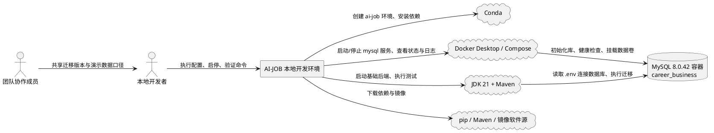
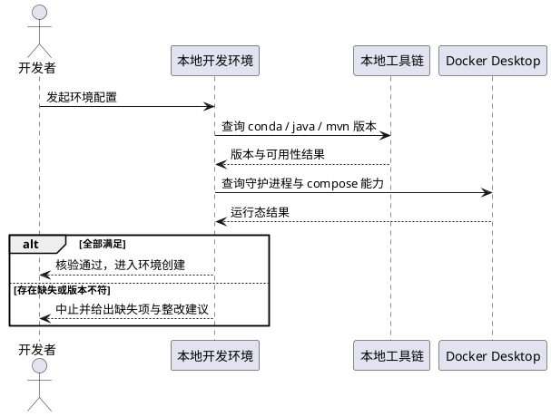
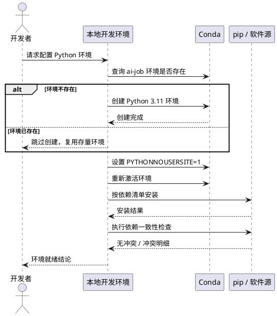
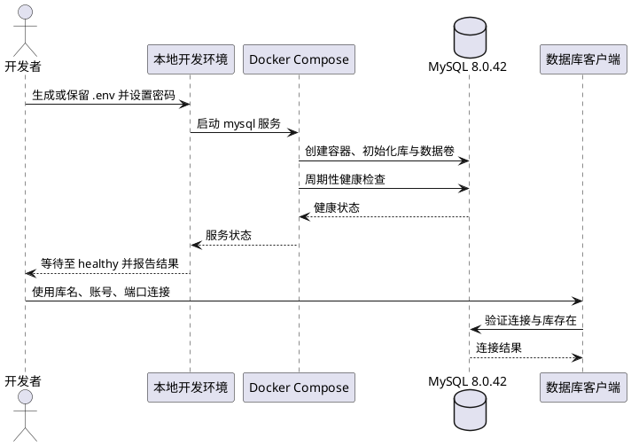
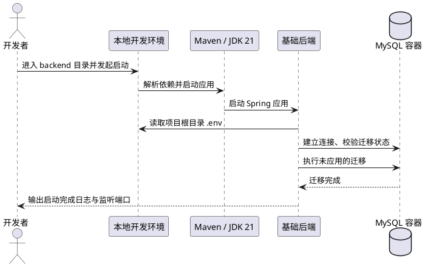
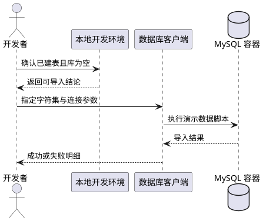
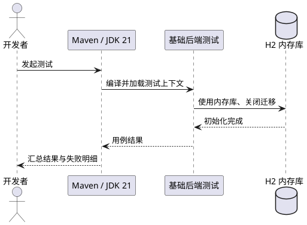
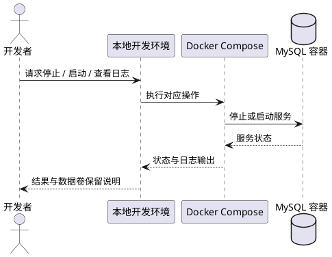

# 1. 组件定位

## 1.1 核心职责

本组件负责把 AI-JOB 代码仓库在本机配置成可复现、可自检、可启动可测试的本地开发环境，实现"一次配置、按序验证、环境可回收"。

## 1.2 核心输入

1. **开发者操作指令**：来自开发者在项目根目录（或 `project/backend`）执行的配置命令，包括环境创建、容器启停、后端启动与测试。
2. **仓库内配置文件**：`readme.md`（配置流程说明）、`docker-compose.yml`（MySQL 服务定义）、`.env.example`（环境变量模板）、`requirements.txt`（Python 依赖清单）、`project/backend/pom.xml`（Java 依赖与 JDK 版本约束）。
3. **本地工具链状态**：Conda、Python、Docker Desktop 与 Compose、JDK、Maven 的安装状态与版本号。
4. **外部软件源**：MySQL 8.0.42 容器镜像、Python 包索引、Maven 中央仓库。

## 1.3 核心输出

1. **可用的 Conda 环境**：名为 `ai-job` 的 Python 3.11 环境，依赖安装完成且 `pip check` 无冲突。
2. **运行中的 MySQL 服务**：状态为 `healthy` 的 MySQL 容器，含 `career_business` 数据库与 Flyway 建的 31 张业务表，数据落于命名卷。
3. **本地环境变量文件**：项目根目录 `.env`，含自定义的数据库账号与密码，不进入版本库。
4. **运行中的 Java 后端**：监听 `8080` 端口的基础后端进程，日志出现启动完成标志。
5. **测试结果**：`mvn test` 的可判定结论（成功/失败及失败原因）。
6. **环境自检结论**：每一步的成功判据、失败位置与整改建议。

## 1.4 职责边界

1. **不负责** Python Agent 服务、Qdrant 向量库、Redis、前端工程的启动与联调；这些组件不由本项目 Compose 启动，需要时另行准备。
2. **不负责** 业务接口、JWT 登录认证、Agent 通信等业务功能的实现；当前后端仅提供工程骨架与 Spring Security 默认保护。
3. **不负责** 表结构设计；`V1__init_business_schema.sql` 执行后不得直接修改，结构调整走新增版本迁移。
4. **不负责** 生产部署、CI/CD、后端容器化与公网发布方案。
5. **不负责** 团队成员之间的 Docker 数据同步，也不把命名卷当作备份手段。
6. **不负责** 已存在数据库账号密码的自动变更：修改 `.env` 不会回写已初始化的数据库账号。

# 2. 领域术语

**本地开发环境**
: 开发者个人机器上，由仓库内配置驱动的、可独立启动后端与数据库的一套工具链与运行实例集合。

**ai-job 环境**
: 由 Conda 创建的 Python 3.11 命名环境，用于承载 Python AI 服务的依赖。
: 备注：与容器名 `ai-job`、Compose 项目名区分，后者指 Docker 资源集合。

**基础后端**
: `project/backend` 下基于 Spring Boot 的 Java 服务骨架，启动成功后监听 8080 端口。
: 备注：不含业务接口与正式登录认证。

**健康状态**
: MySQL 容器健康检查连续成功、可接受连接的状态，显示为 `healthy`；仅"运行中"不代表可连接。

**Flyway 迁移**
: 由后端启动时自动执行的版本化数据库结构变更脚本，执行记录被持久化，已执行版本不得原地修改。

**演示数据**
: 供空开发库手动导入的测试样本脚本，含虚构岗位与公司、已禁用演示账号，不随应用启动自动执行，不可重复导入。

**占位密码**
: `.env.example` 中的示例值（如 `replace_with_a_strong_password`），属于未配置状态，禁止用于实际启动。

**命名卷**
: Docker 管理的持久化数据卷，普通停止或重建容器不会删除其中的数据。

# 3. 角色与边界

## 3.1 核心角色

1. **本地开发者**：在自己的机器上按流程完成环境配置、启动、验证与回收，并负责本地密码的设定与保管。
2. **团队协作成员**：与本地开发者共享同一套 Compose、依赖清单与迁移脚本，负责迁移版本号协调与演示数据口径约定。

## 3.2 外部系统

1. **Conda**：提供 Python 3.11 解释器与独立环境隔离能力。
2. **Docker Desktop / Docker Compose**：提供容器运行时、编排能力与命名卷管理。
3. **MySQL 8.0.42 容器**：承载 `career_business` 数据库，提供持久化存储与健康检查。
4. **JDK 21 与 Maven**：编译并启动 Java 基础后端，执行后端测试。
5. **软件源（pip / Maven 仓库 / 镜像仓库）**：提供 Python 依赖、Java 依赖与 MySQL 镜像。
6. **H2 内存数据库**：仅在测试期替代真实 MySQL，用于启动测试。

## 3.3 交互上下文

# 4. DFX 约束

## 4.1 性能

1. **首次环境就绪时间**：在 100Mbps 可用带宽下，从零完成镜像拉取、容器初始化到 `healthy`，不得超过 15 分钟；超出时应能通过日志定位到网络或镜像源原因。
2. **二次启动时间**：MySQL 容器从执行启动到 `healthy` 不得超过 90 秒；后端从启动命令到出现启动完成日志不得超过 60 秒（依赖已缓存）。
3. **测试执行时间**：`mvn test` 在依赖已缓存时不得超过 5 分钟。
4. **资源占用**：本地环境同时运行时，MySQL 容器内存占用不得超过 2GB，后端 JVM 默认堆不得超过 2GB；开发机可用内存低于 4GB 时应提前提示。

## 4.2 可靠性

1. **可重入**：所有配置步骤重复执行不得破坏已有环境；已存在的 Conda 环境、`.env`、数据卷必须保留。
2. **持久化**：MySQL 数据必须保存在命名卷中，普通停止、重启、重建容器后数据仍可读。
3. **故障恢复**：容器异常退出后按 `unless-stopped` 策略自动拉起；健康检查失败次数达到 12 次且持续 40 秒以上时，必须判定为启动失败并给出日志查看指引。
4. **可回滚**：环境回收必须支持"停止但不删数据"和"显式删数据"两种路径，默认路径不得删除数据。
5. **迁移一致性**：同一数据库内已执行的迁移版本必须唯一且不可重复执行；迁移失败时必须中止启动并保留可读错误信息。

## 4.3 安全性

1. **凭据保护**：`.env` 必须被 Git 忽略，任何配置步骤与输出不得提交、打印或回显明文密码。
2. **占位值拦截**：`MYSQL_PASSWORD` 与 `MYSQL_ROOT_PASSWORD` 必须为非占位值，且两者必须不同。
3. **最小暴露**：`MYSQL_BIND_ADDRESS` 默认必须为 `127.0.0.1`；监听非回环地址时必须由开发者显式确认，且禁止直接暴露到公网。
4. **数据保护**：默认流程禁止执行 `docker compose down -v`；该操作必须由开发者显式确认，并在执行前提示数据不可恢复。
5. **权限最小化**：数据库应用账号仅需具备迁移所需的建表、改表与读写权限，不得使用 root 账号运行后端。

## 4.4 可维护性

1. **逐步可验证**：每个配置阶段必须给出成功判据，包括但不限于 `No broken requirements found.`、容器状态 `healthy`、启动完成日志、`BUILD SUCCESS`。
2. **日志可读**：容器日志与后端日志必须可随时查看；失败信息必须能区分"未启动""未健康""认证失败""迁移失败"四类原因。
3. **单点说明**：端口、库名、账号、依赖版本必须在仓库内唯一来源定义，不得在多处复制后不一致。
4. **环境报告**：配置完成后必须输出一份包含各工具版本、容器状态、后端端口、测试结论的检查摘要。

## 4.5 兼容性

1. **操作系统**：Windows 下 PowerShell 为主流程；`git-bash`/`cmd` 下等效命令必须可用。路径含空格或中文时必须正常执行。
2. **工具版本**：Python 3.11、JDK 21、Maven 3.9.x、MySQL 8.0.42、Docker Compose v2。低于或高于 JDK 21 主版本时必须给出明确不兼容提示，不得静默继续。
3. **工作目录**：后端必须支持从项目根目录或 `project/backend` 目录启动，且均能读取项目根目录的 `.env`。
4. **存量环境**：已存在的 Conda 环境、`.env`、数据卷、非空数据库必须被识别为存量状态，不得按全新环境处理。

# 5. 核心能力

## 5.1 前置条件核验

### 5.1.1 业务规则

1. **工具可用性核验**：执行任何配置前，必须核验 Conda、Docker Compose、JDK、Maven 四项是否可用。
   a. 验收条件：任一工具命令找不到 → 立即中止并在结果中指明缺失工具与安装要求，后续步骤不执行。
2. **版本匹配核验**：JDK 主版本必须为 21；Conda 需能创建 Python 3.11 环境；Maven 实际运行所用 JDK 必须与 JDK 21 一致。
   a. 验收条件：`mvn -version` 显示 Java 版本为 17 → 判定不兼容并提示切换 `JAVA_HOME`，不得继续启动后端。
3. **Docker 运行态核验**：必须确认 Docker 守护进程可用，而不仅是客户端已安装。
   a. 验收条件：Docker Desktop 未启动 → 提示"请先启动 Docker Desktop"并中止容器相关步骤。
4. **工作目录核验**：必须在项目根目录或约定子目录执行对应命令，且目录下存在 `.env.example`、`docker-compose.yml`、`requirements.txt`。
   a. 验收条件：在错误目录执行 → 提示正确工作目录并终止，不产生副作用。
5. **禁止项**：禁止在未确认工具版本的情况下直接执行依赖安装或容器启动。
   a. 验收条件：跳过核验直接启动 → 视为流程违规，配置结果不予采信。

### 5.1.2 交互流程

### 5.1.3 异常场景

1. **Conda 未安装或不在 PATH**
   a. 触发条件：执行 `conda --version` 无结果。
   b. 系统行为：终止 Python 环境相关步骤，其余不相关步骤不做假设性继续。
   c. 用户感知：提示安装 Conda 或将 Conda 加入 PATH 后重试。
2. **JDK 版本不符**
   a. 触发条件：`java -version` 或 `mvn -version` 显示非 21 主版本（例如 17）。
   b. 系统行为：不下载依赖、不启动后端，保留已完成的数据库步骤不动。
   c. 用户感知：提示安装 JDK 21 并校正 `JAVA_HOME` 与 `PATH` 顺序。
3. **Docker 守护进程未运行**
   a. 触发条件：Docker 客户端存在但守护进程不可达或命令长时间无响应。
   b. 系统行为：设置等待上限后中止，不无限等待。
   c. 用户感知：提示启动 Docker Desktop 并确认 `docker compose version` 可用。
4. **工作目录错误**
   a. 触发条件：当前目录缺少仓库配置文件。
   b. 系统行为：只读检查，不创建文件、不启动容器。
   c. 用户感知：提示切换到项目根目录，并给出正确目录示例。

## 5.2 Conda Python 环境配置

### 5.2.1 业务规则

1. **环境命名规则**：Python 环境必须命名为 `ai-job`，使用 Python 3.11。
   a. 验收条件：环境列表中存在 `ai-job` 且其解释器版本为 3.11.x → 判定通过。
2. **用户包隔离规则**：必须在环境级设置 `PYTHONNOUSERSITE=1`，阻止加载用户目录下的第三方包。
   a. 验收条件：环境变量生效后，导入依赖不来自用户 site-packages → 判定通过。
3. **配置生效规则**：环境变量设置后必须重新激活环境才可安装依赖。
   a. 验收条件：在已激活状态下设置变量后未重新激活 → 视为未生效，需退出并重新激活。
4. **存量环境规则**：`ai-job` 环境已存在时必须跳过创建，不得重建或清空。
   a. 验收条件：重复执行创建步骤 → 不报错且不覆盖已有环境。
5. **依赖安装规则**：必须按仓库依赖清单安装，直接依赖版本必须与清单一致。
   a. 验收条件：清单中的版本与实际安装版本不一致 → 判定失败并指出差异项。
6. **依赖一致性规则**：安装后必须执行依赖冲突检查，输出无冲突结论。
   a. 验收条件：检查输出 `No broken requirements found.` → 判定通过；出现冲突 → 输出冲突链路并判定失败。
7. **完成度规则**：依赖安装完成仅代表 Python 环境可用，不代表 AI 服务已实现或可启动。
   a. 验收条件：环境就绪报告中不得将"依赖装好"表述为"AI 服务可用"。

### 5.2.2 交互流程

### 5.2.3 异常场景

1. **环境已存在但版本不符**
   a. 触发条件：`ai-job` 环境已存在且 Python 主次版本不是 3.11。
   b. 系统行为：不自动删除环境，提示需人工确认迁移或重建。
   c. 用户感知：提示版本差异，要求开发者显式确认后续动作。
2. **依赖安装失败**
   a. 触发条件：网络不可达、软件源不可用或版本不可解析。
   b. 系统行为：保留已安装部分并记录失败包名，不重复执行破坏性清理。
   c. 用户感知：提示失败包、可能原因与重试方式。
3. **依赖冲突**
   a. 触发条件：`pip check` 报告版本冲突。
   b. 系统行为：不继续宣称环境就绪，输出冲突的包与版本约束。
   c. 用户感知：提示冲突明细，需调整依赖或环境后重试。
4. **用户包干扰**
   a. 触发条件：未关闭用户 site-packages 或未重新激活环境。
   b. 系统行为：导入路径仍包含用户目录时判定隔离未生效。
   c. 用户感知：提示退出环境、重新激活后再校验。

## 5.3 Docker MySQL 配置

### 5.3.1 业务规则

1. **配置初始化规则**：首次使用时必须由模板生成 `.env`；`.env` 已存在时必须保留，不得覆盖。
   a. 验收条件：`.env` 已存在再执行初始化 → 文件内容不变。
2. **密码配置规则**：开发者必须设置自有的 `MYSQL_PASSWORD` 与 `MYSQL_ROOT_PASSWORD`，两者必须不同且不得为模板占位值。
   a. 验收条件：密码仍为占位值或两者相同 → 拒绝启动容器并提示修改。
3. **绑定地址规则**：`MYSQL_BIND_ADDRESS` 默认必须为 `127.0.0.1`，表示仅本机可连接。
   a. 验收条件：绑定为非回环地址且未获开发者确认 → 判定配置不合规。
4. **端口规则**：宿主端口默认为 `3307`，仅允许在首次启动前调整；已被占用时必须改用空闲端口。
   a. 验收条件：宿主端口被占用 → 容器启动失败或端口冲突，需改端口后重建。
5. **启动顺序规则**：必须先启动容器并等待 `healthy`，再进行后端启动或数据库客户端连接。
   a. 验收条件：容器为 `starting` 或 `running` 但未 `healthy` 即连接 → 判定时序错误。
6. **初始化语义规则**：数据库名固定为 `career_business`；用户与密码仅在全新数据卷首次初始化时创建。
   a. 验收条件：已有数据卷下修改 `.env` 密码 → 数据库账号不变，判定为预期行为而非缺陷。
7. **建表边界规则**：Compose 只创建库与数据卷，不创建业务表；业务表必须由后端启动时的迁移创建。
   a. 验收条件：仅启动容器后检查表数量为空 → 属正常状态。
8. **数据保护规则**：普通停止与再次启动必须保留数据；禁止使用会删除数据卷的停止方式。
   a. 验收条件：停止后重启，数据仍可查询 → 判定通过。
9. **禁止项**：禁止将本机数据库端口直接暴露到公网，禁止在仓库中提交 `.env`。
   a. 验收条件：`.env` 出现在版本库变更中 → 判定为严重违规并要求移除。

### 5.3.2 交互流程

### 5.3.3 异常场景

1. **密码未替换**
   a. 触发条件：`.env` 中密码仍为模板占位值。
   b. 系统行为：容器不启动或启动后认证异常；流程判定配置未完成。
   c. 用户感知：提示替换密码后重试，不显示密码内容。
2. **端口被占用**
   a. 触发条件：`3307` 或其他配置端口已被本机进程占用。
   b. 系统行为：容器无法绑定端口，启动失败并保留原数据卷。
   c. 用户感知：提示改用空闲端口，并说明须在首次启动前修改。
3. **镜像拉取失败**
   a. 触发条件：镜像仓库不可达、磁盘空间不足或镜像源受限。
   b. 系统行为：停止重试并保留已下载层，报告失败原因类别。
   c. 用户感知：提示检查网络、磁盘空间或镜像源配置。
4. **健康检查超时**
   a. 触发条件：初始化超过健康检查宽限期仍不可连接。
   b. 系统行为：判定服务未就绪，不进入后端启动步骤。
   c. 用户感知：提示查看容器日志并给出可能原因（初始化慢、资源不足、配置错误）。
5. **存量数据卷与配置不一致**
   a. 触发条件：修改 `.env` 中账号或密码但数据卷已初始化。
   b. 系统行为：沿用数据库内已有凭据，不自动改密。
   c. 用户感知：提示需在数据库内改密并同步 `.env`，或经确认后重建数据卷。
6. **误删数据卷**
   a. 触发条件：执行删除数据卷的停止命令。
   b. 系统行为：必须在执行前提示不可恢复；未确认不得执行。
   c. 用户感知：明确告知数据已删除且无法通过容器恢复，仅能依赖外部备份。

## 5.4 Java 基础后端启动与建表

### 5.4.1 业务规则

1. **前置依赖规则**：启动后端前，MySQL 容器必须为 `healthy`。
   a. 验收条件：容器未健康时启动后端 → 判定前置条件不满足，先等待或修复数据库。
2. **配置读取规则**：后端必须自动读取项目根目录 `.env`；从项目根目录或 `project/backend` 启动都必须成功读取。
   a. 验收条件：两个工作目录分别启动，均使用 `.env` 中的账号与端口连接 → 判定通过。
3. **端口规则**：后端默认监听 `8080`，可通过环境变量覆盖；端口被占用时必须提示冲突并允许改用其他端口。
   a. 验收条件：默认端口已有监听进程 → 启动失败并提示端口占用。
4. **迁移执行规则**：首次启动时必须自动执行版本化迁移，创建业务表与迁移记录；不得手工改库代替迁移。
   a. 验收条件：成功启动后业务表存在且迁移记录包含首个版本 → 判定通过。
5. **权限规则**：应用数据库账号必须具备迁移所需的建表与改表权限。
   a. 验收条件：账号无建表权限 → 启动中止并提示授权要求。
6. **架构边界规则**：启动成功仅代表基础骨架可用；正式登录认证、业务接口与 Agent 通信均未实现。
   a. 验收条件：环境报告中不得把"启动成功"描述为"业务功能可用"。
7. **禁止项**：禁止修改已执行的首个迁移版本；结构调整必须新增版本迁移。
   a. 验收条件：首个迁移文件内容或校验值变化 → 后端启动报迁移校验失败，判定违规。
8. **配套服务规则**：Redis 默认指向本机 6379，未启动时不影响骨架启动，但相关功能不可用；不得因此判定环境配置失败。
   a. 验收条件：无 Redis 情况下启动成功 → 属预期结果。

### 5.4.2 交互流程

### 5.4.3 异常场景

1. **环境变量未加载**
   a. 触发条件：配置导入路径异常或工作目录不符合预期，`.env` 未被读取。
   b. 系统行为：以空密码或默认值连接数据库，连接失败即中止启动。
   c. 用户感知：提示数据库认证或连接失败，并提示核对配置导入路径与工作目录。
2. **数据库不可达**
   a. 触发条件：容器未启动、端口不符、绑定地址不符或网络隔离。
   b. 系统行为：启动中止，保留已加载的依赖缓存。
   c. 用户感知：提示按"容器状态 → 端口 → 账号"顺序排查。
3. **迁移失败**
   a. 触发条件：脚本语法错误、版本冲突、权限不足或库中已有同名对象。
   b. 系统行为：中止启动，不执行后续迁移。
   c. 用户感知：提示迁移版本号与失败类别，要求修正后重试。
4. **存量非空库被当作新库**
   a. 触发条件：数据库存在结构但缺少迁移记录。
   b. 系统行为：拒绝自动建表，判定迁移策略未确认。
   c. 用户感知：提示先确认迁移基线策略，不得强制清理数据。
5. **端口冲突**
   a. 触发条件：`8080` 已被其他进程监听。
   b. 系统行为：启动中止并保留原有进程。
   c. 用户感知：提示占用情况与替代端口设置方式。
6. **JDK 版本不符**
   a. 触发条件：Maven 实际使用 JDK 17。
   b. 系统行为：编译期即失败，不产生可运行产物。
   c. 用户感知：提示切换至 JDK 21 后重试。

## 5.5 演示数据导入

### 5.5.1 业务规则

1. **前置条件规则**：导入前必须确认表结构已由迁移创建，且目标为空的开发库。
   a. 验收条件：表不存在或库非空 → 不得导入，提示先完成建表或改用共享联调库。
2. **字符集规则**：导入必须使用 `utf8mb4`，避免中文与特殊字符损坏。
   a. 验收条件：导入后中文岗位与公司名称可正常显示 → 判定通过。
3. **连接参数规则**：主机、端口、用户名必须与本地 `.env` 一致，密码由开发者手工输入。
   a. 验收条件：参数与 `.env` 不一致 → 连接失败，需按实际值修正。
4. **幂等性规则**：演示数据脚本不是可重复导入脚本，禁止重复执行。
   a. 验收条件：重复导入导致主键冲突或数据重复 → 判定为预期限制，需重建空库后再导入。
5. **环境限制规则**：演示数据仅限开发库使用，禁止在生产或共享正式库执行；演示账号为禁用状态，数据为虚构。
   a. 验收条件：在非开发库执行 → 判定违规。

### 5.5.2 交互流程

### 5.5.3 异常场景

1. **表结构未创建**
   a. 触发条件：仅启动容器，尚未启动后端完成迁移。
   b. 系统行为：导入报对象不存在。
   c. 用户感知：提示先启动后端完成迁移，再导入。
2. **重复导入**
   a. 触发条件：同一库二次执行脚本。
   b. 系统行为：出现唯一键冲突或数据重复。
   c. 用户感知：提示该脚本不可重复导入，需重建空库或使用共享联调库。
3. **字符集不匹配**
   a. 触发条件：客户端未指定 `utf8mb4`。
   b. 系统行为：中文数据出现乱码或写入失败。
   c. 用户感知：提示使用统一字符集重新导入。
4. **连接参数不一致**
   a. 触发条件：命令中的主机、端口或用户名与 `.env` 不符。
   b. 系统行为：连接被拒绝或认证失败。
   c. 用户感知：提示按 `.env` 实际值修正参数。

## 5.6 后端测试

### 5.6.1 业务规则

1. **执行规则**：测试必须在 `project/backend` 目录执行，使用项目自带测试依赖。
   a. 验收条件：测试命令返回成功汇总 → 判定通过。
2. **测试隔离规则**：启动测试必须使用内存数据库并关闭迁移，不得依赖本机 MySQL。
   a. 验收条件：未启动 MySQL 容器时测试仍可执行 → 判定通过。
3. **范围声明规则**：测试通过只表示骨架启动测试通过，不表示真实数据库、Redis 或服务间联调已验证。
   a. 验收条件：环境报告须同时说明测试覆盖范围与未覆盖范围。
4. **失败定位规则**：测试失败必须区分编译失败、断言失败与运行时崩溃三类，分别给出定位方向。
   a. 验收条件：仅重复执行而不给出分类与定位信息 → 判定流程不合格。

### 5.6.2 交互流程

### 5.6.3 异常场景

1. **编译失败**
   a. 触发条件：JDK 版本不符或依赖缺失。
   b. 系统行为：中止测试，输出编译错误位置。
   c. 用户感知：提示先修复工具链或依赖，不得盲目重跑。
2. **测试上下文启动失败**
   a. 触发条件：测试配置缺失或端口冲突。
   b. 系统行为：输出异常堆栈与失败配置项。
   c. 用户感知：提示按堆栈定位配置问题。
3. **用例断言失败**
   a. 触发条件：被测行为与预期不一致。
   b. 系统行为：输出失败用例与断言位置。
   c. 用户感知：提示按失败用例逐项修复，不通过降低断言绕过。

## 5.7 环境回收与日常运维

### 5.7.1 业务规则

1. **启停规则**：必须支持"停止数据库""再次启动数据库""查看启动日志"三类日常操作。
   a. 验收条件：三类操作均可用且不影响数据 → 判定通过。
2. **数据保护规则**：默认停止操作只停止容器，不删除容器与数据卷。
   a. 验收条件：停止后数据卷仍存在、重启后数据可查 → 判定通过。
3. **状态可观测规则**：必须能随时查看容器状态与日志，并能区分健康与未健康。
   a. 验收条件：状态输出可读到健康标记与端口映射 → 判定通过。
4. **后端停止规则**：后端通过中断信号停止，停止后端口必须释放。
   a. 验收条件：再次启动不报端口占用 → 判定通过。
5. **禁止项**：默认运维流程不得包含删除数据卷的操作。
   a. 验收条件：回收步骤默认路径出现删除数据卷命令 → 判定不合规。

### 5.7.2 交互流程

### 5.7.3 异常场景

1. **容器残留导致端口占用**
   a. 触发条件：旧容器仍在运行或异常退出后未清理。
   b. 系统行为：启动新容器时端口绑定失败。
   c. 用户感知：提示先查看状态并停止残留容器，禁止直接删除数据卷。
2. **日志过大**
   a. 触发条件：容器长时间运行且日志未限制。
   b. 系统行为：日志查看缓慢或磁盘占用增加。
   c. 用户感知：提示按需查看最近日志并清理容器日志，不清理数据卷。
3. **误执行数据删除**
   a. 触发条件：开发者执行带数据卷删除的操作。
   b. 系统行为：执行前必须二次确认；未确认不得执行。
   c. 用户感知：明确告知数据不可恢复，只能依赖外部备份。

# 6. 数据约束

## 6.1 环境变量文件（.env）

1. **MYSQL_BIND_ADDRESS**：必填，默认 `127.0.0.1`；取值必须是本机可绑定的地址；非回环地址需开发者显式确认。
2. **MYSQL_PORT**：必填，默认 `3307`；取值必须是 1–65535 的整数且本机未被占用；仅允许在首次启动前变更。
3. **MYSQL_USER**：必填，默认 `aijob`；不得为 root；必须与数据库内已创建账号一致。
4. **MYSQL_PASSWORD**：必填，不得为空、不得为模板占位值、不得与 root 密码相同；仅在全新数据卷首次初始化时生效。
5. **MYSQL_ROOT_PASSWORD**：必填，不得为空、不得为占位值、必须与普通用户密码不同；属敏感信息，禁止提交与回显。
6. **文件安全约束**：`.env` 必须位于项目根目录且被版本库忽略；文件内容不得出现在日志、提交记录或共享文档中。
7. **模板约束**：`.env.example` 只允许保留占位值，不得写入真实密码。

## 6.2 Conda 环境（ai-job）

1. **环境名**：必须为 `ai-job`，唯一，不得与其他项目环境混用。
2. **解释器版本**：Python 主次版本必须为 3.11。
3. **用户包隔离**：必须设置 `PYTHONNOUSERSITE=1` 并在设置后重新激活环境。
4. **依赖版本**：直接依赖版本必须与仓库依赖清单完全一致；间接依赖允许浮动，但不得产生冲突。
5. **一致性状态**：依赖检查结果必须为无冲突；存在冲突时环境状态标记为"未就绪"。
6. **范围约束**：环境就绪不代表 AI 服务已实现或已启动。

## 6.3 MySQL 容器与数据卷

1. **镜像版本**：必须为 MySQL 8.0.42，不得随意升级主版本。
2. **数据库名**：固定为 `career_business`，不得由其他配置覆盖为不同名称。
3. **容器状态**：对外可用状态必须为健康；启动中或运行中但未健康不得视为可用。
4. **端口映射**：宿主端口与容器内 3306 映射，宿主端口取值与 `.env` 一致。
5. **数据卷**：数据必须落于命名卷；卷的生命周期独立于容器；普通停止与重建不得删除卷。
6. **重启策略**：异常退出后自动拉起，不因单次崩溃导致长期不可用。
7. **健康检查**：检查间隔 10 秒、超时 5 秒、重试 12 次、启动宽限 40 秒；连续失败达到阈值判定为不健康。
8. **时区**：容器时区固定为 UTC；连接串必须显式声明时区，避免时间偏移。
9. **表结构来源**：业务表只能由版本化迁移创建，禁止手工建表作为常规路径。
10. **迁移版本**：已执行版本不可修改，新增变更必须有更高且唯一的版本号。

## 6.4 后端运行配置

1. **服务端口**：默认 `8080`，可覆盖；取值必须是未被占用的整数端口。
2. **数据库连接来源**：必须优先来自项目根目录 `.env`；环境变量覆盖时以显式覆盖值为准。
3. **数据库账号**：默认使用 `.env` 中的普通用户，不得使用 root。
4. **Redis 配置**：默认 `localhost:6379`，密码可空；未就绪时不影响骨架启动，但相关功能不可用。
5. **测试数据源**：测试必须使用内存数据库并关闭迁移，禁止连接真实 MySQL。
6. **日志约束**：日志不得输出数据库密码、令牌等敏感信息。