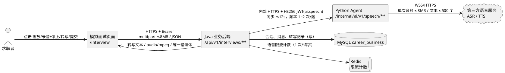
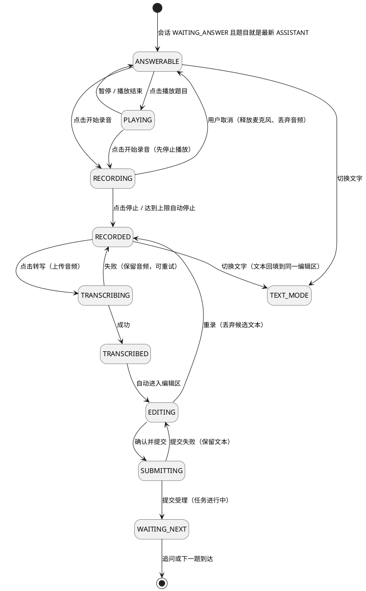
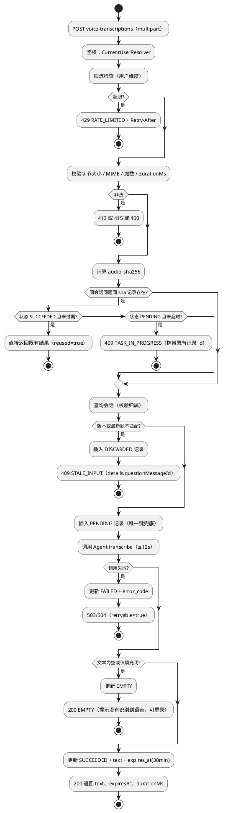
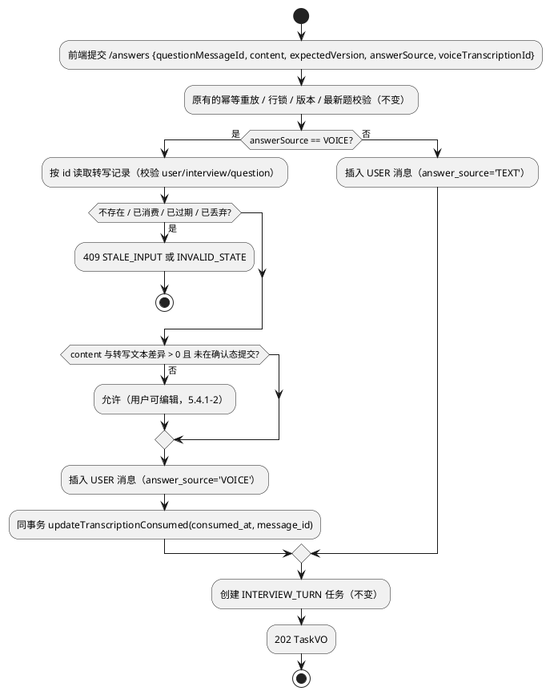
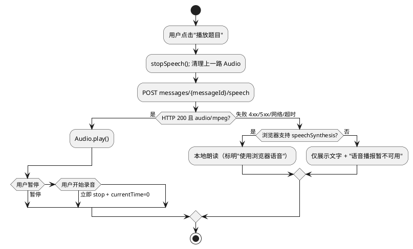
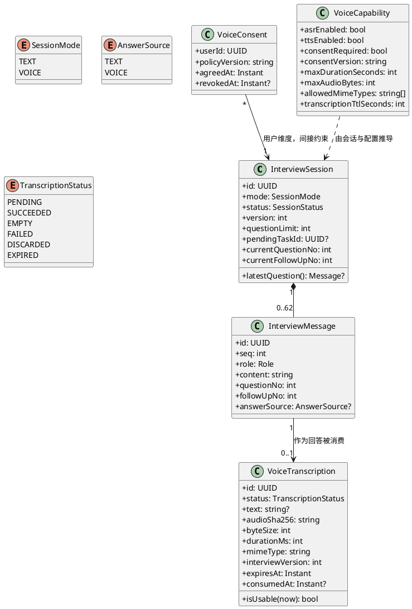
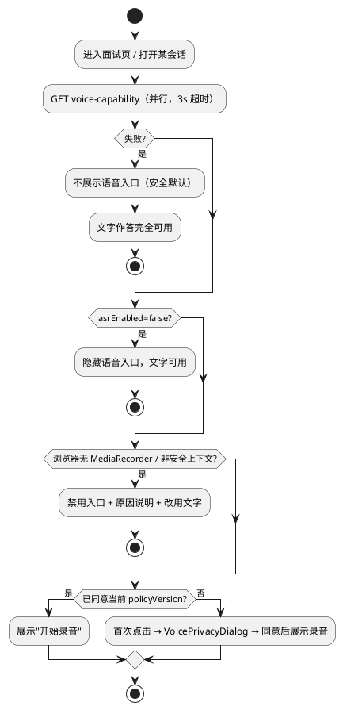

# 语音模拟面试 - 技术设计文档

> 需求来源：`.codeartsdoer/specs/voice_interview/spec.md`
> 关联资料：`docs/项目架构.md`、`docs/功能资料/09-模拟面试/模拟面试后端接口示例.md`、`docs/功能资料/09-模拟面试/Agent接口示例.md`、`docs/AI-JOB问题整改验收标准_2026-11-14.md`（U13）、原型 `docs/功能资料/09-模拟面试/21-语音模拟面试.png`
> 参考仓库：`https://github.com/Snailclimb/interview-guide`（下称"参考仓库"）
> 代码基线：`feature/job-dashboard` @ `24482ac`，以当前工作区为准
> 设计范围：仅技术设计，不产出业务代码、不改数据库、不提交代码

**标注约定**

| 标记 | 含义 |
|------|------|
| 【源码】 | 已阅读仓库源码确认，附文件路径与行号 |
| 【文档】 | 来自 `docs/**` 或需求规格，未在代码中验证 |
| 【设计建议】 | 本文提出的方案，尚未实现 |
| 【待验证】 | 需要真实环境（浏览器、真实 ASR/TTS、MySQL 隔离库、HTTPS）验证，不能由静态阅读确认 |

正文中凡未标注且有源码行号者为【源码】结论；凡描述"将如何实现"者为【设计建议】；凡涉及真机/真实服务/真实迁移者为【待验证】。

**章节导航（对应交付要求）**

| 交付要求 | 章节 |
|---------|------|
| 1 需求与存量关系分析（文档/代码/验证三方对照） | 一（1.1、1.2、1.2.6） |
| 2 增量设计（模型/接口/数据/前端/Python/边界/幂等/隐私） | 二（2.1–2.9） |
| 3 失败与恢复矩阵 | 三（3.1–3.5，共 40 条） |
| 4 关键设计决策与取舍 | 2.4（D1–D14） |
| 5 非功能设计与验证策略 | 四（4.1–4.8） |
| 6 第二阶段能力评估与投入阈值 | 五（5.1–5.3） |
| 7 实现步骤、分工、验收清单、首个里程碑 | 六（6.1–6.6） |

**本轮核对边界（如实说明）**

1. 仓库源码逐文件核对完成；行号以当前工作区文件为准。
2. 原型图片 `21-语音模拟面试.png` **未能读取**（当前模型不支持图像输入），页面结构依据 `spec.md` 5.1–5.8 与既有文字面试页布局推断，UI 细节标注【待验证】。
3. 参考仓库：`docs/voice-interview-architecture.md`（546 行）已完整核对；文件清单（535 个文件）已核对；但 `VoiceInterviewWebSocketHandler.java`、`QwenAsrService.java`、`QwenTtsService.java`、`AudioRecorder.tsx` 等**未能逐行核对**——沙箱网络在 `raw.githubusercontent.com` 与 GitHub contents 接口上连续失败（`curl: (2) getaddrinfo() thread failed to start`）。相关描述仅引用架构文档与文件路径，不做实现级断言。

---

# 一、需求与存量功能关系分析

## 1.1 需求功能与存量功能对比

### 1.1.1 已实现功能

| 需求功能 | 存量功能 | 代码位置 | 匹配度 |
|---------|---------|---------|--------|
| 会话状态机（PREPARING/WAITING_ANSWER/GENERATING/ENDING/COMPLETED/FAILED） | `interview_session.status` + CHECK 约束 | 【源码】`project/backend/src/main/resources/db/migration/V1__init_business_schema.sql:419,433`；`V1:409-434` | 100% |
| 回答提交与版本并发控制 | `answer()` 行锁 + `expectedVersion` 比对 + `latestQuestion` 校验 | 【源码】`InterviewService.java:111-175`（锁 121、版本 123-124、最新题 128-131） | 100% |
| 重复提交幂等 | `Idempotency-Key` + `api_idempotency` 唯一键 + 任务重放 | 【源码】`IdempotencyService.java:38-65`；`V1:581-599`；`InterviewController.java:53-60` | 100% |
| 同题重复回答分支（进行中/失败可重试/内容冲突） | `answerByQuestion` + 最近任务状态判定 | 【源码】`InterviewService.java:132-151`；`InterviewMapper.java:99-101` | 100% |
| 追问与下一题生成（含追问上限 2、主问题上限） | `InterviewTurnHandler` + Java 二次校验 | 【源码】`project/agent/app/handlers.py:1131-1253`；`InterviewResultHandler.java:86-146` | 100% |
| 逐轮评分与成长证据 | `evaluateAnswer` + `ability.addIndependent` | 【源码】`InterviewResultHandler.java:149-174` | 100% |
| 面试报告与完成类型 | `report()` + `NORMAL/EARLY_END/NO_VALID_ANSWER` | 【源码】`InterviewResultHandler.java:177-241`；`V1:475-490` | 100% |
| 异步任务 + SSE 事件流 | `useTask`（SSE + 4s 轮询兜底）、`TaskSseService` | 【源码】`project/frontend/src/composables/useTask.ts:31-274,252`；`TaskController.java:70-82` | 100% |
| 前端页面恢复（刷新后按 `interviewId` 重新拉取） | `watch` + `onMounted` 读取 query | 【源码】`InterviewView.vue:470-489` | 100% |
| 提交回答前端失败处理（409 刷新不自动重发） | `submitAnswer` catch 分支 | 【源码】`InterviewView.vue:314-355`（409 处理 346-351） | 100% |
| 请求层能力（JSON/FormData/幂等键/401 刷新） | `request<T>` | 【源码】`project/frontend/src/api/request.ts:124-178`（FormData 137、幂等 133-135、401 157） | 100% |
| 内部服务鉴权（Java→Agent） | `InternalJwtService` HS256 + 短 TTL（300s） | 【源码】`InternalJwtService.java:32-34,66-79` | 100% |
| 任务级并发保护（每人最多 2 个活动 AI 任务） | `activeTaskCount >= 2` 拒绝 | 【源码】`TaskService.java:68-78` | 100% |
| 统一错误码与错误体 | `ApiErrorCode`（含 `PAYLOAD_TOO_LARGE`/`UNSUPPORTED_FILE_TYPE`/`DEPENDENCY_UNAVAILABLE`） | 【源码】`ApiErrorCode.java:5-26`；`BusinessException.java:126-144` | 100%（错误码可复用） |
| 文件上传先例（multipart + 大小限制 + 哈希） | `FileStorageService.store` | 【源码】`FileStorageService.java:50-93`（10MB 52、sha256 87） | 75%（可复用约定，不复用落盘） |

> 结论：**文字面试主链路已完整实现**，语音能力只需在"回答内容来源"与"题目播报/转写"两个外围切面扩展，不应重写会话状态机、评分与报告逻辑。

### 1.1.2 需要扩展的功能

| 需求功能 | 存量功能 | 差异说明 | 扩展方向 |
|---------|---------|---------|---------|
| 回答来源标识（TEXT/VOICE） | `interview_message` 仅有 `role/question_no/follow_up_no`，无来源列 | 输入：新增可选 `answerSource`；输出：详情/列表中回显；边界：历史数据视为 TEXT | `V15` 增列并设默认 `NULL`→读取时按 `TEXT` 处理；提交接口新增可选字段（向后兼容） |
| 会话模式标识 | `interview_session` 无 `mode` 列 | 输入：创建会话时可选 `mode`；输出：详情返回；边界：历史会话默认 TEXT | `V15` 增列 `mode VARCHAR(8) DEFAULT 'TEXT'`；`create` 可选参数，缺省 TEXT |
| 回答提交（语音确认后提交） | `/answers` 已具备全部规则 | 差异：需要绑定"转写记录"并标记 `VOICE`，且转写必须已确认、未过期、未消费 | 扩展 `/answers` 可选字段（`answerSource`、`voiceTranscriptionId`），复用手锁/版本/幂等逻辑，禁止新增平行提交接口 |
| 页面"当前仅支持文字面试"提示 | 硬编码提示条 | 需要按能力与模式动态展示 | 改为数据驱动：能力探测 + 模式切换；文字路径保持默认 |
| 前端作答区 | 仅有 `textarea` | 需要录音、试听、重录、转写中、可编辑确认、播放题目 | 拆出 `VoiceAnswerPanel` 等子组件，`answerContent` 作为共享编辑区（语音/文字共用） |
| 错误提示映射 | `errorMessage(reason)` 通用映射 | 语音新增 `SPEECH_*` 类失败需要可执行出口（重试/重录/转文字） | 在 `utils/format.ts` 增加语音失败文案映射，不改通用异常语义 |
| 任务并发额度 | `TaskService` 硬上限 2 | 转写若也占用 `ai_task`，会在"追问生成中 + 转写"时触发 409 `INVALID_STATE` | 转写/合成**不进入** `ai_task`（见 4.1 D1） |

### 1.1.3 需要新增的功能或接口

**模块 A：数据库（`V15`，当前最新为 `V14`）**

- A1. `interview_session.mode`（TEXT/VOICE）。【源码依据】`V14__add_practice_sets.sql` 为现存最大版本号，故下一个为 `V15`。
- A2. `interview_message.answer_source`（TEXT/VOICE/NULL）。
- A3. `interview_voice_transcription`（临时转写记录，含 `audio_sha256` 唯一约束、过期与消费时间）。
- A4. `interview_voice_consent`（隐私同意/撤回，按用户 + 政策版本唯一）。

**模块 B：Java 语音编排（`com.aijob.backend.interview.voice`）**

- B1. `VoiceInterviewController`：转写上传、转写查询、转写放弃、题目合成、能力探测。
- B2. `VoiceTranscriptionService`：格式/大小/时长校验、`audio_sha256` 幂等、旧题晚到判定、过期清理、限流。
- B3. `QuestionSpeechService`：题目文本→语音，进程内有界缓存，失败降级。
- B4. `VoiceMapper`：转写与同意记录读写。
- B5. `SpeechAgentClient`：以同步 HTTP 调用 Agent `speech` 模块（内部 JWT，`ai:speech` scope）。
- B6. `InternalJwtService.speechToken()`：新增短 TTL 语音作用域令牌（不复用 `ai:run`）。

**模块 C：Python 语音能力（`project/agent/app/speech/`）**

- C1. Provider 抽象：`AsrProvider` / `TtsProvider`（协议 + 数据类）。
- C2. `FakeAsrProvider` / `FakeTtsProvider`：离线可测，返回确定结果。
- C3. `QwenAsrProvider` / `QwenTtsProvider`：阿里云百炼实时语音（首版非流式调用）。
- C4. `SpeechService`：magic-bytes 校验、大小/时长/文本长度校验、脱敏日志、指标。
- C5. 同步路由：`POST /internal/ai/v1/speech/transcribe`、`POST /internal/ai/v1/speech/synthesize`（200，非 202）。

**模块 D：前端**

- D1. `api/voiceInterviews.ts`：五个语音接口的类型化封装（含 multipart）。
- D2. `composables/useVoiceRecorder.ts`：`MediaRecorder` 封装、权限、计时、上限、页签隐藏/路由离开释放。
- D3. `composables/useQuestionSpeech.ts`：服务端 TTS 播放 + 浏览器 `speechSynthesis` 降级 + 停止。
- D4. `composables/useVoiceAnswer.ts`：作答状态机、转写、恢复、废弃。
- D5. 组件：`QuestionAudioPlayer`、`VoiceAnswerPanel`、`RecordingControls`、`TranscriptionEditor`、`VoicePrivacyDialog`。
- D6. 工具：`utils/voice/formats.ts`（格式协商与魔数校验）、`utils/voice/limits.ts`（常量集中）。

## 1.2 存量功能详细分析

### 1.2.1 面试会话服务（Java）

- **接口契约**：`POST /api/v1/interviews`、`GET /api/v1/interviews`、`GET /{id}`、`POST /{id}/answers`、`POST /{id}/end`、`GET /{id}/report`；写接口均要求 `Idempotency-Key`（`InterviewController.java:36,55,64`）。
- **业务规则**：`create` 要求岗位 `ACTIVE` + 简历版本 `CONFIRMED`，且每人最多一个活动会话（`InterviewService.java:64-77`）；`answer` 要求状态 `WAITING_ANSWER`、版本一致、只能回答"最新一条 ASSISTANT"（`:121-131`）；`end` 仅 `WAITING_ANSWER` 可结束（`:189-191`）。
- **扩展点**：`answer` 的请求体由 `Map<String,Object>` 解析，**新增可选字段不会破坏既有客户端**（`Data.text/uuid/integer` 均为按需读取，`Data.java:15-83`）。`sessionVo` 为白名单装配，新增字段需显式追加（`InterviewService.java:228-244`）。
- **约束**：
  1. `answer` 的重试分支复用原 `ai_task` 的 `inputSnapshotJson`（`:143-150`），因此**语音来源必须在任务创建前落到消息或快照**，不能依赖任务回调补写。
  2. `interview_message` 有 `uk_question_message_id` 唯一键（`V1:451`），一个题目只能有一条回答——语音重复提交必须靠幂等与转写记录防重，而非新增消息。
  3. `updateTaskStatus/updateTurn` 每次 `version+1`（`InterviewMapper.java:53-65`），转写过程**绝对不能调用**这两条语句，否则会破坏 `expectedVersion` 语义（对应 `spec.md` 4.2-4）。

### 1.2.2 异步任务与 SSE

- **接口契约**：任务创建返回 202 + `TaskVO`；`/api/v1/tasks/{id}/events` 提供 `accepted/stage/delta/done/error/cancelled`（`TaskController.java:70-82`；文档 944-1008 行）。
- **业务规则**：每人同时最多 2 个活动任务（`TaskService.java:68-78`）；`INTERVIEW_REPORT` 会为同会话正在跑的 `INTERVIEW_TURN` 抵扣 1 个额度（`:69-74`）。
- **前端约束**：`useTask` 在 SSE 断开时 1s/2s/4s 退避重连，最多 3 次，同时每 4s 轮询一次（`useTask.ts:95-105,252`）。转写若做成任务，会让前端多一路流 + 一个任务的并发额度；这是本设计选择同步转写的主因之一。

### 1.2.3 Agent 内部契约

- **接口契约**：全部 `202 + AIRunVO`，payload 经 Pydantic 校验并核对 `inputVersions`（`project/agent/app/api.py:213-250`；`operations.py:165-211`）。
- **业务规则**：`INTERVIEW_TURN` 要求 `inputVersions` 含 `profileVersion` 与 `interviewVersion`（`operations.py:148`）；`queue_max_size` 满返回 429（`runner.py:153-154`）；截止时间最大 300s（`config.py:52`）。
- **约束**：现有 API 均为"受理即返回"，无同步返回结果的先例；语音转写要满足 P95 ≤ 8s，必须新增同步端点（见 2.2）。

### 1.2.4 前端页面与请求层

- **接口契约**：`interviewApi` 六个方法（`api/interviews.ts:5-24`）；`request<T>` 支持 JSON、`FormData`、`Blob`（`request.ts:136-142`）。
- **约束**：
  1. 写接口经 `submitTrackedTask` 自动带 `Idempotency-Key` 并登记重试参数（`task-registry.ts:50-54`）；**转写请求不应登记为可重试任务**（它不产生 `TaskVO`）。
  2. 页面当前在头部渲染"当前仅支持文字面试"（`InterviewView.vue:505`），并要求用户直接输入文字（`InterviewView.vue:612-622`）。
  3. 代码库中**不存在** `MediaRecorder`、`getUserMedia`、`speechSynthesis`、`AudioContext` 的任何使用（`project/frontend/src` 全量检索无命中），录音/播报能力需从零引入，不引入第三方录音库时需自行封装。
  4. `package.json` 声明了 `axios`（`package.json:15`），但请求层实际使用原生 `fetch`（`request.ts:124-151`）；语音接口沿用 `fetch`，不新增依赖。

### 1.2.5 数据与安全现状

- **已有**：`interview_session`/`interview_message`/`interview_turn_evaluation`/`interview_report` 四表完整（`V1:409-490`）；`ai_task` 及 `ai_task_event`（`V1:508-557`）；`audit_log` 表存在但**代码中无任何读写**（全仓库检索 `audit_log` 无命中）。
- **缺失**：无录音/转写/语音同意相关表；无任何语音能力配置项（`application.yml:78-86` 仅 agent/files/tasks）。
- **安全基线**：所有 `/api/**` 需认证（`SecurityConfig.java:67-69`）；Origin 校验仅覆盖 `/api/v1/auth/{refresh,logout,csrf}`（`OriginValidationFilter.java:17-21`），语音接口沿用 Bearer + 同源，不额外引入 CSRF 语义。
- **关键缺口**：`spring.servlet.multipart.max-file-size: 10MB`（`application.yml:13-16`）超限时 Spring 抛 `MaxUploadSizeExceededException`，而 `GlobalExceptionHandler` **未处理器该异常**（`GlobalExceptionHandler.java:41-168`），最终落入 500 兜底。语音上传必须显式处理为 413（见 2.2.2）。

### 1.2.6 「文档写的 / 代码已有的 / 实际验证过的」对照

| 主题 | 文档怎么写的 | 代码有什么 | 实际验证到什么 | 结论 |
|------|-------------|-----------|---------------|------|
| 语音面试范围 | U13 要求验收录音授权、语音输入、追问、播放、失败恢复、文字降级、隐私提示；当前判定"阻塞"（`AI-JOB问题整改验收标准_2026-11-14.md:133,255`） | 页面明示"当前仅支持文字面试"（`InterviewView.vue:505`） | 未执行任何语音用例（文档第七节 U13 记录） | 【文档】范围未确认，需产品决策后进入验收 |
| 会话模式/来源 | `spec.md` 6.1/6.2 要求可标识 | 表中无字段 | 未验证 | 【设计建议】`V15` 增列 |
| ASR/TTS 能力 | `spec.md` 5.2/5.4 要求 | Java/Agent 均无语音依赖；`requirements.txt` 无 dashscope | 未验证 | 【设计建议】新增 Provider 抽象，默认 Fake |
| 转写链路 | `spec.md` 要求停止录音后转写、确认后提交 | 无任何转写表/接口 | 未验证 | 【设计建议】同步转写 + 临时表 |
| 隐私告知 | `spec.md` 5.7 与 4.3-4 | 无同意表、无前端对话框 | 未验证 | 【设计建议】同意表 + 一次性对话框 |
| 上传上限 | `spec.md` 5.3.1-3 要求硬上限 | 全局 multipart 10MB，超限映射为 500 | 【待验证】需真机上传超限文件确认状态码 | 【设计建议】专用 413 处理器 + 8MB 业务上限 |
| 前端录音能力 | 需求隐含浏览器媒体能力 | 无 `MediaRecorder` 使用记录 | 【待验证】Chrome/Edge/Safari 格式差异 | 【设计建议】格式协商 + 服务端魔数校验 |

---
# 二、增量设计方案

## 2.1 实现模型

### 2.1.1 上下文视图

首版链路：**浏览器 → Java（业务与鉴权） → Python Agent（语音能力） → 第三方 ASR/TTS**。浏览器不直接访问 Agent，也不持有语音密钥（`spec.md` 4.3-3；`SecurityConfig.java:67-69` 全部 `/api/**` 需认证）。



**交互契约**

| 交互 | 方向 | 协议 | 频率 | 超时 | 说明 |
|------|------|------|------|------|------|
| 题目合成 | 前端→Java | `POST /api/v1/interviews/{id}/messages/{mid}/speech` | 用户手势触发，0~3 次/题 | 前端 12s | 响应二进制 `audio/mpeg`，`Cache-Control: no-store` |
| 转写上传 | 前端→Java | `POST /api/v1/interviews/{id}/voice-transcriptions`（multipart） | 1 次/次录音 | 前端 15s | 同音频重传返回同一结果 |
| 转写调用 | Java→Agent | `POST /internal/ai/v1/speech/transcribe`（multipart） | 同上 | Java 12s（Agent 内部 8s） | 同步返回 200 |
| 合成调用 | Java→Agent | `POST /internal/ai/v1/speech/synthesize`（JSON） | 同播放 | Java 10s（Agent 内部 6s） | 返回 base64 + mime |
| 回答提交 | 前端→Java | 复用 `POST /api/v1/interviews/{id}/answers` | 1 次/题 | 现状 | 新增可选 `answerSource/voiceTranscriptionId` |

**不引入的组件**：不引入消息队列、不引入 WebSocket（首版）、不引入对象存储。理由是首版音频只在内存中传递一次，`spec.md` 1.4-3 明确不持久化音频。

### 2.1.2 服务/组件总体架构

```plantuml
@startuml
top to bottom direction
skinparam packageStyle rectangle

package "前端 views/interview" {
  [InterviewView]
  [QuestionAudioPlayer]
  [VoiceAnswerPanel]
  [RecordingControls]
  [TranscriptionEditor]
  [VoicePrivacyDialog]
}

package "前端 composables/voice" {
  [useVoiceRecorder]
  [useQuestionSpeech]
  [useVoiceAnswer]
}

package "前端 api" {
  [voiceInterviews]
  [request (fetch)]
  [interviews (既有)]
}

package "Java interview.voice" {
  [VoiceInterviewController]
  [VoiceTranscriptionService]
  [QuestionSpeechService]
  [VoiceMapper]
  [SpeechAgentClient]
  [VoiceRateLimiter]
}

package "Java 既有" {
  [InterviewService]
  [TaskService]
  [InternalJwtService]
  [CurrentUserResolver]
  [GlobalExceptionHandler]
}

package "Python agent.speech" {
  [SpeechRouter]
  [SpeechService]
  [AsrProvider 接口]
  [TtsProvider 接口]
  [FakeProvider]
  [QwenProvider]
}

database "MySQL" as DB
cloud "DashScope" as Vendor

InterviewView --> QuestionAudioPlayer
InterviewView --> VoiceAnswerPanel
InterviewView --> VoicePrivacyDialog
VoiceAnswerPanel --> RecordingControls
VoiceAnswerPanel --> TranscriptionEditor
VoiceAnswerPanel --> useVoiceRecorder
VoiceAnswerPanel --> useVoiceAnswer
QuestionAudioPlayer --> useQuestionSpeech
useVoiceAnswer --> voiceInterviews
useQuestionSpeech --> voiceInterviews
VoiceAnswerPanel --> "interviews (既有)" : 确认后提交回答
voiceInterviews --> "request (fetch)"
VoiceInterviewController --> VoiceTranscriptionService
VoiceInterviewController --> QuestionSpeechService
VoiceTranscriptionService --> VoiceMapper
VoiceTranscriptionService --> SpeechAgentClient
QuestionSpeechService --> SpeechAgentClient
VoiceTranscriptionService --> VoiceRateLimiter
VoiceInterviewController --> CurrentUserResolver
SpeechAgentClient --> InternalJwtService
SpeechAgentClient --> SpeechRouter : 同步 HTTP
"interviews (既有)" --> InterviewService
InterviewService --> TaskService
VoiceMapper --> DB
SpeechRouter --> SpeechService
SpeechService --> AsrProvider 接口
SpeechService --> TtsProvider 接口
AsrProvider 接口 <|.. FakeProvider
TtsProvider 接口 <|.. FakeProvider
AsrProvider 接口 <|.. QwenProvider
TtsProvider 接口 <|.. QwenProvider
QwenProvider --> Vendor
@enduml
```

**职责与不承担**

| 组件 | 职责 | 不承担 |
|------|------|--------|
| `InterviewView` | 模式切换、能力探测、编排既有会话区与语音区 | 录音、播放、转写细节 |
| `VoiceAnswerPanel` | 本题作答容器：状态展示、按钮组、错误出口 | 直接调 HTTP |
| `RecordingControls` | 开始/停止/计时/上限自动停止 | 上传 |
| `TranscriptionEditor` | 候选文本编辑、确认提交、重录/放弃 | 判定题目是否过期（由服务端判定） |
| `QuestionAudioPlayer` | 播放/暂停/重播/停止、进度与失败提示 | 文本合成本身 |
| `useVoiceRecorder` | 媒体权限、`MediaRecorder`、计时、释放 | 状态机业务语义 |
| `useQuestionSpeech` | 请求音频、播放控制、浏览器 TTS 降级 | 题目文本读取 |
| `useVoiceAnswer` | 状态机、转写调用、刷新恢复、废弃 | 会话推进（既有 `submitAnswer`） |
| `VoiceTranscriptionService` | 校验、幂等、晚到判定、过期、限流 | 推进会话、生成题目 |
| `QuestionSpeechService` | 文本校验、缓存、降级、错误映射 | 前端播放控制 |
| `SpeechService`（Python） | 编解码校验、Provider 调度、指标、脱敏 | 业务归属与幂等（Java 负责） |

**目录与文件清单（实现阶段落地目标）**

| 类型 | 路径 | 说明 |
|------|------|------|
| 新增 | `project/backend/src/main/resources/db/migration/V15__add_voice_interview.sql` | 语音相关表与列 |
| 新增 | `project/backend/src/main/java/com/aijob/backend/interview/voice/VoiceInterviewController.java` | 5 个语音接口 |
| 新增 | `.../interview/voice/VoiceTranscriptionService.java` | 转写编排与校验 |
| 新增 | `.../interview/voice/QuestionSpeechService.java` | 合成与缓存 |
| 新增 | `.../interview/voice/VoiceMapper.java` | 转写/同意读写 |
| 新增 | `.../interview/voice/SpeechAgentClient.java` | Java→Agent 同步调用 |
| 新增 | `.../interview/voice/VoiceRateLimiter.java` | Redis 计数限流 |
| 新增 | `.../interview/voice/VoiceLimits.java` | 上限常量集中 |
| 修改 | `.../interview/InterviewService.java` | `answer` 接受可选来源与转写；`sessionVo` 回显 `mode/answerSource` |
| 修改 | `.../interview/InterviewController.java` | 透传可选字段（不新增提交接口） |
| 修改 | `.../interview/InterviewMapper.java` | 插入消息携带 `answer_source`；查询转写绑定 |
| 修改 | `.../task/InternalJwtService.java` | 新增 `speechToken(requestId)` |
| 修改 | `.../common/GlobalExceptionHandler.java` | 新增 `MaxUploadSizeExceededException`→413 |
| 新增 | `project/agent/app/speech/*.py` | Provider 抽象、Fake/Qwen、服务与路由 |
| 修改 | `project/agent/app/api.py` | 注册 speech router |
| 修改 | `project/agent/app/config.py` | `speech_*` 配置项 |
| 修改 | `project/agent/app/security.py` | 允许 `ai:speech` scope |
| 修改 | `project/agent/requirements.txt`（根 `requirements.txt`） | 新增 DashScope 依赖（可选、真实 provider 启用时） |
| 新增 | `project/frontend/src/api/voiceInterviews.ts` | 语音接口封装 |
| 新增 | `project/frontend/src/composables/voice/*.ts` | 三个 composable |
| 新增 | `project/frontend/src/views/interview/components/*.vue` | 五个组件 |
| 新增 | `project/frontend/src/utils/voice/*.ts` | 格式协商、上限常量 |
| 修改 | `project/frontend/src/views/interview/InterviewView.vue` | 接入模式与语音区，移除"仅文字"提示 |
| 修改 | `project/frontend/src/api/types.ts` | `VoiceTranscriptionVO`、`VoiceCapabilityVO`、`InterviewVO.mode`、`MessageVO.answerSource` |
| 修改 | `project/frontend/src/utils/format.ts` | 语音失败文案映射 |
| 不改 | `project/frontend/src/composables/useTask.ts` | 语音不产生任务，无需改动 |
| 不改 | `project/frontend/src/router/routes.ts` | `/interview` 已注册（`routes.ts:48`） |

### 2.1.3 实现设计文档

#### （1）前端作答状态机（单个题目单元）



**状态语义与约束**

| 状态 | 页面表现 | 关键约束 |
|------|---------|---------|
| `ANSWERABLE` | 题目文本 + "开始录音/播放题目/改用文字" | 语音入口仅在能力可用 + 已同意时显示（`spec.md` 5.1.3-1/2） |
| `PLAYING` | 播放进度、暂停/重播 | 同一时刻最多一个 `Audio` 实例，重复点击不叠加播放（5.2.3-3） |
| `RECORDING` | 计时、波形/电平、停止按钮 | 进入即 `stopSpeech()`；超过 `maxDurationSeconds` 自动停止（5.3.1-3） |
| `RECORDED` | 时长、试听、重录、转写 | 试听使用 `URL.createObjectURL`，重录前 `revokeObjectURL`（5.3.1-4） |
| `TRANSCRIBING` | 进度提示 + 取消 | 取消只释放本地引用，不产生会话数据 |
| `TRANSCRIBED` / `EDITING` | 编辑框 + "识别结果需确认" | 提交前必须展示候选态（5.4.1-1） |
| `SUBMITTING` | 禁用按钮 | 复用 `submitAnswer`，不新增提交逻辑 |
| `WAITING_NEXT` | 既有任务面板 | 由 `useTask` 驱动，行为不变 |
| `TEXT_MODE` | 仅 textarea | 已转写文本保留在同一编辑区（5.1.2-3、5.8.1-2） |

#### （2）转写主流程（Java 侧）



**要点**

1. **幂等键为 `audio_sha256`**，不是 `Idempotency-Key`：同一段音频重传必须返回同一结果（`spec.md` 4.1-4），而浏览器重录会产生新音频、新 sha，天然是不同记录。
2. **唯一键兜底**：并发两个相同 sha 的请求，第二条插入撞唯一键 → 回读既有记录并按状态返回（`SUCCEEDED` 直接返回，`PENDING` 返回 409），避免重复计费。
3. **不产生正式消息**：转写只写 `interview_voice_transcription`，不触碰 `interview_message`、不 `version+1`（`spec.md` 4.2-4）。
4. **旧题晚到**：只有在"版本不一致"或"当前最新题不同"时才落 `DISCARDED`；请求返回 `409 STALE_INPUT`，前端提示"该题已提交，本次识别结果未生效"（5.4.3-4）。

#### （3）确认提交（复用既有回答接口）



**关键不变量**

1. **转写记录只消费一次**：`consumed_at` 与 `consumed_message_id` 在插入消息的同一事务内写入；重复提交走 `answerByQuestion` 重试分支，不会二次消费。
2. **评分口径不变**：Agent 只看到 `content`，看不到来源（`spec.md` 5.5.1-3）。
3. **报告不读转写**：`reportTask` 的 payload 仍由 `agentMessages()` 构造（`InterviewService.java:246-256`），不含转写字段（6.4-1）。

#### （4）题目播报流程与降级



**要点**

1. **手势触发**：播放请求只能由点击产生，不做自动播放（`spec.md` 5.2.1-1）；被拦截时提示点击播放（5.2.3-2）。
2. **录音必停播**：`useVoiceRecorder.start()` 中先 `await stopSpeech()` 再 `getUserMedia`，避免录到播报（5.3.1-2）。
3. **服务端缓存**：`QuestionSpeechService` 用 `(interviewId, messageId, voiceId, sha256(text))` 作为键做进程内 LRU（≤200 项、单条 ≤512KB），命中直接返回，避免重复计费；**不落库、不落盘**（`spec.md` 5.7.1-2）。

#### （5）页面刷新与恢复

| 场景 | 恢复来源 | 行为 |
|------|---------|------|
| 刷新后会话仍在 `WAITING_ANSWER` | `GET /interviews/{id}`（既有） | 渲染题目；若本用户该题存在未过期 `SUCCEEDED` 转写，返回候选文本并标记"识别结果需确认" |
| 刷新后有在途任务 | `pendingTaskId` + `useTask`（既有） | 行为不变（`InterviewView.vue:224-231`） |
| 刷新时转写仍在 PENDING | `GET voice-transcriptions?questionMessageId=` | 返回 `PENDING`，前端显示"仍在识别中"，禁止重复上传（可点"重新转写"覆盖为新 sha） |
| 刷新后题目已变化 | 服务端 | 旧记录返回 `DISCARDED`/过期，前端不展示候选文本，只提示"上次识别未生效" |
| 切换为文字 | 本地 | 候选文本回填到 `answerContent`，不再调用语音接口 |

**约束**：候选文本只在"当前题 + 未消费 + 未过期"时回填，避免把旧题文本误填到新题（`spec.md` 5.4.1-6）。

---
## 2.2 接口设计

### 2.2.1 总体设计

**结论：新增 5 个语音专用接口 + 扩展 1 个既有接口；不新增回答提交接口，不新增 Agent 任务类型。**

| 序号 | 接口 | 方法 | 稳定性 | 状态 | 鉴权 | 归属校验 | 超时（前端/Java） | 大小限制 |
|------|------|------|--------|------|------|---------|------------------|---------|
| V1 | `/api/v1/interviews/{id}/voice-capability` | GET | 稳定 | 新增 | Bearer | 会话归属 | 3s / — | — |
| V2 | `/api/v1/interviews/{id}/voice-transcriptions` | POST(multipart) | 稳定 | 新增 | Bearer | 会话 + 最新题 | 15s / 12s | 8MB、10–180s |
| V3 | `/api/v1/interviews/{id}/voice-transcriptions` | GET | 稳定 | 新增 | Bearer | 会话 + 题目 | 5s / — | — |
| V4 | `/api/v1/interviews/{id}/voice-transcriptions/{tid}/discard` | POST | 稳定 | 新增 | Bearer | 会话 + 转写 | 5s / — | — |
| V5 | `/api/v1/interviews/{id}/messages/{mid}/speech` | POST | 稳定 | 新增 | Bearer | 会话 + 消息 | 12s / 10s | 文本 ≤500 字 |
| V6 | `/api/v1/interviews/{id}/answers` | POST | 稳定 | **扩展** | Bearer + 幂等键 | 会话 + 最新题 | 现状 | 1–10000 字 |
| A1 | `/internal/ai/v1/speech/transcribe` | POST(multipart) | 实验 | 新增 | 内部 JWT(`ai:speech`) | taskId/requestId 绑定 | — / 12s | 8MB |
| A2 | `/internal/ai/v1/speech/synthesize` | POST(JSON) | 实验 | 新增 | 内部 JWT(`ai:speech`) | requestId 绑定 | — / 10s | 500 字 |

**版本与兼容策略**

1. 全部走既有 `/api/v1`，不新增私有版本号。
2. V6 的新字段为**可选**：未携带时行为与当前完全一致（历史客户端/历史记录不受影响，`spec.md` 4.5-3）。
3. 响应新增字段（`mode`、`answerSource`）为可空，前端按可空处理。
4. Agent 同步接口标注"实验"：真实 Provider 变更只改 Agent 侧实现与配置，不改 Java 契约（Provider 抽象的价值）。

### 2.2.2 接口清单

#### （1）语音能力探测 `V1`

- **签名**：`GET /api/v1/interviews/{interviewId}/voice-capability` → `CommonResult<VoiceCapabilityVO>`
- **业务说明**：供前端决定是否展示语音入口、隐私文案版本与上限，避免前端硬编码阈值。
- **读取字段**：`asrEnabled`、`ttsEnabled`、`consentRequired`、`consentVersion`、`maxDurationSeconds`、`maxAudioBytes`、`allowedMimeTypes`、`transcriptionTtlSeconds`。
- **前置条件**：已登录且会话属于本人（`InterviewMapper.session` 已按 `user_id` 过滤，`InterviewMapper.java:30-31`）。
- **后置条件**：只读，无副作用。
- **异常映射**：`401 UNAUTHENTICATED`；`404 RESOURCE_NOT_FOUND`（不存在或非本人，不区分）。
- **示例响应**：
```json
{"asrEnabled":true,"ttsEnabled":true,"consentRequired":true,"consentVersion":"voice-2026-11",
 "maxDurationSeconds":180,"maxAudioBytes":8388608,
 "allowedMimeTypes":["audio/webm","audio/ogg","audio/mp4"],"transcriptionTtlSeconds":1800}
```

#### （2）上传并转写 `V2`

- **签名**：`POST /api/v1/interviews/{interviewId}/voice-transcriptions`（`multipart/form-data`）→ `CommonResult<VoiceTranscriptionVO>`
- **表单字段**：

| 字段 | 类型 | 必填 | 约束 |
|------|------|------|------|
| `audio` | file | 是 | ≤8MB；MIME ∈ 白名单；魔数校验通过 |
| `questionMessageId` | UUID | 是 | 必须是该会话最新 ASSISTANT 消息 |
| `expectedVersion` | int | 是 | 与会话当前 `version` 一致 |
| `durationMs` | int | 是 | 10_000–180_000，与服务端估算差 ≤30% |
| `mimeType` | string | 否 | 声明格式，服务端以魔数为准 |

- **业务说明**：把一段录音转写为候选文本；不创建正式消息、不推进会话。
- **前置条件**：会话 `status=WAITING_ANSWER`；已满足录音次数限流；用户已同意隐私告知。
- **后置条件**：插入/更新 `interview_voice_transcription`（`SUCCEEDED`/`EMPTY`/`FAILED`/`DISCARDED`），`expires_at = now + 30min`。
- **幂等**：`(interview_id, question_message_id, audio_sha256)` 唯一；同 sha 重传返回同一记录（`reused=true`）。
- **异常映射**：

| 场景 | HTTP | code | key | 前端动作 |
|------|------|------|-----|---------|
| 参数缺失/类型错误 | 400 | 40001 | `VALIDATION_ERROR` | 修正后重试 |
| 未登录 | 401 | 40101 | `UNAUTHENTICATED` | 跳登录 |
| 会话非本人 | 404 | 40401 | `RESOURCE_NOT_FOUND` | 不猜测 |
| 版本/最新题已变化 | 409 | 40905 | `STALE_INPUT` | 刷新会话，丢弃本次结果 |
| 相同音频仍在处理 | 409 | 40902 | `TASK_IN_PROGRESS` | 等待 1–2 秒重查 |
| 音频超 8MB / 请求超限 | 413 | 41301 | `PAYLOAD_TOO_LARGE` | 重录（提示缩短） |
| 非音频或伪装音频 | 415 | 41501 | `UNSUPPORTED_FILE_TYPE` | 重录 |
| 时长越界 | 400 | 40001 | `VALIDATION_ERROR` | 重录 |
| 语音服务不可用/超时 | 503 / 504 | 50301 | `DEPENDENCY_UNAVAILABLE` | 重试或改文字 |
| 限流 | 429 | 42901 | `RATE_LIMITED` | 按 `Retry-After` 提示 |
| 服务端转写内部错误 | 500 | 50001 | `INTERNAL_ERROR` | 重试或改文字 |

- **示例响应**（成功）：
```json
{"id":"<tid>","status":"SUCCEEDED","text":"项目里用 Redis 缓存热点商品……",
 "questionMessageId":"<qid>","interviewVersion":3,"durationMs":41200,
 "expiresAt":"2026-11-17T13:10:00Z","reused":false}
```
- **示例响应**（空识别）：
```json
{"id":"<tid>","status":"EMPTY","text":null,"questionMessageId":"<qid>",
 "interviewVersion":3,"durationMs":3000,"expiresAt":"2026-11-17T13:10:00Z","reused":false}
```

#### （3）查询当前题转写 `V3`

- **签名**：`GET /api/v1/interviews/{interviewId}/voice-transcriptions?questionMessageId={qid}` → `CommonResult<VoiceTranscriptionVO | null>`
- **业务说明**：刷新恢复候选文本；只返回 `PENDING/SUCCEEDED/EMPTY`，`DISCARDED/EXPIRED` 返回 `null` 并附 `status` 说明字段。
- **前置条件**：会话属于本人。
- **后置条件**：只读；顺带把已过 `expires_at` 的记录标记 `EXPIRED`（惰性过期，作为定时清理的补充）。
- **异常映射**：`401`、`404`；参数非法 `400`。

#### （4）放弃转写 `V4`

- **签名**：`POST /api/v1/interviews/{interviewId}/voice-transcriptions/{transcriptionId}/discard` → `CommonResult<Boolean>`
- **业务说明**：用户点"放弃/重录"时清理候选数据（`spec.md` 5.4.3-5）；已被消费的记录不删除，只返回 `false`。
- **前置条件**：记录属于本人且属于该会话。
- **后置条件**：`status=DISCARDED`，`text` 置空（保留 `audio_sha256` 用于同音频重传复用判定外的审计）。
- **异常映射**：`401`、`404`；已消费 → `409 INVALID_STATE`。

#### （5）题目合成 `V5`

- **签名**：`POST /api/v1/interviews/{interviewId}/messages/{messageId}/speech` → `200 audio/mpeg`（失败时 `CommonError` JSON）
- **业务说明**：把指定 ASSISTANT 题的文本合成为语音；只允许合成该会话内 `role=ASSISTANT` 的消息（防越权读取他人题目）。
- **前置条件**：已登录；消息属于本人会话；`ttsEnabled=true`。
- **后置条件**：无业务数据写入（缓存只在内存）。
- **请求头**：`Accept: audio/mpeg`；可选 `X-Voice-Id`（默认配置音色）。
- **响应头**：`Content-Type: audio/mpeg`、`Content-Length`、`Cache-Control: no-store`、`X-Speech-Voice`、`X-Speech-Chars`。
- **异常映射**：`404`（消息不存在/非本人）；`400 VALIDATION_ERROR`（文本为空或超 500 字，需分句）；`503 DEPENDENCY_UNAVAILABLE`（合成失败，前端降级浏览器 TTS）；`429 RATE_LIMITED`。
- **示例**：`curl -X POST -H "Authorization: Bearer <token>" -H "Accept: audio/mpeg" -o q1.mp3 ...`

#### （6）提交回答（扩展）`V6`

- **签名**：`POST /api/v1/interviews/{interviewId}/answers` → `202 CommonResult<TaskVO>`（不变）
- **请求体变化**（新增两个可选字段）：

```json
{"questionMessageId":"<qid>","content":"最终确认的文本","expectedVersion":3,
 "answerSource":"VOICE","voiceTranscriptionId":"<tid>"}
```

| 字段 | 必填 | 取值 | 缺省行为 |
|------|------|------|---------|
| `answerSource` | 否 | `TEXT` / `VOICE` | 视为 `TEXT` |
| `voiceTranscriptionId` | `answerSource=VOICE` 时必填 | UUID | 缺失 → 400 |

- **业务说明**：语音回答与文字回答共用同一提交与推进逻辑，评审口径完全一致（`spec.md` 5.5.1-3/4）。
- **前置条件**：转写 `SUCCEEDED`、未过期、未消费、`content` 长度 1–10000。
- **后置条件**：`interview_message.answer_source` 落库；转写 `consumed_at/consumed_message_id` 落库；任务创建（既有）。
- **异常映射**：转写不可用 → `409 STALE_INPUT`（`details.reason=TRANSCRIPTION_EXPIRED|CONSUMED|DISCARDED`）；其余沿用既有（`VERSION_CONFLICT`、`TASK_IN_PROGRESS`、`INVALID_STATE`）。
- **重试一致性**：既有 `answerByQuestion` 重试分支要求"内容一致"（`InterviewService.java:139-142`），因此**前端重试必须提交与首次相同的确认文本**；用户再次编辑属于新的业务意图，需刷新会话或先重录。

#### （7）Agent 转写 `A1`

- **签名**：`POST /internal/ai/v1/speech/transcribe`（`multipart/form-data`）→ `200 CommonResult<TranscribeResult>`
- **表单字段**：`audio`（file）、`requestId`（UUID，Java 生成，用于归属与幂等）、`userId`、`mimeType`、`durationMs`、`language`（默认 `zh`）。
- **响应字段**：`text`（string|null）、`empty`（bool）、`provider`、`model`、`durationMs`（处理耗时）、`audioDurationMs`、`confidence`（可选）。
- **前置条件**：内部 JWT 有效且 `scope` 含 `ai:speech`，`requestId` 在 token 声明内（防止越权重放）。
- **后置条件**：无持久化（不写 `agent_runs.db`）；仅在日志中留结构化指标。
- **异常映射**：`400` 参数；`413` 超限；`415` 非音频；`422` 供应商返回结构异常；`429` 队列/配额；`503` 供应商不可用；`504` 超时。
- **说明**：同步端点**不进入** `RunService` 队列（`runner.py:153-154` 的队列上限与它无关），避免占用 `worker_count=2` 的 LLM 执行槽位（`config.py:46`）。

#### （8）Agent 合成 `A2`

- **签名**：`POST /internal/ai/v1/speech/synthesize` → `200 CommonResult<SynthesizeResult>`
- **请求体**：`{"requestId":"<uuid>","userId":"<uuid>","text":"…","voice":"Cherry","format":"mp3"}`
- **响应体**：`{"audioBase64":"…","mimeType":"audio/mpeg","provider":"qwen","chars":86,"latencyMs":320}`
- **业务规则**：`text` ≤500 字（参考仓库明确"单次合成不超过 500 字符，长文本需分段"，`docs/voice-interview-architecture.md:536-539`）；超长返回 `400`，由 Java 先分句（2.4 D5）。
- **异常映射**：`400/413/429/503/504`；`503` 时前端降级 `speechSynthesis`。
- **为什么不直接返回二进制**：内部统一 `CommonResult`，便于错误体、traceId、单测与日志脱敏；base64 体积 +33%，在 ≤500 字（≈≤120KB 音频）下可接受，且 Java 只在内存透传。

### 2.2.3 限流与配额（位置决策）

| 维度 | 位置 | 键 | 默认阈值 | 说明 |
|------|------|----|---------|------|
| 转写次数 | Java（Redis） | `career:rate:voice:asr:{userId}` | 30 次/10 分钟、200 次/日 | 复用 `StringRedisTemplate`（`RateLimitService.java:22-28` 已有先例），不新增中间件 |
| 合成长度 | Java | `career:rate:voice:tts:chars:{userId}` | 20_000 字/日 | 避免长题反复合成 |
| Agent 并发 | Python | 信号量（进程内） | 4（可配） | 保护供应商配额；满则 429 |
| 全局兜底 | 网关/Nginx | IP | 部署侧配置 | 设计不含网关配置 |

**理由**：浏览器只信任 Java 的鉴权（`SecurityConfig.java:67-69`），Python 未暴露公网；限流放在 Java 才能拿到可信 `userId`。Redis 不可用时**降级为放行并告警**（语音是可选能力，不应因限流服务故障阻断面试），与既有登录限流"Redis 故障即 503"的策略不同，需在代码注释中说明差异。

### 2.2.4 内部令牌设计

- 现状：`runToken(taskId)` 以 `ai:run` scope + 300s TTL + `taskIds` 声明（`InternalJwtService.java:32-34,66-79`）。
- 新增：`speechToken(requestId)`，`scope=ai:speech`，TTL=60s，`taskIds=[requestId]`（沿用 `taskIds` 声明结构，Agent 侧对 `requestId` 校验同一语义）。
- Agent 侧：`security.py` 的 scope 校验需接受 `ai:speech`；而 `principal_dependency` 目前固定传 `settings.run_scope`（`api.py:202-211`），speech 路由需独立依赖项，避免放宽 `ai:run` 权限。

---
## 2.3 数据模型

### 2.3.1 设计目标

1. **只加不破**：历史会话/消息语义完全不变；所有新列可空或带默认值（`spec.md` 4.5-1）。
2. **转写是临时数据**：有明确有效期、可被置空、不作为评分来源（`spec.md` 6.3-4）。
3. **幂等由数据库兜底**：`audio_sha256` 唯一键是最终防线，而不是仅靠应用层查询。
4. **可清理**：过期记录可按索引批量删除，不产生全表扫描。
5. **最小化**：不存音频字节、不存外部 URL、不存 IP/UA；文本仅在用户确认前短期存在。
6. **版本可追溯**：记录写入时的 `interview_version` 与 `question_message_id`，用于晚到丢弃判定与排障。

### 2.3.2 模型实现（`V15__add_voice_interview.sql`）

> 命名风格与既有迁移一致：`CHAR(36) ascii_bin` 主键、`DATETIME(3)`、`utf8mb4_0900_ai_ci`、显式命名约束（参考 `V1:409-490`、`V14:44-61`）。

```sql
-- V15: 语音模拟面试（首版逐题整段录音 + 同步转写 + 服务端 TTS）
-- 原则：不改既有会话/消息语义；转写为临时数据，音频不落库。

-- 1) 会话模式：历史数据一律 TEXT
ALTER TABLE `interview_session`
  ADD COLUMN `mode` VARCHAR(8) NOT NULL DEFAULT 'TEXT' AFTER `status`,
  ADD CONSTRAINT `ck_interview_session_mode` CHECK (`mode` IN ('TEXT','VOICE'));

-- 2) 回答来源：仅 USER 消息有来源，历史数据为 NULL（读取时按 TEXT 处理）
ALTER TABLE `interview_message`
  ADD COLUMN `answer_source` VARCHAR(8) NULL DEFAULT NULL AFTER `role`,
  ADD CONSTRAINT `ck_interview_message_source`
    CHECK (`answer_source` IS NULL OR `answer_source` IN ('TEXT','VOICE')),
  ADD CONSTRAINT `ck_interview_message_source_role`
    CHECK (`role` = 'USER' OR `answer_source` IS NULL);

-- 3) 转写记录（临时）
CREATE TABLE `interview_voice_transcription` (
  `id` CHAR(36) CHARACTER SET ascii COLLATE ascii_bin NOT NULL,
  `created_at` DATETIME(3) NOT NULL DEFAULT CURRENT_TIMESTAMP(3),
  `updated_at` DATETIME(3) NOT NULL DEFAULT CURRENT_TIMESTAMP(3),
  `user_id` CHAR(36) CHARACTER SET ascii COLLATE ascii_bin NOT NULL,
  `interview_id` CHAR(36) CHARACTER SET ascii COLLATE ascii_bin NOT NULL,
  `question_message_id` CHAR(36) CHARACTER SET ascii COLLATE ascii_bin NOT NULL,
  `interview_version` INT UNSIGNED NOT NULL,
  `status` VARCHAR(16) NOT NULL DEFAULT 'PENDING',
  `text` MEDIUMTEXT CHARACTER SET utf8mb4 NULL DEFAULT NULL,
  `mime_type` VARCHAR(64) CHARACTER SET ascii COLLATE ascii_bin NOT NULL,
  `byte_size` INT UNSIGNED NOT NULL,
  `duration_ms` INT UNSIGNED NOT NULL,
  `audio_sha256` CHAR(64) CHARACTER SET ascii COLLATE ascii_bin NOT NULL,
  `provider` VARCHAR(32) CHARACTER SET ascii COLLATE ascii_bin NULL DEFAULT NULL,
  `error_key` VARCHAR(64) CHARACTER SET ascii COLLATE ascii_bin NULL DEFAULT NULL,
  `expires_at` DATETIME(3) NOT NULL,
  `consumed_at` DATETIME(3) NULL DEFAULT NULL,
  `consumed_message_id` CHAR(36) CHARACTER SET ascii COLLATE ascii_bin NULL DEFAULT NULL,
  PRIMARY KEY (`id`),
  UNIQUE KEY `uk_voice_audio_sha` (`interview_id`,`question_message_id`,`audio_sha256`),
  KEY `idx_voice_user_created` (`user_id`,`created_at`,`id`),
  KEY `idx_voice_question` (`interview_id`,`question_message_id`,`created_at`),
  KEY `idx_voice_expiry` (`expires_at`,`status`),
  CONSTRAINT `ck_voice_status`
    CHECK (`status` IN ('PENDING','SUCCEEDED','EMPTY','FAILED','DISCARDED','EXPIRED')),
  CONSTRAINT `ck_voice_bytes` CHECK (`byte_size` BETWEEN 1 AND 8388608),
  CONSTRAINT `ck_voice_duration` CHECK (`duration_ms` BETWEEN 1000 AND 180000),
  CONSTRAINT `ck_voice_text_len` CHECK (`text` IS NULL OR CHAR_LENGTH(`text`) <= 10000),
  CONSTRAINT `ck_voice_consumed`
    CHECK ((`consumed_at` IS NULL AND `consumed_message_id` IS NULL)
        OR (`consumed_at` IS NOT NULL AND `consumed_message_id` IS NOT NULL)),
  CONSTRAINT `fk_voice_user` FOREIGN KEY (`user_id`) REFERENCES `app_user` (`id`)
    ON DELETE RESTRICT ON UPDATE RESTRICT,
  CONSTRAINT `fk_voice_interview` FOREIGN KEY (`interview_id`) REFERENCES `interview_session` (`id`)
    ON DELETE RESTRICT ON UPDATE RESTRICT,
  CONSTRAINT `fk_voice_question` FOREIGN KEY (`question_message_id`) REFERENCES `interview_message` (`id`)
    ON DELETE RESTRICT ON UPDATE RESTRICT,
  CONSTRAINT `fk_voice_consumed_message` FOREIGN KEY (`consumed_message_id`) REFERENCES `interview_message` (`id`)
    ON DELETE RESTRICT ON UPDATE RESTRICT
) ENGINE=InnoDB DEFAULT CHARSET=utf8mb4 COLLATE=utf8mb4_0900_ai_ci;

-- 4) 语音隐私同意（按用户 + 政策版本唯一）
CREATE TABLE `interview_voice_consent` (
  `id` CHAR(36) CHARACTER SET ascii COLLATE ascii_bin NOT NULL,
  `created_at` DATETIME(3) NOT NULL DEFAULT CURRENT_TIMESTAMP(3),
  `updated_at` DATETIME(3) NOT NULL DEFAULT CURRENT_TIMESTAMP(3),
  `user_id` CHAR(36) CHARACTER SET ascii COLLATE ascii_bin NOT NULL,
  `policy_version` VARCHAR(32) CHARACTER SET ascii COLLATE ascii_bin NOT NULL,
  `agreed_at` DATETIME(3) NOT NULL,
  `revoked_at` DATETIME(3) NULL DEFAULT NULL,
  PRIMARY KEY (`id`),
  UNIQUE KEY `uk_voice_consent_user_policy` (`user_id`,`policy_version`),
  KEY `idx_voice_consent_user` (`user_id`,`agreed_at`),
  CONSTRAINT `fk_voice_consent_user` FOREIGN KEY (`user_id`) REFERENCES `app_user` (`id`)
    ON DELETE RESTRICT ON UPDATE RESTRICT
) ENGINE=InnoDB DEFAULT CHARSET=utf8mb4 COLLATE=utf8mb4_0900_ai_ci;
```

**兼容与回填**

| 项 | 处理 |
|----|------|
| 历史会话 `mode` | 默认 `TEXT`，无需回填（`NOT NULL DEFAULT`） |
| 历史消息 `answer_source` | 保持 `NULL`；读取时 `answer_source ?? 'TEXT'`（前端与后端同规则） |
| 历史 ASSISTANT 消息 | 无来源，符合 `ck_interview_message_source_role` |
| 历史数据是否需重建 | 不需要；新增列与表均为增量 |
| 迁移可重复执行风险 | Flyway 一次性执行；回滚策略为人工 `DROP` 新表并删除新列（P0 无自动回滚，与既有迁移一致） |
| MySQL 版本要求 | `CHECK` 约束生效需 MySQL 8.0.16+；V14 已使用 `DROP CHECK`/`ADD CONSTRAINT`（`V14:19-23`），说明目标库版本满足 |

**惰性过期与清理**

1. 读取时若 `expires_at < now` 且 `status IN ('PENDING','SUCCEEDED','EMPTY')` → 置 `EXPIRED` 并清空 `text`（保证"过期后不可恢复"，`spec.md` 5.4.1-5）。
2. 定时兜底：新增 `VoiceTranscriptionSweeper`（`@Scheduled(fixedDelay=10min)`），删除 `expires_at < now - 24h` 且 `consumed_at IS NULL` 的记录；已消费记录保留 7 天供排障后删除（仅保留 `status/audio_sha256/时间`，`text` 置空）。
3. 清理失败不阻断业务：记录告警日志（`error=SWEEP_FAILED`），下一轮重试。

### 2.3.3 领域模型与类图



**模型约束**

1. `VoiceTranscription.isUsable = status==SUCCEEDED && consumedAt==null && now<expiresAt`；只有 `isUsable` 才能绑定 `VOICE` 回答。
2. `InterviewMessage.answerSource` 对 ASSISTANT 恒为 `null`；对 USER 为 `TEXT` 或 `VOICE`（历史为 `null`，按 `TEXT` 渲染）。
3. `InterviewSession.mode` 只表达"默认入口"，**不限制**逐题切换（`spec.md` 5.1.1-2）。
4. `VoiceCapability` 是运行时推导值（配置 + Provider 健康 + 政策开关），不持久化。

**生命周期**

| 对象 | 创建 | 变更 | 销毁 |
|------|------|------|------|
| `VoiceTranscription` | 上传时 `PENDING` | → `SUCCEEDED/EMPTY/FAILED` → 消费 → 过期 | 过期置 `EXPIRED` 清文本；定时删除 |
| `VoiceConsent` | 首次同意 | `revoked_at`（撤回） | 不删除（合规留痕），撤回后新会话需重新同意 |
| `InterviewMessage` | 提交回答 | 不修改内容 | 随会话保留（既有语义） |

**持久化策略**

| 数据 | 是否持久化 | 位置 | 保留期 |
|------|-----------|------|--------|
| 录音字节 | 否 | 仅请求内存 | 请求结束即释放 |
| 转写文本 | 是（临时） | `interview_voice_transcription.text` | 30 分钟（可配），过期清空 |
| 确认后回答文本 | 是 | `interview_message.content` | 永久（既有） |
| 同意记录 | 是 | `interview_voice_consent` | 永久 |
| 合成音频 | 否 | 进程内 LRU | ≤5 分钟或 200 条 |
| ASR/TTS 密钥 | 否 | Agent 环境变量 | — |

## 2.4 关键设计决策与取舍

| 编号 | 决策点 | 结论 | 理由（含源码/文档依据） | 代价/风险 |
|------|-------|------|------------------------|----------|
| D1 | 转写是否走 `ai_task` | **不走**，新增同步接口 | ① 每人最多 2 个活动任务（`TaskService.java:68-78`），追问生成与转写并发会撞 409；② 转写不产生正式消息、不需要 SSE 与重试任务（`spec.md` 4.2-4）；③ 8s P95 要求同步返回，异步只会叠加轮询延迟（`useTask.ts:252` 4s 轮询） | 需要新增同步调用链与超时/熔断；同步请求占用 HTTP 线程，需限制并发（限流 + 8MB 上限） |
| D2 | 提交接口 | **扩展既有 `/answers`**，不新增 | 会话锁、版本、最新题、幂等重试分支全部已实现（`InterviewService.java:111-151`）；新建平行接口必然复制这些规则，产生两套语义 | `answer` 方法体增大；需保证未传新字段时行为零变化 |
| D3 | 转写幂等键 | **`audio_sha256`**（会话+题+sha 唯一） | 同音频重传返回同一结果（`spec.md` 4.1-4）；`Idempotency-Key` 语义是"同一次请求重放"，不适合"同音频不同请求" | 极端情况下不同音频碰撞需第二阶段评估（sha256 碰撞可忽略）；重录产生新记录需清理旧记录 |
| D4 | 录音开始时是否立即停播 | **必须同步停播并复位进度** | 否则播报被录入，ASR 会把题目识别成回答（`spec.md` 5.3.1-2）；参考仓库亦在录音链路分离播放与采集（`docs/voice-interview-architecture.md:341-346`） | 用户可能希望"边听边录"，产品上需明确提示 |
| D5 | 长题播报 | **先按句切分，再逐段同步合成，首段就播放** | 参考仓库明确单次合成 ≤500 字符、长文本需分段（`architecture.md:536-539`）；题目上限 3000 字（`handlers.py:1169`），一次合成会超限且首包变慢 | 引入分句规则与拼接播放；第二阶段再做流式 TTS |
| D6 | 格式协商 | **前端按能力从高到低协商，服务端以魔数为准** | 浏览器编码差异大（Chrome/Edge `webm/opus`，Safari `mp4/aac`）；`spec.md` 5.3.1-6 要求以实际格式校验；既有上传先例也按魔数判类型（`FileStorageService.java:59-72`） | 需维护白名单；不支持的格式要给出"改用文字"出口 |
| D7 | 音频传输链路 | **前端→Java→Agent 内存透传，不落盘、不用 URL** | `spec.md` 1.4-3/5.7.1-2 要求不保存音频；`FileStorageService` 是落盘实现（`FileStorageService.java:80-87`），复用它反而违反最小化 | 单请求内存占用 ≤8MB；并发高时需限制（限流 + 信号量） |
| D8 | 限流位置 | **Java（Redis）+ Python 进程信号量** | 浏览器只信任 Java 鉴权（`SecurityConfig.java:67-69`）；Redis 已用于限流（`RateLimitService.java:22-28`） | Redis 故障策略需与登录限流不同（语音降级放行） |
| D9 | 语音能力部署位置 | **Python Agent 内新增 `speech` 模块，Java 不持密钥** | `spec.md` 4.3-3 密钥不得出现在 Java 配置与日志；Agent 已有外部 HTTP 能力与脱敏日志（`logging_config.py:121-151`） | 增加一跳网络延迟（同机 ≈1–3ms）；需要 Health/熔断 |
| D10 | Provider 默认值 | **默认 `fake`，真实 provider 需显式配置** | Agent 现状：`llm_provider=auto` 时无 key 自动回落 fake（`config.py:184-187`）；测试可离线（`tests/test_handlers.py` 已如此） | 生产若忘记配置，用户会看到"语音不可用"而不是静默假结果（需 capability 接口如实返回） |
| D11 | 旧题晚到 | **服务端判定 + 落 DISCARDED + 409** | 只有在服务端才知道"当前最新题/版本"（`InterviewMapper.java:96-97`）；前端无法可靠判定 | 用户会看到一次失败提示；需文案明确"未生效，可重新作答" |
| D12 | 是否记录同意 | **记录到专用表**（不复用 `audit_log`） | `audit_log` 无代码读写、且无唯一键约束，不适合"按政策版本唯一"；合规需要可查询"谁何时同意/撤回"（`spec.md` 4.3-4） | 新增表；撤回后的历史数据保留策略需法务确认【待验证】 |
| D13 | 前端口令与状态存放 | **不落 `localStorage`/`sessionStorage` 存转写文本** | 转写全文属敏感内容（`spec.md` 4.3-5）；刷新恢复通过服务端 `V3` 接口 | 刷新恢复依赖网络；离线刷新无候选文本 |
| D14 | 是否保留"仅文字"提示 | **移除硬编码提示**，改为能力驱动 | 现有提示与语音范围冲突（`InterviewView.vue:505`）；未启用语音时应由 capability 决定隐藏入口而非写死文案 | 需同步更新页面文案与 U13 验收口径 |

---
## 2.5 前端组件划分与交互约束（状态机见 2.1.3-1）

### 2.5.1 分层与数据流

```
InterviewView（页面编排）
├── 既有：任务面板 / 会话消息 / 报告 / 历史
├── QuestionAudioPlayer（当前题播报）
├── VoiceAnswerPanel（本题语音作答容器）
│   ├── RecordingControls（开始/停止/计时/试听/重录）
│   ├── TranscriptionEditor（候选文本编辑 + 确认提交）
│   └── 失败出口（重试 / 重录 / 改用文字）
└── VoicePrivacyDialog（一次性告知 + 同意）
```

**共享状态（`VoiceAnswerPanel` 内单一来源）**

| 状态 | 类型 | 说明 |
|------|------|------|
| `phase` | 联合字面量（2.1.3-1） | 状态机当前态 |
| `questionMessageId` | `string` | 来自 `currentQuestion.id`（`InterviewView.vue:78-84`） |
| `interviewVersion` | `number` | 来自 `currentInterview.version` |
| `audioBlob` / `audioUrl` / `durationMs` | `Blob \| null` 等 | 本地音频与试听 URL |
| `transcriptionId` / `candidateText` | `string \| null` | 服务端候选 |
| `lastError` | `VoiceError \| null` | 含 `key`、`retryable`、`traceId` |
| `speechPlaying` | `boolean` | 由 `useQuestionSpeech` 暴露 |

**关键约束**

1. `candidateText` 与既有 `answerContent` **双向绑定同一编辑区**：切文字时把候选文本写回 `answerContent`，切语音时不清空（`spec.md` 5.1.2-3、5.8.1-2）。
2. 只有 `phase==='EDITING'` 且 `canAnswer`（既有条件，`InterviewView.vue:85-93`）为真时才能提交，避免与任务进行中冲突。
3. 提交调用既有 `submitAnswer(content)`，仅增加来源字段；**不复制**版本冲突/409 刷新逻辑（`InterviewView.vue:344-354`）。

### 2.5.2 媒体资源的生命周期（必须逐项落实）

| 时机 | 必须执行 | 依据 |
|------|---------|------|
| 点击开始录音 | 先 `await stopSpeech()`，再 `getUserMedia` | `spec.md` 5.3.1-2（防录入播报） |
| 点击停止 | `MediaRecorder.stop()` → `onstop` 生成 Blob → 释放 `MediaStreamTrack` | 释放麦克风占用（5.3.3-5） |
| 重录 | `URL.revokeObjectURL(audioUrl)`；清空 `candidateText` 与 `transcriptionId`；如有服务端记录调用 `V4 discard` | 5.3.1-4、5.4.3-5 |
| 切换文字 | 停止录音、停止播放、保留文本 | 5.3.1-5、5.8.1-2 |
| 路由离开 / 组件卸载 | `onBeforeUnmount`：停录音、停播放、`revokeObjectURL` | 5.3.3-5 |
| `visibilitychange` 隐藏 | 停止录音（保留已录部分并进入 `RECORDED`），停止播放 | 5.3.1-5 |
| 达到时长上限 | 自动停止 + 提示"已达上限" | 5.3.1-3、5.3.3-4 |
| 权限被拒/无设备 | 区分文案；提供"改用文字"，不反复弹权限 | 5.3.3-1/2 |

### 2.5.3 能力探测与入口展示



**非安全上下文判定**：`window.isSecureContext === false` 时 `getUserMedia` 不可用；本机 `http://localhost` 视为安全上下文。生产 HTTPS 提供方尚未确认（`spec.md` 7.6），标注【待验证】。

### 2.5.4 可访问性与文案

| 项 | 要求 |
|----|------|
| 按钮语义 | 录音/播放使用 `<button>` 或 Element Plus `el-button`，提供 `aria-label`（如"开始录音，最多 3 分钟"） |
| 计时播报 | 计时不作为高频 `aria-live`，仅状态变化（开始/停止）播报 |
| 错误文案 | "没有识别到语音"、"语音服务暂时不可用，可重试或改用文字"、"该题已提交，本次识别结果未生效" |
| 禁止文案 | 不出现"评分更高的语音回答"等口径差异表述（`spec.md` 5.5.1-3） |

## 2.6 Python `speech` 模块设计

### 2.6.1 模块结构

```
project/agent/app/speech/
├── __init__.py          # 导出 SpeechService、providers
├── schemas.py           # TranscribeRequest/Result、SynthesizeRequest/Result（Pydantic）
├── base.py              # AsrProvider / TtsProvider 协议 + AudioInput/SpeechAudio 数据类 + SpeechError
├── fake.py              # FakeAsrProvider / FakeTtsProvider（默认）
├── qwen.py              # QwenAsrProvider / QwenTtsProvider（DashScope 实时接口）
├── service.py           # SpeechService：校验、调度、指标、脱敏
└── router.py            # APIRouter：/internal/ai/v1/speech/transcribe|synthesize
```

**与既有模块的边界**

| 复用 | 不复用 |
|------|--------|
| `Settings`（新增 `speech_*` 字段）、`configure_logging`、`ApiError`、`Principal` 校验 | 不复用 `RunService` 队列与 `handler` 体系（它们是 LLM 长任务，带 deadline/SSE/回调） |
| `logging_config.summarize_payload` 的脱敏思路 | 不写 `agent_runs.db`（同步转写无运行记录） |

### 2.6.2 Provider 抽象

```python
class AsrProvider(Protocol):
    name: str
    async def transcribe(self, audio: AudioInput, *, language: str = "zh") -> AsrResult: ...

class TtsProvider(Protocol):
    name: str
    async def synthesize(self, text: str, *, voice: str, fmt: str) -> AudioOutput: ...
```

| 契约字段 | 说明 |
|---------|------|
| `AudioInput.data` | `bytes`，≤8MB |
| `AudioInput.mime_type` / `format` | 由魔数判定后的真实格式（`webm/ogg/mp4`） |
| `AudioInput.duration_ms` | Java 传入的时长（服务端用容器头二次估算，差异 >30% 拒绝） |
| `AsrResult.text` | 去空白后的文本；空识别返回空字符串（由 Service 映射 `EMPTY`） |
| `AsrResult.provider/model` | 用于 Java 落 `provider` 字段与排障 |
| `AudioOutput.data` | mp3 字节；`mime_type`、`chars`、`latency_ms` |

**Fake provider 行为（用于测试与离线开发）**

1. `FakeAsrProvider`：按 `sha256(audio)[:8]` 派生确定文本（如 `"（模拟转写）这是一段语音回答，编号 3f2a"`）；若音频字节 < 2KB 且全静音特征（如全 `0xFF` 填充或时长短于 1s）返回空字符串，用于覆盖"静音/空识别"用例。
2. `FakeTtsProvider`：返回固定时长的可播放 mp3（内置 1 秒静音音的 base64 常量），`chars = len(text)`，`latency_ms` 固定 30，便于断言。
3. Fake 模式**不得**在 `app_env=prod` 下启用：`Settings.validate_runtime_security()` 已有 prod 校验（`config.py:195-203`），追加一条"prod 不允许 `speech_provider=fake`"。

### 2.6.3 配置项（`config.py` 新增）

| 配置 | 默认 | 说明 |
|------|------|------|
| `speech_provider` | `auto` | `auto/fake/qwen`；auto = 有 key 用 qwen，否则 fake（与 `llm_provider` 一致，`config.py:184-187`） |
| `speech_api_key` | `None`（别名 `AI_BAILIAN_API_KEY`/`SPEECH_API_KEY`） | 不得出现在日志（`repr=False`，参考 `config.py:109`） |
| `speech_base_url` | `wss://dashscope.aliyuncs.com/api-ws/v1/realtime` | 与参考仓库一致（`architecture.md:453,465`） |
| `speech_asr_model` | `qwen3-asr-flash-realtime` | 参考仓库模型名（`architecture.md:454`） |
| `speech_tts_model` | `qwen3-tts-flash-realtime` | 同上（`:466`） |
| `speech_tts_voice` | `Cherry` | 参考仓库音色（`:468`）；产品最终音色待定（`spec.md` 7.1） |
| `speech_timeout_seconds` | `8.0` | 覆盖 8s P95 目标；java 侧 12s 兜底 |
| `speech_max_bytes` | `8 * 1024 * 1024` | 与 Java 上限一致 |
| `speech_max_tts_chars` | `500` | 单次合成上限 |
| `speech_concurrency` | `4` | 进程内信号量 |
| `speech_vad_silence_ms` | `400` | 预留：第二阶段服务端 VAD 用，首版不启用 |

**采样率与格式**：参考仓库统一 16kHz / PCM（`architecture.md:458-459,470`）。首版 Java 收到的浏览器容器（webm/ogg/mp4）由 Provider 内部解封装后送供应商；**是否需要解码/重采样标注【待验证】**（取决于最终供应商是否接受容器格式）。

### 2.6.4 脱敏日志（强制）

| 字段 | 记录策略 |
|------|---------|
| 音频字节 | 绝不记录 |
| 转写全文 | 绝不记录（仅 `textChars` 长度、是否为空） |
| `audio_sha256` | 仅前 8 位，如 `sha=3f2a91cc` |
| `requestId` / `traceId` | 记录（`log_context` 已有 trace/task/run/op/user，`logging_config.py:36-51`） |
| 供应商错误体 | 仅 `error_key` + HTTP 状态；不记录原始响应（可能回显文本） |
| API Key | 不记录；如需确认配置，使用 `mask_secret`（`logging_config.py:121-126`） |

**指标（结构化日志字段，供后续接监控）**

| 指标 | 字段 | 用途（`spec.md` 4.4-3） |
|------|------|------------------------|
| 转写耗时 | `latencyMd`、`audioDurationMs` | P95 ≤ 8s 验证 |
| 失败率 | `outcome=failed`、`errorKey` | 可用性 |
| 空识别占比 | `outcome=empty` | 静音/权限问题定位 |
| 合成耗时 | `latencyMs`、`chars` | 首字节 ≤2s 验证 |
| 重录率 / 编辑率 | 由 Java 记录（`asr_attempts`、`consumed_text_diff_len`），需在 `V15` 之外的派生表或指标上报中实现，**首版用日志统计** | 体验优化依据 |

## 2.7 异步任务与同步转写的边界

| 维度 | 异步任务（既有 `ai_task`） | 同步语音调用（新增） |
|------|---------------------------|---------------------|
| 适用 | 出题、追问、评分、报告 | 转写、合成 |
| 返回 | `202 + TaskVO`，SSE/轮询取结果 | `200 + 结果体` |
| 幂等 | `Idempotency-Key` + `api_idempotency`（`IdempotencyService.java:38-65`） | `audio_sha256` 唯一键 |
| 并发额度 | 每人 2 个（`TaskService.java:76-78`） | 不占额度；Redis 限流 + 信号量 |
| 失败可见性 | `task.error` + `useTask` 面板 | 直接 `CommonError` + 前端出口按钮 |
| 事件 | `ai_task_event` + SSE | 无事件 |
| 审计 | `audit_log` 可复用（未启用） | 仅结构化日志 |

**边界规则**

1. 转写**不得**创建 `ai_task`、**不得**写 `ai_task_event`、**不得**触发 outbox（`TaskService.java:96-97`）。
2. 合成**不得**触发模型调用，仅供应商 TTS；不占用 `worker_count` 槽位（`config.py:46`）。
3. 题目生成（`INTERVIEW_TURN`）仍在异步通道；语音作答只影响"提交的文本"，不改变任务时序。

## 2.8 幂等与并发

| 场景 | 防线 | 行为 |
|------|------|------|
| 同一段音频重复上传（双击/重试） | 唯一键 `(interview_id, question_message_id, audio_sha256)` | 返回同一条 `SUCCEEDED` 结果（`reused=true`） |
| 两路并发上传同一音频 | 唯一键插入失败 → 回读 | 后到者返回既有记录或 409（`PENDING`） |
| 用户重录后上传新音频 | 新 sha → 新记录 | 旧记录保留至过期；`V4 discard` 可提前清理 |
| 双击"确认并提交" | 既有 `Idempotency-Key` + 行锁 + `answerByQuestion` | 第二次返回 `TASK_IN_PROGRESS` 或幂等重放（`InterviewService.java:132-151`） |
| 提交时版本已变 | `expectedVersion` 比对 | `409 VERSION_CONFLICT` + `details.currentVersion`，前端刷新不自动重发 |
| 提交时题目已变（用户切题后旧文本） | `latestQuestion` 校验 | `409 INVALID_STATE`（既有语义） |
| 转写期间用户已提交本题 | `question_message_id` 不再是"待答" + `interview_version` 变化 | 结果落 `DISCARDED`，返回 `409 STALE_INPUT` |
| 转写在会话结束后返回 | 会话状态非 `WAITING_ANSWER` | `DISCARDED` |
| 同题多个 `PENDING`（不同 sha） | 应用层：同题只允许一个 `PENDING`（`SELECT ... FOR UPDATE` 会话行） | 后到者 `409 TASK_IN_PROGRESS`，前端等待或取消 |
| Agent 同步接口重复调用 | Java 传 `requestId`；Agent 不做持久幂等 | 重复调用最多多计费一次；由 Java 的 `audio_sha256` 拦截保证不重复调用 |
| 页面刷新后重复点击转写 | `V3` 返回 `PENDING` | 前端禁用按钮并提示"仍在识别中" |

**并发实现要点（避免锁放大）**

1. 转写上传先做"会话行 `SELECT ... FOR UPDATE`"（复用 `InterviewMapper.lockSession`，`:33-34`）再插记录，保证"同题只一个 PENDING"；锁持有时间必须 ≤ 记录插入（**不得**包住外部调用）。
2. Agent 调用在事务外执行，结果回写用短事务；进程崩溃时 `PENDING` 记录由惰性过期（`expires_at`）兜底，不会永久卡死。
3. 提交回答的事务只做本地消息与转写状态更新，不包外部调用（既有实现已是任务模式，`InterviewService.java:167-174`）。

## 2.9 隐私与数据最小化

| 要求（`spec.md`） | 设计落地 |
|------------------|---------|
| 4.3-4 录音前告知第三方处理 + 不长期保存 | `VoicePrivacyDialog` 首次展示；政策文案版本 `policyVersion`；同意写 `interview_voice_consent` |
| 4.3-5 日志不记音频/全文/密钥/幂等键原文 | Java 只记 `sha` 前 8 位、`textChars`、`durationMs`；Python 见 2.6.4；`Idempotency-Key` 不打印（既有 `TaskService` 仅记录任务号） |
| 5.7.1-2 不保存原始音频 | 全链路内存透传，未引入文件存储；`FileStorageService` 不被语音复用 |
| 5.7.1-3 未确认文本有效期与清理 | `expires_at=30min`，惰性过期 + 定时清理；过期清空 `text` |
| 5.7.3-2 清理失败兜底 | 定时任务失败告警 + 次日重试；`expire` 索引保证可批量处理 |
| 撤回同意 | `revoked_at` 置位；后续录音请求返回 `409 INVALID_STATE`（`key=CONSENT_REVOKED`，复用 `INVALID_STATE` 语义）；已提交文本不受影响 |
| 不改变评分口径 | 报告/证据只读 `interview_message`（`InterviewResultHandler.java:186-215`） |

**数据留存最小化表**

| 数据 | 位置 | 留存 | 删除方式 |
|------|------|------|---------|
| 录音 | 请求内存 | 秒级 | 请求结束释放 |
| 转写文本 | MySQL | 30 分钟 | 过期置 `EXPIRED` + 清 `text` |
| 合成音频 | 进程内存 | ≤5 分钟 | LRU 淘汰 |
| 同意记录 | MySQL | 长期 | 不删除（合规留痕） |
| 指标 | 日志 | 按日志留存策略 | 运维侧 |

---
# 三、失败与恢复矩阵

> 对应交付要求第 3 项；"关键设计决策与取舍"见 2.4。每条均需在 `spec.md` 5.x 异常场景与 8 章验收基线中找到对应项。

## 3.1 采集阶段

| 编号 | 场景 | 触发条件 | 系统行为 | 用户可见 | 恢复路径 | 数据一致性 | 验证方式 |
|------|------|---------|---------|---------|---------|-----------|---------|
| F01 | 浏览器不支持录音 | 无 `MediaRecorder` / `isSecureContext=false` | 不请求权限，隐藏语音入口 | "当前浏览器无法录音，可改用文字作答" | 文字作答 | 无会话变更 | 手工（Chrome/Edge/Safari + 非 HTTPS）【待验证】 |
| F02 | 用户拒绝麦克风权限 | `getUserMedia` reject `NotAllowedError` | 不重试弹窗；记录一次本地状态 | "麦克风未授权" + 重试指引 + 改用文字 | 浏览器设置授权后重试 | 无 | 手工（需真实设备）【待验证】 |
| F03 | 无麦克风 / 被占用 | `NotFoundError` / `NotReadableError` | 区分文案，允许重试 | "未检测到麦克风"/"麦克风被其他程序占用" | 关闭占用程序后重试 | 无 | 手工【待验证】 |
| F04 | 录音过短 | `durationMs < 1000` | 不发起上传，直接提示 | "录音太短，请重录" | 重录 | 无转写记录 | 手工 |
| F05 | 达到时长上限 | 计时到 `maxDurationSeconds` | 自动停止、保留已录部分 | "已达上限并自动停止" | 转写或重录 | 无 | 手工（缩短上限配置验证） |
| F06 | 录制中切页/隐藏标签 | `visibilitychange` / 路由离开 | 停止录音、释放麦克风、停止播放 | 返回后显示已录时长 | 继续转写或重录 | 已录部分保留在内存，刷新则丢失 | 手工 |
| F07 | 录音时题目播报仍在播放 | 用户直接点录音 | 先 `await stopSpeech()` 再开录 | 无提示（静默处理） | — | 避免录到播报 | 单测 + 手工（检查转写不含题目原文） |

## 3.2 上传与转写阶段

| 编号 | 场景 | 触发条件 | 系统行为 | 用户可见 | 恢复路径 | 数据一致性 | 验证方式 |
|------|------|---------|---------|---------|-----------|-----------|---------|
| F08 | 格式不支持 | 魔数不在白名单 | `415 UNSUPPORTED_FILE_TYPE`，不调用 Agent | "录音格式不支持，请重录或改用文字" | 重录/文字 | 无记录（或 `FAILED` 仅用于审计，建议不落库） | Java 单测 + 真实浏览器样本【待验证】 |
| F09 | 文件超限 | >8MB（或全局 10MB 触发 multipart 异常） | `413 PAYLOAD_TOO_LARGE` | "录音过大，请缩短后重录" | 重录 | 无记录 | 单测 + 手工上传超限文件【待验证】（当前全局异常未处理，会 500） |
| F10 | 时长与服务端估算不符 | 差异 >30% | `400 VALIDATION_ERROR` | "录音时长异常，请重录" | 重录 | 无记录 | 单测（构造容器头） |
| F11 | 空识别 / 全静音 | Agent 返回空文本 | 记录 `EMPTY`，`text=null` | "没有识别到语音，请靠近麦克风重录" | 重录 | 不产生会话数据 | Fake provider 单测 + 真实 ASR【待验证】 |
| F12 | 转写超时 | Agent >12s 或供应商 >8s | `504`（`DEPENDENCY_UNAVAILABLE`，`retryable=true`） | "识别超时，可重试或改用文字" | 重试（同 sha 复用/重传） | 记录 `FAILED`；不消费 | 注入延迟（stub provider）【待验证】 |
| F13 | 语音服务不可用 | 供应商 5xx / 网络错误 | `503 DEPENDENCY_UNAVAILABLE` | 可读提示 + 三个出口 | 重试/重录/文字 | `FAILED` | 停止 Agent 进程手工验证【待验证】 |
| F14 | 限流 | Redis 计数超阈 | `429 RATE_LIMITED` + `Retry-After` | "请求过于频繁，请 X 秒后重试" | 等待后重试 | 无记录 | 单测（固定时钟） |
| F15 | 相同音频重复上传 | 同 sha 已 `SUCCEEDED` | 直接返回既有结果 | 无感（不重复计费） | — | 不新增记录 | 单测（并发 + 串行） |
| F16 | 相同音频仍在处理 | 同 sha 为 `PENDING` | `409 TASK_IN_PROGRESS`（`details.recordId`） | "正在识别中，请稍候" | 1–2s 后调用 `V3` 查询 | 不新增记录 | 单测 |
| F17 | 旧题晚到 | 上传时版本/最新题已变 | 落 `DISCARDED` + `409 STALE_INPUT` | "该题已提交，本次识别结果未生效" | 刷新会话，重新作答 | 不写消息、不 `version+1` | 单测（构造版本变化） |
| F18 | 转写期间刷新页面 | 页面重载 | `V3` 返回 `PENDING` / `SUCCEEDED` | "仍在识别中"或回填候选文本 | 等待或继续确认 | 记录一致 | 手工 + 接口测试 |
| F19 | 未同意隐私 | 无同意记录 / 已撤回 | `409 INVALID_STATE`（`details.reason=CONSENT_REQUIRED`/`REVOKED`） | 重新展示告知或仅文字 | 同意后重试 | 无记录 | 单测 |
| F20 | 会话已结束/已变状态 | 非 `WAITING_ANSWER` | `409 INVALID_STATE` | "本次面试状态已变化" | 刷新 | 无记录 | 单测 |
| F21 | 清理失败 | 定时任务异常 | 告警日志，下一轮重试 | 无感 | — | 记录最多延后清理 | 单测（模拟异常） |

## 3.3 确认提交与推进阶段

| 编号 | 场景 | 触发条件 | 系统行为 | 用户可见 | 恢复路径 | 数据一致性 | 验证方式 |
|------|------|---------|---------|---------|-----------|-----------|---------|
| F22 | 双击提交 | 两个相同请求 | 幂等键/行锁：其一受理 | 无重复消息 | — | 一条 USER 消息、一个任务 | 单测（并发） |
| F23 | 版本冲突 | 页面版本落后 | `409 VERSION_CONFLICT` + 当前版本 | "状态已变化，已刷新，请确认后再次提交" | 前端刷新会话，不自动重发 | 无消息写入 | 单测 + 手工 |
| F24 | 题目已变化 | `questionMessageId` 非最新 | `409 INVALID_STATE` | 同上文案 | 刷新后重答 | 无写入 | 单测 |
| F25 | 转写已过期/已消费 | `expires_at<now` 或 `consumed_at!=null` | `409 STALE_INPUT`（`details.reason`） | "识别结果已失效，请重新录音或改用文字" | 重录/文字 | 不写消息 | 单测 |
| F26 | 内容与首次不同（重试） | 同题已有消息且内容不一致 | `409 INVALID_STATE`（既有语义，`InterviewService.java:139-142`） | "当前问题已回答或重试内容不一致" | 按既有规则：使用原内容重试或刷新 | 不产生新消息 | 单测 |
| F27 | 追问任务失败 | `INTERVIEW_TURN` 失败 | 状态回 `WAITING_ANSWER`（`InterviewResultHandler.java:62-73`） | 任务面板展示失败 + 重试 | 既有"重试失败任务" | 回答已保存，会话可继续 | 单测/手工 |
| F28 | 报告任务失败 | `INTERVIEW_REPORT` 失败 | 状态回 `WAITING_ANSWER`（`:66-68`） | 失败提示 + 重试 | 既有重试 | 会话不丢 | 单测/手工 |
| F29 | 等待结果时断网 | 网络中断 | SSE 退避重连 + 4s 轮询（`useTask.ts:95-105,252`） | "轮询恢复中" | 恢复后自动拉取 | 一致 | 手工（断网）【待验证】 |

## 3.4 播报阶段

| 编号 | 场景 | 触发条件 | 系统行为 | 用户可见 | 恢复路径 | 数据一致性 | 验证方式 |
|------|------|---------|---------|---------|-----------|-----------|---------|
| F30 | 合成失败/超时 | Agent 503/504 | 前端降级 `speechSynthesis` | "语音播报暂不可用（已尝试本地朗读）" | 重试/本地朗读/仅文字 | 无写入 | 手工（模拟 503） |
| F31 | 浏览器无本地 TTS | `speechSynthesis` undefined | 仅展示文字 | "语音播报不可用，请阅读题目" | 阅读文字 | 无 | 手工 |
| F32 | 自动播放被拦截 | `Audio.play()` reject `NotAllowedError` | 不重试；提示点击 | "请点击播放按钮开始" | 用户点击 | 无 | 手工（自动播放策略） |
| F33 | 重复点击播放 | 快速多次点击 | 单实例 `Audio` + 取消进行中的请求 | 无多路声音 | — | 无 | 单测（防抖） |
| F34 | 播报中开始录音 | 用户点录音 | 立即停止并复位 | 播放条归零 | — | 不录入播报 | 手工 + 检查转写文本 |
| F35 | 文本超 500 字 | 长题 | Java 分句后逐段合成 | 首段先播 | 连续播放 | 无 | 单测（分句规则） |

## 3.5 全局与合规

| 编号 | 场景 | 系统行为 | 用户可见 | 验证方式 |
|------|------|---------|---------|---------|
| F36 | 登录过期 | 401 → 前端既有刷新/跳登录（`request.ts:155-158`） | 跳登录并返回原页 | 手工 |
| F37 | 越权访问他人会话/消息 | `404`（不区分不存在与非本人，`BusinessException.java:65-68`） | 资源不存在 | 双账号接口测试【待验证】 |
| F38 | 日志泄露检查 | 断言日志无音频字节/全文/密钥 | 无 | 日志抽查 + 单测（`caplog`） |
| F39 | 撤回同意 | 后续录音 409，历史文本保留 | 仅文字可用 | 单测 |
| F40 | 供应商长期不可用 | capability `asrEnabled=false`（健康探测失败阈值） | 语音入口隐藏，仅文字 | 手工/定时探测【待验证】 |

**"不得发生"清单（用于验收反例）**

1. 转写导致 `interview_session.version` 变化。
2. 转写产生 `interview_message` 或 `interview_turn_evaluation`。
3. 同一音频产生两条 `SUCCEEDED` 记录或两次计费。
4. 旧题晚到写入任何会话数据。
5. 语音回答与文字回答在报告/证据上出现口径差异。
6. 录音未释放（页签关闭后仍占用麦克风指示灯）。
7. 日志出现转写全文、音频 base64、`Idempotency-Key` 原文、语音密钥。

---
# 四、非功能设计与验证策略

> 对应交付要求第 5 项；"关键设计决策"已见 2.4。

## 4.1 性能

| 指标（`spec.md` 4.1） | 目标 | 设计手段 | 验证方式 |
|----------------------|------|---------|---------|
| 停止录音→文本可编辑 P95 | ≤8s | ① 单次同步调用（无队列等待）；② 转写跳过 `ai_task` 队列；③ Agent 内部 8s 超时、Java 12s 兜底；④ 上传前前端压缩/限制码率（可选 `audioBitsPerSecond: 32000`） | Agent 单测注入延迟 + 本地压测（Fake provider 固定延迟模拟）；真实供应商需实测【待验证】 |
| 题目播报首字节 | ≤2s | ① `QuestionSpeechService` 进程内缓存；② 长题分句，首句 ≤120 字；③ 合成接口独立于 LLM 队列 | 手工计时 + 日志 `latencyMs`【待验证】 |
| 不占用评分任务并发 | 不触发 `activeTaskCount` | 转写/合成不写 `ai_task`（2.7） | 单测断言"转写后 `count(ai_task)=0`" |
| 重复上传不重复计费 | 0 次重复调用 | `audio_sha256` 唯一 + 命中直接返回 | 并发单测（2 线程） |
| 内存峰值 | 单请求 ≤8MB + 1 份副本 | 上限校验先于读入（`MultipartFile.getSize()`），Agent 侧同样先校验 | 单测 + 压测（10 并发 × 8MB）【待验证】 |

**首屏与页面交互**：语音能力探测与既有 `loadOptions/loadHistory/loadInterview` 并行（`InterviewView.vue:482-489`），不阻塞首屏；失败不影响文字链路。

## 4.2 可靠性

| 要求 | 设计 |
|------|------|
| 任一语音环节失败不破坏会话 | 语音失败只返回 `CommonError`；不调用 `updateTaskStatus/updateTurn`（`InterviewMapper.java:53-65` 不被使用） |
| 刷新/断网后可恢复 | 会话与消息走既有 `GET /interviews/{id}`；候选文本走 `V3`；任务走 `useTask`（SSE+轮询） |
| 未确认结果有有效期 | `expires_at` 30 分钟；惰性过期 + 定时清理；过期 `text` 置空 |
| 转写不改版本、不产生消息 | 事务边界：仅 `interview_voice_transcription` 写操作（2.1.3-2） |
| Agent 不可用快速降级 | capability 探测 + `503` 出口；前端默认推荐"改用文字"（`spec.md` 5.8.3-2） |
| 幂等 | 见 2.8 表 |

## 4.3 安全

| 风险 | 控制 |
|------|------|
| 越权访问会话/消息 | 全部查询带 `user_id` 过滤（`InterviewMapper.java:30-34,126-127` 既有模式）；不存在与非本人统一 404 |
| 伪造音频 | 魔数 + MIME 白名单 + 时长一致性；拒绝纯文本伪装为 `audio/*` |
| 重放/重复计费 | `audio_sha256` 唯一键；`PENDING` 期间拒绝同 sha 并发 |
| 密钥泄露 | 密钥只在 Agent 环境变量；Java 配置无语音密钥；日志脱敏（2.6.4） |
| 前端令牌泄露面 | 不在 URL 传 token（既有 SSE 亦如此，文档 1004 行）；语音接口全部 `Authorization` 头 |
| CSRF | 沿用 Bearer + 同源；不新增 cookie 凭据；`OriginValidationFilter` 覆盖面不变（`OriginValidationFilter.java:17-21`） |
| 上传拒绝服务 | 8MB 上限 + 限流 + multipart 全局 10MB；超限映射 413（需补处理器） |
| 日志合规 | 结构化字段白名单；`summarize_payload` 思路复用（`logging_config.py:129-151`） |

## 4.4 兼容性

| 兼容对象 | 策略 |
|---------|------|
| 旧文字会话/消息/报告 | 新列可空/默认值；读取时 `answer_source ?? 'TEXT'`、`mode ?? 'TEXT'` |
| 旧客户端（不带新字段） | `/answers` 新字段可选；`/interviews` 响应多字段被忽略 |
| 既有 SSE/任务中心 | 语音不新增事件类型（`ck_ai_task_event_1` 枚举不变，`V1:556`） |
| 浏览器 | 支持 `MediaRecorder` 的 Chrome/Edge/Safari 14+；不支持则隐藏入口 |
| 移动端 | 录音按钮与计时在 ≤700px 下全宽（参考 `InterviewView.vue:815-822` 断点风格） |

## 4.5 可维护性

1. Provider 抽象 + Fake 默认：`speech_provider=fake` 可离线跑全链路（含前端），CI 不依赖外部服务。
2. 上限常量集中：Java `VoiceLimits`、前端 `utils/voice/limits.ts`、Python `config.py`，三处数值必须一致，用单测断言同一组数值（避免"前端说 3 分钟、后端拒 2 分钟"）。
3. 错误码复用既有体系（`ApiErrorCode.java:5-26`），新增语义通过 `error.key` 的子原因 `details.reason` 表达，不滥加 HTTP 状态。
4. 可观测：指标字段固定（2.6.4），后续接监控无需改代码。

## 4.6 测试分层

| 层 | 范围 | 关键用例 | 工具 |
|----|------|---------|------|
| Python 单测 | `speech/` 模块 | Provider 调度、魔数校验、空识别、超长拒绝、脱敏日志、并发信号量 | `pytest`（既有 `tests/` 风格，`project/agent/tests/`） |
| Python 接口测 | `api.py` 注册 | JWT scope 校验（`ai:speech` 通过、`ai:run` 拒绝）、413/415、200 结构 | `httpx` + FastAPI TestClient（参考 `tests/test_runner_api.py`） |
| Java 单测 | `voice/` 包 | 幂等、晚到、过期、限流、提交绑定转写、日志无全文 | JUnit + Mockito（既有定向测试模式，见验收文档 155 行） |
| Java 集成（MySQL 隔离库） | `V15` 迁移 + 并发 | 唯一键冲突路径、行锁、迁移前后历史数据可读 | 隔离库 `aijob_voice_*`【待验证】 |
| 前端单测 | 状态机与工具 | 格式协商、状态迁移（含失败回退）、上限/计时、停止播报 | 需新增 Vitest（当前 `package.json` 无测试框架，`package.json:6-12`）【设计建议】 |
| 端到端（手工/Playwright） | 真实浏览器 + Fake Provider | 播放→录音→停止→转写→编辑→提交→追问；权限拒绝；静音；刷新恢复；文字切换回归 | Playwright（参考仓库有 `frontend/e2e/voice-interview.spec.ts`，AI-JOB 侧需新建） |
| 真实供应商 | DashScope | P95 耗时、空识别率、格式兼容（webm/ogg/mp4） | 需账号与网络【待验证】 |

**静态验证**

1. `npm.cmd run type-check` 零错误、无 `any`（`package.json:10`）。
2. `mvn -o -q -DskipTests package` 通过；新增迁移在隔离库成功执行。
3. `python -m pytest project/agent/tests -q` 通过（新增 speech 用例）。

## 4.7 观测与告警（首版最小集）

| 指标 | 阈值（建议） | 动作 |
|------|-------------|------|
| 转写失败率（5 分钟窗口） | >10% | 告警，capability 置 `asrEnabled=false` |
| 转写 P95 | >8s 连续 3 个窗口 | 排查供应商/网络，考虑 B2 第二阶段 |
| 空识别占比 | >15% | 排查前端录音（权限/设备/格式） |
| TTS 失败率 | >10% | 默认走浏览器 TTS，告警 |
| 429 占比 | >5% | 调整限流阈值或配额 |
| 内存/线程 | 同步接口并发 > N | 熔断（Java 侧信号量，默认 16） |

## 4.8 风险与依赖

| 风险 | 影响 | 应对 |
|------|------|------|
| 供应商未选型（`spec.md` 7.1） | 无法做真实 P95 验收 | Fake 先跑通全链路；Provider 可替换 |
| 浏览器录音格式差异 | 部分环境上传被拒 | 格式协商 + 服务端魔数 + 真机矩阵测试【待验证】 |
| 全局 multipart 异常映射缺失 | 超限返回 500 | 本设计新增处理器（`GlobalExceptionHandler` 扩展点，`GlobalExceptionHandler.java:41-168`） |
| 同步接口占用 HTTP 线程 | 高并发下线程耗尽 | 限流 + 信号量 + 8MB 上限；必要时改为异步（第二阶段再评估） |
| 前端无测试框架 | 状态机回归只能手工 | 里程碑 1 引入 Vitest（仅新增 devDependency） |
| 原型图未能读取 | UI 细节可能与原型有偏差 | 实现前需对照原型人工确认布局【待验证】 |
| 隐私文案未定稿 | 合规风险 | 政策版本化；文案由运营/合规确认（`spec.md` 3.1-4） |

---

# 五、第二阶段能力评估

> 对应交付要求第 6 项。参考仓库做法来自 `docs/voice-interview-architecture.md`（已核对全文）与仓库文件清单；**WebSocket Handler / ASR / TTS / AudioRecorder 的实现代码未能逐行核对**（网络受限，见文首）。因此本节结论用于"是否投入"的决策输入，不作为等价实现承诺。

## 5.1 能力逐项评估

| 能力 | 解决的问题 | 参考仓库做法（可核对部分） | AI-JOB 落点 | 投入阈值（建议） | 首版是否投入 |
|------|-----------|--------------------------|------------|-----------------|-------------|
| WebSocket 音频流 | 整段录音上传体积大、必须等录完才有结果 | 浏览器 `AudioRecorder` 采 PCM → WebSocket；服务端 `VoiceInterviewWebSocketHandler` 按 `AUDIO/SUBTITLE/CONTROL` 处理（`architecture.md:162-168,341-346`）；SSE 仅用于文字面试（`项目架构.md:64`） | Java 新增 WS 端点（`/ws/interviews/{id}/voice`），Java 作为代理转发到 Agent（浏览器不直连 Agent）；Agent 新增流式 ASR 会话 | 转写 P95 > 8s；或单题录音平均时长 > 45s；或上传体积 P95 > 4MB | 否（先看指标） |
| 服务端 VAD | 静音/停顿导致空识别、断句差 | `enable-turn-detection: true`、`turn-detection-type: server_vad`、静音阈值 400ms（`architecture.md:459-461`）；ASR 断句延迟 400ms（`:12,194`） | 作为 ASR Provider 参数（`speech_vad_silence_ms` 已预留），流式模式下由供应商完成；Java 只透传 | 空识别占比 > 10%；或用户"重录原因=没反应"占比 > 15% | 否（与 WebSocket 捆绑） |
| 实时字幕 | 用户不知道系统是否在听、等待焦虑 | `RealtimeSubtitle` 组件 + `SUBTITLE` 消息（`architecture.md:134-139,165-168`）；中间结果与最终结果（`:188-191`） | 前端新增字幕区；通道可复用既有 SSE（任务）或新增 WS；AI-JOB 的"确认后提交"语义要求字幕**不可**直接作为回答 | 转写等待期间放弃率 > 5%；或转写 P95 > 5s | 否 |
| 分句 TTS | 长题首包慢、单次合成上限 | 单次合成 ≤500 字符，长文本分段（`architecture.md:536-539`）；TTS 首包 200ms（`:13,217`） | **首版即做轻量版**：Java 按标点分句（≤120 字/段）串行合成 + 顺序播放；第二阶段再做流式/并发合成 | 题目平均字数 > 120；或首字节 P95 > 2s | **部分（分句串行）** |
| 打断播报（barge-in） | 用户想立刻说话，播报还在继续 | `CONTROL` 控制消息（`architecture.md:168`）；播放与录音链路分离（`:341-346`） | 首版已有"录音即停播"；第二阶段做"说话即打断"（VAD 触发停止播放） | 用户点击"停止播报"占播放会话 > 15% | 否 |
| 回声控制 | 播报被麦克风再次录入 | 参考仓库未见明确 AEC 说明（架构文档未提及回声消除；文件清单无 AEC 相关文件） | 首版：强制停播 + 建议佩戴耳机 + 提示"请在安静环境"；第二阶段：`getUserMedia({echoCancellation:true, noiseSuppression:true})` + 服务端 VAD 去重 | 人工抽检转写中出现播报原文 > 3% | 否（首版仅提示与约束） |
| 断线恢复 | 网络抖动导致会话丢失 | 会话可暂停/恢复接口 `PUT .../pause|resume`（`architecture.md:155-156`）；活跃会话 Redis 缓存（`:182`） | 首版已具备：刷新按 `interviewId` 重拉（`InterviewView.vue:470-489`）；第二阶段：WS 断线重连 + 会话游标（复用 `Last-Event-ID` 思路） | 断线导致会话丢失 > 0.5%/日 | 否 |

## 5.2 参考仓库与 AI-JOB 的架构差异（决定不能照搬）

| 维度 | 参考仓库 | AI-JOB | 影响 |
|------|---------|--------|------|
| 语音链路位置 | Spring Boot 内直接持有 ASR/TTS（`QwenAsrService`/`QwenTtsService`，`architecture.md:183-218`） | Java 管业务、Python 管 AI（`项目架构.md:46`；`WebClientAgentClient.java:31-45`） | 语音能力放 Agent，Java 只做编排与鉴权 |
| 会话模型 | 独立的 `voice_interview_sessions` 与阶段（INTRO/TECH/…，`architecture.md:236-249`） | 复用文字面试会话状态机与追问规则（`InterviewService.java`） | 不引入第二套会话模型，避免评分/报告双轨 |
| 提交语义 | 语音直接进入对话（AI 回复即下一轮） | 必须"用户确认文本"后才推进（`spec.md` 5.4.1-1） | 字幕与 ASR 结果不能直接当回答；需要确认态 |
| 实时性 | WebSocket 全双工 | 首版 HTTP + SSE（任务） | 第二阶段才引入 WS，避免首版同时改三条链路 |
| LLM 供应商 | DashScope 直连（`architecture.md:196-204`） | Python Agent 的 `LLMClient`（`llm.py`，DeepSeek） | 语音供应商与 LLM 供应商解耦配置 |

## 5.3 投入决策规则

1. **进入第二阶段的门槛**：首版上线 ≥2 周真实数据，且满足以下任一：转写 P95 > 8s、空识别率 > 10%、语音题放弃率 > 10%。
2. **优先级**：分句 TTS（低成本已部分做）→ 服务端 VAD + WebSocket（捆绑，成本最高）→ 实时字幕 → 打断 → 回声 → 断线恢复。
3. **不建议做的**：在首版同时引入 WebSocket + VAD + 实时字幕 + 打断。理由是这四项共享"流式音频会话"基础设施，需一次性重构前端录音链路、Java 转发、Agent 流式 ASR 与断线状态，风险远高于收益（首版验收基线只要求"逐题整段录音"）。

---
# 六、实现步骤与分工、验收清单与第一个里程碑

> 对应交付要求第 7 项。任务编号可直接映射到 `tasks.md`。

## 6.1 里程碑

| 里程碑 | 目标 | 完成判定（可演示） |
|--------|------|------------------|
| **M0 契约与骨架**（0.5–1 天） | 文档冻结、接口骨架、`V15` 迁移脚本评审、Fake Provider 目录建立 | 设计评审通过；接口签名与错误码表确认；`V15` 在隔离库空跑成功【待验证】 |
| **M1 第一个可交付（本设计的验收起点）** | Fake Provider 下的**完整逐题语音闭环**：播放题目→录音→停止→转写→编辑→确认提交→追问/下一题 | 本地（Chrome 或 Edge）首题演示通过；刷新后候选文本可恢复；切文字可完成面试；既有文字面试回归通过 |
| M2 生产可用 | 真实 ASR/TTS provider、限流、隐私同意、过期清理、指标、失败矩阵补齐 | F01–F40 中可自动化项全绿；真实供应商 P95 与首字节实测记录【待验证】 |
| M3 加固与观测 | 压测、告警阈值、双账号越权测试、日志抽查、U13 全场景验收 | U13 各子项有证据；无"不得发生"清单项 |

**M1 为什么这样切**：它把风险最高的"浏览器录音 + 媒体释放 + 确认语义 + 旧题晚到"先跑通，而把"供应商不确定性"隔离在 Provider 开关后面（`speech_provider=fake|qwen`）。这样即使真实供应商未到位，前后端与业务规则也能完成验收（与 `job_workbench` 以 Mock 先验收的思路一致）。

## 6.2 任务拆分

### 数据库

| 编号 | 任务 | 依赖 | 产出 | 验收 |
|------|------|------|------|------|
| DB-1 | `V15__add_voice_interview.sql` | 无 | 四张变更/新表、索引、约束 | 隔离库迁移成功；历史会话/消息可读 |
| DB-2 | 回滚与清理脚本（运维手册） | DB-1 | `DROP TABLE` + `DROP COLUMN` 顺序说明 | 演练记录【待验证】 |

### Java

| 编号 | 任务 | 依赖 | 产出 | 验收 |
|------|------|------|------|------|
| J-1 | `SpeechAgentClient` + `InternalJwtService.speechToken` | 无 | 同步调用与令牌 | 单测：token scope/TTL、超时映射 503/504 |
| J-2 | `VoiceMapper` + 转写状态机 | DB-1 | 读写与惰性过期 | 单测：状态迁移、`isUsable` |
| J-3 | `VoiceTranscriptionService`（校验/幂等/晚到/限流） | J-2 | 上传主流程 | 单测：同 sha 复用、PENDING 409、晚到 DISCARDED |
| J-4 | `VoiceInterviewController` 5 个接口 | J-3 | 路由与错误映射 | 接口测试（含 413/415/404） |
| J-5 | `QuestionSpeechService`（分句 + 缓存 + 降级） | J-1 | 合成接口 | 单测：分句边界、缓存命中、超长 400 |
| J-6 | 扩展 `/answers`（来源 + 转写绑定 + 消息落库） | J-2 | 提交链路 | 单测：未传字段行为不变；VOICE 绑定与一次性消费 |
| J-7 | `GlobalExceptionHandler` 补 413 | 无 | 上传超限映射 | 单测：`MaxUploadSizeExceededException`→413 |
| J-8 | 会话 Vo 回显 `mode/answerSource` | J-6 | 详情/列表字段 | 单测：历史数据为 TEXT |

### Python

| 编号 | 任务 | 依赖 | 产出 | 验收 |
|------|------|------|------|------|
| P-1 | `speech/base.py` + `schemas.py` | 无 | Provider 协议与模型 | 类型检查/单测 |
| P-2 | `FakeAsrProvider` / `FakeTtsProvider` | P-1 | 离线能力 | 单测：确定文本、静音→空、TTS 可播放字节 |
| P-3 | `SpeechService`（魔数/大小/时长/文本长度/信号量） | P-1,P-2 | 校验与调度 | 单测：415/413/400/429 |
| P-4 | `speech/router.py` + `api.py` 注册 | P-3 | 两个同步端点 | 接口测：200 结构、错误体、traceId |
| P-5 | `security.py` 支持 `ai:speech` scope | 无 | 独立依赖 | 单测：`ai:run` 拒绝、`ai:speech` 通过 |
| P-6 | `QwenAsrProvider` / `QwenTtsProvider` | P-1 | 真实 provider | 需账号实测【待验证】 |
| P-7 | 配置项与 prod 校验 | P-3 | `speech_*` | 单测：prod 拒绝 fake |

### 前端

| 编号 | 任务 | 依赖 | 产出 | 验收 |
|------|------|------|------|------|
| F-1 | `api/voiceInterviews.ts` + 类型 | J-4,J-5 | 五个方法 | type-check 零错误 |
| F-2 | `useVoiceRecorder` | 无 | 权限/计时/上限/释放 | 手工：权限拒绝、切页释放、自动停止 |
| F-3 | `useQuestionSpeech` | F-1 | 播放/暂停/重播/停止/降级 | 手工：503 降级、重复点击不叠加 |
| F-4 | `useVoiceAnswer`（状态机 + 恢复 + 废弃） | F-1,F-2 | 编排 | 单测（新增 Vitest）状态迁移 |
| F-5 | 组件五件套 | F-2,F-3,F-4 | UI | 手工：桌面/≤700px |
| F-6 | `InterviewView` 接入（移除"仅文字"提示、能力探测） | F-5 | 页面集成 | 手工：默认文字、语音入口按能力显示 |
| F-7 | 隐私对话框 + 同意接口对接 | J-4 | 首次告知 | 手工：拒绝→仅文字；同意→可录音 |
| F-8 | 失败文案与出口 | F-6 | 可执行提示 | 手工：F02/F09/F12/F17 |
| F-9 | 格式协商与魔数预检（可选前端预检） | 无 | `utils/voice/formats.ts` | 单测：Safari/Chrome 候选顺序 |

### 测试与产品

| 编号 | 任务 | 依赖 | 产出 | 验收 |
|------|------|------|------|------|
| T-1 | Java 单测 + 隔离库集成 | J-1…J-8 | 用例集 | 全绿 |
| T-2 | Agent 单测 + 接口测 | P-1…P-5 | 用例集 | 全绿 |
| T-3 | 前端 Vitest（新增） | F-4,F-9 | 用例集 | 全绿 |
| T-4 | E2E（Playwright） | M1 全部 | 主链路脚本 | 本地通过 |
| T-5 | 真实供应商实测报告 | P-6 | P95/首字节/格式矩阵 | 有数据【待验证】 |
| PR-1 | 隐私文案与政策版本 | 无 | 文案定稿 | 合规确认 |
| PR-2 | 上限与配额决策（`spec.md` 7.3/7.4） | 无 | 参数表 | 产品确认 |

## 6.3 分工建议（并行度）

| 角色 | M1 范围 | 说明 |
|------|--------|------|
| Java 后端 | J-1～J-5、J-7（J-6 可与 F-4 并行） | 可先以 Agent Fake 契约联调 |
| Python Agent | P-1～P-5 | M1 不接真实供应商，保证离线可测 |
| 前端 | F-1～F-6、F-8 | F-2 可与后端并行（本地录音不依赖接口） |
| 测试 | T-1～T-4 | 在 M0 就准备用例清单（3 章矩阵） |
| 产品/合规 | PR-1、PR-2 | 决定上限、TTL、文案版本、是否纳入本期 U13 |

**接口先行**：M0 先冻结 2.2 的签名与错误码表，Java/Python/前端可三线并行；契约变更必须同步更新本文档与 `tasks.md`。

## 6.4 验收清单（对应 `spec.md` 第 8 章）

| 验收项 | 判定方法 | 通过标准 |
|--------|---------|---------|
| A1 首题闭环 | Chrome/Edge 本地，Fake Provider | 播放题目→录音→停止→转写→修改→提交→获得追问/下一题 |
| A2 权限拒绝 | 浏览器拒绝麦克风 | 有可执行引导 + 可切文字；不重复弹窗 |
| A3 静音/空识别 | 录 3 秒静音 | 提示"没有识别到语音"，可重录，无会话数据 |
| A4 超时/超限 | 3 分钟上限、8MB 上限 | 自动停止/413 提示，可重录 |
| A5 断网 | 转写中断网 | 提示可重试，音频仍在页面，恢复后可重传 |
| A6 语音服务失败 | Agent 停止或返回 503 | 提示 + 重试/重录/文字三出口；会话状态不变 |
| A7 重复提交 | 双击确认、刷新后再次提交 | 只产生一条回答；无重复任务 |
| A8 旧题晚到 | 提交本题后返回旧转写 | 提示"未生效"，不写入会话 |
| A9 刷新恢复 | 转写成功后刷新 | 候选文本回填且标注"需确认" |
| A10 文字切换 | 语音中途切文字 | 文本保留，可完成面试并生成报告 |
| A11 文字面试回归 | 全链路文字面试 | 页面无语音入口（未启用时）、行为不变、历史记录展示不变 |
| A12 报告一致性 | 语音/文字各一次同类回答 | 评分维度与证据规则一致；报告不读取转写 |
| A13 日志合规 | 抽查 Java/Agent 日志 | 无音频字节、转写全文、密钥、幂等键原文 |
| A14 越权 | 双账号访问他人会话/消息/转写 | 均 404，无数据泄露 |
| A15 隐私告知 | 首次录音 | 告知第三方处理与不长期保存；拒绝后仅文字 |

**M1 必过项**：A1、A2、A3、A7、A9、A10、A11、A13（其余在 M2/M3 完成）。

## 6.5 遗留决策（需在 M0 收口）

| 编号 | 决策 | 影响 |
|------|------|------|
| O1 | 语音供应商/账号/地域/音色（`spec.md` 7.1） | P-6 与真实 P95 |
| O2 | 录音时长上限、大小上限、配额（7.3） | `VoiceLimits`/`config.py`/前端常量 |
| O3 | 转写 TTL（建议 30 分钟，7.4） | `expires_at` |
| O4 | 是否允许逐题混用（建议允许，7.5） | 状态机与文案 |
| O5 | 生产 HTTPS 形态（7.6） | 麦克风可用性 |
| O6 | 第三方音频留存政策是否可接受（7.7） | 隐私文案与合规结论 |
| O7 | U13 是否纳入本期验收 | 验收范围与排期 |

## 6.6 设计自检

| 检查项 | 结论 |
|--------|------|
| 是否改动会话状态机/追问上限/评分/报告规则 | 否（`InterviewService` 仅扩展可选字段与字段回显） |
| 是否持久化音频 | 否 |
| 是否新增第二套提交接口 | 否（扩展 `/answers`） |
| 是否引入非必要中间件 | 否（复用 MySQL/Redis/Agent） |
| 是否所有关键判断有出处 | 是（源码路径+行号 / 参考仓库文档行号 / 标注待验证） |
| 哪些必须真机验证 | 浏览器录音格式与权限、真实 ASR/TTS P95、multipart 超限状态码、移动端布局、HTTPS |

---

**附：本轮核对过的关键文件**

| 类别 | 文件 |
|------|------|
| 需求 | `.codeartsdoer/specs/voice_interview/spec.md`、`docs/AI-JOB问题整改验收标准_2026-11-14.md`（U13）、`docs/功能资料/09-模拟面试/模拟面试后端接口示例.md`、`Agent接口示例.md` |
| 前端 | `src/views/interview/InterviewView.vue`、`src/api/{interviews,request,task-registry,tasks,types,session}.ts`、`src/composables/useTask.ts`、`src/router/routes.ts`、`vite.config.ts`、`package.json` |
| Java | `interview/{InterviewController,InterviewService,InterviewMapper,InterviewResultHandler}.java`、`task/{TaskService,IdempotencyService,TaskController,TaskMapper,InternalTaskController,InternalJwtService,WebClientAgentClient}.java`、`common/{ApiErrorCode,BusinessException,GlobalExceptionHandler,Data,CurrentUserResolver}.java`、`config/SecurityConfig.java`、`auth/security/{OriginGuard,OriginValidationFilter}.java`、`auth/service/RateLimitService.java`、`resume/FileStorageService.java`、`application.yml`、`pom.xml` |
| Python | `app/{api,runner,handlers,schemas,operations,config,logging_config,main}.py`、`requirements.txt`、`pyproject.toml`、`tests/` 目录结构 |
| 数据库 | `V1__init_business_schema.sql`、`V3__add_ai_business_extensions.sql`、`V14__add_practice_sets.sql`（确认下一版本为 V15） |
| 参考仓库 | `docs/voice-interview-architecture.md`（全文 546 行）、仓库文件树（535 个文件）；Handler/ASR/TTS/Recorder 实现未逐行核对（网络受限） |
---

# 七、M0 决策冻结记录（编码阶段回填）

> 本节由编码任务执行阶段（2026-11-17）回填，记录 M0-01～M0-04 的落地结论。未标注"已确认"的均为**临时值**，上线前需产品/合规复核。

| 编号 | 决策 | 本期结论 | 状态 |
|------|------|---------|------|
| O1 | 语音供应商/账号/地域/音色 | 首版 M1 使用 Fake Provider；真实供应商接口留给 M2-01 | 待确认 |
| O2 | 录音时长/大小/配额 | 180s / 8MB / 30 次每 10 分钟 / 200 次每日 | 临时值 |
| O3 | 未确认转写 TTL | 30 分钟（`expires_at`） | 临时值 |
| O4 | 逐题语音/文字混用 | 允许；切换不改变会话版本 | 临时值 |
| O5 | 生产 HTTPS | 未决；前端在非安全上下文禁用录音入口 | 待确认 |
| O6 | 第三方音频留存政策 | 未决；文案按"识别后删除、仅保存确认文本"撰写 | 待确认 |
| O7 | U13 是否纳入本期 | 未决；验收证据按纳入准备 | 待确认 |
| O8 | 持久化会话模式与单条来源 | 均保存：`interview_session.mode`、`interview_message.answer_source` | 已落地 |
| O9 | 隐私同意接口归属（C1） | 新增 `V7 POST /api/v1/interviews/{id}/voice-consent`，写 `interview_voice_consent` | 已落地 |
| O10 | 超时错误语义（C2） | 统一 503 `DEPENDENCY_UNAVAILABLE` + `details.reason=TIMEOUT`，不新增 504 | 已落地 |
| O11 | 录音时长下限（C3） | 业务下限 2000ms；DB CHECK 硬边界 1000ms | 已落地 |

**M1 落地方式修正（C4～C10）**

1. C4：V5 采用"分句串行合成 + 一次性返回完整 mp3"，不做分段/流式；长题耗时留待 M2-08 实测。
2. C5：新增 `requestBlob()`，不复用 `downloadBinary`。
3. C6：`interviewApi.answer` 增加可选 `answerSource` / `voiceTranscriptionId`；`AnswerAttempt` 同步扩展。
4. C7：`insertMessage` 增加 `answerSource` 参数，ASSISTANT 传 `null`，USER 传 `TEXT/VOICE`。
5. C9：转写 VO 手工白名单装配，未使用 `ApiView.map`。
6. C10：`sessionVo` 手工 `put("mode", ...)`；消息侧由通用映射带出 `answerSource`。
7. C8：`security.py` 未改动，仅在 `api.py` 增加 `speech_principal_dependency` 与 router 注册。

**未完成项（需后续里程碑）**：M2-01 真实 ASR/TTS Provider、M2-05 能力熔断、M2-06 完整指标、M2-08 实测报告、M3 压测与二期评估；V15 迁移尚未在真实 MySQL 执行。