# 语音模拟面试 - 技术设计文档

> 需求来源：`.codeartsdoer/specs/voice_interview/spec.md`
> 关联资料：`docs/项目架构.md`、`docs/功能资料/09-模拟面试/模拟面试后端接口示例.md`、`docs/功能资料/09-模拟面试/Agent接口示例.md`、`docs/AI-JOB问题整改验收标准_2026-11-14.md`（U13）、原型 `docs/功能资料/09-模拟面试/21-语音模拟面试.png`
> 参考仓库：`https://github.com/Snailclimb/interview-guide`（下称"参考仓库"）
> 代码基线：`feature/job-dashboard` @ `24482ac`，以当前工作区为准
> 设计范围：仅技术设计，不产出业务代码、不改数据库、不提交代码

**标注约定**

| 标记 | 含义 |
|------|------|
| 【源码】 | 已阅读仓库源码确认，附文件路径与行号 |
| 【文档】 | 来自 `docs/**` 或需求规格，未在代码中验证 |
| 【设计建议】 | 本文提出的方案，尚未实现 |
| 【待验证】 | 需要真实环境（浏览器、真实 ASR/TTS、MySQL 隔离库、HTTPS）验证，不能由静态阅读确认 |

正文中凡未标注且有源码行号者为【源码】结论；凡描述"将如何实现"者为【设计建议】；凡涉及真机/真实服务/真实迁移者为【待验证】。

**章节导航（对应交付要求）**

| 交付要求 | 章节 |
|---------|------|
| 1 需求与存量关系分析（文档/代码/验证三方对照） | 一（1.1、1.2、1.2.6） |
| 2 增量设计（模型/接口/数据/前端/Python/边界/幂等/隐私） | 二（2.1–2.9） |
| 3 失败与恢复矩阵 | 三（3.1–3.5，共 40 条） |
| 4 关键设计决策与取舍 | 2.4（D1–D14） |
| 5 非功能设计与验证策略 | 四（4.1–4.8） |
| 6 第二阶段能力评估与投入阈值 | 五（5.1–5.3） |
| 7 实现步骤、分工、验收清单、首个里程碑 | 六（6.1–6.6） |
| 8 总提问数量预算与后端结束规则 | 八（8.1–8.13） |
| 9 **ASR 结果晚到保护（本轮增量）**：状态机与允许操作矩阵、二次校验事务边界、条件更新 SQL 语义、attempt 迁移、幂等/重试分层、前端令牌、真实数据库测试矩阵、差异清单、验收与风险 | 九（9.0–9.13） |

**本轮核对边界（如实说明）**

1. 仓库源码逐文件核对完成；行号以当前工作区文件为准。
2. 原型图片 `21-语音模拟面试.png` **未能读取**（当前模型不支持图像输入），页面结构依据 `spec.md` 5.1–5.8 与既有文字面试页布局推断，UI 细节标注【待验证】。
3. 参考仓库：`docs/voice-interview-architecture.md`（546 行）已完整核对；文件清单（535 个文件）已核对；但 `VoiceInterviewWebSocketHandler.java`、`QwenAsrService.java`、`QwenTtsService.java`、`AudioRecorder.tsx` 等**未能逐行核对**——沙箱网络在 `raw.githubusercontent.com` 与 GitHub contents 接口上连续失败（`curl: (2) getaddrinfo() thread failed to start`）。相关描述仅引用架构文档与文件路径，不做实现级断言。

---

# 一、需求与存量功能关系分析

## 1.1 需求功能与存量功能对比

### 1.1.1 已实现功能

| 需求功能 | 存量功能 | 代码位置 | 匹配度 |
|---------|---------|---------|--------|
| 会话状态机（PREPARING/WAITING_ANSWER/GENERATING/ENDING/COMPLETED/FAILED） | `interview_session.status` + CHECK 约束 | 【源码】`project/backend/src/main/resources/db/migration/V1__init_business_schema.sql:419,433`；`V1:409-434` | 100% |
| 回答提交与版本并发控制 | `answer()` 行锁 + `expectedVersion` 比对 + `latestQuestion` 校验 | 【源码】`InterviewService.java:111-175`（锁 121、版本 123-124、最新题 128-131） | 100% |
| 重复提交幂等 | `Idempotency-Key` + `api_idempotency` 唯一键 + 任务重放 | 【源码】`IdempotencyService.java:38-65`；`V1:581-599`；`InterviewController.java:53-60` | 100% |
| 同题重复回答分支（进行中/失败可重试/内容冲突） | `answerByQuestion` + 最近任务状态判定 | 【源码】`InterviewService.java:132-151`；`InterviewMapper.java:99-101` | 100% |
| 追问与下一题生成（含追问上限 2） | `InterviewTurnHandler` + Java 二次校验 | 【源码】`project/agent/app/handlers.py:1131-1253`；`InterviewResultHandler.java:86-146` | 100% |
| 题数上限（主问题编号上限） | `questionLimit` + `question_no <= limit` + `answeredNo >= limit` 自动结束 | 【源码】`InterviewService.java:73,198,317`；`handlers.py:1234`；`InterviewResultHandler.java:108-117` | 100%，但与"含追问的总提问上限"不一致（见第八章） |
| 逐轮评分与成长证据 | `evaluateAnswer` + `ability.addIndependent` | 【源码】`InterviewResultHandler.java:149-174` | 100% |
| 面试报告与完成类型 | `report()` + `NORMAL/EARLY_END/NO_VALID_ANSWER` | 【源码】`InterviewResultHandler.java:177-241`；`V1:475-490` | 100% |
| 异步任务 + SSE 事件流 | `useTask`（SSE + 4s 轮询兜底）、`TaskSseService` | 【源码】`project/frontend/src/composables/useTask.ts:31-274,252`；`TaskController.java:70-82` | 100% |
| 前端页面恢复（刷新后按 `interviewId` 重新拉取） | `watch` + `onMounted` 读取 query | 【源码】`InterviewView.vue:470-489` | 100% |
| 提交回答前端失败处理（409 刷新不自动重发） | `submitAnswer` catch 分支 | 【源码】`InterviewView.vue:314-355`（409 处理 346-351） | 100% |
| 请求层能力（JSON/FormData/幂等键/401 刷新） | `request<T>` | 【源码】`project/frontend/src/api/request.ts:124-178`（FormData 137、幂等 133-135、401 157） | 100% |
| 内部服务鉴权（Java→Agent） | `InternalJwtService` HS256 + 短 TTL（300s） | 【源码】`InternalJwtService.java:32-34,66-79` | 100% |
| 任务级并发保护（每人最多 2 个活动 AI 任务） | `activeTaskCount >= 2` 拒绝 | 【源码】`TaskService.java:68-78` | 100% |
| 统一错误码与错误体 | `ApiErrorCode`（含 `PAYLOAD_TOO_LARGE`/`UNSUPPORTED_FILE_TYPE`/`DEPENDENCY_UNAVAILABLE`） | 【源码】`ApiErrorCode.java:5-26`；`BusinessException.java:126-144` | 100%（错误码可复用） |
| 文件上传先例（multipart + 大小限制 + 哈希） | `FileStorageService.store` | 【源码】`FileStorageService.java:50-93`（10MB 52、sha256 87） | 75%（可复用约定，不复用落盘） |

> 结论：**文字面试主链路已完整实现**，语音能力只需在"回答内容来源"与"题目播报/转写"两个外围切面扩展，不应重写会话状态机、评分与报告逻辑。

### 1.1.2 需要扩展的功能

| 需求功能 | 存量功能 | 差异说明 | 扩展方向 |
|---------|---------|---------|---------|
| 回答来源标识（TEXT/VOICE） | `interview_message` 仅有 `role/question_no/follow_up_no`，无来源列 | 输入：新增可选 `answerSource`；输出：详情/列表中回显；边界：历史数据视为 TEXT | `V15` 增列并设默认 `NULL`→读取时按 `TEXT` 处理；提交接口新增可选字段（向后兼容） |
| 会话模式标识 | `interview_session` 无 `mode` 列 | 输入：创建会话时可选 `mode`；输出：详情返回；边界：历史会话默认 TEXT | `V15` 增列 `mode VARCHAR(8) DEFAULT 'TEXT'`；`create` 可选参数，缺省 TEXT |
| 回答提交（语音确认后提交） | `/answers` 已具备全部规则 | 差异：需要绑定"转写记录"并标记 `VOICE`，且转写必须已确认、未过期、未消费 | 扩展 `/answers` 可选字段（`answerSource`、`voiceTranscriptionId`），复用手锁/版本/幂等逻辑，禁止新增平行提交接口 |
| 页面"当前仅支持文字面试"提示 | 硬编码提示条 | 需要按能力与模式动态展示 | 改为数据驱动：能力探测 + 模式切换；文字路径保持默认 |
| 前端作答区 | 仅有 `textarea` | 需要录音、试听、重录、转写中、可编辑确认、播放题目 | 拆出 `VoiceAnswerPanel` 等子组件，`answerContent` 作为共享编辑区（语音/文字共用） |
| 错误提示映射 | `errorMessage(reason)` 通用映射 | 语音新增 `SPEECH_*` 类失败需要可执行出口（重试/重录/转文字） | 在 `utils/format.ts` 增加语音失败文案映射，不改通用异常语义 |
| 任务并发额度 | `TaskService` 硬上限 2 | 转写若也占用 `ai_task`，会在"追问生成中 + 转写"时触发 409 `INVALID_STATE` | 转写/合成**不进入** `ai_task`（见 4.1 D1） |
| 总提问数量预算（主问题 + 追问共用一个上限） | `questionLimit` 实际只限制主问题编号；追问不占额度 | Python 以 `question_no < question_limit` 判断下一个主问题，Java 以 `answeredNo >= limit` 自动结束；额度耗尽后模型仍可继续追问；Agent 输入无已提问数 | 新增计数规则版本、已提问数输入与后端锁内额度复核（见第八章；`spec.md` 5.9） |

### 1.1.3 需要新增的功能或接口

**模块 A：数据库（`V15`，当前最新为 `V14`）**

- A1. `interview_session.mode`（TEXT/VOICE）。【源码依据】`V14__add_practice_sets.sql` 为现存最大版本号，故下一个为 `V15`。
- A2. `interview_message.answer_source`（TEXT/VOICE/NULL）。
- A3. `interview_voice_transcription`（临时转写记录，含 `audio_sha256` 唯一约束、过期与消费时间）。
- A4. `interview_voice_consent`（隐私同意/撤回，按用户 + 政策版本唯一）。

**模块 B：Java 语音编排（`com.aijob.backend.interview.voice`）**

- B1. `VoiceInterviewController`：转写上传、转写查询、转写放弃、题目合成、能力探测。
- B2. `VoiceTranscriptionService`：格式/大小/时长校验、`audio_sha256` 幂等、旧题晚到判定、过期清理、限流。
- B3. `QuestionSpeechService`：题目文本→语音，进程内有界缓存，失败降级。
- B4. `VoiceMapper`：转写与同意记录读写。
- B5. `SpeechAgentClient`：以同步 HTTP 调用 Agent `speech` 模块（内部 JWT，`ai:speech` scope）。
- B6. `InternalJwtService.speechToken()`：新增短 TTL 语音作用域令牌（不复用 `ai:run`）。

**模块 C：Python 语音能力（`project/agent/app/speech/`）**

- C1. Provider 抽象：`AsrProvider` / `TtsProvider`（协议 + 数据类）。
- C2. `FakeAsrProvider` / `FakeTtsProvider`：离线可测，返回确定结果。
- C3. `QwenAsrProvider` / `QwenTtsProvider`：阿里云百炼实时语音（首版非流式调用）。
- C4. `SpeechService`：magic-bytes 校验、大小/时长/文本长度校验、脱敏日志、指标。
- C5. 同步路由：`POST /internal/ai/v1/speech/transcribe`、`POST /internal/ai/v1/speech/synthesize`（200，非 202）。

**模块 D：前端**

- D1. `api/voiceInterviews.ts`：五个语音接口的类型化封装（含 multipart）。
- D2. `composables/useVoiceRecorder.ts`：`MediaRecorder` 封装、权限、计时、上限、页签隐藏/路由离开释放。
- D3. `composables/useQuestionSpeech.ts`：服务端 TTS 播放 + 浏览器 `speechSynthesis` 降级 + 停止。
- D4. `composables/useVoiceAnswer.ts`：作答状态机、转写、恢复、废弃。
- D5. 组件：`QuestionAudioPlayer`、`VoiceAnswerPanel`、`RecordingControls`、`TranscriptionEditor`、`VoicePrivacyDialog`。
- D6. 工具：`utils/voice/formats.ts`（格式协商与魔数校验）、`utils/voice/limits.ts`（常量集中）。

## 1.2 存量功能详细分析

### 1.2.1 面试会话服务（Java）

- **接口契约**：`POST /api/v1/interviews`、`GET /api/v1/interviews`、`GET /{id}`、`POST /{id}/answers`、`POST /{id}/end`、`GET /{id}/report`；写接口均要求 `Idempotency-Key`（`InterviewController.java:36,55,64`）。
- **业务规则**：`create` 要求岗位 `ACTIVE` + 简历版本 `CONFIRMED`，且每人最多一个活动会话（`InterviewService.java:64-77`）；`answer` 要求状态 `WAITING_ANSWER`、版本一致、只能回答"最新一条 ASSISTANT"（`:121-131`）；`end` 仅 `WAITING_ANSWER` 可结束（`:189-191`）。
- **扩展点**：`answer` 的请求体由 `Map<String,Object>` 解析，**新增可选字段不会破坏既有客户端**（`Data.text/uuid/integer` 均为按需读取，`Data.java:15-83`）。`sessionVo` 为白名单装配，新增字段需显式追加（`InterviewService.java:228-244`）。
- **约束**：
  1. `answer` 的重试分支复用原 `ai_task` 的 `inputSnapshotJson`（`:143-150`），因此**语音来源必须在任务创建前落到消息或快照**，不能依赖任务回调补写。
  2. `interview_message` 有 `uk_question_message_id` 唯一键（`V1:451`），一个题目只能有一条回答——语音重复提交必须靠幂等与转写记录防重，而非新增消息。
  3. `updateTaskStatus/updateTurn` 每次 `version+1`（`InterviewMapper.java:53-65`），转写过程**绝对不能调用**这两条语句，否则会破坏 `expectedVersion` 语义（对应 `spec.md` 4.2-4）。

### 1.2.2 异步任务与 SSE

- **接口契约**：任务创建返回 202 + `TaskVO`；`/api/v1/tasks/{id}/events` 提供 `accepted/stage/delta/done/error/cancelled`（`TaskController.java:70-82`；文档 944-1008 行）。
- **业务规则**：每人同时最多 2 个活动任务（`TaskService.java:68-78`）；`INTERVIEW_REPORT` 会为同会话正在跑的 `INTERVIEW_TURN` 抵扣 1 个额度（`:69-74`）。
- **前端约束**：`useTask` 在 SSE 断开时 1s/2s/4s 退避重连，最多 3 次，同时每 4s 轮询一次（`useTask.ts:95-105,252`）。转写若做成任务，会让前端多一路流 + 一个任务的并发额度；这是本设计选择同步转写的主因之一。

### 1.2.3 Agent 内部契约

- **接口契约**：全部 `202 + AIRunVO`，payload 经 Pydantic 校验并核对 `inputVersions`（`project/agent/app/api.py:213-250`；`operations.py:165-211`）。
- **业务规则**：`INTERVIEW_TURN` 要求 `inputVersions` 含 `profileVersion` 与 `interviewVersion`（`operations.py:148`）；`queue_max_size` 满返回 429（`runner.py:153-154`）；截止时间最大 300s（`config.py:52`）。
- **约束**：现有 API 均为"受理即返回"，无同步返回结果的先例；语音转写要满足 P95 ≤ 8s，必须新增同步端点（见 2.2）。

### 1.2.4 前端页面与请求层

- **接口契约**：`interviewApi` 六个方法（`api/interviews.ts:5-24`）；`request<T>` 支持 JSON、`FormData`、`Blob`（`request.ts:136-142`）。
- **约束**：
  1. 写接口经 `submitTrackedTask` 自动带 `Idempotency-Key` 并登记重试参数（`task-registry.ts:50-54`）；**转写请求不应登记为可重试任务**（它不产生 `TaskVO`）。
  2. 页面当前在头部渲染"当前仅支持文字面试"（`InterviewView.vue:505`），并要求用户直接输入文字（`InterviewView.vue:612-622`）。
  3. 代码库中**不存在** `MediaRecorder`、`getUserMedia`、`speechSynthesis`、`AudioContext` 的任何使用（`project/frontend/src` 全量检索无命中），录音/播报能力需从零引入，不引入第三方录音库时需自行封装。
  4. `package.json` 声明了 `axios`（`package.json:15`），但请求层实际使用原生 `fetch`（`request.ts:124-151`）；语音接口沿用 `fetch`，不新增依赖。

### 1.2.5 数据与安全现状

- **已有**：`interview_session`/`interview_message`/`interview_turn_evaluation`/`interview_report` 四表完整（`V1:409-490`）；`ai_task` 及 `ai_task_event`（`V1:508-557`）；`audit_log` 表存在但**代码中无任何读写**（全仓库检索 `audit_log` 无命中）。
- **缺失**：无录音/转写/语音同意相关表；无任何语音能力配置项（`application.yml:78-86` 仅 agent/files/tasks）。
- **安全基线**：所有 `/api/**` 需认证（`SecurityConfig.java:67-69`）；Origin 校验仅覆盖 `/api/v1/auth/{refresh,logout,csrf}`（`OriginValidationFilter.java:17-21`），语音接口沿用 Bearer + 同源，不额外引入 CSRF 语义。
- **关键缺口**：`spring.servlet.multipart.max-file-size: 10MB`（`application.yml:13-16`）超限时 Spring 抛 `MaxUploadSizeExceededException`，而 `GlobalExceptionHandler` **未处理器该异常**（`GlobalExceptionHandler.java:41-168`），最终落入 500 兜底。语音上传必须显式处理为 413（见 2.2.2）。

### 1.2.6 「文档写的 / 代码已有的 / 实际验证过的」对照

| 主题 | 文档怎么写的 | 代码有什么 | 实际验证到什么 | 结论 |
|------|-------------|-----------|---------------|------|
| 语音面试范围 | U13 要求验收录音授权、语音输入、追问、播放、失败恢复、文字降级、隐私提示；当前判定"阻塞"（`AI-JOB问题整改验收标准_2026-11-14.md:133,255`） | 页面明示"当前仅支持文字面试"（`InterviewView.vue:505`） | 未执行任何语音用例（文档第七节 U13 记录） | 【文档】范围未确认，需产品决策后进入验收 |
| 会话模式/来源 | `spec.md` 6.1/6.2 要求可标识 | 表中无字段 | 未验证 | 【设计建议】`V15` 增列 |
| ASR/TTS 能力 | `spec.md` 5.2/5.4 要求 | Java/Agent 均无语音依赖；`requirements.txt` 无 dashscope | 未验证 | 【设计建议】新增 Provider 抽象，默认 Fake |
| 转写链路 | `spec.md` 要求停止录音后转写、确认后提交 | 无任何转写表/接口 | 未验证 | 【设计建议】同步转写 + 临时表 |
| 隐私告知 | `spec.md` 5.7 与 4.3-4 | 无同意表、无前端对话框 | 未验证 | 【设计建议】同意表 + 一次性对话框 |
| 上传上限 | `spec.md` 5.3.1-3 要求硬上限 | 全局 multipart 10MB，超限映射为 500 | 【待验证】需真机上传超限文件确认状态码 | 【设计建议】专用 413 处理器 + 8MB 业务上限 |
| 前端录音能力 | 需求隐含浏览器媒体能力 | 无 `MediaRecorder` 使用记录 | 【待验证】Chrome/Edge/Safari 格式差异 | 【设计建议】格式协商 + 服务端魔数校验 |

---
# 二、增量设计方案

## 2.1 实现模型

### 2.1.1 上下文视图

首版链路：**浏览器 → Java（业务与鉴权） → Python Agent（语音能力） → 第三方 ASR/TTS**。浏览器不直接访问 Agent，也不持有语音密钥（`spec.md` 4.3-3；`SecurityConfig.java:67-69` 全部 `/api/**` 需认证）。

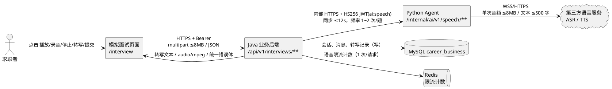

**交互契约**

| 交互 | 方向 | 协议 | 频率 | 超时 | 说明 |
|------|------|------|------|------|------|
| 题目合成 | 前端→Java | `POST /api/v1/interviews/{id}/messages/{mid}/speech` | 用户手势触发，0~3 次/题 | 前端 12s | 响应二进制 `audio/mpeg`，`Cache-Control: no-store` |
| 转写上传 | 前端→Java | `POST /api/v1/interviews/{id}/voice-transcriptions`（multipart） | 1 次/次录音 | 前端 15s | 同音频重传返回同一结果 |
| 转写调用 | Java→Agent | `POST /internal/ai/v1/speech/transcribe`（multipart） | 同上 | Java 12s（Agent 内部 8s） | 同步返回 200 |
| 合成调用 | Java→Agent | `POST /internal/ai/v1/speech/synthesize`（JSON） | 同播放 | Java 10s（Agent 内部 6s） | 返回 base64 + mime |
| 回答提交 | 前端→Java | 复用 `POST /api/v1/interviews/{id}/answers` | 1 次/题 | 现状 | 新增可选 `answerSource/voiceTranscriptionId` |

**不引入的组件**：不引入消息队列、不引入 WebSocket（首版）、不引入对象存储。理由是首版音频只在内存中传递一次，`spec.md` 1.4-3 明确不持久化音频。

### 2.1.2 服务/组件总体架构

```plantuml
@startuml
top to bottom direction
skinparam packageStyle rectangle

package "前端 views/interview" {
  [InterviewView]
  [QuestionAudioPlayer]
  [VoiceAnswerPanel]
  [RecordingControls]
  [TranscriptionEditor]
  [VoicePrivacyDialog]
}

package "前端 composables/voice" {
  [useVoiceRecorder]
  [useQuestionSpeech]
  [useVoiceAnswer]
}

package "前端 api" {
  [voiceInterviews]
  [request (fetch)]
  [interviews (既有)]
}

package "Java interview.voice" {
  [VoiceInterviewController]
  [VoiceTranscriptionService]
  [QuestionSpeechService]
  [VoiceMapper]
  [SpeechAgentClient]
  [VoiceRateLimiter]
}

package "Java 既有" {
  [InterviewService]
  [TaskService]
  [InternalJwtService]
  [CurrentUserResolver]
  [GlobalExceptionHandler]
}

package "Python agent.speech" {
  [SpeechRouter]
  [SpeechService]
  [AsrProvider 接口]
  [TtsProvider 接口]
  [FakeProvider]
  [QwenProvider]
}

database "MySQL" as DB
cloud "DashScope" as Vendor

InterviewView --> QuestionAudioPlayer
InterviewView --> VoiceAnswerPanel
InterviewView --> VoicePrivacyDialog
VoiceAnswerPanel --> RecordingControls
VoiceAnswerPanel --> TranscriptionEditor
VoiceAnswerPanel --> useVoiceRecorder
VoiceAnswerPanel --> useVoiceAnswer
QuestionAudioPlayer --> useQuestionSpeech
useVoiceAnswer --> voiceInterviews
useQuestionSpeech --> voiceInterviews
VoiceAnswerPanel --> "interviews (既有)" : 确认后提交回答
voiceInterviews --> "request (fetch)"
VoiceInterviewController --> VoiceTranscriptionService
VoiceInterviewController --> QuestionSpeechService
VoiceTranscriptionService --> VoiceMapper
VoiceTranscriptionService --> SpeechAgentClient
QuestionSpeechService --> SpeechAgentClient
VoiceTranscriptionService --> VoiceRateLimiter
VoiceInterviewController --> CurrentUserResolver
SpeechAgentClient --> InternalJwtService
SpeechAgentClient --> SpeechRouter : 同步 HTTP
"interviews (既有)" --> InterviewService
InterviewService --> TaskService
VoiceMapper --> DB
SpeechRouter --> SpeechService
SpeechService --> AsrProvider 接口
SpeechService --> TtsProvider 接口
AsrProvider 接口 <|.. FakeProvider
TtsProvider 接口 <|.. FakeProvider
AsrProvider 接口 <|.. QwenProvider
TtsProvider 接口 <|.. QwenProvider
QwenProvider --> Vendor
@enduml
```

**职责与不承担**

| 组件 | 职责 | 不承担 |
|------|------|--------|
| `InterviewView` | 模式切换、能力探测、编排既有会话区与语音区 | 录音、播放、转写细节 |
| `VoiceAnswerPanel` | 本题作答容器：状态展示、按钮组、错误出口 | 直接调 HTTP |
| `RecordingControls` | 开始/停止/计时/上限自动停止 | 上传 |
| `TranscriptionEditor` | 候选文本编辑、确认提交、重录/放弃 | 判定题目是否过期（由服务端判定） |
| `QuestionAudioPlayer` | 播放/暂停/重播/停止、进度与失败提示 | 文本合成本身 |
| `useVoiceRecorder` | 媒体权限、`MediaRecorder`、计时、释放 | 状态机业务语义 |
| `useQuestionSpeech` | 请求音频、播放控制、浏览器 TTS 降级 | 题目文本读取 |
| `useVoiceAnswer` | 状态机、转写调用、刷新恢复、废弃 | 会话推进（既有 `submitAnswer`） |
| `VoiceTranscriptionService` | 校验、幂等、晚到判定、过期、限流 | 推进会话、生成题目 |
| `QuestionSpeechService` | 文本校验、缓存、降级、错误映射 | 前端播放控制 |
| `SpeechService`（Python） | 编解码校验、Provider 调度、指标、脱敏 | 业务归属与幂等（Java 负责） |

**目录与文件清单（实现阶段落地目标）**

| 类型 | 路径 | 说明 |
|------|------|------|
| 新增 | `project/backend/src/main/resources/db/migration/V15__add_voice_interview.sql` | 语音相关表与列 |
| 新增 | `project/backend/src/main/java/com/aijob/backend/interview/voice/VoiceInterviewController.java` | 5 个语音接口 |
| 新增 | `.../interview/voice/VoiceTranscriptionService.java` | 转写编排与校验 |
| 新增 | `.../interview/voice/QuestionSpeechService.java` | 合成与缓存 |
| 新增 | `.../interview/voice/VoiceMapper.java` | 转写/同意读写 |
| 新增 | `.../interview/voice/SpeechAgentClient.java` | Java→Agent 同步调用 |
| 新增 | `.../interview/voice/VoiceRateLimiter.java` | Redis 计数限流 |
| 新增 | `.../interview/voice/VoiceLimits.java` | 上限常量集中 |
| 修改 | `.../interview/InterviewService.java` | `answer` 接受可选来源与转写；`sessionVo` 回显 `mode/answerSource` |
| 修改 | `.../interview/InterviewController.java` | 透传可选字段（不新增提交接口） |
| 修改 | `.../interview/InterviewMapper.java` | 插入消息携带 `answer_source`；查询转写绑定 |
| 修改 | `.../task/InternalJwtService.java` | 新增 `speechToken(requestId)` |
| 修改 | `.../common/GlobalExceptionHandler.java` | 新增 `MaxUploadSizeExceededException`→413 |
| 新增 | `project/agent/app/speech/*.py` | Provider 抽象、Fake/Qwen、服务与路由 |
| 修改 | `project/agent/app/api.py` | 注册 speech router |
| 修改 | `project/agent/app/config.py` | `speech_*` 配置项 |
| 修改 | `project/agent/app/security.py` | 允许 `ai:speech` scope |
| 修改 | `project/agent/requirements.txt`（根 `requirements.txt`） | 新增 DashScope 依赖（可选、真实 provider 启用时） |
| 新增 | `project/frontend/src/api/voiceInterviews.ts` | 语音接口封装 |
| 新增 | `project/frontend/src/composables/voice/*.ts` | 三个 composable |
| 新增 | `project/frontend/src/views/interview/components/*.vue` | 五个组件 |
| 新增 | `project/frontend/src/utils/voice/*.ts` | 格式协商、上限常量 |
| 修改 | `project/frontend/src/views/interview/InterviewView.vue` | 接入模式与语音区，移除"仅文字"提示 |
| 修改 | `project/frontend/src/api/types.ts` | `VoiceTranscriptionVO`、`VoiceCapabilityVO`、`InterviewVO.mode`、`MessageVO.answerSource` |
| 修改 | `project/frontend/src/utils/format.ts` | 语音失败文案映射 |
| 不改 | `project/frontend/src/composables/useTask.ts` | 语音不产生任务，无需改动 |
| 不改 | `project/frontend/src/router/routes.ts` | `/interview` 已注册（`routes.ts:48`） |

### 2.1.3 实现设计文档

#### （1）前端作答状态机（单个题目单元）

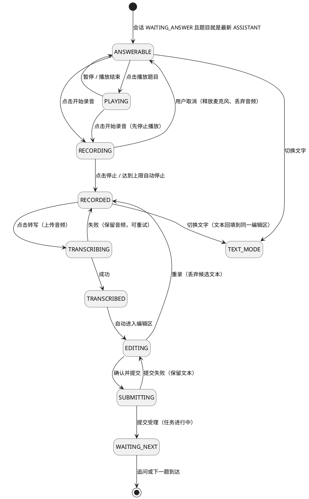

**状态语义与约束**

| 状态 | 页面表现 | 关键约束 |
|------|---------|---------|
| `ANSWERABLE` | 题目文本 + "开始录音/播放题目/改用文字" | 语音入口仅在能力可用 + 已同意时显示（`spec.md` 5.1.3-1/2） |
| `PLAYING` | 播放进度、暂停/重播 | 同一时刻最多一个 `Audio` 实例，重复点击不叠加播放（5.2.3-3） |
| `RECORDING` | 计时、波形/电平、停止按钮 | 进入即 `stopSpeech()`；超过 `maxDurationSeconds` 自动停止（5.3.1-3） |
| `RECORDED` | 时长、试听、重录、转写 | 试听使用 `URL.createObjectURL`，重录前 `revokeObjectURL`（5.3.1-4） |
| `TRANSCRIBING` | 进度提示 + 取消 | 取消只释放本地引用，不产生会话数据 |
| `TRANSCRIBED` / `EDITING` | 编辑框 + "识别结果需确认" | 提交前必须展示候选态（5.4.1-1） |
| `SUBMITTING` | 禁用按钮 | 复用 `submitAnswer`，不新增提交逻辑 |
| `WAITING_NEXT` | 既有任务面板 | 由 `useTask` 驱动，行为不变 |
| `TEXT_MODE` | 仅 textarea | 已转写文本保留在同一编辑区（5.1.2-3、5.8.1-2） |

#### （2）转写主流程（Java 侧）

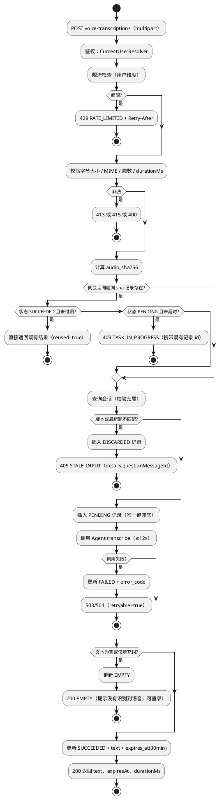

**要点**

1. **幂等键为 `audio_sha256`**，不是 `Idempotency-Key`：同一段音频重传必须返回同一结果（`spec.md` 4.1-4），而浏览器重录会产生新音频、新 sha，天然是不同记录。
2. **唯一键兜底**：并发两个相同 sha 的请求，第二条插入撞唯一键 → 回读既有记录并按状态返回（`SUCCEEDED` 直接返回，`PENDING` 返回 409），避免重复计费。
3. **不产生正式消息**：转写只写 `interview_voice_transcription`，不触碰 `interview_message`、不 `version+1`（`spec.md` 4.2-4）。
4. **旧题晚到**：只有在"版本不一致"或"当前最新题不同"时才落 `DISCARDED`；请求返回 `409 STALE_INPUT`，前端提示"该题已提交，本次识别结果未生效"（5.4.3-4）。

#### （3）确认提交（复用既有回答接口）

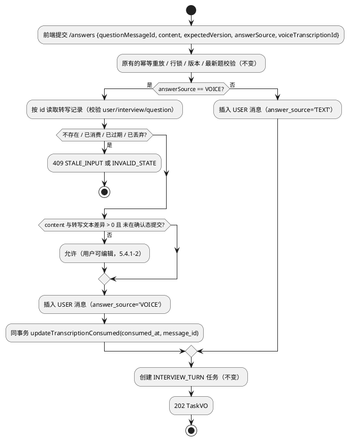

**关键不变量**

1. **转写记录只消费一次**：`consumed_at` 与 `consumed_message_id` 在插入消息的同一事务内写入；重复提交走 `answerByQuestion` 重试分支，不会二次消费。
2. **评分口径不变**：Agent 只看到 `content`，看不到来源（`spec.md` 5.5.1-3）。
3. **报告不读转写**：`reportTask` 的 payload 仍由 `agentMessages()` 构造（`InterviewService.java:246-256`），不含转写字段（6.4-1）。

#### （4）题目播报流程与降级

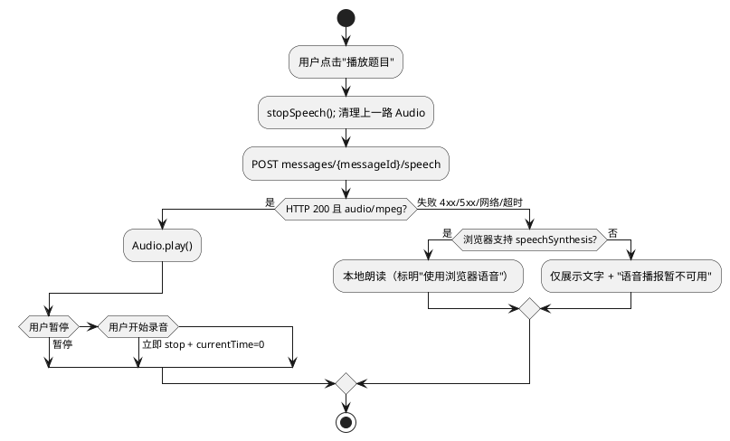

**要点**

1. **手势触发**：播放请求只能由点击产生，不做自动播放（`spec.md` 5.2.1-1）；被拦截时提示点击播放（5.2.3-2）。
2. **录音必停播**：`useVoiceRecorder.start()` 中先 `await stopSpeech()` 再 `getUserMedia`，避免录到播报（5.3.1-2）。
3. **服务端缓存**：`QuestionSpeechService` 用 `(interviewId, messageId, voiceId, sha256(text))` 作为键做进程内 LRU（≤200 项、单条 ≤512KB），命中直接返回，避免重复计费；**不落库、不落盘**（`spec.md` 5.7.1-2）。

#### （5）页面刷新与恢复

| 场景 | 恢复来源 | 行为 |
|------|---------|------|
| 刷新后会话仍在 `WAITING_ANSWER` | `GET /interviews/{id}`（既有） | 渲染题目；若本用户该题存在未过期 `SUCCEEDED` 转写，返回候选文本并标记"识别结果需确认" |
| 刷新后有在途任务 | `pendingTaskId` + `useTask`（既有） | 行为不变（`InterviewView.vue:224-231`） |
| 刷新时转写仍在 PENDING | `GET voice-transcriptions?questionMessageId=` | 返回 `PENDING`，前端显示"仍在识别中"，禁止重复上传（可点"重新转写"覆盖为新 sha） |
| 刷新后题目已变化 | 服务端 | 旧记录返回 `DISCARDED`/过期，前端不展示候选文本，只提示"上次识别未生效" |
| 切换为文字 | 本地 | 候选文本回填到 `answerContent`，不再调用语音接口 |

**约束**：候选文本只在"当前题 + 未消费 + 未过期"时回填，避免把旧题文本误填到新题（`spec.md` 5.4.1-6）。

---
## 2.2 接口设计

### 2.2.1 总体设计

**结论：新增 5 个语音专用接口 + 扩展 1 个既有接口；不新增回答提交接口，不新增 Agent 任务类型。**

| 序号 | 接口 | 方法 | 稳定性 | 状态 | 鉴权 | 归属校验 | 超时（前端/Java） | 大小限制 |
|------|------|------|--------|------|------|---------|------------------|---------|
| V1 | `/api/v1/interviews/{id}/voice-capability` | GET | 稳定 | 新增 | Bearer | 会话归属 | 3s / — | — |
| V2 | `/api/v1/interviews/{id}/voice-transcriptions` | POST(multipart) | 稳定 | 新增 | Bearer | 会话 + 最新题 | 15s / 12s | 8MB、10–180s |
| V3 | `/api/v1/interviews/{id}/voice-transcriptions` | GET | 稳定 | 新增 | Bearer | 会话 + 题目 | 5s / — | — |
| V4 | `/api/v1/interviews/{id}/voice-transcriptions/{tid}/discard` | POST | 稳定 | 新增 | Bearer | 会话 + 转写 | 5s / — | — |
| V5 | `/api/v1/interviews/{id}/messages/{mid}/speech` | POST | 稳定 | 新增 | Bearer | 会话 + 消息 | 12s / 10s | 文本 ≤500 字 |
| V6 | `/api/v1/interviews/{id}/answers` | POST | 稳定 | **扩展** | Bearer + 幂等键 | 会话 + 最新题 | 现状 | 1–10000 字 |
| A1 | `/internal/ai/v1/speech/transcribe` | POST(multipart) | 实验 | 新增 | 内部 JWT(`ai:speech`) | taskId/requestId 绑定 | — / 12s | 8MB |
| A2 | `/internal/ai/v1/speech/synthesize` | POST(JSON) | 实验 | 新增 | 内部 JWT(`ai:speech`) | requestId 绑定 | — / 10s | 500 字 |

**版本与兼容策略**

1. 全部走既有 `/api/v1`，不新增私有版本号。
2. V6 的新字段为**可选**：未携带时行为与当前完全一致（历史客户端/历史记录不受影响，`spec.md` 4.5-3）。
3. 响应新增字段（`mode`、`answerSource`）为可空，前端按可空处理。
4. Agent 同步接口标注"实验"：真实 Provider 变更只改 Agent 侧实现与配置，不改 Java 契约（Provider 抽象的价值）。

### 2.2.2 接口清单

#### （1）语音能力探测 `V1`

- **签名**：`GET /api/v1/interviews/{interviewId}/voice-capability` → `CommonResult<VoiceCapabilityVO>`
- **业务说明**：供前端决定是否展示语音入口、隐私文案版本与上限，避免前端硬编码阈值。
- **读取字段**：`asrEnabled`、`ttsEnabled`、`consentRequired`、`consentVersion`、`maxDurationSeconds`、`maxAudioBytes`、`allowedMimeTypes`、`transcriptionTtlSeconds`。
- **前置条件**：已登录且会话属于本人（`InterviewMapper.session` 已按 `user_id` 过滤，`InterviewMapper.java:30-31`）。
- **后置条件**：只读，无副作用。
- **异常映射**：`401 UNAUTHENTICATED`；`404 RESOURCE_NOT_FOUND`（不存在或非本人，不区分）。
- **示例响应**：
```json
{"asrEnabled":true,"ttsEnabled":true,"consentRequired":true,"consentVersion":"voice-2026-11",
 "maxDurationSeconds":180,"maxAudioBytes":8388608,
 "allowedMimeTypes":["audio/webm","audio/ogg","audio/mp4"],"transcriptionTtlSeconds":1800}
```

#### （2）上传并转写 `V2`

- **签名**：`POST /api/v1/interviews/{interviewId}/voice-transcriptions`（`multipart/form-data`）→ `CommonResult<VoiceTranscriptionVO>`
- **表单字段**：

| 字段 | 类型 | 必填 | 约束 |
|------|------|------|------|
| `audio` | file | 是 | ≤8MB；MIME ∈ 白名单；魔数校验通过 |
| `questionMessageId` | UUID | 是 | 必须是该会话最新 ASSISTANT 消息 |
| `expectedVersion` | int | 是 | 与会话当前 `version` 一致 |
| `durationMs` | int | 是 | 10_000–180_000，与服务端估算差 ≤30% |
| `mimeType` | string | 否 | 声明格式，服务端以魔数为准 |

- **业务说明**：把一段录音转写为候选文本；不创建正式消息、不推进会话。
- **前置条件**：会话 `status=WAITING_ANSWER`；已满足录音次数限流；用户已同意隐私告知。
- **后置条件**：插入/更新 `interview_voice_transcription`（`SUCCEEDED`/`EMPTY`/`FAILED`/`DISCARDED`），`expires_at = now + 30min`。
- **幂等**：`(interview_id, question_message_id, audio_sha256)` 唯一；同 sha 重传返回同一记录（`reused=true`）。
- **异常映射**：

| 场景 | HTTP | code | key | 前端动作 |
|------|------|------|-----|---------|
| 参数缺失/类型错误 | 400 | 40001 | `VALIDATION_ERROR` | 修正后重试 |
| 未登录 | 401 | 40101 | `UNAUTHENTICATED` | 跳登录 |
| 会话非本人 | 404 | 40401 | `RESOURCE_NOT_FOUND` | 不猜测 |
| 版本/最新题已变化 | 409 | 40905 | `STALE_INPUT` | 刷新会话，丢弃本次结果 |
| 相同音频仍在处理 | 409 | 40902 | `TASK_IN_PROGRESS` | 等待 1–2 秒重查 |
| 音频超 8MB / 请求超限 | 413 | 41301 | `PAYLOAD_TOO_LARGE` | 重录（提示缩短） |
| 非音频或伪装音频 | 415 | 41501 | `UNSUPPORTED_FILE_TYPE` | 重录 |
| 时长越界 | 400 | 40001 | `VALIDATION_ERROR` | 重录 |
| 语音服务不可用/超时 | 503 / 504 | 50301 | `DEPENDENCY_UNAVAILABLE` | 重试或改文字 |
| 限流 | 429 | 42901 | `RATE_LIMITED` | 按 `Retry-After` 提示 |
| 服务端转写内部错误 | 500 | 50001 | `INTERNAL_ERROR` | 重试或改文字 |

- **示例响应**（成功）：
```json
{"id":"<tid>","status":"SUCCEEDED","text":"项目里用 Redis 缓存热点商品……",
 "questionMessageId":"<qid>","interviewVersion":3,"durationMs":41200,
 "expiresAt":"2026-11-17T13:10:00Z","reused":false}
```
- **示例响应**（空识别）：
```json
{"id":"<tid>","status":"EMPTY","text":null,"questionMessageId":"<qid>",
 "interviewVersion":3,"durationMs":3000,"expiresAt":"2026-11-17T13:10:00Z","reused":false}
```

#### （3）查询当前题转写 `V3`

- **签名**：`GET /api/v1/interviews/{interviewId}/voice-transcriptions?questionMessageId={qid}` → `CommonResult<VoiceTranscriptionVO | null>`
- **业务说明**：刷新恢复候选文本；只返回 `PENDING/SUCCEEDED/EMPTY`，`DISCARDED/EXPIRED` 返回 `null` 并附 `status` 说明字段。
- **前置条件**：会话属于本人。
- **后置条件**：只读；顺带把已过 `expires_at` 的记录标记 `EXPIRED`（惰性过期，作为定时清理的补充）。
- **异常映射**：`401`、`404`；参数非法 `400`。

#### （4）放弃转写 `V4`

- **签名**：`POST /api/v1/interviews/{interviewId}/voice-transcriptions/{transcriptionId}/discard` → `CommonResult<Boolean>`
- **业务说明**：用户点"放弃/重录"时清理候选数据（`spec.md` 5.4.3-5）；已被消费的记录不删除，只返回 `false`。
- **前置条件**：记录属于本人且属于该会话。
- **后置条件**：`status=DISCARDED`，`text` 置空（保留 `audio_sha256` 用于同音频重传复用判定外的审计）。
- **异常映射**：`401`、`404`；已消费 → `409 INVALID_STATE`。

#### （5）题目合成 `V5`

- **签名**：`POST /api/v1/interviews/{interviewId}/messages/{messageId}/speech` → `200 audio/mpeg`（失败时 `CommonError` JSON）
- **业务说明**：把指定 ASSISTANT 题的文本合成为语音；只允许合成该会话内 `role=ASSISTANT` 的消息（防越权读取他人题目）。
- **前置条件**：已登录；消息属于本人会话；`ttsEnabled=true`。
- **后置条件**：无业务数据写入（缓存只在内存）。
- **请求头**：`Accept: audio/mpeg`；可选 `X-Voice-Id`（默认配置音色）。
- **响应头**：`Content-Type: audio/mpeg`、`Content-Length`、`Cache-Control: no-store`、`X-Speech-Voice`、`X-Speech-Chars`。
- **异常映射**：`404`（消息不存在/非本人）；`400 VALIDATION_ERROR`（文本为空或超 500 字，需分句）；`503 DEPENDENCY_UNAVAILABLE`（合成失败，前端降级浏览器 TTS）；`429 RATE_LIMITED`。
- **示例**：`curl -X POST -H "Authorization: Bearer <token>" -H "Accept: audio/mpeg" -o q1.mp3 ...`

#### （6）提交回答（扩展）`V6`

- **签名**：`POST /api/v1/interviews/{interviewId}/answers` → `202 CommonResult<TaskVO>`（不变）
- **请求体变化**（新增两个可选字段）：

```json
{"questionMessageId":"<qid>","content":"最终确认的文本","expectedVersion":3,
 "answerSource":"VOICE","voiceTranscriptionId":"<tid>"}
```

| 字段 | 必填 | 取值 | 缺省行为 |
|------|------|------|---------|
| `answerSource` | 否 | `TEXT` / `VOICE` | 视为 `TEXT` |
| `voiceTranscriptionId` | `answerSource=VOICE` 时必填 | UUID | 缺失 → 400 |

- **业务说明**：语音回答与文字回答共用同一提交与推进逻辑，评审口径完全一致（`spec.md` 5.5.1-3/4）。
- **前置条件**：转写 `SUCCEEDED`、未过期、未消费、`content` 长度 1–10000。
- **后置条件**：`interview_message.answer_source` 落库；转写 `consumed_at/consumed_message_id` 落库；任务创建（既有）。
- **异常映射**：转写不可用 → `409 STALE_INPUT`（`details.reason=TRANSCRIPTION_EXPIRED|CONSUMED|DISCARDED`）；其余沿用既有（`VERSION_CONFLICT`、`TASK_IN_PROGRESS`、`INVALID_STATE`）。
- **重试一致性**：既有 `answerByQuestion` 重试分支要求"内容一致"（`InterviewService.java:139-142`），因此**前端重试必须提交与首次相同的确认文本**；用户再次编辑属于新的业务意图，需刷新会话或先重录。

#### （7）Agent 转写 `A1`

- **签名**：`POST /internal/ai/v1/speech/transcribe`（`multipart/form-data`）→ `200 CommonResult<TranscribeResult>`
- **表单字段**：`audio`（file）、`requestId`（UUID，Java 生成，用于归属与幂等）、`userId`、`mimeType`、`durationMs`、`language`（默认 `zh`）。
- **响应字段**：`text`（string|null）、`empty`（bool）、`provider`、`model`、`durationMs`（处理耗时）、`audioDurationMs`、`confidence`（可选）。
- **前置条件**：内部 JWT 有效且 `scope` 含 `ai:speech`，`requestId` 在 token 声明内（防止越权重放）。
- **后置条件**：无持久化（不写 `agent_runs.db`）；仅在日志中留结构化指标。
- **异常映射**：`400` 参数；`413` 超限；`415` 非音频；`422` 供应商返回结构异常；`429` 队列/配额；`503` 供应商不可用；`504` 超时。
- **说明**：同步端点**不进入** `RunService` 队列（`runner.py:153-154` 的队列上限与它无关），避免占用 `worker_count=2` 的 LLM 执行槽位（`config.py:46`）。

#### （8）Agent 合成 `A2`

- **签名**：`POST /internal/ai/v1/speech/synthesize` → `200 CommonResult<SynthesizeResult>`
- **请求体**：`{"requestId":"<uuid>","userId":"<uuid>","text":"…","voice":"Cherry","format":"mp3"}`
- **响应体**：`{"audioBase64":"…","mimeType":"audio/mpeg","provider":"qwen","chars":86,"latencyMs":320}`
- **业务规则**：`text` ≤500 字（参考仓库明确"单次合成不超过 500 字符，长文本需分段"，`docs/voice-interview-architecture.md:536-539`）；超长返回 `400`，由 Java 先分句（2.4 D5）。
- **异常映射**：`400/413/429/503/504`；`503` 时前端降级 `speechSynthesis`。
- **为什么不直接返回二进制**：内部统一 `CommonResult`，便于错误体、traceId、单测与日志脱敏；base64 体积 +33%，在 ≤500 字（≈≤120KB 音频）下可接受，且 Java 只在内存透传。

### 2.2.3 限流与配额（位置决策）

| 维度 | 位置 | 键 | 默认阈值 | 说明 |
|------|------|----|---------|------|
| 转写次数 | Java（Redis） | `career:rate:voice:asr:{userId}` | 30 次/10 分钟、200 次/日 | 复用 `StringRedisTemplate`（`RateLimitService.java:22-28` 已有先例），不新增中间件 |
| 合成长度 | Java | `career:rate:voice:tts:chars:{userId}` | 20_000 字/日 | 避免长题反复合成 |
| Agent 并发 | Python | 信号量（进程内） | 4（可配） | 保护供应商配额；满则 429 |
| 全局兜底 | 网关/Nginx | IP | 部署侧配置 | 设计不含网关配置 |

**理由**：浏览器只信任 Java 的鉴权（`SecurityConfig.java:67-69`），Python 未暴露公网；限流放在 Java 才能拿到可信 `userId`。Redis 不可用时**降级为放行并告警**（语音是可选能力，不应因限流服务故障阻断面试），与既有登录限流"Redis 故障即 503"的策略不同，需在代码注释中说明差异。

### 2.2.4 内部令牌设计

- 现状：`runToken(taskId)` 以 `ai:run` scope + 300s TTL + `taskIds` 声明（`InternalJwtService.java:32-34,66-79`）。
- 新增：`speechToken(requestId)`，`scope=ai:speech`，TTL=60s，`taskIds=[requestId]`（沿用 `taskIds` 声明结构，Agent 侧对 `requestId` 校验同一语义）。
- Agent 侧：`security.py` 的 scope 校验需接受 `ai:speech`；而 `principal_dependency` 目前固定传 `settings.run_scope`（`api.py:202-211`），speech 路由需独立依赖项，避免放宽 `ai:run` 权限。

---
## 2.3 数据模型

### 2.3.1 设计目标

1. **只加不破**：历史会话/消息语义完全不变；所有新列可空或带默认值（`spec.md` 4.5-1）。
2. **转写是临时数据**：有明确有效期、可被置空、不作为评分来源（`spec.md` 6.3-4）。
3. **幂等由数据库兜底**：`audio_sha256` 唯一键是最终防线，而不是仅靠应用层查询。
4. **可清理**：过期记录可按索引批量删除，不产生全表扫描。
5. **最小化**：不存音频字节、不存外部 URL、不存 IP/UA；文本仅在用户确认前短期存在。
6. **版本可追溯**：记录写入时的 `interview_version` 与 `question_message_id`，用于晚到丢弃判定与排障。

### 2.3.2 模型实现（`V15__add_voice_interview.sql`）

> 命名风格与既有迁移一致：`CHAR(36) ascii_bin` 主键、`DATETIME(3)`、`utf8mb4_0900_ai_ci`、显式命名约束（参考 `V1:409-490`、`V14:44-61`）。

```sql
-- V15: 语音模拟面试（首版逐题整段录音 + 同步转写 + 服务端 TTS）
-- 原则：不改既有会话/消息语义；转写为临时数据，音频不落库。

-- 1) 会话模式：历史数据一律 TEXT
ALTER TABLE `interview_session`
  ADD COLUMN `mode` VARCHAR(8) NOT NULL DEFAULT 'TEXT' AFTER `status`,
  ADD CONSTRAINT `ck_interview_session_mode` CHECK (`mode` IN ('TEXT','VOICE'));

-- 2) 回答来源：仅 USER 消息有来源，历史数据为 NULL（读取时按 TEXT 处理）
ALTER TABLE `interview_message`
  ADD COLUMN `answer_source` VARCHAR(8) NULL DEFAULT NULL AFTER `role`,
  ADD CONSTRAINT `ck_interview_message_source`
    CHECK (`answer_source` IS NULL OR `answer_source` IN ('TEXT','VOICE')),
  ADD CONSTRAINT `ck_interview_message_source_role`
    CHECK (`role` = 'USER' OR `answer_source` IS NULL);

-- 3) 转写记录（临时）
CREATE TABLE `interview_voice_transcription` (
  `id` CHAR(36) CHARACTER SET ascii COLLATE ascii_bin NOT NULL,
  `created_at` DATETIME(3) NOT NULL DEFAULT CURRENT_TIMESTAMP(3),
  `updated_at` DATETIME(3) NOT NULL DEFAULT CURRENT_TIMESTAMP(3),
  `user_id` CHAR(36) CHARACTER SET ascii COLLATE ascii_bin NOT NULL,
  `interview_id` CHAR(36) CHARACTER SET ascii COLLATE ascii_bin NOT NULL,
  `question_message_id` CHAR(36) CHARACTER SET ascii COLLATE ascii_bin NOT NULL,
  `interview_version` INT UNSIGNED NOT NULL,
  `status` VARCHAR(16) NOT NULL DEFAULT 'PENDING',
  `text` MEDIUMTEXT CHARACTER SET utf8mb4 NULL DEFAULT NULL,
  `mime_type` VARCHAR(64) CHARACTER SET ascii COLLATE ascii_bin NOT NULL,
  `byte_size` INT UNSIGNED NOT NULL,
  `duration_ms` INT UNSIGNED NOT NULL,
  `audio_sha256` CHAR(64) CHARACTER SET ascii COLLATE ascii_bin NOT NULL,
  `provider` VARCHAR(32) CHARACTER SET ascii COLLATE ascii_bin NULL DEFAULT NULL,
  `error_key` VARCHAR(64) CHARACTER SET ascii COLLATE ascii_bin NULL DEFAULT NULL,
  `expires_at` DATETIME(3) NOT NULL,
  `consumed_at` DATETIME(3) NULL DEFAULT NULL,
  `consumed_message_id` CHAR(36) CHARACTER SET ascii COLLATE ascii_bin NULL DEFAULT NULL,
  PRIMARY KEY (`id`),
  UNIQUE KEY `uk_voice_audio_sha` (`interview_id`,`question_message_id`,`audio_sha256`),
  KEY `idx_voice_user_created` (`user_id`,`created_at`,`id`),
  KEY `idx_voice_question` (`interview_id`,`question_message_id`,`created_at`),
  KEY `idx_voice_expiry` (`expires_at`,`status`),
  CONSTRAINT `ck_voice_status`
    CHECK (`status` IN ('PENDING','SUCCEEDED','EMPTY','FAILED','DISCARDED','EXPIRED')),
  CONSTRAINT `ck_voice_bytes` CHECK (`byte_size` BETWEEN 1 AND 8388608),
  CONSTRAINT `ck_voice_duration` CHECK (`duration_ms` BETWEEN 1000 AND 180000),
  CONSTRAINT `ck_voice_text_len` CHECK (`text` IS NULL OR CHAR_LENGTH(`text`) <= 10000),
  CONSTRAINT `ck_voice_consumed`
    CHECK ((`consumed_at` IS NULL AND `consumed_message_id` IS NULL)
        OR (`consumed_at` IS NOT NULL AND `consumed_message_id` IS NOT NULL)),
  CONSTRAINT `fk_voice_user` FOREIGN KEY (`user_id`) REFERENCES `app_user` (`id`)
    ON DELETE RESTRICT ON UPDATE RESTRICT,
  CONSTRAINT `fk_voice_interview` FOREIGN KEY (`interview_id`) REFERENCES `interview_session` (`id`)
    ON DELETE RESTRICT ON UPDATE RESTRICT,
  CONSTRAINT `fk_voice_question` FOREIGN KEY (`question_message_id`) REFERENCES `interview_message` (`id`)
    ON DELETE RESTRICT ON UPDATE RESTRICT,
  CONSTRAINT `fk_voice_consumed_message` FOREIGN KEY (`consumed_message_id`) REFERENCES `interview_message` (`id`)
    ON DELETE RESTRICT ON UPDATE RESTRICT
) ENGINE=InnoDB DEFAULT CHARSET=utf8mb4 COLLATE=utf8mb4_0900_ai_ci;

-- 4) 语音隐私同意（按用户 + 政策版本唯一）
CREATE TABLE `interview_voice_consent` (
  `id` CHAR(36) CHARACTER SET ascii COLLATE ascii_bin NOT NULL,
  `created_at` DATETIME(3) NOT NULL DEFAULT CURRENT_TIMESTAMP(3),
  `updated_at` DATETIME(3) NOT NULL DEFAULT CURRENT_TIMESTAMP(3),
  `user_id` CHAR(36) CHARACTER SET ascii COLLATE ascii_bin NOT NULL,
  `policy_version` VARCHAR(32) CHARACTER SET ascii COLLATE ascii_bin NOT NULL,
  `agreed_at` DATETIME(3) NOT NULL,
  `revoked_at` DATETIME(3) NULL DEFAULT NULL,
  PRIMARY KEY (`id`),
  UNIQUE KEY `uk_voice_consent_user_policy` (`user_id`,`policy_version`),
  KEY `idx_voice_consent_user` (`user_id`,`agreed_at`),
  CONSTRAINT `fk_voice_consent_user` FOREIGN KEY (`user_id`) REFERENCES `app_user` (`id`)
    ON DELETE RESTRICT ON UPDATE RESTRICT
) ENGINE=InnoDB DEFAULT CHARSET=utf8mb4 COLLATE=utf8mb4_0900_ai_ci;
```

**增量列（`V17`，已执行，本轮只登记不改动）**

```sql
-- V17: 语音转写识别尝试序号（详见 9.4.2）
ALTER TABLE `interview_voice_transcription`
  ADD COLUMN `attempt` INT UNSIGNED NOT NULL DEFAULT 1 AFTER `status`,
  ADD CONSTRAINT `ck_voice_attempt` CHECK (`attempt` >= 1);
```

语义：`attempt` 标识"同一条记录的某一次供应商调用"，新插入为默认值 1，显式重试时 `attempt+1`；所有结果回写都必须携带它（9.4.3）。历史行无需回填。

**兼容与回填**

| 项 | 处理 |
|----|------|
| 历史会话 `mode` | 默认 `TEXT`，无需回填（`NOT NULL DEFAULT`） |
| 历史转写 `attempt` | 默认 1，无需回填；语义为"第一次尝试"（`V17`） |
| 历史消息 `answer_source` | 保持 `NULL`；读取时 `answer_source ?? 'TEXT'`（前端与后端同规则） |
| 历史 ASSISTANT 消息 | 无来源，符合 `ck_interview_message_source_role` |
| 历史数据是否需重建 | 不需要；新增列与表均为增量 |
| 迁移可重复执行风险 | Flyway 一次性执行；回滚策略为人工 `DROP` 新表并删除新列（P0 无自动回滚，与既有迁移一致） |
| MySQL 版本要求 | `CHECK` 约束生效需 MySQL 8.0.16+；V14 已使用 `DROP CHECK`/`ADD CONSTRAINT`（`V14:19-23`），说明目标库版本满足 |

**惰性过期与清理**

1. 读取时若 `expires_at < now` 且 `status IN ('PENDING','SUCCEEDED','EMPTY')` → 置 `EXPIRED` 并清空 `text`（保证"过期后不可恢复"，`spec.md` 5.4.1-5）。
2. 定时兜底：新增 `VoiceTranscriptionSweeper`（`@Scheduled(fixedDelay=10min)`），删除 `expires_at < now - 24h` 且 `consumed_at IS NULL` 的记录；已消费记录保留 7 天供排障后删除（仅保留 `status/audio_sha256/时间`，`text` 置空）。
3. 清理失败不阻断业务：记录告警日志（`error=SWEEP_FAILED`），下一轮重试。

### 2.3.3 领域模型与类图

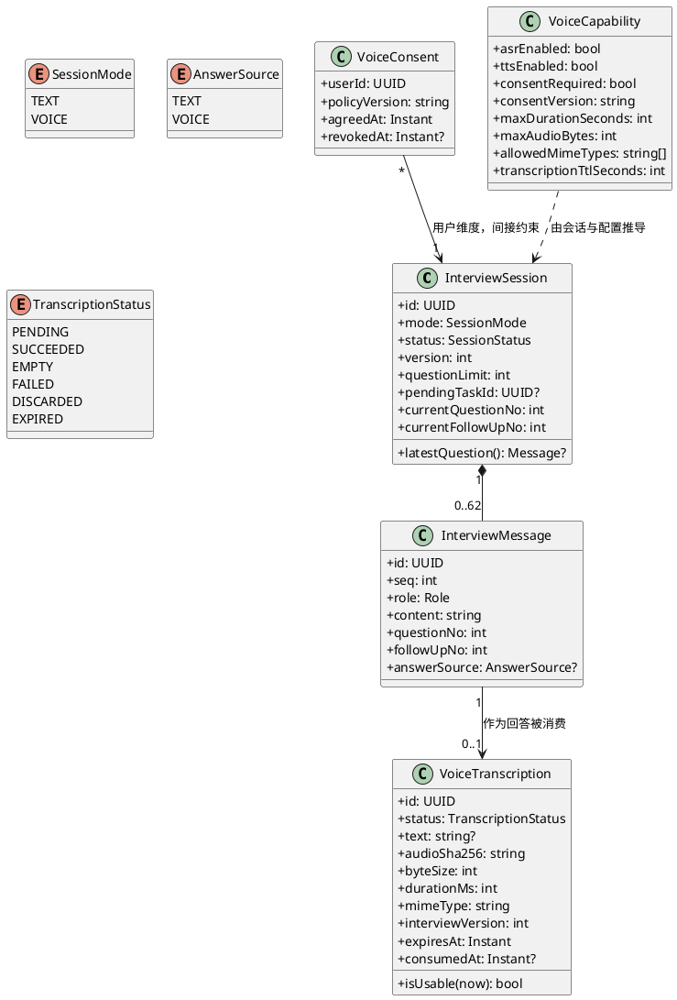

**模型约束**

1. `VoiceTranscription.isUsable = status==SUCCEEDED && consumedAt==null && now<expiresAt`；只有 `isUsable` 才能绑定 `VOICE` 回答。
2. `InterviewMessage.answerSource` 对 ASSISTANT 恒为 `null`；对 USER 为 `TEXT` 或 `VOICE`（历史为 `null`，按 `TEXT` 渲染）。
3. `InterviewSession.mode` 只表达"默认入口"，**不限制**逐题切换（`spec.md` 5.1.1-2）。
4. `VoiceCapability` 是运行时推导值（配置 + Provider 健康 + 政策开关），不持久化。

**生命周期**

| 对象 | 创建 | 变更 | 销毁 |
|------|------|------|------|
| `VoiceTranscription` | 上传时 `PENDING` | → `SUCCEEDED/EMPTY/FAILED` → 消费 → 过期 | 过期置 `EXPIRED` 清文本；定时删除 |
| `VoiceConsent` | 首次同意 | `revoked_at`（撤回） | 不删除（合规留痕），撤回后新会话需重新同意 |
| `InterviewMessage` | 提交回答 | 不修改内容 | 随会话保留（既有语义） |

**持久化策略**

| 数据 | 是否持久化 | 位置 | 保留期 |
|------|-----------|------|--------|
| 录音字节 | 否 | 仅请求内存 | 请求结束即释放 |
| 转写文本 | 是（临时） | `interview_voice_transcription.text` | 30 分钟（可配），过期清空 |
| 确认后回答文本 | 是 | `interview_message.content` | 永久（既有） |
| 同意记录 | 是 | `interview_voice_consent` | 永久 |
| 合成音频 | 否 | 进程内 LRU | ≤5 分钟或 200 条 |
| ASR/TTS 密钥 | 否 | Agent 环境变量 | — |

## 2.4 关键设计决策与取舍

| 编号 | 决策点 | 结论 | 理由（含源码/文档依据） | 代价/风险 |
|------|-------|------|------------------------|----------|
| D1 | 转写是否走 `ai_task` | **不走**，新增同步接口 | ① 每人最多 2 个活动任务（`TaskService.java:68-78`），追问生成与转写并发会撞 409；② 转写不产生正式消息、不需要 SSE 与重试任务（`spec.md` 4.2-4）；③ 8s P95 要求同步返回，异步只会叠加轮询延迟（`useTask.ts:252` 4s 轮询） | 需要新增同步调用链与超时/熔断；同步请求占用 HTTP 线程，需限制并发（限流 + 8MB 上限） |
| D2 | 提交接口 | **扩展既有 `/answers`**，不新增 | 会话锁、版本、最新题、幂等重试分支全部已实现（`InterviewService.java:111-151`）；新建平行接口必然复制这些规则，产生两套语义 | `answer` 方法体增大；需保证未传新字段时行为零变化 |
| D3 | 转写幂等键 | **`audio_sha256`**（会话+题+sha 唯一） | 同音频重传返回同一结果（`spec.md` 4.1-4）；`Idempotency-Key` 语义是"同一次请求重放"，不适合"同音频不同请求" | 极端情况下不同音频碰撞需第二阶段评估（sha256 碰撞可忽略）；重录产生新记录需清理旧记录 |
| D4 | 录音开始时是否立即停播 | **必须同步停播并复位进度** | 否则播报被录入，ASR 会把题目识别成回答（`spec.md` 5.3.1-2）；参考仓库亦在录音链路分离播放与采集（`docs/voice-interview-architecture.md:341-346`） | 用户可能希望"边听边录"，产品上需明确提示 |
| D5 | 长题播报 | **先按句切分，再逐段同步合成，首段就播放** | 参考仓库明确单次合成 ≤500 字符、长文本需分段（`architecture.md:536-539`）；题目上限 3000 字（`handlers.py:1169`），一次合成会超限且首包变慢 | 引入分句规则与拼接播放；第二阶段再做流式 TTS |
| D6 | 格式协商 | **前端按能力从高到低协商，服务端以魔数为准** | 浏览器编码差异大（Chrome/Edge `webm/opus`，Safari `mp4/aac`）；`spec.md` 5.3.1-6 要求以实际格式校验；既有上传先例也按魔数判类型（`FileStorageService.java:59-72`） | 需维护白名单；不支持的格式要给出"改用文字"出口 |
| D7 | 音频传输链路 | **前端→Java→Agent 内存透传，不落盘、不用 URL** | `spec.md` 1.4-3/5.7.1-2 要求不保存音频；`FileStorageService` 是落盘实现（`FileStorageService.java:80-87`），复用它反而违反最小化 | 单请求内存占用 ≤8MB；并发高时需限制（限流 + 信号量） |
| D8 | 限流位置 | **Java（Redis）+ Python 进程信号量** | 浏览器只信任 Java 鉴权（`SecurityConfig.java:67-69`）；Redis 已用于限流（`RateLimitService.java:22-28`） | Redis 故障策略需与登录限流不同（语音降级放行） |
| D9 | 语音能力部署位置 | **Python Agent 内新增 `speech` 模块，Java 不持密钥** | `spec.md` 4.3-3 密钥不得出现在 Java 配置与日志；Agent 已有外部 HTTP 能力与脱敏日志（`logging_config.py:121-151`） | 增加一跳网络延迟（同机 ≈1–3ms）；需要 Health/熔断 |
| D10 | Provider 默认值 | **默认 `fake`，真实 provider 需显式配置** | Agent 现状：`llm_provider=auto` 时无 key 自动回落 fake（`config.py:184-187`）；测试可离线（`tests/test_handlers.py` 已如此） | 生产若忘记配置，用户会看到"语音不可用"而不是静默假结果（需 capability 接口如实返回） |
| D11 | 旧题晚到 | **服务端判定 + 落 DISCARDED + 409** | 只有在服务端才知道"当前最新题/版本"（`InterviewMapper.java:96-97`）；前端无法可靠判定 | 用户会看到一次失败提示；需文案明确"未生效，可重新作答" |
| D12 | 是否记录同意 | **记录到专用表**（不复用 `audit_log`） | `audit_log` 无代码读写、且无唯一键约束，不适合"按政策版本唯一"；合规需要可查询"谁何时同意/撤回"（`spec.md` 4.3-4） | 新增表；撤回后的历史数据保留策略需法务确认【待验证】 |
| D13 | 前端口令与状态存放 | **不落 `localStorage`/`sessionStorage` 存转写文本** | 转写全文属敏感内容（`spec.md` 4.3-5）；刷新恢复通过服务端 `V3` 接口 | 刷新恢复依赖网络；离线刷新无候选文本 |
| D14 | 是否保留"仅文字"提示 | **移除硬编码提示**，改为能力驱动 | 现有提示与语音范围冲突（`InterviewView.vue:505`）；未启用语音时应由 capability 决定隐藏入口而非写死文案 | 需同步更新页面文案与 U13 验收口径 |

---
## 2.5 前端组件划分与交互约束（状态机见 2.1.3-1）

### 2.5.1 分层与数据流

```
InterviewView（页面编排）
├── 既有：任务面板 / 会话消息 / 报告 / 历史
├── QuestionAudioPlayer（当前题播报）
├── VoiceAnswerPanel（本题语音作答容器）
│   ├── RecordingControls（开始/停止/计时/试听/重录）
│   ├── TranscriptionEditor（候选文本编辑 + 确认提交）
│   └── 失败出口（重试 / 重录 / 改用文字）
└── VoicePrivacyDialog（一次性告知 + 同意）
```

**共享状态（`VoiceAnswerPanel` 内单一来源）**

| 状态 | 类型 | 说明 |
|------|------|------|
| `phase` | 联合字面量（2.1.3-1） | 状态机当前态 |
| `questionMessageId` | `string` | 来自 `currentQuestion.id`（`InterviewView.vue:78-84`） |
| `interviewVersion` | `number` | 来自 `currentInterview.version` |
| `audioBlob` / `audioUrl` / `durationMs` | `Blob \| null` 等 | 本地音频与试听 URL |
| `transcriptionId` / `candidateText` | `string \| null` | 服务端候选 |
| `lastError` | `VoiceError \| null` | 含 `key`、`retryable`、`traceId` |
| `speechPlaying` | `boolean` | 由 `useQuestionSpeech` 暴露 |

**关键约束**

1. `candidateText` 与既有 `answerContent` **双向绑定同一编辑区**：切文字时把候选文本写回 `answerContent`，切语音时不清空（`spec.md` 5.1.2-3、5.8.1-2）。
2. 只有 `phase==='EDITING'` 且 `canAnswer`（既有条件，`InterviewView.vue:85-93`）为真时才能提交，避免与任务进行中冲突。
3. 提交调用既有 `submitAnswer(content)`，仅增加来源字段；**不复制**版本冲突/409 刷新逻辑（`InterviewView.vue:344-354`）。

### 2.5.2 媒体资源的生命周期（必须逐项落实）

| 时机 | 必须执行 | 依据 |
|------|---------|------|
| 点击开始录音 | 先 `await stopSpeech()`，再 `getUserMedia` | `spec.md` 5.3.1-2（防录入播报） |
| 点击停止 | `MediaRecorder.stop()` → `onstop` 生成 Blob → 释放 `MediaStreamTrack` | 释放麦克风占用（5.3.3-5） |
| 重录 | `URL.revokeObjectURL(audioUrl)`；清空 `candidateText` 与 `transcriptionId`；如有服务端记录调用 `V4 discard` | 5.3.1-4、5.4.3-5 |
| 切换文字 | 停止录音、停止播放、保留文本 | 5.3.1-5、5.8.1-2 |
| 路由离开 / 组件卸载 | `onBeforeUnmount`：停录音、停播放、`revokeObjectURL` | 5.3.3-5 |
| `visibilitychange` 隐藏 | 停止录音（保留已录部分并进入 `RECORDED`），停止播放 | 5.3.1-5 |
| 达到时长上限 | 自动停止 + 提示"已达上限" | 5.3.1-3、5.3.3-4 |
| 权限被拒/无设备 | 区分文案；提供"改用文字"，不反复弹权限 | 5.3.3-1/2 |

### 2.5.3 能力探测与入口展示

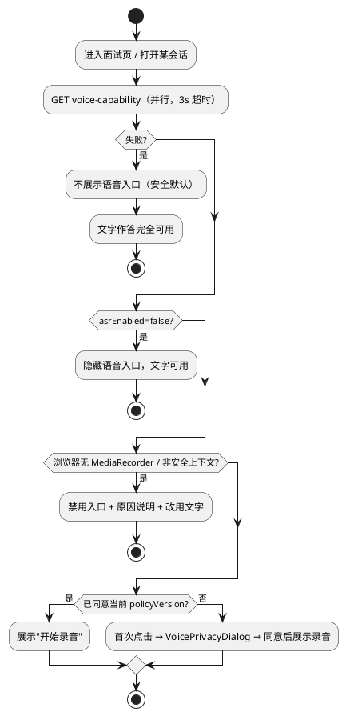

**非安全上下文判定**：`window.isSecureContext === false` 时 `getUserMedia` 不可用；本机 `http://localhost` 视为安全上下文。生产 HTTPS 提供方尚未确认（`spec.md` 7.6），标注【待验证】。

### 2.5.4 可访问性与文案

| 项 | 要求 |
|----|------|
| 按钮语义 | 录音/播放使用 `<button>` 或 Element Plus `el-button`，提供 `aria-label`（如"开始录音，最多 3 分钟"） |
| 计时播报 | 计时不作为高频 `aria-live`，仅状态变化（开始/停止）播报 |
| 错误文案 | "没有识别到语音"、"语音服务暂时不可用，可重试或改用文字"、"该题已提交，本次识别结果未生效" |
| 禁止文案 | 不出现"评分更高的语音回答"等口径差异表述（`spec.md` 5.5.1-3） |

## 2.6 Python `speech` 模块设计

### 2.6.1 模块结构

```
project/agent/app/speech/
├── __init__.py          # 导出 SpeechService、providers
├── schemas.py           # TranscribeRequest/Result、SynthesizeRequest/Result（Pydantic）
├── base.py              # AsrProvider / TtsProvider 协议 + AudioInput/SpeechAudio 数据类 + SpeechError
├── fake.py              # FakeAsrProvider / FakeTtsProvider（默认）
├── qwen.py              # QwenAsrProvider / QwenTtsProvider（DashScope 实时接口）
├── service.py           # SpeechService：校验、调度、指标、脱敏
└── router.py            # APIRouter：/internal/ai/v1/speech/transcribe|synthesize
```

**与既有模块的边界**

| 复用 | 不复用 |
|------|--------|
| `Settings`（新增 `speech_*` 字段）、`configure_logging`、`ApiError`、`Principal` 校验 | 不复用 `RunService` 队列与 `handler` 体系（它们是 LLM 长任务，带 deadline/SSE/回调） |
| `logging_config.summarize_payload` 的脱敏思路 | 不写 `agent_runs.db`（同步转写无运行记录） |

### 2.6.2 Provider 抽象

```python
class AsrProvider(Protocol):
    name: str
    async def transcribe(self, audio: AudioInput, *, language: str = "zh") -> AsrResult: ...

class TtsProvider(Protocol):
    name: str
    async def synthesize(self, text: str, *, voice: str, fmt: str) -> AudioOutput: ...
```

| 契约字段 | 说明 |
|---------|------|
| `AudioInput.data` | `bytes`，≤8MB |
| `AudioInput.mime_type` / `format` | 由魔数判定后的真实格式（`webm/ogg/mp4`） |
| `AudioInput.duration_ms` | Java 传入的时长（服务端用容器头二次估算，差异 >30% 拒绝） |
| `AsrResult.text` | 去空白后的文本；空识别返回空字符串（由 Service 映射 `EMPTY`） |
| `AsrResult.provider/model` | 用于 Java 落 `provider` 字段与排障 |
| `AudioOutput.data` | mp3 字节；`mime_type`、`chars`、`latency_ms` |

**Fake provider 行为（用于测试与离线开发）**

1. `FakeAsrProvider`：按 `sha256(audio)[:8]` 派生确定文本（如 `"（模拟转写）这是一段语音回答，编号 3f2a"`）；若音频字节 < 2KB 且全静音特征（如全 `0xFF` 填充或时长短于 1s）返回空字符串，用于覆盖"静音/空识别"用例。
2. `FakeTtsProvider`：返回固定时长的可播放 mp3（内置 1 秒静音音的 base64 常量），`chars = len(text)`，`latency_ms` 固定 30，便于断言。
3. Fake 模式**不得**在 `app_env=prod` 下启用：`Settings.validate_runtime_security()` 已有 prod 校验（`config.py:195-203`），追加一条"prod 不允许 `speech_provider=fake`"。

### 2.6.3 配置项（`config.py` 新增）

| 配置 | 默认 | 说明 |
|------|------|------|
| `speech_provider` | `auto` | 兼容旧配置的总开关；具体项未设置时生效 |
| `speech_asr_provider` | `auto` | `auto/fake/qwen`；优先于总开关；auto = 有 key 用 qwen，否则 fake |
| `speech_tts_provider` | `auto` | 同上；本次仅实现 Fake TTS，真实 TTS 未接入 |
| `speech_api_key` | `None`（别名 `AI_BAILIAN_API_KEY`/`SPEECH_API_KEY`） | 不得出现在日志（`repr=False`）；环境变量优先于 `.env` |
| `speech_base_url` | `https://dashscope.aliyuncs.com` | 生产必须使用业务空间专属域名 `https://{WorkspaceId}.cn-beijing.maas.aliyuncs.com` |
| `speech_asr_model` | `qwen-audio-3.1-asr-flash` | 已验证的非实时短音频模型（≤5 分钟） |
| `speech_tts_model` | `cosyvoice-v1` | 本次不调用真实 TTS |
| `speech_tts_voice` | `longxiaochun` | 产品最终音色待定（`spec.md` 7.1） |
| `speech_timeout_seconds` | `8.0` | 覆盖 8s P95 目标；java 侧 12s 兜底 |
| `speech_trust_env` | `False` | 不读取系统代理，避免专属域名被代理拦截 |
| `speech_max_bytes` | `8 * 1024 * 1024` | 与 Java 上限一致 |
| `speech_max_tts_chars` | `500` | 单次合成上限 |
| `speech_concurrency` | `4` | 进程内信号量 |
| `speech_vad_silence_ms` | `400` | 预留：第二阶段服务端 VAD 用，首版不启用 |

**采样率与格式（2026-11-20 实测更新）**：`qwen-audio-3.1-asr-flash` 支持 URL 或 Base64 Data URI，格式包含 `webm/ogg/mp4/wav/mp3` 等，采样率任意、服务端处理。已验证路径为：本地 M4A → Base64 Data URI → 同步 HTTP，**不需要解码、重采样或 OSS**。浏览器 WebM/Opus 仅官方格式表支持，尚未用真实浏览器录音验收；长录音（>5 分钟）不在本模型范围。

### 2.6.4 脱敏日志（强制）

| 字段 | 记录策略 |
|------|---------|
| 音频字节 | 绝不记录 |
| 转写全文 | 绝不记录（仅 `textChars` 长度、是否为空） |
| `audio_sha256` | 仅前 8 位，如 `sha=3f2a91cc` |
| `requestId` / `traceId` | 记录（`log_context` 已有 trace/task/run/op/user，`logging_config.py:36-51`） |
| 供应商错误体 | 仅 `error_key` + HTTP 状态；不记录原始响应（可能回显文本） |
| API Key | 不记录；如需确认配置，使用 `mask_secret`（`logging_config.py:121-126`） |

**指标（结构化日志字段，供后续接监控）**

| 指标 | 字段 | 用途（`spec.md` 4.4-3） |
|------|------|------------------------|
| 转写耗时 | `latencyMd`、`audioDurationMs` | P95 ≤ 8s 验证 |
| 失败率 | `outcome=failed`、`errorKey` | 可用性 |
| 空识别占比 | `outcome=empty` | 静音/权限问题定位 |
| 合成耗时 | `latencyMs`、`chars` | 首字节 ≤2s 验证 |
| 重录率 / 编辑率 | 由 Java 记录（`asr_attempts`、`consumed_text_diff_len`），需在 `V15` 之外的派生表或指标上报中实现，**首版用日志统计** | 体验优化依据 |

## 2.7 异步任务与同步转写的边界

| 维度 | 异步任务（既有 `ai_task`） | 同步语音调用（新增） |
|------|---------------------------|---------------------|
| 适用 | 出题、追问、评分、报告 | 转写、合成 |
| 返回 | `202 + TaskVO`，SSE/轮询取结果 | `200 + 结果体` |
| 幂等 | `Idempotency-Key` + `api_idempotency`（`IdempotencyService.java:38-65`） | `audio_sha256` 唯一键 |
| 并发额度 | 每人 2 个（`TaskService.java:76-78`） | 不占额度；Redis 限流 + 信号量 |
| 失败可见性 | `task.error` + `useTask` 面板 | 直接 `CommonError` + 前端出口按钮 |
| 事件 | `ai_task_event` + SSE | 无事件 |
| 审计 | `audit_log` 可复用（未启用） | 仅结构化日志 |

**边界规则**

1. 转写**不得**创建 `ai_task`、**不得**写 `ai_task_event`、**不得**触发 outbox（`TaskService.java:96-97`）。
2. 合成**不得**触发模型调用，仅供应商 TTS；不占用 `worker_count` 槽位（`config.py:46`）。
3. 题目生成（`INTERVIEW_TURN`）仍在异步通道；语音作答只影响"提交的文本"，不改变任务时序。

## 2.8 幂等与并发

| 场景 | 防线 | 行为 |
|------|------|------|
| 同一段音频重复上传（双击/重试） | 唯一键 `(interview_id, question_message_id, audio_sha256)` | 返回同一条 `SUCCEEDED` 结果（`reused=true`） |
| 两路并发上传同一音频 | 唯一键插入失败 → 回读 | 后到者返回既有记录或 409（`PENDING`） |
| 用户重录后上传新音频 | 新 sha → 新记录 | 旧记录保留至过期；`V4 discard` 可提前清理 |
| 双击"确认并提交" | 既有 `Idempotency-Key` + 行锁 + `answerByQuestion` | 第二次返回 `TASK_IN_PROGRESS` 或幂等重放（`InterviewService.java:132-151`） |
| 提交时版本已变 | `expectedVersion` 比对 | `409 VERSION_CONFLICT` + `details.currentVersion`，前端刷新不自动重发 |
| 提交时题目已变（用户切题后旧文本） | `latestQuestion` 校验 | `409 INVALID_STATE`（既有语义） |
| 转写期间用户已提交本题 | `question_message_id` 不再是"待答" + `interview_version` 变化 | 结果落 `DISCARDED`，返回 `409 STALE_INPUT` |
| 转写在会话结束后返回 | 会话状态非 `WAITING_ANSWER` | `DISCARDED` |
| 同题多个 `PENDING`（不同 sha） | 会话锁内互斥：**同一 sha** 且新鲜（60 秒）时后到者 409；**超过新鲜窗口**视为僵死，允许接管 | 后到者 `409 TASK_IN_PROGRESS`；接管前把同题陈旧 `PENDING` 落 `DISCARDED`，保证同题至多一条活跃尝试（详见 9.4.7、D-06） |
| Agent 同步接口重复调用 | Java 传 `requestId`；Agent 不做持久幂等 | 重复调用最多多计费一次；由 Java 的 `audio_sha256` 拦截保证不重复调用 |
| 页面刷新后重复点击转写 | `V3` 返回 `PENDING` | 前端禁用按钮并提示"仍在识别中" |

**并发实现要点（避免锁放大）**

1. 转写上传先做"会话行 `SELECT ... FOR UPDATE`"（复用 `InterviewMapper.lockSession`，`:33-34`）再插记录，保证"同题只一个 PENDING"；锁持有时间必须 ≤ 记录插入（**不得**包住外部调用）。
2. Agent 调用在事务外执行，结果回写用短事务；进程崩溃时 `PENDING` 记录由惰性过期（`expires_at`）兜底，不会永久卡死。
3. 提交回答的事务只做本地消息与转写状态更新，不包外部调用（既有实现已是任务模式，`InterviewService.java:167-174`）。

## 2.9 隐私与数据最小化

| 要求（`spec.md`） | 设计落地 |
|------------------|---------|
| 4.3-4 录音前告知第三方处理 + 不长期保存 | `VoicePrivacyDialog` 首次展示；政策文案版本 `policyVersion`；同意写 `interview_voice_consent` |
| 4.3-5 日志不记音频/全文/密钥/幂等键原文 | Java 只记 `sha` 前 8 位、`textChars`、`durationMs`；Python 见 2.6.4；`Idempotency-Key` 不打印（既有 `TaskService` 仅记录任务号） |
| 5.7.1-2 不保存原始音频 | 全链路内存透传，未引入文件存储；`FileStorageService` 不被语音复用 |
| 5.7.1-3 未确认文本有效期与清理 | `expires_at=30min`，惰性过期 + 定时清理；过期清空 `text` |
| 5.7.3-2 清理失败兜底 | 定时任务失败告警 + 次日重试；`expire` 索引保证可批量处理 |
| 撤回同意 | `revoked_at` 置位；后续录音请求返回 `409 INVALID_STATE`（`key=CONSENT_REVOKED`，复用 `INVALID_STATE` 语义）；已提交文本不受影响 |
| 不改变评分口径 | 报告/证据只读 `interview_message`（`InterviewResultHandler.java:186-215`） |

**数据留存最小化表**

| 数据 | 位置 | 留存 | 删除方式 |
|------|------|------|---------|
| 录音 | 请求内存 | 秒级 | 请求结束释放 |
| 转写文本 | MySQL | 30 分钟 | 过期置 `EXPIRED` + 清 `text` |
| 合成音频 | 进程内存 | ≤5 分钟 | LRU 淘汰 |
| 同意记录 | MySQL | 长期 | 不删除（合规留痕） |
| 指标 | 日志 | 按日志留存策略 | 运维侧 |

---
# 三、失败与恢复矩阵

> 对应交付要求第 3 项；"关键设计决策与取舍"见 2.4。每条均需在 `spec.md` 5.x 异常场景与 8 章验收基线中找到对应项。

## 3.1 采集阶段

| 编号 | 场景 | 触发条件 | 系统行为 | 用户可见 | 恢复路径 | 数据一致性 | 验证方式 |
|------|------|---------|---------|---------|---------|-----------|---------|
| F01 | 浏览器不支持录音 | 无 `MediaRecorder` / `isSecureContext=false` | 不请求权限，隐藏语音入口 | "当前浏览器无法录音，可改用文字作答" | 文字作答 | 无会话变更 | 手工（Chrome/Edge/Safari + 非 HTTPS）【待验证】 |
| F02 | 用户拒绝麦克风权限 | `getUserMedia` reject `NotAllowedError` | 不重试弹窗；记录一次本地状态 | "麦克风未授权" + 重试指引 + 改用文字 | 浏览器设置授权后重试 | 无 | 手工（需真实设备）【待验证】 |
| F03 | 无麦克风 / 被占用 | `NotFoundError` / `NotReadableError` | 区分文案，允许重试 | "未检测到麦克风"/"麦克风被其他程序占用" | 关闭占用程序后重试 | 无 | 手工【待验证】 |
| F04 | 录音过短 | `durationMs < 1000` | 不发起上传，直接提示 | "录音太短，请重录" | 重录 | 无转写记录 | 手工 |
| F05 | 达到时长上限 | 计时到 `maxDurationSeconds` | 自动停止、保留已录部分 | "已达上限并自动停止" | 转写或重录 | 无 | 手工（缩短上限配置验证） |
| F06 | 录制中切页/隐藏标签 | `visibilitychange` / 路由离开 | 停止录音、释放麦克风、停止播放 | 返回后显示已录时长 | 继续转写或重录 | 已录部分保留在内存，刷新则丢失 | 手工 |
| F07 | 录音时题目播报仍在播放 | 用户直接点录音 | 先 `await stopSpeech()` 再开录 | 无提示（静默处理） | — | 避免录到播报 | 单测 + 手工（检查转写不含题目原文） |

## 3.2 上传与转写阶段

| 编号 | 场景 | 触发条件 | 系统行为 | 用户可见 | 恢复路径 | 数据一致性 | 验证方式 |
|------|------|---------|---------|---------|-----------|-----------|---------|
| F08 | 格式不支持 | 魔数不在白名单 | `415 UNSUPPORTED_FILE_TYPE`，不调用 Agent | "录音格式不支持，请重录或改用文字" | 重录/文字 | 无记录（或 `FAILED` 仅用于审计，建议不落库） | Java 单测 + 真实浏览器样本【待验证】 |
| F09 | 文件超限 | >8MB（或全局 10MB 触发 multipart 异常） | `413 PAYLOAD_TOO_LARGE` | "录音过大，请缩短后重录" | 重录 | 无记录 | 单测 + 手工上传超限文件【待验证】（当前全局异常未处理，会 500） |
| F10 | 时长与服务端估算不符 | 差异 >30% | `400 VALIDATION_ERROR` | "录音时长异常，请重录" | 重录 | 无记录 | 单测（构造容器头） |
| F11 | 空识别 / 全静音 | Agent 返回空文本 | 记录 `EMPTY`，`text=null` | "没有识别到语音，请靠近麦克风重录" | 重录 | 不产生会话数据 | Fake provider 单测 + 真实 ASR【待验证】 |
| F12 | 转写超时 | Agent >12s 或供应商 >8s | `504`（`DEPENDENCY_UNAVAILABLE`，`retryable=true`） | "识别超时，可重试或改用文字" | 重试（同 sha 复用/重传） | 记录 `FAILED`；不消费 | 注入延迟（stub provider）【待验证】 |
| F13 | 语音服务不可用 | 供应商 5xx / 网络错误 | `503 DEPENDENCY_UNAVAILABLE` | 可读提示 + 三个出口 | 重试/重录/文字 | `FAILED` | 停止 Agent 进程手工验证【待验证】 |
| F14 | 限流 | Redis 计数超阈 | `429 RATE_LIMITED` + `Retry-After` | "请求过于频繁，请 X 秒后重试" | 等待后重试 | 无记录 | 单测（固定时钟） |
| F15 | 相同音频重复上传 | 同 sha 已 `SUCCEEDED` | 直接返回既有结果 | 无感（不重复计费） | — | 不新增记录 | 单测（并发 + 串行） |
| F16 | 相同音频仍在处理 | 同 sha 为 `PENDING` | `409 TASK_IN_PROGRESS`（`details.recordId`） | "正在识别中，请稍候" | 1–2s 后调用 `V3` 查询 | 不新增记录 | 单测 |
| F17 | 旧题晚到 | 上传时版本/最新题已变，或**供应商返回时会话/版本/当前题已变** | 落 `DISCARDED` + `409 STALE_INPUT`；失败/空识别同上（详见 9.2.4、9.4.5） | "该题已提交，本次识别结果未生效" | 刷新会话，重新作答 | 不写消息、不 `version+1`、不改题数；旧尝试不改任何记录 | 真实库矩阵 LA-03/LA-04/LA-10（顺序 Mock 不算证据） |
| F18 | 转写期间刷新页面 | 页面重载 | `V3` 返回 `PENDING` / `SUCCEEDED` | "仍在识别中"或回填候选文本 | 等待或继续确认 | 记录一致 | 手工 + 接口测试 |
| F19 | 未同意隐私 | 无同意记录 / 已撤回 | `409 INVALID_STATE`（`details.reason=CONSENT_REQUIRED`/`REVOKED`） | 重新展示告知或仅文字 | 同意后重试 | 无记录 | 单测 |
| F20 | 会话已结束/已变状态 | 非 `WAITING_ANSWER` | `409 INVALID_STATE` | "本次面试状态已变化" | 刷新 | 无记录 | 单测 |
| F21 | 清理失败 | 定时任务异常 | 告警日志，下一轮重试 | 无感 | — | 记录最多延后清理 | 单测（模拟异常） |

## 3.3 确认提交与推进阶段

| 编号 | 场景 | 触发条件 | 系统行为 | 用户可见 | 恢复路径 | 数据一致性 | 验证方式 |
|------|------|---------|---------|---------|-----------|-----------|---------|
| F22 | 双击提交 | 两个相同请求 | 幂等键/行锁：其一受理 | 无重复消息 | — | 一条 USER 消息、一个任务 | 单测（并发） |
| F23 | 版本冲突 | 页面版本落后 | `409 VERSION_CONFLICT` + 当前版本 | "状态已变化，已刷新，请确认后再次提交" | 前端刷新会话，不自动重发 | 无消息写入 | 单测 + 手工 |
| F24 | 题目已变化 | `questionMessageId` 非最新 | `409 INVALID_STATE` | 同上文案 | 刷新后重答 | 无写入 | 单测 |
| F25 | 转写已过期/已消费 | `expires_at<now` 或 `consumed_at!=null` | `409 STALE_INPUT`（`details.reason`） | "识别结果已失效，请重新录音或改用文字" | 重录/文字 | 不写消息 | 单测 |
| F26 | 内容与首次不同（重试） | 同题已有消息且内容不一致 | `409 INVALID_STATE`（既有语义，`InterviewService.java:139-142`） | "当前问题已回答或重试内容不一致" | 按既有规则：使用原内容重试或刷新 | 不产生新消息 | 单测 |
| F27 | 追问任务失败 | `INTERVIEW_TURN` 失败 | 状态回 `WAITING_ANSWER`（`InterviewResultHandler.java:62-73`） | 任务面板展示失败 + 重试 | 既有"重试失败任务" | 回答已保存，会话可继续 | 单测/手工 |
| F28 | 报告任务失败 | `INTERVIEW_REPORT` 失败 | 状态回 `WAITING_ANSWER`（`:66-68`） | 失败提示 + 重试 | 既有重试 | 会话不丢 | 单测/手工 |
| F29 | 等待结果时断网 | 网络中断 | SSE 退避重连 + 4s 轮询（`useTask.ts:95-105,252`） | "轮询恢复中" | 恢复后自动拉取 | 一致 | 手工（断网）【待验证】 |

## 3.4 播报阶段

| 编号 | 场景 | 触发条件 | 系统行为 | 用户可见 | 恢复路径 | 数据一致性 | 验证方式 |
|------|------|---------|---------|---------|-----------|-----------|---------|
| F30 | 合成失败/超时 | Agent 503/504 | 前端降级 `speechSynthesis` | "语音播报暂不可用（已尝试本地朗读）" | 重试/本地朗读/仅文字 | 无写入 | 手工（模拟 503） |
| F31 | 浏览器无本地 TTS | `speechSynthesis` undefined | 仅展示文字 | "语音播报不可用，请阅读题目" | 阅读文字 | 无 | 手工 |
| F32 | 自动播放被拦截 | `Audio.play()` reject `NotAllowedError` | 不重试；提示点击 | "请点击播放按钮开始" | 用户点击 | 无 | 手工（自动播放策略） |
| F33 | 重复点击播放 | 快速多次点击 | 单实例 `Audio` + 取消进行中的请求 | 无多路声音 | — | 无 | 单测（防抖） |
| F34 | 播报中开始录音 | 用户点录音 | 立即停止并复位 | 播放条归零 | — | 不录入播报 | 手工 + 检查转写文本 |
| F35 | 文本超 500 字 | 长题 | Java 分句后逐段合成 | 首段先播 | 连续播放 | 无 | 单测（分句规则） |

## 3.5 全局与合规

| 编号 | 场景 | 系统行为 | 用户可见 | 验证方式 |
|------|------|---------|---------|---------|
| F36 | 登录过期 | 401 → 前端既有刷新/跳登录（`request.ts:155-158`） | 跳登录并返回原页 | 手工 |
| F37 | 越权访问他人会话/消息 | `404`（不区分不存在与非本人，`BusinessException.java:65-68`） | 资源不存在 | 双账号接口测试【待验证】 |
| F38 | 日志泄露检查 | 断言日志无音频字节/全文/密钥 | 无 | 日志抽查 + 单测（`caplog`） |
| F39 | 撤回同意 | 后续录音 409，历史文本保留 | 仅文字可用 | 单测 |
| F40 | 供应商长期不可用 | capability `asrEnabled=false`（健康探测失败阈值） | 语音入口隐藏，仅文字 | 手工/定时探测【待验证】 |

**"不得发生"清单（用于验收反例）**

1. 转写导致 `interview_session.version` 变化。
2. 转写产生 `interview_message` 或 `interview_turn_evaluation`。
3. 同一音频产生两条 `SUCCEEDED` 记录或两次计费。
4. 旧题晚到写入任何会话数据。
5. 语音回答与文字回答在报告/证据上出现口径差异。
6. 录音未释放（页签关闭后仍占用麦克风指示灯）。
7. 日志出现转写全文、音频 base64、`Idempotency-Key` 原文、语音密钥。

---
# 四、非功能设计与验证策略

> 对应交付要求第 5 项；"关键设计决策"已见 2.4。

## 4.1 性能

| 指标（`spec.md` 4.1） | 目标 | 设计手段 | 验证方式 |
|----------------------|------|---------|---------|
| 停止录音→文本可编辑 P95 | ≤8s | ① 单次同步调用（无队列等待）；② 转写跳过 `ai_task` 队列；③ Agent 内部 8s 超时、Java 12s 兜底；④ 上传前前端压缩/限制码率（可选 `audioBitsPerSecond: 32000`） | Agent 单测注入延迟 + 本地压测（Fake provider 固定延迟模拟）；真实供应商需实测【待验证】 |
| 题目播报首字节 | ≤2s | ① `QuestionSpeechService` 进程内缓存；② 长题分句，首句 ≤120 字；③ 合成接口独立于 LLM 队列 | 手工计时 + 日志 `latencyMs`【待验证】 |
| 不占用评分任务并发 | 不触发 `activeTaskCount` | 转写/合成不写 `ai_task`（2.7） | 单测断言"转写后 `count(ai_task)=0`" |
| 重复上传不重复计费 | 0 次重复调用 | `audio_sha256` 唯一 + 命中直接返回 | 并发单测（2 线程） |
| 内存峰值 | 单请求 ≤8MB + 1 份副本 | 上限校验先于读入（`MultipartFile.getSize()`），Agent 侧同样先校验 | 单测 + 压测（10 并发 × 8MB）【待验证】 |

**首屏与页面交互**：语音能力探测与既有 `loadOptions/loadHistory/loadInterview` 并行（`InterviewView.vue:482-489`），不阻塞首屏；失败不影响文字链路。

## 4.2 可靠性

| 要求 | 设计 |
|------|------|
| 任一语音环节失败不破坏会话 | 语音失败只返回 `CommonError`；不调用 `updateTaskStatus/updateTurn`（`InterviewMapper.java:53-65` 不被使用） |
| 刷新/断网后可恢复 | 会话与消息走既有 `GET /interviews/{id}`；候选文本走 `V3`；任务走 `useTask`（SSE+轮询） |
| 未确认结果有有效期 | `expires_at` 30 分钟；惰性过期 + 定时清理；过期 `text` 置空 |
| 转写不改版本、不产生消息 | 事务边界：仅 `interview_voice_transcription` 写操作（2.1.3-2） |
| Agent 不可用快速降级 | capability 探测 + `503` 出口；前端默认推荐"改用文字"（`spec.md` 5.8.3-2） |
| 幂等 | 见 2.8 表 |

## 4.3 安全

| 风险 | 控制 |
|------|------|
| 越权访问会话/消息 | 全部查询带 `user_id` 过滤（`InterviewMapper.java:30-34,126-127` 既有模式）；不存在与非本人统一 404 |
| 伪造音频 | 魔数 + MIME 白名单 + 时长一致性；拒绝纯文本伪装为 `audio/*` |
| 重放/重复计费 | `audio_sha256` 唯一键；`PENDING` 期间拒绝同 sha 并发 |
| 密钥泄露 | 密钥只在 Agent 环境变量；Java 配置无语音密钥；日志脱敏（2.6.4） |
| 前端令牌泄露面 | 不在 URL 传 token（既有 SSE 亦如此，文档 1004 行）；语音接口全部 `Authorization` 头 |
| CSRF | 沿用 Bearer + 同源；不新增 cookie 凭据；`OriginValidationFilter` 覆盖面不变（`OriginValidationFilter.java:17-21`） |
| 上传拒绝服务 | 8MB 上限 + 限流 + multipart 全局 10MB；超限映射 413（需补处理器） |
| 日志合规 | 结构化字段白名单；`summarize_payload` 思路复用（`logging_config.py:129-151`） |

## 4.4 兼容性

| 兼容对象 | 策略 |
|---------|------|
| 旧文字会话/消息/报告 | 新列可空/默认值；读取时 `answer_source ?? 'TEXT'`、`mode ?? 'TEXT'` |
| 旧客户端（不带新字段） | `/answers` 新字段可选；`/interviews` 响应多字段被忽略 |
| 既有 SSE/任务中心 | 语音不新增事件类型（`ck_ai_task_event_1` 枚举不变，`V1:556`） |
| 浏览器 | 支持 `MediaRecorder` 的 Chrome/Edge/Safari 14+；不支持则隐藏入口 |
| 移动端 | 录音按钮与计时在 ≤700px 下全宽（参考 `InterviewView.vue:815-822` 断点风格） |

## 4.5 可维护性

1. Provider 抽象 + Fake 默认：`speech_provider=fake` 可离线跑全链路（含前端），CI 不依赖外部服务。
2. 上限常量集中：Java `VoiceLimits`、前端 `utils/voice/limits.ts`、Python `config.py`，三处数值必须一致，用单测断言同一组数值（避免"前端说 3 分钟、后端拒 2 分钟"）。
3. 错误码复用既有体系（`ApiErrorCode.java:5-26`），新增语义通过 `error.key` 的子原因 `details.reason` 表达，不滥加 HTTP 状态。
4. 可观测：指标字段固定（2.6.4），后续接监控无需改代码。

## 4.6 测试分层

| 层 | 范围 | 关键用例 | 工具 |
|----|------|---------|------|
| Python 单测 | `speech/` 模块 | Provider 调度、魔数校验、空识别、超长拒绝、脱敏日志、并发信号量 | `pytest`（既有 `tests/` 风格，`project/agent/tests/`） |
| Python 接口测 | `api.py` 注册 | JWT scope 校验（`ai:speech` 通过、`ai:run` 拒绝）、413/415、200 结构 | `httpx` + FastAPI TestClient（参考 `tests/test_runner_api.py`） |
| Java 单测 | `voice/` 包 | 幂等、晚到、过期、限流、提交绑定转写、日志无全文 | JUnit + Mockito（既有定向测试模式，见验收文档 155 行） |
| Java 集成（MySQL 隔离库） | `V15` 迁移 + 并发 | 唯一键冲突路径、行锁、迁移前后历史数据可读 | 隔离库 `aijob_voice_*`【待验证】 |
| 前端单测 | 状态机与工具 | 格式协商、状态迁移（含失败回退）、上限/计时、停止播报 | 需新增 Vitest（当前 `package.json` 无测试框架，`package.json:6-12`）【设计建议】 |
| 端到端（手工/Playwright） | 真实浏览器 + Fake Provider | 播放→录音→停止→转写→编辑→提交→追问；权限拒绝；静音；刷新恢复；文字切换回归 | Playwright（参考仓库有 `frontend/e2e/voice-interview.spec.ts`，AI-JOB 侧需新建） |
| 真实供应商 | DashScope | P95 耗时、空识别率、格式兼容（webm/ogg/mp4） | 需账号与网络【待验证】 |

**静态验证**

1. `npm.cmd run type-check` 零错误、无 `any`（`package.json:10`）。
2. `mvn -o -q -DskipTests package` 通过；新增迁移在隔离库成功执行。
3. `python -m pytest project/agent/tests -q` 通过（新增 speech 用例）。

## 4.7 观测与告警（首版最小集）

| 指标 | 阈值（建议） | 动作 |
|------|-------------|------|
| 转写失败率（5 分钟窗口） | >10% | 告警，capability 置 `asrEnabled=false` |
| 转写 P95 | >8s 连续 3 个窗口 | 排查供应商/网络，考虑 B2 第二阶段 |
| 空识别占比 | >15% | 排查前端录音（权限/设备/格式） |
| TTS 失败率 | >10% | 默认走浏览器 TTS，告警 |
| 429 占比 | >5% | 调整限流阈值或配额 |
| 内存/线程 | 同步接口并发 > N | 熔断（Java 侧信号量，默认 16） |

## 4.8 风险与依赖

| 风险 | 影响 | 应对 |
|------|------|------|
| 供应商未选型（`spec.md` 7.1） | 无法做真实 P95 验收 | Fake 先跑通全链路；Provider 可替换 |
| 浏览器录音格式差异 | 部分环境上传被拒 | 格式协商 + 服务端魔数 + 真机矩阵测试【待验证】 |
| 全局 multipart 异常映射缺失 | 超限返回 500 | 本设计新增处理器（`GlobalExceptionHandler` 扩展点，`GlobalExceptionHandler.java:41-168`） |
| 同步接口占用 HTTP 线程 | 高并发下线程耗尽 | 限流 + 信号量 + 8MB 上限；必要时改为异步（第二阶段再评估） |
| 前端无测试框架 | 状态机回归只能手工 | 里程碑 1 引入 Vitest（仅新增 devDependency） |
| 原型图未能读取 | UI 细节可能与原型有偏差 | 实现前需对照原型人工确认布局【待验证】 |
| 隐私文案未定稿 | 合规风险 | 政策版本化；文案由运营/合规确认（`spec.md` 3.1-4） |

---

# 五、第二阶段能力评估

> 对应交付要求第 6 项。参考仓库做法来自 `docs/voice-interview-architecture.md`（已核对全文）与仓库文件清单；**WebSocket Handler / ASR / TTS / AudioRecorder 的实现代码未能逐行核对**（网络受限，见文首）。因此本节结论用于"是否投入"的决策输入，不作为等价实现承诺。

## 5.1 能力逐项评估

| 能力 | 解决的问题 | 参考仓库做法（可核对部分） | AI-JOB 落点 | 投入阈值（建议） | 首版是否投入 |
|------|-----------|--------------------------|------------|-----------------|-------------|
| WebSocket 音频流 | 整段录音上传体积大、必须等录完才有结果 | 浏览器 `AudioRecorder` 采 PCM → WebSocket；服务端 `VoiceInterviewWebSocketHandler` 按 `AUDIO/SUBTITLE/CONTROL` 处理（`architecture.md:162-168,341-346`）；SSE 仅用于文字面试（`项目架构.md:64`） | Java 新增 WS 端点（`/ws/interviews/{id}/voice`），Java 作为代理转发到 Agent（浏览器不直连 Agent）；Agent 新增流式 ASR 会话 | 转写 P95 > 8s；或单题录音平均时长 > 45s；或上传体积 P95 > 4MB | 否（先看指标） |
| 服务端 VAD | 静音/停顿导致空识别、断句差 | `enable-turn-detection: true`、`turn-detection-type: server_vad`、静音阈值 400ms（`architecture.md:459-461`）；ASR 断句延迟 400ms（`:12,194`） | 作为 ASR Provider 参数（`speech_vad_silence_ms` 已预留），流式模式下由供应商完成；Java 只透传 | 空识别占比 > 10%；或用户"重录原因=没反应"占比 > 15% | 否（与 WebSocket 捆绑） |
| 实时字幕 | 用户不知道系统是否在听、等待焦虑 | `RealtimeSubtitle` 组件 + `SUBTITLE` 消息（`architecture.md:134-139,165-168`）；中间结果与最终结果（`:188-191`） | 前端新增字幕区；通道可复用既有 SSE（任务）或新增 WS；AI-JOB 的"确认后提交"语义要求字幕**不可**直接作为回答 | 转写等待期间放弃率 > 5%；或转写 P95 > 5s | 否 |
| 分句 TTS | 长题首包慢、单次合成上限 | 单次合成 ≤500 字符，长文本分段（`architecture.md:536-539`）；TTS 首包 200ms（`:13,217`） | **首版即做轻量版**：Java 按标点分句（≤120 字/段）串行合成 + 顺序播放；第二阶段再做流式/并发合成 | 题目平均字数 > 120；或首字节 P95 > 2s | **部分（分句串行）** |
| 打断播报（barge-in） | 用户想立刻说话，播报还在继续 | `CONTROL` 控制消息（`architecture.md:168`）；播放与录音链路分离（`:341-346`） | 首版已有"录音即停播"；第二阶段做"说话即打断"（VAD 触发停止播放） | 用户点击"停止播报"占播放会话 > 15% | 否 |
| 回声控制 | 播报被麦克风再次录入 | 参考仓库未见明确 AEC 说明（架构文档未提及回声消除；文件清单无 AEC 相关文件） | 首版：强制停播 + 建议佩戴耳机 + 提示"请在安静环境"；第二阶段：`getUserMedia({echoCancellation:true, noiseSuppression:true})` + 服务端 VAD 去重 | 人工抽检转写中出现播报原文 > 3% | 否（首版仅提示与约束） |
| 断线恢复 | 网络抖动导致会话丢失 | 会话可暂停/恢复接口 `PUT .../pause|resume`（`architecture.md:155-156`）；活跃会话 Redis 缓存（`:182`） | 首版已具备：刷新按 `interviewId` 重拉（`InterviewView.vue:470-489`）；第二阶段：WS 断线重连 + 会话游标（复用 `Last-Event-ID` 思路） | 断线导致会话丢失 > 0.5%/日 | 否 |

## 5.2 参考仓库与 AI-JOB 的架构差异（决定不能照搬）

| 维度 | 参考仓库 | AI-JOB | 影响 |
|------|---------|--------|------|
| 语音链路位置 | Spring Boot 内直接持有 ASR/TTS（`QwenAsrService`/`QwenTtsService`，`architecture.md:183-218`） | Java 管业务、Python 管 AI（`项目架构.md:46`；`WebClientAgentClient.java:31-45`） | 语音能力放 Agent，Java 只做编排与鉴权 |
| 会话模型 | 独立的 `voice_interview_sessions` 与阶段（INTRO/TECH/…，`architecture.md:236-249`） | 复用文字面试会话状态机与追问规则（`InterviewService.java`） | 不引入第二套会话模型，避免评分/报告双轨 |
| 提交语义 | 语音直接进入对话（AI 回复即下一轮） | 必须"用户确认文本"后才推进（`spec.md` 5.4.1-1） | 字幕与 ASR 结果不能直接当回答；需要确认态 |
| 实时性 | WebSocket 全双工 | 首版 HTTP + SSE（任务） | 第二阶段才引入 WS，避免首版同时改三条链路 |
| LLM 供应商 | DashScope 直连（`architecture.md:196-204`） | Python Agent 的 `LLMClient`（`llm.py`，DeepSeek） | 语音供应商与 LLM 供应商解耦配置 |

## 5.3 投入决策规则

1. **进入第二阶段的门槛**：首版上线 ≥2 周真实数据，且满足以下任一：转写 P95 > 8s、空识别率 > 10%、语音题放弃率 > 10%。
2. **优先级**：分句 TTS（低成本已部分做）→ 服务端 VAD + WebSocket（捆绑，成本最高）→ 实时字幕 → 打断 → 回声 → 断线恢复。
3. **不建议做的**：在首版同时引入 WebSocket + VAD + 实时字幕 + 打断。理由是这四项共享"流式音频会话"基础设施，需一次性重构前端录音链路、Java 转发、Agent 流式 ASR 与断线状态，风险远高于收益（首版验收基线只要求"逐题整段录音"）。

---
# 六、实现步骤与分工、验收清单与第一个里程碑

> 对应交付要求第 7 项。任务编号可直接映射到 `tasks.md`。

## 6.1 里程碑

| 里程碑 | 目标 | 完成判定（可演示） |
|--------|------|------------------|
| **M0 契约与骨架**（0.5–1 天） | 文档冻结、接口骨架、`V15` 迁移脚本评审、Fake Provider 目录建立 | 设计评审通过；接口签名与错误码表确认；`V15` 在隔离库空跑成功【待验证】 |
| **M1 第一个可交付（本设计的验收起点）** | Fake Provider 下的**完整逐题语音闭环**：播放题目→录音→停止→转写→编辑→确认提交→追问/下一题 | 本地（Chrome 或 Edge）首题演示通过；刷新后候选文本可恢复；切文字可完成面试；既有文字面试回归通过 |
| M2 生产可用 | 真实 ASR/TTS provider、限流、隐私同意、过期清理、指标、失败矩阵补齐 | F01–F40 中可自动化项全绿；真实供应商 P95 与首字节实测记录【待验证】 |
| M3 加固与观测 | 压测、告警阈值、双账号越权测试、日志抽查、U13 全场景验收 | U13 各子项有证据；无"不得发生"清单项 |

**M1 为什么这样切**：它把风险最高的"浏览器录音 + 媒体释放 + 确认语义 + 旧题晚到"先跑通，而把"供应商不确定性"隔离在 Provider 开关后面（`speech_provider=fake|qwen`）。这样即使真实供应商未到位，前后端与业务规则也能完成验收（与 `job_workbench` 以 Mock 先验收的思路一致）。

## 6.2 任务拆分

### 数据库

| 编号 | 任务 | 依赖 | 产出 | 验收 |
|------|------|------|------|------|
| DB-1 | `V15__add_voice_interview.sql` | 无 | 四张变更/新表、索引、约束 | 隔离库迁移成功；历史会话/消息可读 |
| DB-2 | 回滚与清理脚本（运维手册） | DB-1 | `DROP TABLE` + `DROP COLUMN` 顺序说明 | 演练记录【待验证】 |

### Java

| 编号 | 任务 | 依赖 | 产出 | 验收 |
|------|------|------|------|------|
| J-1 | `SpeechAgentClient` + `InternalJwtService.speechToken` | 无 | 同步调用与令牌 | 单测：token scope/TTL、超时映射 503/504 |
| J-2 | `VoiceMapper` + 转写状态机 | DB-1 | 读写与惰性过期 | 单测：状态迁移、`isUsable` |
| J-3 | `VoiceTranscriptionService`（校验/幂等/晚到/限流） | J-2 | 上传主流程 | 单测：同 sha 复用、PENDING 409、晚到 DISCARDED |
| J-4 | `VoiceInterviewController` 5 个接口 | J-3 | 路由与错误映射 | 接口测试（含 413/415/404） |
| J-5 | `QuestionSpeechService`（分句 + 缓存 + 降级） | J-1 | 合成接口 | 单测：分句边界、缓存命中、超长 400 |
| J-6 | 扩展 `/answers`（来源 + 转写绑定 + 消息落库） | J-2 | 提交链路 | 单测：未传字段行为不变；VOICE 绑定与一次性消费 |
| J-7 | `GlobalExceptionHandler` 补 413 | 无 | 上传超限映射 | 单测：`MaxUploadSizeExceededException`→413 |
| J-8 | 会话 Vo 回显 `mode/answerSource` | J-6 | 详情/列表字段 | 单测：历史数据为 TEXT |

### Python

| 编号 | 任务 | 依赖 | 产出 | 验收 |
|------|------|------|------|------|
| P-1 | `speech/base.py` + `schemas.py` | 无 | Provider 协议与模型 | 类型检查/单测 |
| P-2 | `FakeAsrProvider` / `FakeTtsProvider` | P-1 | 离线能力 | 单测：确定文本、静音→空、TTS 可播放字节 |
| P-3 | `SpeechService`（魔数/大小/时长/文本长度/信号量） | P-1,P-2 | 校验与调度 | 单测：415/413/400/429 |
| P-4 | `speech/router.py` + `api.py` 注册 | P-3 | 两个同步端点 | 接口测：200 结构、错误体、traceId |
| P-5 | `security.py` 支持 `ai:speech` scope | 无 | 独立依赖 | 单测：`ai:run` 拒绝、`ai:speech` 通过 |
| P-6 | `QwenAsrProvider` / `QwenTtsProvider` | P-1 | 真实 provider | 需账号实测【待验证】 |
| P-7 | 配置项与 prod 校验 | P-3 | `speech_*` | 单测：prod 拒绝 fake |

### 前端

| 编号 | 任务 | 依赖 | 产出 | 验收 |
|------|------|------|------|------|
| F-1 | `api/voiceInterviews.ts` + 类型 | J-4,J-5 | 五个方法 | type-check 零错误 |
| F-2 | `useVoiceRecorder` | 无 | 权限/计时/上限/释放 | 手工：权限拒绝、切页释放、自动停止 |
| F-3 | `useQuestionSpeech` | F-1 | 播放/暂停/重播/停止/降级 | 手工：503 降级、重复点击不叠加 |
| F-4 | `useVoiceAnswer`（状态机 + 恢复 + 废弃） | F-1,F-2 | 编排 | 单测（新增 Vitest）状态迁移 |
| F-5 | 组件五件套 | F-2,F-3,F-4 | UI | 手工：桌面/≤700px |
| F-6 | `InterviewView` 接入（移除"仅文字"提示、能力探测） | F-5 | 页面集成 | 手工：默认文字、语音入口按能力显示 |
| F-7 | 隐私对话框 + 同意接口对接 | J-4 | 首次告知 | 手工：拒绝→仅文字；同意→可录音 |
| F-8 | 失败文案与出口 | F-6 | 可执行提示 | 手工：F02/F09/F12/F17 |
| F-9 | 格式协商与魔数预检（可选前端预检） | 无 | `utils/voice/formats.ts` | 单测：Safari/Chrome 候选顺序 |

### 测试与产品

| 编号 | 任务 | 依赖 | 产出 | 验收 |
|------|------|------|------|------|
| T-1 | Java 单测 + 隔离库集成 | J-1…J-8 | 用例集 | 全绿 |
| T-2 | Agent 单测 + 接口测 | P-1…P-5 | 用例集 | 全绿 |
| T-3 | 前端 Vitest（新增） | F-4,F-9 | 用例集 | 全绿 |
| T-4 | E2E（Playwright） | M1 全部 | 主链路脚本 | 本地通过 |
| T-5 | 真实供应商实测报告 | P-6 | P95/首字节/格式矩阵 | 有数据【待验证】 |
| PR-1 | 隐私文案与政策版本 | 无 | 文案定稿 | 合规确认 |
| PR-2 | 上限与配额决策（`spec.md` 7.3/7.4） | 无 | 参数表 | 产品确认 |

## 6.3 分工建议（并行度）

| 角色 | M1 范围 | 说明 |
|------|--------|------|
| Java 后端 | J-1～J-5、J-7（J-6 可与 F-4 并行） | 可先以 Agent Fake 契约联调 |
| Python Agent | P-1～P-5 | M1 不接真实供应商，保证离线可测 |
| 前端 | F-1～F-6、F-8 | F-2 可与后端并行（本地录音不依赖接口） |
| 测试 | T-1～T-4 | 在 M0 就准备用例清单（3 章矩阵） |
| 产品/合规 | PR-1、PR-2 | 决定上限、TTL、文案版本、是否纳入本期 U13 |

**接口先行**：M0 先冻结 2.2 的签名与错误码表，Java/Python/前端可三线并行；契约变更必须同步更新本文档与 `tasks.md`。

## 6.4 验收清单（对应 `spec.md` 第 8 章）

| 验收项 | 判定方法 | 通过标准 |
|--------|---------|---------|
| A1 首题闭环 | Chrome/Edge 本地，Fake Provider | 播放题目→录音→停止→转写→修改→提交→获得追问/下一题 |
| A2 权限拒绝 | 浏览器拒绝麦克风 | 有可执行引导 + 可切文字；不重复弹窗 |
| A3 静音/空识别 | 录 3 秒静音 | 提示"没有识别到语音"，可重录，无会话数据 |
| A4 超时/超限 | 3 分钟上限、8MB 上限 | 自动停止/413 提示，可重录 |
| A5 断网 | 转写中断网 | 提示可重试，音频仍在页面，恢复后可重传 |
| A6 语音服务失败 | Agent 停止或返回 503 | 提示 + 重试/重录/文字三出口；会话状态不变 |
| A7 重复提交 | 双击确认、刷新后再次提交 | 只产生一条回答；无重复任务 |
| A8 旧题晚到 | 提交本题后返回旧转写 | 提示"未生效"，不写入会话 |
| A9 刷新恢复 | 转写成功后刷新 | 候选文本回填且标注"需确认" |
| A10 文字切换 | 语音中途切文字 | 文本保留，可完成面试并生成报告 |
| A11 文字面试回归 | 全链路文字面试 | 页面无语音入口（未启用时）、行为不变、历史记录展示不变 |
| A12 报告一致性 | 语音/文字各一次同类回答 | 评分维度与证据规则一致；报告不读取转写 |
| A13 日志合规 | 抽查 Java/Agent 日志 | 无音频字节、转写全文、密钥、幂等键原文 |
| A14 越权 | 双账号访问他人会话/消息/转写 | 均 404，无数据泄露 |
| A15 隐私告知 | 首次录音 | 告知第三方处理与不长期保存；拒绝后仅文字 |

**M1 必过项**：A1、A2、A3、A7、A9、A10、A11、A13（其余在 M2/M3 完成）。

## 6.5 遗留决策（需在 M0 收口）

| 编号 | 决策 | 影响 |
|------|------|------|
| O1 | 语音供应商/账号/地域/音色（`spec.md` 7.1） | P-6 与真实 P95 |
| O2 | 录音时长上限、大小上限、配额（7.3） | `VoiceLimits`/`config.py`/前端常量 |
| O3 | 转写 TTL（建议 30 分钟，7.4） | `expires_at` |
| O4 | 是否允许逐题混用（建议允许，7.5） | 状态机与文案 |
| O5 | 生产 HTTPS 形态（7.6） | 麦克风可用性 |
| O6 | 第三方音频留存政策是否可接受（7.7） | 隐私文案与合规结论 |
| O7 | U13 是否纳入本期验收 | 验收范围与排期 |

## 6.6 设计自检

| 检查项 | 结论 |
|--------|------|
| 是否改动会话状态机/追问上限/评分/报告规则 | 首版结论为"否"；**2026-11-21 增量修正**：会话状态机、每主问题追问上限（2 次）、评分与报告规则仍不改，但"题数上限"的语义由"主问题数"修订为"含追问的总提问数"，并新增会话级计数规则版本（见第八章，覆盖本条） |
| 是否持久化音频 | 否 |
| 是否新增第二套提交接口 | 否（扩展 `/answers`） |
| 是否引入非必要中间件 | 否（复用 MySQL/Redis/Agent） |
| 是否所有关键判断有出处 | 是（源码路径+行号 / 参考仓库文档行号 / 标注待验证） |
| 哪些必须真机验证 | 浏览器录音格式与权限、真实 ASR/TTS P95、multipart 超限状态码、移动端布局、HTTPS |

---

**附：本轮核对过的关键文件**

| 类别 | 文件 |
|------|------|
| 需求 | `.codeartsdoer/specs/voice_interview/spec.md`、`docs/AI-JOB问题整改验收标准_2026-11-14.md`（U13）、`docs/功能资料/09-模拟面试/模拟面试后端接口示例.md`、`Agent接口示例.md` |
| 前端 | `src/views/interview/InterviewView.vue`、`src/api/{interviews,request,task-registry,tasks,types,session}.ts`、`src/composables/useTask.ts`、`src/router/routes.ts`、`vite.config.ts`、`package.json` |
| Java | `interview/{InterviewController,InterviewService,InterviewMapper,InterviewResultHandler}.java`、`task/{TaskService,IdempotencyService,TaskController,TaskMapper,InternalTaskController,InternalJwtService,WebClientAgentClient}.java`、`common/{ApiErrorCode,BusinessException,GlobalExceptionHandler,Data,CurrentUserResolver}.java`、`config/SecurityConfig.java`、`auth/security/{OriginGuard,OriginValidationFilter}.java`、`auth/service/RateLimitService.java`、`resume/FileStorageService.java`、`application.yml`、`pom.xml` |
| Python | `app/{api,runner,handlers,schemas,operations,config,logging_config,main}.py`、`requirements.txt`、`pyproject.toml`、`tests/` 目录结构 |
| 数据库 | `V1__init_business_schema.sql`、`V3__add_ai_business_extensions.sql`、`V14__add_practice_sets.sql`（确认下一版本为 V15） |
| 参考仓库 | `docs/voice-interview-architecture.md`（全文 546 行）、仓库文件树（535 个文件）；Handler/ASR/TTS/Recorder 实现未逐行核对（网络受限） |
---

# 七、M0 决策冻结记录（编码阶段回填）

> 本节由编码任务执行阶段（2026-11-17）回填，记录 M0-01～M0-04 的落地结论。未标注"已确认"的均为**临时值**，上线前需产品/合规复核。

| 编号 | 决策 | 本期结论 | 状态 |
|------|------|---------|------|
| O1 | 语音供应商/账号/地域/音色 | 首版 M1 使用 Fake Provider；真实供应商接口留给 M2-01 | 待确认 |
| O2 | 录音时长/大小/配额 | 180s / 8MB / 30 次每 10 分钟 / 200 次每日 | 临时值 |
| O3 | 未确认转写 TTL | 30 分钟（`expires_at`） | 临时值 |
| O4 | 逐题语音/文字混用 | 允许；切换不改变会话版本 | 临时值 |
| O5 | 生产 HTTPS | 未决；前端在非安全上下文禁用录音入口 | 待确认 |
| O6 | 第三方音频留存政策 | 未决；文案按"识别后删除、仅保存确认文本"撰写 | 待确认 |
| O7 | U13 是否纳入本期 | 未决；验收证据按纳入准备 | 待确认 |
| O8 | 持久化会话模式与单条来源 | 均保存：`interview_session.mode`、`interview_message.answer_source` | 已落地 |
| O9 | 隐私同意接口归属（C1） | 新增 `V7 POST /api/v1/interviews/{id}/voice-consent`，写 `interview_voice_consent` | 已落地 |
| O10 | 超时错误语义（C2） | 统一 503 `DEPENDENCY_UNAVAILABLE` + `details.reason=TIMEOUT`，不新增 504 | 已落地 |
| O11 | 录音时长下限（C3） | 业务下限 2000ms；DB CHECK 硬边界 1000ms | 已落地 |

**M1 落地方式修正（C4～C10）**

1. C4：V5 采用"分句串行合成 + 一次性返回完整 mp3"，不做分段/流式；长题耗时留待 M2-08 实测。
2. C5：新增 `requestBlob()`，不复用 `downloadBinary`。
3. C6：`interviewApi.answer` 增加可选 `answerSource` / `voiceTranscriptionId`；`AnswerAttempt` 同步扩展。
4. C7：`insertMessage` 增加 `answerSource` 参数，ASSISTANT 传 `null`，USER 传 `TEXT/VOICE`。
5. C9：转写 VO 手工白名单装配，未使用 `ApiView.map`。
6. C10：`sessionVo` 手工 `put("mode", ...)`；消息侧由通用映射带出 `answerSource`。
7. C8：`security.py` 未改动，仅在 `api.py` 增加 `speech_principal_dependency` 与 router 注册。

**未完成项（需后续里程碑）**：M2-01 真实 ASR/TTS Provider、M2-05 能力熔断、M2-06 完整指标、M2-08 实测报告、M3 压测与二期评估；V15 迁移尚未在真实 MySQL 执行。
# 2026-11-21 接入修复补充

- Agent 与 `scripts/verify_asr.py` 共用 `app/speech_config.py`。`AGENT_SPEECH_CONFIG_SOURCE=auto` 在开发环境采用项目 dotenv、缺失时环境回退；生产仅采用环境变量。可显式选择 `env` 或 `dotenv`。
- 同一语音字段的别名或开发环境 dotenv/环境值不一致时，启动及验证脚本拒绝调用，错误只列字段和来源。首选 `SPEECH_API_KEY`；兼容 `AI_BAILIAN_API_KEY`、`DASHSCOPE_API_KEY`，禁止静默覆盖。启动日志不输出密钥值、长度、前缀或指纹。
- ASR 上传在 Agent 读取最多 `speech_max_bytes + 1` 字节，超过限制返回 413 并关闭上传对象。这是应用读取上限，不代表 multipart 接收缓冲永不落盘。
- Java 语音依赖错误保持对外 503，`details.reason` 区分 AUTH、TIMEOUT、UPSTREAM 和 CONNECTION。鉴权错误按 Agent 的安全错误键识别，不仅依据 HTTP 状态。
- 重复上传结果只能在会话归属、版本、状态和当前题目校验通过后复用；PENDING 判断与记录创建在会话锁内完成，避免相同音频并发重复计费。
- 语音回答“使用原内容重新提交”保留 `answerSource` 与 `voiceTranscriptionId`。
- 本轮 M4A 完整联调使用真实 ASR；后续面试题生成使用 Fake，TTS 仍为 Fake，不作为真实朗读或面试模型验收。
---

# 八、总提问数量预算与后端结束规则（2026-11-21 增量设计）

> 本章是 `spec.md` 第 5.9 节的技术落地设计，**覆盖第一章 1.1.1/1.1.2 与 6.6 中"题数上限"的旧表述**，其余章节结论不变。
> 本章 8.1～8.11 保留设计阶段的现状与预期，不能当作最新实现状态；当前验证结果见 8.12 及 tasks.md 13.7。

## 8.1 设计前行为与新规则的差异（历史基线）

| 维度 | 当前实现（【源码】） | 新规则（`spec.md` 5.9） | 差异性质 |
|------|---------------------|------------------------|---------|
| 计数单位 | `questionLimit` 实际是主问题编号上限：Java 校验 `questionNo <= limit`（`InterviewResultHandler.java:125`），Python 用 `question_no < question_limit` 决定是否出下一主问题（`handlers.py:1234`） | 主问题与追问共用一个"总提问上限" | 语义变更 |
| 追问是否占额度 | 不占。追问只受 `follow_up_no <= maxFollowUps(2)` 约束（`handlers.py:1220`、`V1:432,455`） | 追问同样计数 | 语义变更 |
| 结束触发 | 答完第 `limit` 个主问题且模型未选择追问时自动结束（`InterviewResultHandler.java:111-117`）；模型若选择追问则继续生成，总题数可超过 `limit` | 回答完成后已提问数达到上限即结束，模型选择追问也不得超额 | 行为变更 |
| Agent 输入 | `questionLimit` + `maxFollowUps`（`InterviewService.java:317-318`；`schemas.py:830-831`） | 增加已提问数、剩余额度、计数规则版本 | 契约扩展 |
| 权威计数 | 无独立计数；以 `current_question_no`、模型输出编号为准（`InterviewMapper.java:59-65`；`handlers.py:1206`） | 以数据库实际保存的提问记录为准（8.2） | 新增机制 |
| 旧结果防护 | 回调只校验会话状态（`InterviewResultHandler.java:88`），未校验"该任务仍是会话的待处理任务" | 增加待处理任务/版本校验 | 加固 |
| 页面文案 | 创建表单"主问题数量（3–10）"（`InterviewView.vue:634`）、会话头"N 个主问题"（`:650`）、历史"计划 N 个主问题"（`:803`） | "总提问上限（含追问）"与"已提问 x / y（含追问）" | 展示变更 |
| 历史会话 | `questionLimit` 直接当主问题数使用 | 按会话保存的计数规则版本解释 | 兼容要求 |

> 历史结论：设计前没有总提问计数查询与预算契约；当前已实现，验证证据见 8.12。

## 8.2 计数依据（决策 G1）

### 8.2.1 候选方案取舍

| 方案 | 定义 | 优点 | 缺点 | 结论 |
|------|------|------|------|------|
| A. 查询实际提问记录 | `COUNT(*) FROM interview_message WHERE interview_id=? AND role='ASSISTANT'` | 单一事实源；与题目写入同事务；回滚自动还原；无需回填 | 每次多一次 COUNT（成本可忽略） | **推荐** |
| B. 会话持久化计数 | `interview_session.asked_count`，插入题目时 +1 | 读取快 | 双写不一致风险；回滚需补偿；历史需回填；并发需额外加锁 | 不推荐（本期） |
| C. 主问题编号 | `current_question_no` 或 `MAX(question_no)` | 现成字段 | 追问不递增 → 严重低估；模型编号错误会污染；历史可能跳号 | 禁止 |
| D. 回答数量 | `COUNT(role='USER')` 或评价数 | 现成 | 最后一题尚未回答时被漏算 → 允许第 6 题；重试/评价重试会干扰 | 禁止 |
| E. 消息总数 | `COUNT(*)` | 简单 | 回答消息也计入；未来系统提示会污染 | 禁止 |

### 8.2.2 推荐方案

以**实际保存的提问记录**为唯一权威：

```
asked = SELECT COUNT(*) FROM interview_message
        WHERE interview_id = #{interviewId} AND role = 'ASSISTANT'
```

依据与可行性：

1. `ASSISTANT` 消息只由题目写入路径产生（`InterviewResultHandler.java:142`），全仓库无其他 `ASSISTANT` 写入点（已检索 `insertMessage` 的两处调用）。
2. 主问题与追问都是 `ASSISTANT` 行，`question_no / follow_up_no` 只描述关系，不参与计数，天然满足"共用一个上限"。
3. 回答评价写 `interview_turn_evaluation`（`V1:458-473`），报告写 `interview_report`（`V1:475-490`），系统提示与状态不落消息表 → 均不计入。
4. 索引 `idx_interview_id_role_seq (interview_id, role, seq)`（`V1:452`）可覆盖该查询；单会话消息上限 62（`schemas.py:834`），成本可忽略。
5. 新增 `InterviewMapper.askedQuestions(String interviewId)` 即可，不需要新增表、不需要新增索引。
6. 计数与作答来源无关：文字与语音回答都不产生 `ASSISTANT` 行；`answer_source`（`V15`）只影响 USER 消息展示，不影响额度。因此同一会话混用两种作答方式时预算天然一致（`spec.md` 5.9.1-13）。

### 8.2.3 并发、恢复与一致性

| 关注点 | 处理 |
|--------|------|
| 并发 | 同一会话的所有额度判定都必须在会话行锁（`InterviewMapper.lockSession`，`InterviewMapper.java:33-34`）持有期间进行；`answer` 已在锁内（`InterviewService.java:133`），回调 `turn` 也已加锁（`InterviewResultHandler.java:87`）。不同会话互不影响。 |
| 隔离级别 | 默认 MySQL 可重复读；`SELECT ... FOR UPDATE` 后再 COUNT，读到的是本事务可见的最新已提交数据，配合行锁串行化。 |
| 恢复 | 计数是派生值，无独立状态；数据库回滚、备份恢复后自动一致，无需重建或校准任务。 |
| 事务一致性 | 插入题目（`insertMessage`）与状态更新（`updateTurn`）在同一事务；任一失败回滚后行不存在，额度自动"返还"，不需要补偿逻辑。 |
| 报告阶段 | 报告只读取 `interview_message` 与 `interview_turn_evaluation`，不参与计数。 |

> 决策：**不引入冗余计数列**。若后续单会话题数明显扩大（例如 >200）再评估；本期 `questionLimit ≤ 10` + 消息 ≤62，查询成本不构成问题。

### 8.2.4 实现级落地（Mapper、SQL、调用点与锁内顺序）

**（1）查询语句与索引**

```sql
SELECT COUNT(*) FROM interview_message
 WHERE interview_id = #{interviewId} AND role = 'ASSISTANT'
```

- 覆盖索引：`idx_interview_id_role_seq (interview_id, role, seq)`（【源码】`V1__init_business_schema.sql:452`）前缀完全匹配，COUNT 走覆盖索引、无需回表；单会话消息上限 62（【源码】`app/schemas.py:834`）。
- Mapper 方法（【设计建议】新增在 `InterviewMapper.java` 的 `latestQuestion` 附近，当前 :104 之后）：

```java
@Select("SELECT COUNT(*) FROM interview_message WHERE interview_id=#{interviewId} AND role='ASSISTANT'")
int askedQuestions(@Param("interviewId") String interviewId);
```

- **不新增索引、不新增表、不新增计数列**。当前 `interview_message` 上没有任何可替代的计数字段；`current_question_no` 只统计主问题，不能用于总提问口径。

**（2）三个读取点（缺一不可）**

| 读取点 | 是否在会话行锁内 | 用途 | 实现位置与顺序要求 |
|--------|----------------|------|-------------------|
| `InterviewResultHandler.turn` | 是（`lockSession`，:87） | 额度硬判定 | 必须在 :88 状态校验之后、:98 `evaluateAnswer` 之前执行，作为本事务**第一条普通 SELECT** |
| `InterviewService.answer` 重试分支 | 是（`lockSession`，:133） | 重写 `inputSnapshotJson` 的 `askedCount/remainingQuestions` | 在 :178 组装 payload 之前读取；不改 `inputVersions` |
| `InterviewService.sessionVo` / `InterviewMapper.page` | 否 | 页面展示 | 允许读已提交快照；不参与额度判定，误差只影响展示一次刷新 |

**（3）为什么必须"锁后立即读"**

MySQL InnoDB 默认 REPEATABLE READ：事务内第一条非锁定 SELECT 会建立一致性快照。`turn` 中 `evaluateAnswer` 内部会执行 `evaluationByAnswer`、`message` 等普通查询（【源码】`InterviewResultHandler.java:153,156,157`）。若把 COUNT 放在评价之后，快照可能早于并发提交的提问，导致少计 1 条，进而多放行一道题。

因此规定（实现约束，写进代码注释）：

1. `askedQuestions` 必须是 `turn` 事务中第一条普通 SELECT，紧随 `lockSession` 与内存态校验；
2. `evaluateAnswer` 与后续额度判定都复用这一个值，禁止二次查询得到不同结果；
3. 若后续有人调整顺序，等价的安全写法是给 COUNT 加 `FOR SHARE`；本期不采用——会话行锁已串行化同一会话的全部写路径，额外间隙锁只会增加死锁面。

**（4）并发、恢复与一致性复核**

| 关注点 | 结论 | 依据 |
|--------|------|------|
| 唯一写路径 | 只有 `InterviewResultHandler:142` 插入 ASSISTANT，`:144` 同事务推进会话；`answer` 只写 USER（`InterviewService:205`） | 【源码】全仓库 `insertMessage` 仅两处调用 |
| 两个回调并发 | 后到者阻塞在 `lockSession`；前者提交后后到者 COUNT 读到新值；额度耗尽则走结束分支，且通常在 :88 状态校验即被拒 | 【源码】`InterviewMapper:33-34`；`V1:425` 无版本条件，靠行锁 |
| 回滚 | COUNT 是派生值；`insertMessage`/`updateTurn`/报告任务占位同属 `TaskResultService.submit` 事务（:46 `@Transactional`），失败整体回滚，额度自动"返还" | 【源码】`TaskResultService.java:46,117-119` |
| 恢复 | 备份/恢复/主从切换后无需校准；不存在"计数列与消息行不一致" | 【设计建议】派生值特性 |
| 崩溃 | 无中间状态可残留；已提交即计数，未提交即不存在 | 【设计建议】 |

## 8.3 历史兼容（决策 G2）

### 8.3.1 问题定义

`questionLimit` 在历史会话中表示"主问题数"（`InterviewService.java:73` 的取值、前端文案、`question_no <= limit` 校验、报告 `answeredQuestionCount` 的语义都按此解释）。若直接把该字段改解释为"总提问数"，历史未完成会话可能出现"已提问数已超过上限 → 立刻结束"的突变。

### 8.3.2 方案：会话级计数规则版本

新增 `interview_session.question_count_rule`：

| 取值 | 适用 | `questionLimit` 语义 | 结束判定 |
|------|------|---------------------|---------|
| `MAIN_ONLY` | 历史会话（默认值） | 主问题编号上限，追问不占额度 | 沿用现状（答完第 limit 个主问题后结束） |
| `TOTAL_ASKED` | 本版之后创建的会话 | 主问题 + 追问的总数上限 | 后端锁内以 `asked >= limit` 强制结束 |

- 默认值必须是 `MAIN_ONLY`：存量行无需回填即保持原义（这与 `V15` 中 `mode DEFAULT 'TEXT'` 的处理方式一致）。
- 新会话由 `InterviewService.create` 的 `insertSession` 显式写入 `TOTAL_ASKED`，不依赖默认值。
- **必须持久化规则版本**：不能用"创建时间"或"迁移时间"推断（时钟、导入、回放都可能失真），且规则未来可能再次演进。
- 同一会话创建后不得切换规则；`questionLimit` 的取值校验仍为 3..10（`V1:431`），本轮不扩大。

### 8.3.3 迁移设计（现已实现并在隔离库验证，见 8.12；禁止修改已执行的 `V15`）

```sql
-- 设计稿：project/backend/src/main/resources/db/migration/V16__add_interview_question_count_rule.sql
-- 未创建、未执行
ALTER TABLE `interview_session`
  ADD COLUMN `question_count_rule` VARCHAR(16) NOT NULL DEFAULT 'MAIN_ONLY' AFTER `question_limit`,
  ADD CONSTRAINT `ck_interview_session_rule`
    CHECK (`question_count_rule` IN ('MAIN_ONLY','TOTAL_ASKED'));
```

- 影响：仅新增一列 + 一个 CHECK；历史行全部为 `MAIN_ONLY`，语义不变；不涉及数据回填。
- 回滚：`ALTER TABLE interview_session DROP CHECK ck_interview_session_rule;` 再 `DROP COLUMN question_count_rule;`（顺序不可反）。
- 若产品要求"历史未完成会话切换到新规则"：需单独立项，记录切换时刻、执行方式与影响行数，并接受"切换后可能立即额度耗尽"；本期**不建议**。

### 8.3.4 报告字段兼容

- 保留 `answeredQuestionCount`：按 `question_no` 去重的有效回答主问题数（`InterviewResultHandler.java:186-197,230`），历史报告含义不变。
- 新增 `answeredAskCount`：有效回答的提问数（含追问），仅 `TOTAL_ASKED` 会话填充，`MAIN_ONLY` 可为 `null`。
- 不允许修改历史报告的 `report_json`。

### 8.3.5 实现级落地（`V16`、会话写入、规则读取与报告字段）

**（1）迁移文件（设计稿，本轮不创建、不执行、不修改 `V15`）**

路径：`project/backend/src/main/resources/db/migration/V16__add_interview_question_count_rule.sql`
（当前迁移最大版本为 `V15__add_voice_interview.sql`，【源码】目录核对；`V15` 共 83 行，已含 `mode`、`answer_source`、两张语音表。）

```sql
ALTER TABLE `interview_session`
  ADD COLUMN `question_count_rule` VARCHAR(16) NOT NULL DEFAULT 'MAIN_ONLY' AFTER `question_limit`,
  ADD CONSTRAINT `ck_interview_session_rule`
    CHECK (`question_count_rule` IN ('MAIN_ONLY','TOTAL_ASKED'));
```

执行约束：

1. 不 `UPDATE` 历史行，`DEFAULT 'MAIN_ONLY'` 完成语义回填；`SHOW CREATE TABLE` 应显示默认值而非 NULL。
2. `question_limit` 的 `ck_interview_session_1 CHECK (3..10)`（【源码】`V1:431`）保持不变，`V16` 不触碰。
3. 回滚顺序固定：`ALTER TABLE interview_session DROP CHECK ck_interview_session_rule;` → `ALTER TABLE interview_session DROP COLUMN question_count_rule;`；Flyway 不做自动回滚。
4. 若产品要求"历史未完成会话切换规则"（O12 未采纳建议值），另立脚本并单独立项，不并入 `V16`。

**（2）会话写入**

- `InterviewMapper.insertSession`（【源码】:18-28）列清单增加 `question_count_rule`，参数增加 `@Param("questionCountRule") String questionCountRule`。
- `InterviewService.create`（:96-97）的 `insertSession` 调用显式传 `"TOTAL_ASKED"`，**不依赖 DEFAULT**。理由是默认值未来若调整，历史与新会话的边界会变得不可判定。
- 首题 `turnPayload`（:92）同步写 `questionCountRule=TOTAL_ASKED`、`askedCount=0`、`remainingQuestions=limit`。

**（3）规则读取与解释**

| 场景 | 代码位置 | 行为 |
|------|---------|------|
| 会话详情/加锁读取 | `InterviewMapper.session` / `lockSession`（:30-34，`SELECT *`） | 新列自动以 `question_count_rule` 出现 |
| 统一解释 | 建议新增 `QuestionCountRule` 枚举（`MAIN_ONLY`/`TOTAL_ASKED`）与 `remaining(rule, asked, limit)` 小工具 | 缺失/未知值一律按 `MAIN_ONLY`，禁止默认猜成新规则 |
| 回答提交 | `InterviewService.answer`（:133 锁内） | 读 `question_count_rule` 写入 payload |
| 回调 | `InterviewResultHandler.turn`（:87 锁内） | 从 session 读规则，用于额度硬判定 |
| 列表/详情展示 | `sessionVo`（:270-287） | 输出规则与派生计数 |

**（4）报告字段（`report_json`）**

| 字段 | 口径 | 实现位置 | 历史兼容 |
|------|------|---------|---------|
| `answeredQuestionCount` | 按 `question_no` 去重的有效回答主问题数 | 【源码】`InterviewResultHandler.java:186-197,230` | 语义不变、字段保留 |
| `answeredAskCount` | 按有效评价的 `question_message_id` 去重的有效回答提问数（含追问） | 【设计建议】同一循环内新增 `asked` 集合 | 新报告新增字段；历史 `report_json` 不重写、不补齐 |
| `askedQuestionCount` | 本次会话实际提问数（报告生成时点） | 【设计建议】报告 payload 带入，写入 `report_json` | 新报告新增；历史报告无此字段，前端按缺失处理 |
| `questionCountRule` | 计数规则版本 | 【设计建议】报告 payload 带入 | 便于报告端按规则分支展示 |

- `reportTask`（`InterviewService.java:237-255`）payload 新增 `questionCountRule`、`askedQuestionCount`；`InterviewReportPayload`（`app/schemas.py:862-867`）可显式加两个可选字段（`APIModel` 为 `extra="ignore"`，不加也可兼容，但显式声明利于后续消费）。
- 报告 handler 读取 payload 时沿用 `json.map(task.getInputSnapshotJson())`（:207），不改变 `completionType` 计算。

**（5）新旧会话解释矩阵**

| 会话来源 | `question_count_rule` | `question_limit` 语义 | 上限判定 | 页面文案 |
|---------|----------------------|---------------------|---------|---------|
| 历史会话 | `MAIN_ONLY`（迁移默认） | 主问题编号上限，追问不占额度 | 沿用 `questionNo ≤ limit` 与 `answeredNo ≥ limit` | "N 个主问题" |
| 新会话 | `TOTAL_ASKED`（显式写入） | 主问题 + 追问的总数上限 | `asked ≥ limit` 即结束 | "已提问 x / y（含追问）" |
| 字段缺失（旧缓存/回滚后） | 视为 `MAIN_ONLY` | 主问题数 | 旧规则 | 旧文案，不显示计数 |

## 8.4 Agent 输入与决策（决策 G3）

### 8.4.1 Java → Agent 输入

`InterviewService.turnPayload`（`InterviewService.java:311-325`）新增三个字段，保留 `questionLimit` 与 `maxFollowUps`：

| 字段 | 类型 | 含义 | 首题 | 后续 |
|------|------|------|------|------|
| `questionLimit` | int | 由 `questionCountRule` 解释的上限 | limit | limit |
| `questionCountRule` | string | `MAIN_ONLY` / `TOTAL_ASKED` | 同会话 | 同会话 |
| `askedCount` | int | 已提问数（DB 查询） | 0 | `askedQuestions(id)` |
| `remainingQuestions` | int | `max(0, limit - askedCount)` | limit | 同上计算 |

注意：

1. `answer` 的重试分支复用原任务的 `inputSnapshotJson`（`InterviewService.java:178-185`），**必须覆盖**以上三个新字段（额度可能因失败/回滚而变化），但不得改变 `inputVersions`（`TaskResultService.java:75-78` 会做 canonical 校验）。
2. 首题任务的 payload 也带这三个字段（`askedCount=0`），避免 Agent 依赖"字段缺失"分支。
3. `maxFollowUps` 仍固定为 2（`InterviewService.java:318`），属局部规则（8.4.3）。

### 8.4.2 Python 契约

`InterviewTurnPayload`（`agent/app/schemas.py:827-836`）新增：

```python
asked_count: int = Field(default=0, ge=0, le=50)
remaining_questions: int | None = Field(default=None, ge=0, le=10)
question_count_rule: Literal["MAIN_ONLY", "TOTAL_ASKED"] = "MAIN_ONLY"
```

- 默认值用于兼容**旧任务快照重放**（重试复用快照时可能缺字段），缺省即按历史语义处理。
- 不做"`asked_count` 必须等于 messages 中 ASSISTANT 数"的强校验，改为防御式取严格值：

```python
assistant_total = len([m for m in payload.messages if m.role == "ASSISTANT"])
asked_effective = max(payload.asked_count, assistant_total)
remaining_effective = payload.question_limit - asked_effective
if payload.remaining_questions is not None:
    remaining_effective = min(remaining_effective, payload.remaining_questions)
```

- `prepare`（`handlers.py:1137-1156`）保留现有 `main_questions`（只统计 `follow_up_no=0`，用于主问题编号），另新增 `assistant_total` 与 `asked_effective`；**主问题编号与总提问数是两个不同口径，不能互相替代**。

### 8.4.3 决策顺序与局部规则的关系

`TOTAL_ASKED` 的判定顺序（替换 `handlers.py:1220-1253` 的分支）：

```
1. 首题：ASK，questionNo=1，followUpNo=0（不变）
2. 必须先评价 latestAnswer（不变）
3. remaining_effective <= 0  → FINISH（question=null，stop_reason=LIMIT_REACHED）
4. needs_follow_up 且 follow_up_no < max_follow_ups → FOLLOW_UP（questionNo 不变，followUpNo+1；即使这是最后一个额度也允许）
5. remaining_effective >= 1 → ASK 下一主问题（questionNo+1，followUpNo=0；消耗后可能正好用完额度）
6. 兜底：其他情况 → FINISH
```

`MAIN_ONLY` 完全保留现状分支（`question_no < question_limit`）。

**两个规则的共同生效**：

- 局部规则：每主问题最多 2 次追问。
- 全局规则：主问题 + 追问总数不超过 `questionLimit`。
- 取更严格者：第 3 步先判总额度，避免"局部还能追问"突破总额度；若当前主问题已追问 2 次（第 4 步不成立），即使剩余额度为 1，也只能通过第 5 步生成下一主问题（作为最后一题）或结束。
- 示例：limit=5，asked=4，当前主问题已追问 2 次，模型 `needsFollowUp=true` → 不采纳追问；若模型给 `nextQuestion` 则作为第 5 题（最后一题）；否则 FINISH。

### 8.4.4 提示词调整（`interview-turn-v5` → `v6`）

文件：`project/agent/app/skills/prompts/interview_turn.md`

1. 明确 `questionLimit` 在 `TOTAL_ASKED` 会话中是"主问题 + 追问的总数上限"，不是主问题编号上限。
2. 明确 `askedCount` 与 `remainingQuestions` 是服务端给出的权威值；`remainingQuestions = 0` 时只输出 `answerEvaluation`，`needsFollowUp=false`，`followUpQuestion=null`，`nextQuestion=null`。
3. 保留首题、编号、`skillCodes`、评价格式与"不暴露参考答案"等全部既有规则。
4. 说明服务端会再次校验并覆盖编号（现状已有），模型输出越界不会生效。

### 8.4.5 实现级契约、有效额度算法与提示词改动点

**（1）Java → Agent payload（JSON 为 camelCase，Python 侧由 `alias_generator=to_camel` 映射）**

第 4 轮、`limit=5`、`asked=3` 时的形态：

```json
{
  "interviewId": "<uuid>",
  "expectedVersion": 4,
  "questionLimit": 5,
  "maxFollowUps": 2,
  "questionCountRule": "TOTAL_ASKED",
  "askedCount": 3,
  "remainingQuestions": 2,
  "profile": { "...": "..." },
  "job": { "...": "..." },
  "messages": ["..."],
  "latestAnswer": { "...": "..." },
  "questionRubricVersion": "technical-answer-v1"
}
```

| 字段 | 类型 | 取值范围 | 位置 | 说明 |
|------|------|---------|------|------|
| `questionCountRule` | string | `MAIN_ONLY` / `TOTAL_ASKED` | `InterviewService.turnPayload`（:311-325），紧跟 `questionLimit` | 与 `questionLimit` 成对解释 |
| `askedCount` | int | 0..62 | 同上 | 服务端权威已提问数 |
| `remainingQuestions` | int | 0..10 | 同上 | `max(0, limit - asked)`；首题等于 `limit` |

三个写入点：

1. `create`（:92）：`TOTAL_ASKED`、`asked=0`、`remaining=limit`；
2. `answer` 新回答（:199）：锁内读取规则与 `askedQuestions` 后传入；
3. `answer` 重试（:178-186）：对复用的 `inputSnapshotJson` **覆盖**三个字段，但不得改 `inputVersions`（【源码】`TaskResultService.java:75-78` 做 canonical 比较）。额度可能因失败、回滚或前一次尝试而变化，覆盖是必要的。

**（2）Python schema（`app/schemas.py:827-836`）**

```python
asked_count: int = Field(default=0, ge=0, le=62)
remaining_questions: int | None = Field(default=None, ge=0, le=10)
question_count_rule: Literal["MAIN_ONLY", "TOTAL_ASKED"] = "MAIN_ONLY"
```

- `le=62` 对齐 `messages max_length=62`（:834）；`le=10` 对齐 `question_limit` 上限（:830）。
- 默认值用于旧任务快照重放：缺字段即按历史语义运行，不抛错。
- 不新增"`asked_count` 必须等于 messages 中 ASSISTANT 数"的强校验。

**（3）`prepare` 扩展（`handlers.py:1137-1156`）**

```text
assistant_total   = messages 中 role == "ASSISTANT" 的数量
asked_effective   = max(payload.asked_count, assistant_total)
remaining_effective = max(0, question_limit - asked_effective)
if payload.remaining_questions is not None:
    remaining_effective = min(remaining_effective, payload.remaining_questions)
```

- 保留 `main_questions`（仅 `follow_up_no == 0`，用于主问题编号与 `question_no` 推导）；**主问题数与总提问数是两个口径，禁止互相替代**。
- `prepare` 返回值增加 `asked_effective`、`remaining_effective`、`rule`（`rule` 取自 payload）。
- 防御原则：`asked_count` 与 messages 不一致时取更严格（更大）的值，不抛错；原因是旧快照可能被裁剪消息，抛错会让用户无法结束面试。

**（4）判定顺序（替换 `handlers.py:1220-1253`）**

```text
if is_first:                                  # 保持 :1191-1201
    -> ASK(q=1, f=0)
if answer_evaluation is None:                 # 保持 :1203-1204
    raise HandlerValidationError
evaluation = build(...)                        # 保持 :1205-1218

if rule == "TOTAL_ASKED":
    if remaining_effective <= 0:
        -> FINISH(question=None, stop_reason="LIMIT_REACHED")
    if needs_follow_up and follow_up_no < max_follow_ups:
        -> FOLLOW_UP(q=question_no, f=follow_up_no+1)
    if remaining_effective >= 1:
        -> ASK(q=question_no+1, f=0)
    -> FINISH(question=None, stop_reason="LIMIT_REACHED")

# MAIN_ONLY：完全保留 :1220-1253 现有分支（含 question_no < question_limit）
```

关键契约变化：

1. `TOTAL_ASKED` 下**不再**用 `question_no < question_limit` 判断能否出下一主问题；`question_no` 只要求与当前主问题连续（`current.question_no + 1`），上限由总额度控制。
2. `question_no` 仍受 `InterviewMessage.question_no le=50`（`schemas.py:809`）约束；`questionLimit ≤ 10`，实际不会触及 50。
3. `stop_reason` 复用既有 `LIMIT_REACHED`，不新增枚举（Java 侧不解析该字段）。
4. 额度为 0 时，模型的 `followUpQuestion`/`nextQuestion` 即使非空也一律丢弃，只保留 `answer_evaluation`。

**（5）提示词（`app/skills/prompts/interview_turn.md`）改动点**

| 位置 | 现状 | 改为 |
|------|------|------|
| 第 5 行 | `version: interview-turn-v5` | `version: interview-turn-v6`；同步 `operations.py:128` 的 `PROMPT_VERSIONS[INTERVIEW_TURN]` |
| 第 16 行 | "追问次数受 maxFollowUps 限制，主问题数受 questionLimit 限制" | 拆成两条：`TOTAL_ASKED` 下 `questionLimit` 是"主问题 + 追问总数上限"；每主问题仍最多 `maxFollowUps` 次追问 |
| 第 16 行之后（新增） | 无 | `remainingQuestions=0` 时只输出 `answerEvaluation`，`needsFollowUp=false`、`followUpQuestion=null`、`nextQuestion=null` |
| 第 14、18–20 行 | 首题、评价格式、skillScores 约束 | 保持不变 |
| 第 17 行 | "服务端会再次校验并覆盖编号" | 补充"服务端还会复核总提问额度，越界题目不会保存" |

> 提示词版本升级的兼容性：`test_handlers.py:789` 仅断言了 `prompt_version` 存在（值为 "p" 的桩），未硬编码 `v5`；但 `operations.py:128` 的版本号会进入任务输入摘要与运行记录，升级后需在 Q-06 用例中一并断言新版本已生效（不依赖模型输出）。

## 8.5 后端硬约束（决策 G4/G5）

### 8.5.1 会话锁内的额度复核与新题保存流程

```text
turn(task, result):                         // TaskResultService.submit 已开启事务
  session = mapper.lockSession(resourceId, userId)          // 会话行锁
  require session != null
  require status ∈ {PREPARING, GENERATING}                  // 现状
  require session.pending_task_id == task.id                // 【新增】旧结果防护
  payload = task.inputSnapshotJson
  asked = mapper.askedQuestions(interviewId)                // 【新增】事务第一条普通 SELECT（见 8.2.4）
  if payload.latestAnswer != null:
      evaluateAnswer(task, latestAnswer, result.answerEvaluation)   // 现状，先评价
  action = result.action
  require action ∈ {ASK, FOLLOW_UP, FINISH}                 // 现状
  rule = session.question_count_rule                         // 【新增】
  remaining = max(0, limit - asked)
  automaticFinish = (action == FINISH)
  if rule == MAIN_ONLY and latestAnswer != null:
      automaticFinish |= (answeredNo >= limit and action != FOLLOW_UP)   // 现状分支
  if rule == TOTAL_ASKED and remaining <= 0:
      automaticFinish = true                                 // 额度耗尽，模型题目一律忽略
  if automaticFinish:
      reportTask(..., "NORMAL", null)                        // 现状方法复用
      return version + 1                                     // 不校验、不保存 question
  // 额度仍 >0 才校验题目结构与编号
  require question != null 且与 action 匹配                   // 现状 :104-107
  require 编号合法（追问 ≤2 次；TOTAL_ASKED 下主问题只校验连续）
  insertMessage(ASSISTANT, ...); updateTurn(WAITING_ANSWER, ...)
  return version + 1
```

关键点：

1. **计数读取在评价之前、额度判定在评价之后**：`askedQuestions` 必须是锁后第一条普通 SELECT（保证 RR 快照读到最新已提交提问，见 8.2.4）；而"是否结束"的判定放在 `evaluateAnswer` 之后，保证最后一题的评价不丢（`spec.md` 5.9.1-9）。
2. **越界题目不校验**：`remaining <= 0` 时直接跳过 question 结构与编号校验，避免模型给出畸形 `question` 导致整个回调回滚、评价丢失、会话卡在 `GENERATING`。此时仅要求 `action` 合法（若 action 非法仍抛 `aiSchema`，由 Agent 重试）。
3. **结束不等于丢题**：终态由后端写，模型返回的 `ASK/FOLLOW_UP` 只被忽略，不视为错误。
4. **事务边界**：评价、题目、会话状态、报告任务都在 `TaskResultService.submit` 的同一事务内（`TaskResultService.java:46`），任一步失败整体回滚。
5. **主问题编号仍由后端校验**：`questionNo = currentQuestionNo + 1`、`followUpNo = currentFollowUpNo + 1 ≤ 2`（现状 `InterviewResultHandler.java:118-128`）；`TOTAL_ASKED` 下主问题不再校验 `questionNo ≤ limit`，但"是否能新增"由总额度决定。

### 8.5.2 重复回调、旧结果、并发与回滚

| 场景 | 现有机制（【源码】） | 本增量需要 |
|------|---------------------|-----------|
| 重复回调（同 run 同结果） | `result_digest` 相同直接返回（`TaskResultService.java:53-57`） | 无 |
| 同一 run 不同结果 | `IDEMPOTENCY_CONFLICT`（`:58-61`） | 无 |
| 已终态后再回调 | 忽略并返回（`:62-64`） | 无 |
| 两个任务回调并发 | `ai_task` 行锁 + `succeed` 的 `status IN ('QUEUED','RUNNING')` 条件（`TaskMapper.java:57-62`）；会话行锁 | 增加 `pending_task_id` 校验 |
| 旧版本结果晚到 | 仅校验会话状态与 `inputVersions` | **必须**增加 `pending_task_id == task.id`（或 `interviewVersion` 与会话版本比对） |
| 最后一次评价重试 | `evaluationByAnswer` 预检 + `uk_answer_message_id`、`uk_task_id`（`InterviewResultHandler.java:153-155`；`V1:469-470`） | 无 |
| 报告任务重复 | `uk_interview_id`、`uk_task_id`（`V1:486-487`）+ `report()` 校验 `ENDING`（`:179`） | 无 |
| 争抢最后一个额度 | 会话行锁串行 + 锁内额度复核 | 第二个回调按"状态已变化"拒绝，**不得**自动重试创建 |
| 问题保存与额度一致 | 题目行即计数 | 同事务插入，回滚即不消耗 |

说明：`TaskService.create` 对 `INTERVIEW_REPORT` 会抵扣同会话正在 `RUNNING` 的 `INTERVIEW_TURN` 任务额度（`TaskService.java:69-74`），因此"自动结束 + 在同一事务内创建报告任务"不会触发"每人最多 2 个活动任务"的误拒。

### 8.5.3 幂等与去重的复用结论

- **任务幂等**：`Idempotency-Key` + `api_idempotency`（`IdempotencyService.replayTask`，`InterviewService.java:117-120`）——回答提交重试不产生第二条 USER 消息，也不触发第二次出题。
- **评价去重**：`uk_answer_message_id` + 预检，重复回调不会产生第二条评价（`spec.md` 5.9.1-9）。
- **报告去重**：`uk_interview_id`；`report()` 要求 `COMPLETED` 且有报告行（`InterviewService.java:257-268`）。
- **结论**：不需要为"总题数"新增任何幂等表或幂等键；计数由数据行派生，天然幂等。

### 8.5.4 改造点清单（类 / 方法 / 行号级）

> 行号以当前工作区文件为准；"现状行号"指改动前位置。

| 文件 | 位置（现状行号） | 改动 | 目的 |
|------|----------------|------|------|
| `InterviewMapper.java` | `insertSession`（:18-28） | 列清单与参数增加 `question_count_rule` | 新会话写 `TOTAL_ASKED` |
| `InterviewMapper.java` | `page`（:38-48） | 增加 `asked_count` 子查询（与 `answered_count` 同风格） | 列表展示已提问数 |
| `InterviewMapper.java` | `latestQuestion` 之后（:104 后） | 新增 `askedQuestions(String)` | 权威计数 |
| `InterviewService.java` | `create`（:92、:96-97） | `turnPayload` 增三字段；`insertSession` 传 `TOTAL_ASKED` | 首题契约与规则落库 |
| `InterviewService.java` | `answer`（:133 之后） | 锁内读 `question_count_rule` 与 `askedQuestions` | 重试/新回答共用 |
| `InterviewService.java` | `answer` 重试分支（:178-186） | 覆盖 `askedCount/remainingQuestions`，不改 `inputVersions` | 额度可能已变化 |
| `InterviewService.java` | `answer` 新回答（:199） | `turnPayload` 传规则与已提问数 | 后续轮次契约 |
| `InterviewService.java` | `sessionVo`（:270-287） | 新增 `questionCountRule`、`askedQuestionCount`、`remainingQuestionCount` 三个 `put` | 详情/列表统一出口 |
| `InterviewService.java` | `reportTask`（:237-255） | payload 增加 `questionCountRule`、`askedQuestionCount` | 报告字段 |
| `InterviewResultHandler.java` | `turn` 开头（:87 之后） | 新增 `pending_task_id == task.id` 校验 | 旧结果防护 |
| `InterviewResultHandler.java` | `turn`（:91-93 之间） | 调用 `askedQuestions`，作为事务第一条普通 SELECT | 快照稳定性（8.2.4） |
| `InterviewResultHandler.java` | `turn`（:104-107） | `action` 合法性保留；`action` 与 `question` 的匹配校验改为"额度未耗尽时才执行" | 越界题目不阻断评价 |
| `InterviewResultHandler.java` | `turn`（:108-128） | 引入 `rule` 与 `budgetExhausted`；`TOTAL_ASKED` 下不再校验 `questionNo ≤ limit`，仅校验连续 | 后端硬约束 |
| `InterviewResultHandler.java` | `turn`（:129-135） | 结束分支保持；确保 `evaluateAnswer` 已在本事务先执行 | 先评价后结束 |
| `InterviewResultHandler.java` | `turn`（:142-144） | 不改（插入 ASSISTANT + `updateTurn`） | 计数与写题同事务 |
| `InterviewResultHandler.java` | `report`（:186-197、:230） | 新增 `answeredAskCount` 去重集合 | 报告口径 |
| `InterviewResultHandler.java` | `failure` / `prepareRetry` / `report`（原位置，现已加固） | 会话行锁、`pending_task_id` 与合法状态校验；失败旧回调忽略，旧成功/重试拒绝 | 防旧任务覆盖新任务或已完成报告，实测见 8.13 |
| `app/schemas.py` | `InterviewTurnPayload`（:827-836） | 三个新字段 | Agent 契约 |
| `app/schemas.py` | `InterviewReportPayload`（:862-867） | 两个可选字段（可选） | 报告契约清晰化 |
| `app/handlers.py` | `prepare`（:1137-1156） | 计算 `asked_effective/remaining_effective` | 决策基础 |
| `app/handlers.py` | `validate_business`（:1220-1253） | `TOTAL_ASKED` 分支替换；`MAIN_ONLY` 保留 | 决策顺序 |
| `app/skills/prompts/interview_turn.md` | :5、:16 | 版本 `v6` 与规则改写 | 模型提示 |
| `src/api/types.ts` | `InterviewVO`（:802-818） | 三个可选字段；报告加 `answeredAskCount` | 前端类型（方案，不改代码） |
| `src/views/interview/InterviewView.vue` | :634-637、:650、:728、:803 | 文案与最后一题提示 | 展示（方案，不改代码） |

**删除/新增文件约定**：本阶段不新增任何 Java/Python/前端源文件；`V16` 仅登记设计稿，未创建。

**（6）对既有测试的影响（必须同步修改，不能只加新用例）**

`InterviewResultHandlerTest.exhaustedFollowupsAdvanceToNextMainQuestion`（【源码】`InterviewResultHandlerTest.java:19-44`）当前只 stub 了 `lockSession` 的 `status/question_limit/current_question_no/current_follow_up_no/version`（:30-31），没有 `pending_task_id` 与 `question_count_rule`。Q-02 落地后：

1. `session.get("pending_task_id")` 为 `null`，`pending_task_id == task.id` 校验会抛 `INVALID_STATE`，既有用例直接失败；
2. `askedQuestions` 是新增 Mapper 方法，Mockito 默认返回 `0`，对既有 `MAIN_ONLY` 分支无影响；
3. `question_count_rule` 缺失时必须按 `MAIN_ONLY` 处理（8.3.5），否则既有用例语义改变。

因此 Q-02 的实现清单必须包含"更新既有测试 stub"：补 `pending_task_id=task`（必要时用 `HashMap` 以允许 null 场景）、补 `question_count_rule="MAIN_ONLY"`，并新增一条 `TOTAL_ASKED` 用例，而不是删改原断言。

## 8.6 接口与页面（决策 G6；实现与验收状态见 8.12）

### 8.6.1 接口字段

沿用现有 camelCase 命名风格，在会话详情与列表增加：

| 字段 | 类型 | 语义 | 兼容策略 |
|------|------|------|---------|
| `questionLimit` | int | 既有字段；含义由 `questionCountRule` 解释 | 沿用 |
| `questionCountRule` | `'MAIN_ONLY' \| 'TOTAL_ASKED'` | 计数规则版本 | 新增；缺失时客户端按 `MAIN_ONLY` 处理 |
| `askedQuestionCount` | int | 已提问数（主问题 + 追问） | 新增 |
| `remainingQuestionCount` | int | `max(0, questionLimit - askedQuestionCount)` | 新增 |

落点：

1. `InterviewService.sessionVo`（`InterviewService.java:270-287`）手工白名单新增三个 `put`（该方法是白名单装配，不会自动带出新列）。
2. `InterviewMapper.page`（`:38-48`）新增 `asked_count` 子查询（与现有 `answered_count` 同风格）；详情单独查询。
3. 报告新增 `answeredAskCount`（8.3.4）。
4. 未携带新字段的旧客户端行为不变（`spec.md` 4.5-3）。

### 8.6.2 页面展示建议

| 位置 | 现状 | `TOTAL_ASKED` 建议 | `MAIN_ONLY`（历史） |
|------|------|-------------------|-------------------|
| 创建表单（`InterviewView.vue:634-637`） | `主问题数量（3–10）` / "每个主问题最多追问 2 次" | `总提问上限（含追问，3–10）` / "每个主问题最多追问 2 次，追问同样计入总数" | — |
| 会话头部（`:650`） | `5 个主问题` | `已提问 3 / 5（含追问）` | 保持 `5 个主问题` |
| 最后一题 | 无提示 | `这是最后一题，提交后生成报告` | 无 |
| 历史列表（`:803`） | `计划 5 个主问题` | `已提问 3 / 5（含追问）` | 保持原文案 |
| 报告（`:728`） | `有效回答主问题数` | 保留原字段，追加 `有效回答（含追问）N` | 保持 |

主问题与追问关系仍由 `questionNo/followUpNo` 表达（例如"第 2 题 · 追问 1"），不因总计数而丢失层级。

### 8.6.3 字段落点、DTO 与前端展示（本阶段只记录，不写前端代码）

**（1）响应示例（`GET /api/v1/interviews/{id}`，新会话第 3 题已发出）**

```json
{
  "id": "<interviewId>",
  "status": "WAITING_ANSWER",
  "mode": "TEXT",
  "questionLimit": 5,
  "questionCountRule": "TOTAL_ASKED",
  "askedQuestionCount": 3,
  "remainingQuestionCount": 2,
  "version": 4,
  "pendingTaskId": null,
  "messages": ["..."]
}
```

- 列表接口 `GET /api/v1/interviews` 额外带出 `jobTitle`、`completionType`、`answeredCount`，本次再增同名字段；语义一致，不另起名称。
- 报告接口 `GET /api/v1/interviews/{id}/report` 的 `report_json` 新增 `answeredAskCount`、`askedQuestionCount`、`questionCountRule`。

**（2）DTO 位置**

项目面试响应采用 `Map<String,Object>` 装配、再经 `CommonResult` 返回，**不存在强类型 DTO 类**：

| 字段 | 装配位置 | 说明 |
|------|---------|------|
| `questionCountRule` | `InterviewService.sessionVo`（:270-287）手工 `put` | 该方法为白名单装配，新列不会自动出现 |
| `askedQuestionCount` | 同上，值来自 session 行的 `asked_count`（列表子查询）或 `askedQuestions`（详情单查） | 详情与列表共用同一 `sessionVo` |
| `remainingQuestionCount` | 同上，`Math.max(0, questionLimit - asked)` | 不落库 |
| `answeredAskCount` | `InterviewResultHandler.report`（:230 之后）写入 `report_json` | 报告接口直接回放 JSON |

**（3）前端类型（方案，不改代码）**

`src/api/types.ts`：

- `InterviewVO`（:802-818）新增可选字段：
  - `questionCountRule?: 'MAIN_ONLY' | 'TOTAL_ASKED' | null`
  - `askedQuestionCount?: number | null`
  - `remainingQuestionCount?: number | null`
- `InterviewReportVO` 新增 `answeredAskCount?: number | null`。
- `src/types/workbench.ts` 与 `src/api/mock/workbench.mock.ts` 同步（两者均存在，【源码】目录核对）。
- 缺失字段一律按 `MAIN_ONLY` 处理，不显示计数，不回退成新规则（`spec.md` 4.5-5）。

**（4）展示方案**

| 位置 | 条件 | 展示 |
|------|------|------|
| 创建表单（`InterviewView.vue:634-637`） | 始终 | 标签"总提问上限（含追问，3–10）"；提示"每个主问题最多追问 2 次，追问同样计入总数"；校验仍为 3..10（:305-306 不改数值） |
| 会话头（:650） | `TOTAL_ASKED` | `已提问 {{ askedQuestionCount }} / {{ questionLimit }}（含追问）` |
| 会话头（:650） | `MAIN_ONLY` 或字段缺失 | 保持 `{{ questionLimit }} 个主问题` |
| 最后一题提示 | `TOTAL_ASKED && askedQuestionCount >= questionLimit && status === 'WAITING_ANSWER'` | 新增提示"这是最后一题，提交后生成报告" |
| 历史列表（:803） | `TOTAL_ASKED` | `有效回答 {{ answeredCount }} 次 · 已提问 {{ askedQuestionCount }} / {{ questionLimit }}（含追问）` |
| 历史列表（:803） | `MAIN_ONLY` | 保持"计划 {{ questionLimit }} 个主问题" |
| 报告（:728） | `answeredAskCount != null` | 保留"有效回答主问题数"，追加"有效回答（含追问）{{ answeredAskCount }}" |
| 消息元信息（:661） | 始终 | 保持"第 N 题 · 追问 M" |

**（5）禁止的改动（越界即缺陷）**

1. 不得在 `canAnswer`（:96-104）中加入额度条件；最后一题必须仍可提交（`spec.md` 5.9.1-8）。
2. 不得用前端计算的剩余额度否决提交；提交只依赖 `status`、`version`、`latestQuestion` 与内容校验。
3. 不得在前端按"创建时间"推断规则；只读 `questionCountRule`。

## 8.7 状态流转

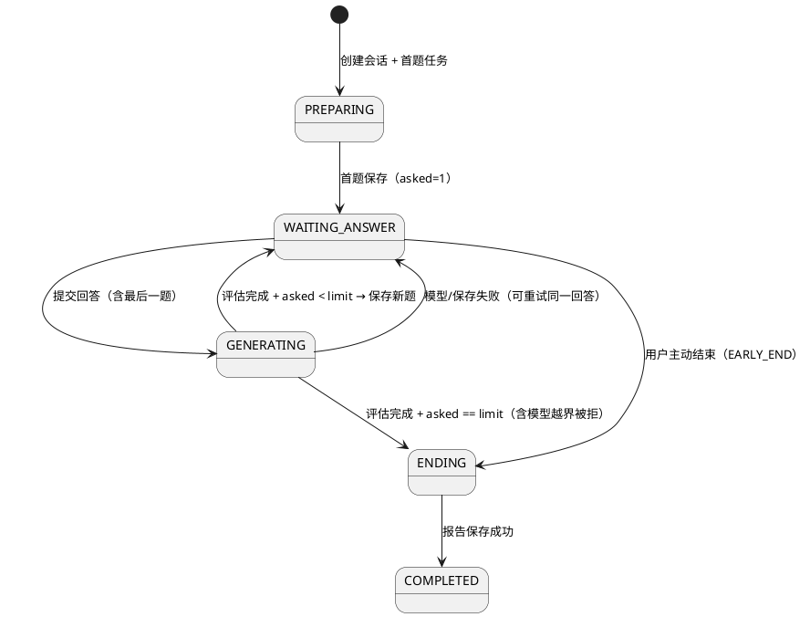

必须区分两个状态：

- **最后一题已发出**：`status = WAITING_ANSWER` 且 `asked == limit`。此时仍可录音、编辑、切换作答方式、提交；页面提示"最后一题"。
- **最后一题已回答**：`status ∈ {GENERATING, ENDING}`。此时不再允许回答，且必然只产生评价与报告，不产生新题。

后端伪代码补充：

```text
onAnswer(interviewId, questionMessageId, content):
  session = lockSession; require status == WAITING_ANSWER
  require latestQuestion.id == questionMessageId     // 现状
  insert USER message; status = GENERATING; create INTERVIEW_TURN task
  // 刻意不校验额度：最后一题必须可答（spec 5.9.1-8）

onTurnResult(...):
  按 8.5.1；asked 达到 limit 时唯一出口是 ENDING + 报告任务
```

### 8.7.1 状态实现伪代码（与 8.5.4 改造点一一对应）

```text
POST /api/v1/interviews/{id}/answers          # InterviewService.answer
  lockSession(user, id)                        # :133
  校验 expectedVersion / WAITING_ANSWER / latestQuestion   # :135-143
  插入 USER 消息 + 标记 GENERATING + 创建 INTERVIEW_TURN   # :205-216
  # 刻意不读 asked、不校验额度：最后一题必须可答

INTERVIEW_TURN 成功回调                        # InterviewResultHandler.turn
  session = lockSession                        # :87
  if status not in {PREPARING, GENERATING}: conflict        # :88
  if session.pending_task_id != task.id: conflict            # 新增
  asked = askedQuestions(interviewId)          # :91-93，第一条普通 SELECT
  if latestAnswer != null: evaluateAnswer(...)               # :98，先评价
  rule = session.question_count_rule
  exhausted = rule == "TOTAL_ASKED" && asked >= limit
  if action == "FINISH" or exhausted:          # :108-135
      reportTask(NORMAL); return version + 1   # 不校验、不保存 question
  # 额度仍 > 0：才校验 question 非空/长度/编号
  if rule == "TOTAL_ASKED": 只校验 questionNo == current + 1、followUpNo == current + 1 <= 2
  if rule == "MAIN_ONLY":   保留 questionNo <= limit 与 automaticFinish 现状
  insertMessage(ASSISTANT) + updateTurn(WAITING_ANSWER)      # :142-144
  return version + 1

INTERVIEW_TURN 失败回调                        # :62-73
  latestAnswer 存在 -> WAITING_ANSWER（用户可重试同一回答）
  首题失败         -> FAILED
```

**两个状态必须分开判定**

| 状态 | 判定条件 | 用户能否作答 | 是否会产生新题 |
|------|---------|-------------|---------------|
| 最后一题已发出 | `status = WAITING_ANSWER` 且 `asked == limit`（`TOTAL_ASKED`） | **能**：录音、编辑、切换方式、提交均可用 | 提交后进入 `GENERATING`，本状态不产生新题 |
| 最后一题已回答 | `status ∈ {GENERATING, ENDING}` | 不能（状态校验拒绝） | 不会；只保存评价、创建报告 |

> 常见错误：把"创建最后一题时"当成"最后一题已回答"，直接跳到 `ENDING`，会让用户无法作答（`spec.md` 5.9.1-8）。本设计要求结束动作只发生在 `turn` 收到最后一题的回答之后，或用户主动 `/end`。

## 8.8 实验矩阵（纸面推演；未执行）

> 说明：以下为设计预期，用于后续 Q-06 落地测试；本轮**未运行**任何用例，"预期"不等于"已通过"。

| 编号 | 前置数据与状态 | 输入事件 / 模型输出 | 操作顺序 | 预期提问数 / 会话状态 / 数据库变化 | 建议验证层级 |
|------|---------------|--------------------|---------|-----------------------------------|-------------|
| A | limit=5，rule=TOTAL_ASKED，asked=0，PREPARING | 每轮模型输出 `nextQuestion` | 连续回答 5 轮 | 共 5 条 ASSISTANT；第 5 题后 WAITING_ANSWER；第 5 题回答后 ENDING→COMPLETED；无第 6 条 | Java 单元 + 接口集成 |
| B | limit=5，TOTAL_ASKED，asked=0 | 依次 ASK、FOLLOW_UP、FOLLOW_UP、ASK、FOLLOW_UP | 逐轮回答并推进 | 合计 5 条 ASSISTANT（2 主 + 3 追问）；第 5 条后 WAITING_ANSWER | Java 单元 + 接口集成 |
| C | limit=5，asked=4（当前主问题追问数=0） | 模型 `needsFollowUp=true` | 回答第 4 题 | 保存追问（questionNo 不变，followUpNo+1），asked=5，WAITING_ANSWER（最后一题）；若当前主问题已追问 2 次，则不采纳追问，改出下一主问题或结束 | Java 单元 + Python 单测 |
| D | limit=5，asked=5，WAITING_ANSWER（第 5 题已发出） | 无模型调用 | 录音→停止→转写→编辑→提交；刷新后再提交 | `/answers` 受理 202；asked 仍 5；状态 GENERATING；消息不重复 | 接口测试 + 前端手工 |
| E | 同 D，用户已提交第 5 题回答 | 模型返回 `ASK`/`FOLLOW_UP` + `answerEvaluation` | 等待回调 | 评价 1 条；不插入新 ASSISTANT；ENDING；报告 1 条；asked=5 | Java 单元 + 集成 |
| F | limit=5，asked=5，GENERATING | 模型返回 `FOLLOW_UP` + 合法追问 | 等待回调 | 后端忽略题目，只保存评价并进入结束；无第 6 题 | Java 单元（8.5.1） |
| G | 任意 asked | 重播、刷新、重录、重新转写 | 重复操作 | asked 不变；无新 ASSISTANT；会话版本只在回答提交时变化（转写不改版本，`spec.md` 4.2-4） | 接口测试 + 前端手工 |
| H | asked=3；另有一个失败且未写题的任务 | 同 Idempotency-Key 重复提交；失败任务重试成功后回调；同 digest 重复回调；不同 digest 回调 | 重复请求 | 同一次回答只产生 1 条 USER；失败任务重试成功只新增 1 条 ASSISTANT（asked=4）；重复回调不再增加；不同 digest 返回冲突 | 接口幂等测试 + 并发集成 |
| I | asked=4（剩余 1），两个回调并发 | 两个回调各自带 ASK | 同时提交 | 只 1 个 succeed；只新增 1 条 ASSISTANT；另一个收到状态冲突；asked=5 | 隔离库并发集成（两线程/两事务） |
| J | asked=3，GENERATING | 模型超时/保存异常/事务回滚 | 触发失败 | asked 仍 3；会话回到 WAITING_ANSWER（失败分支）或保持 GENERATING 可重试；无题目写入 | Java 单元（mock 抛异常）+ 集成 |
| K | 旧任务仍 RUNNING，会话已推进（pending_task_id 已变） | 旧任务结果晚到 | 回调 | 拒绝；不写题；asked 与状态不变 | Java 单元 + 隔离库集成 |
| L | asked=2，WAITING_ANSWER | 用户点击结束 | `/end` | 不新增提问；ENDING→COMPLETED；报告 completionType=EARLY_END | 接口测试 |
| M | 最后一题评价已存在，报告任务失败 | 重试评价/报告任务 | 重复回调 | 评价唯一；报告唯一；无新题 | Java 单元 + 集成 |
| N | 历史会话：rule=MAIN_ONLY，limit=3，已有 5 条提问（含追问） | 继续回答 | 按旧规则推进 | 不因 asked>limit 立即结束；不出现新的总额度限制；展示保持"主问题"口径 | 文字面试回归（T-08）+ 接口测试 |

### 8.8.1 测试落点与验收对应表（A–N → 可执行用例）

> 下表是 Q-06 的实现依据。**本阶段未创建任何测试文件、未执行任何用例**；"断言"是编码后必须满足的判定条件。

| 实验 | 层级 | 测试文件（建议新增/更新） | 测试方法（建议命名） | 关键断言 |
|------|------|------------------------|--------------------|---------|
| A | Java 单元 | 新增 `InterviewQuestionBudgetTest.java` | `budgetA_fiveMainQuestionsStopAtFive` | 连续 5 次 ASK → 5 条 ASSISTANT；第 6 次回调不插入；`reportTask` 恰调用 1 次 |
| B | Java 单元 + Python | 同上；`tests/test_handlers.py` | `budgetB_twoMainThreeFollowUps` / `test_total_asked_two_main_three_follow_ups` | 2 主 3 追问；第 5 次 `WAITING_ANSWER`；`remaining=0` |
| C | Java 单元 + Python | 同上 | `budgetC_lastSlotAllowsFollowUp` / `test_total_asked_last_slot_follow_up` | `remaining=1` + `needs_follow_up` → `FOLLOW_UP`；当前主问题已 2 次追问 → 只出主问题或 FINISH |
| D | 接口 + 前端手工 | `scripts/interview_budget_acceptance.py`（新增） | `budgetD_lastQuestionAnswerable` | `/answers` 返回 202；`COUNT(ASSISTANT)` 仍 5；USER 仅 1 条；刷新后仍可提交 |
| E | Java 单元 + 集成 | `InterviewResultHandlerTest.java` | `budgetE_lastAnswerEvaluatedThenEnd` | 第 5 题回答后 1 条评价、0 条新 ASSISTANT、`ENDING`、1 条报告 |
| F | Java 单元 | `InterviewQuestionBudgetTest.java` | `budgetF_modelOverrunIgnored` | 模型返回 `FOLLOW_UP/ASK` + 题目 → 题目被忽略、评价保存、无第 6 条 |
| G | 接口 + 前端手工 | `scripts/interview_budget_acceptance.py` | `budgetG_nonCountEvents` | 重播/刷新/重录/重转写/上传重试后 `asked` 与 `version`（除提交外）不变 |
| H | Java 幂等 | `InterviewServiceTest.java`；接口脚本 | `budgetH_idempotentRetry` | 同 `Idempotency-Key` → 1 条 USER；失败任务重试成功 → ASSISTANT +1；重复回调不再增加 |
| I | Java 并发集成 | 新增 `InterviewQuestionBudgetConcurrencyTest.java` | `budgetI_twoCallbacksRaceLastSlot` | 2 线程争最后 1 个额度：ASSISTANT 恰好 +1；1 次 succeed；另 1 次 `INVALID_STATE` |
| J | Java 单元 | `InterviewQuestionBudgetTest.java` | `budgetJ_saveFailureKeepsAsked` | `insertMessage` 抛异常 → asked 不变；状态回 `WAITING_ANSWER`；无报告任务 |
| K | Java 单元 + 集成 | 同上 | `budgetK_staleTaskRejected` | `pending_task_id` 不匹配 → `INVALID_STATE`；无 ASSISTANT、无评价、版本不变 |
| L | 接口 | `scripts/interview_budget_acceptance.py` | `budgetL_earlyEnd` | `/end` 后 `completionType=EARLY_END`；asked 不变；无新题 |
| M | Java 单元 | `InterviewResultHandlerTest.java` | `budgetM_reportRetryDedupe` | 评价 1 条、报告 1 条；重复回调不新增 |
| N | 回归 | `InterviewServiceTest.java` + T-08 手工 | `budgetN_mainOnlyUnchanged` | `MAIN_ONLY` 下 asked>limit 不立即结束；文案与报告字段不变 |

**测试文件与执行命令（编码阶段使用）**

| 类型 | 文件 | 命令 |
|------|------|------|
| Java 单元（Mockito） | `project/backend/src/test/java/com/aijob/backend/interview/InterviewQuestionBudgetTest.java` | `mvn -pl project/backend -Dtest=InterviewQuestionBudgetTest test` |
| Java 并发集成（隔离库） | `.../interview/InterviewQuestionBudgetConcurrencyTest.java` | `mvn -pl project/backend -Dtest=InterviewQuestionBudgetConcurrencyTest test` |
| 既有 Java 测试更新 | `InterviewResultHandlerTest.java`、`InterviewServiceTest.java` | `mvn -pl project/backend -Dtest="Interview*Test" test` |
| 既有任务集成 | `project/backend/src/test/java/com/aijob/backend/task/SevenCaseIntegrationTest.java` | 同上（确认报告任务创建不受活动任务上限误拒） |
| Python 单测 | `project/agent/tests/test_handlers.py`、`test_operations.py`、`factories.py` | `python -m pytest project/agent/tests -q -k interview` |
| 接口脚本 | `project/agent/scripts/interview_budget_acceptance.py`（新增，或扩展 `business_acceptance.py`） | `python project/agent/scripts/interview_budget_acceptance.py` |
| 前端 | 无新增代码，仅校验类型与手工走查 | `npx vue-tsc --noEmit`（在 `project/frontend`） |

**测试环境约束**

1. 隔离库命名建议 `aijob_interview_budget_test`，执行 `V1 → V16`，不复用开发库。
2. 不依赖真实模型：Java 单测用 Mockito 构造 `JsonNode` 结果；Python 用 Fake/Fixture；接口脚本用 Fake Provider。
3. Java 单测通过 `TaskResultHandler.success(task, result)` 触发私有 `turn`，与既有 `InterviewResultHandlerTest`（:19-44）同风格；不得为了可测性把 `turn` 改成 public。
4. 并发用例使用两个独立事务/线程，并显式断言"另一个回调返回冲突"，不能只断言最终条数。
5. 所有用例必须覆盖 `TOTAL_ASKED` 与 `MAIN_ONLY` 两条分支；`MAIN_ONLY` 用例不得因为新代码改变预期结果。

## 8.9 完整推演：2 道主问题 + 3 次追问 = 5 道提问

前置：limit=5，rule=TOTAL_ASKED，maxFollowUps=2。

| 轮次 | 触发 | 模型输出 | 后端动作 | asked | remaining | status |
|------|------|---------|---------|-------|-----------|--------|
| 1 | 创建会话 | 首题 `ASK`（q1/f0） | 保存第 1 题 | 1 | 4 | WAITING_ANSWER |
| 2 | 回答 q1 | 评价 + `FOLLOW_UP`（q1/f1） | 保存第 2 题 | 2 | 3 | WAITING_ANSWER |
| 3 | 回答 q1/f1 | 评价 + `FOLLOW_UP`（q1/f2） | 保存第 3 题 | 3 | 2 | WAITING_ANSWER |
| 4 | 回答 q1/f2 | 评价 + `ASK`（q2/f0） | 保存第 4 题 | 4 | 1 | WAITING_ANSWER |
| 5 | 回答 q2 | 评价 + `FOLLOW_UP`（q2/f1） | 保存第 5 题（占最后一个额度） | 5 | 0 | WAITING_ANSWER（**最后一题已发出，可作答**） |
| 6 | 回答 q2/f1 | 评价 + `FOLLOW_UP`（越界） | 保存评价；忽略题目；创建报告任务 | 5 | 0 | ENDING → COMPLETED |

补充说明：

- 第 3 轮 q1 已达到 2 次追问的局部上限，因此第 4 轮只能是新的主问题 q2。
- 第 5 轮仅剩 1 个额度时选择追问是允许的，追问占用最后额度（实验 C）。
- 第 6 轮即使模型仍返回追问，后端也不创建第 6 题；报告 `answeredQuestionCount=2`、`answeredAskCount=5`、`completionType=NORMAL`。

### 8.9.1 可执行的验证步骤（设计预期，本轮未执行）

> 前置：隔离库 `aijob_interview_budget_test` 已执行 `V1 → V16`；后端指向该库；Agent 使用 Fake；`limit=5`。

| 步骤 | 操作 | 断言 / 校验 SQL |
|------|------|-----------------|
| 1 | 创建面试并等待首题 | `SELECT question_count_rule FROM interview_session WHERE id=?` = `TOTAL_ASKED`；`SELECT COUNT(*) FROM interview_message WHERE interview_id=? AND role='ASSISTANT'` = 1；接口 `askedQuestionCount=1`、`remainingQuestionCount=4` |
| 2 | 提交 q1 回答 | 202；`COUNT(USER)=1`；`status=GENERATING` |
| 3 | 等待第 1 次追问回调 | `follow_up_no=1`，`COUNT(ASSISTANT)=2`；`askedQuestionCount=2` |
| 4 | 提交追问回答并再追问一次 | `follow_up_no=2`，`COUNT(ASSISTANT)=3`；当前主问题追问已达 2 次 |
| 5 | 再提交追问回答，模型 `needs_follow_up=true` | Python/后端必须改出主问题（`question_no=2, follow_up_no=0`）；`COUNT(ASSISTANT)=4` |
| 6 | 提交 q2 回答，模型选择追问 | 允许：`question_no=2, follow_up_no=1`；`COUNT(ASSISTANT)=5`；`status=WAITING_ANSWER`；接口 `askedQuestionCount=5`、`remainingQuestionCount=0` |
| 7 | 页面刷新后作答最后一题 | 仍返回该题、`status=WAITING_ANSWER`；`/answers` 受理 202；`COUNT(ASSISTANT)` 仍 5 |
| 8 | 等待最后一题 turn 回调（模型返回越界追问） | `COUNT(ASSISTANT)=5`（无第 6 条）；`COUNT(interview_turn_evaluation)=5`；`status=ENDING`；`COUNT(interview_report)=1` |
| 9 | 等待报告回调 | `status=COMPLETED`；`report_json.answeredQuestionCount=2`、`answeredAskCount=5`、`completionType=NORMAL` |
| 10 | 重跑步骤 1–9 的并发变体（第 6 步用两个回调） | 只新增 1 条 ASSISTANT；一个回调成功、另一个 `INVALID_STATE` |

**可直接执行的校验 SQL 模板**

```sql
SELECT question_count_rule, question_limit, status FROM interview_session WHERE id = ?;
SELECT COUNT(*) AS asked FROM interview_message WHERE interview_id = ? AND role = 'ASSISTANT';
SELECT role, question_no, follow_up_no, seq FROM interview_message
 WHERE interview_id = ? ORDER BY seq;
SELECT COUNT(*) FROM interview_turn_evaluation WHERE interview_id = ?;
SELECT completion_type FROM interview_report WHERE interview_id = ?;
SELECT report_json->>'$.answeredQuestionCount', report_json->>'$.answeredAskCount'
  FROM interview_report WHERE interview_id = ?;
```

**失败判定（任一项出现即不通过）**

1. `COUNT(ASSISTANT)` 为 6 或更多；
2. 第 6 步保存后 `status` 直接变成 `ENDING`/`COMPLETED`（说明"最后一题已发出"被误当成"已回答"）；
3. 最后一题提交返回非 202；
4. 最后一题的评价缺失或重复；
5. `answeredQuestionCount` 被改成 5（应为 2）。

## 8.10 涉及文件与接口（本轮只登记，均未修改）

| 层 | 文件 / 接口 | 预期变更 | 用途 |
|----|------------|---------|------|
| Java | `interview/InterviewMapper.java` | 新增 `askedQuestions`；`insertSession` 增规则列；`page` 增 `asked_count` | 权威计数与展示 |
| Java | `interview/InterviewService.java` | `create` 写 `TOTAL_ASKED`；`turnPayload` 增三字段；`sessionVo` 增三字段；重试覆盖额度字段；`reportTask` 增报告字段 | 契约与展示 |
| Java | `interview/InterviewResultHandler.java` | 锁内额度复核、`pending_task_id` 校验、越界强制结束、`answeredAskCount` | 硬约束 |
| Java 测试 | `InterviewResultHandlerTest`、`InterviewServiceTest`、新增 `InterviewQuestionBudgetTest` / `InterviewQuestionBudgetConcurrencyTest`、`task/SevenCaseIntegrationTest` | 新增 A–N 用例 | 验收 |
| DB | 新增 `V16__add_interview_question_count_rule.sql` | 设计稿，未创建 | 历史兼容 |
| Python | `app/schemas.py`、`app/handlers.py` | 新字段与 `TOTAL_ASKED` 分支 | Agent 决策 |
| Python | `app/skills/prompts/interview_turn.md`、`app/operations.py` | `v5 → v6` | 提示词 |
| Python 测试 | `tests/test_handlers.py`、`tests/test_operations.py`、`tests/factories.py`、`scripts/interview_budget_acceptance.py`（新增） | 预算用例与验收脚本 | 验收 |
| 前端 | `api/types.ts`、`types/workbench.ts`、`api/mock/workbench.mock.ts`、`views/interview/InterviewView.vue` | 三字段类型与文案 | 展示 |
| 文档 | `.codeartsdoer/specs/voice_interview/{spec,design,tasks}.md`、`docs/功能资料/09-模拟面试/{模拟面试后端接口示例.md, Agent接口示例.md}`、`语音模拟面试_process.md` | 本轮已改前三者与 process；接口示例待编码时同步 | 文档一致性 |

接口：`GET /api/v1/interviews/{id}`、`GET /api/v1/interviews` 的响应新增字段；`POST /{id}/answers` 不变（额度不由前端提交）；Agent `INTERVIEW_TURN` payload 新增字段。无新增业务接口。

### 8.10.1 推荐编码顺序（与 `tasks.md` Q-01～Q-06 对齐）

> 任务映射引用（2026-11-21 编码任务规划阶段）：Q-01～Q-06 已在 `tasks.md` 第 13 章细分为 36 个可领取子任务（Q-01.1 ～ Q-06.7），本文 8.5.4 的行号级改造点与 8.8.1 的 A–N 用例分别映射到对应子任务；本节顺序与 `tasks.md` 13.2 等价（Q-04 可在 payload 字段冻结后与 Q-02 并行），设计结论不变。

| 顺序 | 任务 | 主要产出 | 进入条件 | 完成判定（编码阶段） |
|------|------|---------|---------|-------------------|
| 1 | **Q-01** 历史兼容与迁移 | `V16` 脚本（先在隔离库执行）、`insertSession` 增列、叙述回滚顺序 | 本文 8.3 评审通过 | 隔离库 `SHOW CREATE TABLE` 有列与 CHECK；历史行全为 `MAIN_ONLY` |
| 2 | **Q-02** Java 计数与硬约束 | `askedQuestions`、`turn` 锁内额度复核、`pending_task_id`、payload 三字段、`sessionVo`/`page` 展示字段 | Q-01 字段可读 | 单元用例 A/B/C/F/J/K 通过；并发用例 I 通过 |
| 3 | **Q-04** Agent 契约与决策 | schema 三字段、`prepare` 有效额度、`TOTAL_ASKED` 分支、提示词 `v6` | 与 Q-02 冻结同一份 payload 字段表（可并行编码） | Python 用例 B/C + `MAIN_ONLY` 回归通过 |
| 4 | **Q-03** 最后一题评价与报告 | 结束顺序、`answeredAskCount`、报告 payload | Q-02 额度判定可调用 | 用例 E/M 通过；`answeredQuestionCount=2`、`answeredAskCount=5` |
| 5 | **Q-05** 前端展示 | 类型字段、创建表单、会话头、最后一题提示、历史与报告 | Q-02 字段已返回 | `vue-tsc` 零错误；新/旧会话文案正确；最后一题可提交 |
| 6 | **Q-06** 测试与验收 | A–N 用例、隔离库并发、接口脚本、历史回归 | Q-01～Q-05 完成 | 8.8.1 表全部有对应用例并实际执行通过 |

**依赖与并行约束**

1. Q-02 与 Q-04 必须先冻结 payload 字段名（`questionCountRule`/`askedCount`/`remainingQuestions`），冻结后两条线可并行；联调在 Q-06。
2. Q-03 不得先于 Q-02：结束分支依赖额度判定结果；否则会退化成"按模型 action 结束"，重现超额问题。
3. Q-05 不得先于 Q-02：前端字段缺失时只能按 `MAIN_ONLY` 渲染，无法验收新文案。
4. Q-06 的 A/B/C 用例可随 Q-02/Q-04 同步编写，但只有全部落点通过后才允许把 Q-01～Q-06 标记为完成。
5. 任何一步发现与本文不一致（例如行号漂移、事务传播变化），必须回写本文 8.5.4 与 `tasks.md` 对应任务，不得只在代码里"就地解决"。

## 8.11 设计阶段未执行事项与遗留风险（历史记录）

**未执行**：

1. 未修改任何 Java / Python / 前端业务代码。
2. 未创建或执行 `V16`，未修改已执行的 `V15`，未执行任何数据库变更。
3. 未调用真实或 Fake 模型，未启动后端/Agent/前端。
4. 未运行单元测试、集成测试、构建或压测；8.8/8.9 全部为设计预期。
5. 2026-11-21 实现方案阶段二次确认：仍只读代码与文档，只更新 `design.md` / `tasks.md` / 本过程记录；8.8.1 的测试文件与命名均为**建议**，尚未创建；2.5.4/8.9.1 的 SQL 与命令均未执行。

**风险与待决**：

1. 历史 `MAIN_ONLY` 与新 `TOTAL_ASKED` 长期并存，前后端所有展示与判断都必须按规则版本分支，禁止"一刀切"文案。
2. `pending_task_id` 校验是新增防护，需确认与合法重试路径不冲突（重试任务会更新 `pending_task_id`；旧任务应被拒）。`failure()`/`prepareRetry`（:62-83）当前不校验该字段，属既有缺口；本期是否一并加固需在 Q-02 评审时决定。
3. Python 的"取更严格值"依赖 `messages` 完整性；若客户端裁剪消息，需以 `asked_count` 为准并补测试。
4. 报告 `answeredAskCount` 的统计口径（按有效评价去重 `question_message_id`）需产品确认（O13）。
5. 计数依赖"ASSISTANT 行即提问"；未来若新增系统提示类 ASSISTANT 消息，必须加类型字段并排除，否则会误计数。
6. 历史未完成会话是否切换规则（`spec.md` 7.9）与报告新增字段（7.10）仍需产品确认。
7. **快照边界风险**：若实现时把 `askedQuestions` 放到 `evaluateAnswer` 之后，InnoDB REPEATABLE READ 可能读到旧快照而少计 1 条。本文 8.2.4 已规定"锁后立即读"，评审与代码审查必须核对调用顺序。
8. **主问题编号上限**：`TOTAL_ASKED` 下 Python/Java 都不再用 `questionLimit` 限制 `questionNo`，但仍受 `InterviewMessage.question_no le=50`（`schemas.py:809`）与 `V1:444` 的 `INT UNSIGNED` 约束；`limit ≤ 10` 时无实际风险，若未来扩大上限需同步调整两处。
9. **报告任务并发额度抵扣**：`TaskService.create` 的抵扣依赖"同会话最新 INTERVIEW 任务为 RUNNING"（:69-74）；需用 `SevenCaseIntegrationTest` 固定该行为，防止未来调整 `latestResourceTask` 语义后误触"每人 2 个活动任务"。
10. **提示词版本**：`interview-turn-v5 → v6` 会改变运行记录中的 prompt 版本；Q-06 需断言新版本生效，但不得把模型输出当作契约。


## 8.12 当前实现与验证状态（2026-11-21 修复后）

8.1～8.11 的“本轮未实现”均指原设计阶段。现在已有 V16、规则枚举、数据库实际计数、锁内硬限制、Agent 预算分支及前端展示；具体文件和最新证据以 tasks.md 13.7 为准。

- V16 已在独立 MySQL 的 budget_migration_test 演练：先 V15 插入历史行，再 V16，历史为 MAIN_ONLY；校验非法值与空值被拒绝；移除约束再移列后原行保留。此 DDL 演练不等于目标环境发布回退验收。
- 并发实验 I 现由 InterviewQuestionBudgetIntegrationTest 使用两线程、独立事务、真实 MySQL 行锁执行；一成功、一 INVALID_STATE，无第 6 题。原 ConcurrencyTest 仍只是 Mock 拒绝分支，不能单独作为真实并发证据。
- 完整 Fake 面试 API 已得到 2 主问题+3 追问、5 回答、5 评价、1 报告，末题正常提交并结束；相同幂等键复用任务，换键重复提交和完成后再提交均返回 409。
- 实验 L 明确前提：至少一条有效回答后提前结束，completionType=EARLY_END；无有效回答时沿用 NO_VALID_ANSWER，不能为满足脚本断言改变既有业务规则。验收脚本分 early 与 no-answer 独立场景。
- G 只验证了 API 刷新与提交幂等，未执行浏览器重播/重录/重转写；M 报告失败重试完整矩阵、N 历史页面走查和目标部署环境仍待验收。
- 查询 EXPLAIN 在小样本下由优化器选择 uk_interview_id_seq，另一个可用索引为 idx_interview_id_role_seq；没有强制索引或新增计数列。
- Python 使用现有 3.12.4 venv，111 条 Handler/Operation 测试及 3 条脚本回归通过；前端类型检查通过。TTS 仍为 Fake，本轮不是完整真实语音服务验收。


## 8.13 报告回调与浏览器验收修正（2026-11-21）

报告 failure 和 prepareRetry 新增会话行锁、pending_task_id 与合法状态复核；报告 success 也必须匹配当前待处理任务。旧失败无副作用，旧成功/重试拒绝；幂等仍由 TaskResultService/TaskService 保证。真实 MySQL 报告矩阵及页面报告故障恢复通过，具体证据见 tasks.md 13.8。

VoiceAnswerPanel 的 submit 契约增加 answerSource，父组件按实际 TEXT/VOICE 转发。语音确认要求合法转写 ID，文字降级不要求转写 ID；修复原文字降级被当作 VOICE 返回 400 的缺陷。Edge/Chrome 实际 MediaRecorder WebM/Opus→真实 ASR 验证通过，输入为授权录音经虚拟麦克风播放；不是物理麦克风或真实 TTS 验收。
---
# 九、ASR 结果晚到保护（2026-11-22 增量设计）

> 本章是本轮"语音识别结果晚到保护"的增量设计。第一章、第二章描述的是首版设计与后续预算规则增量；本章**不重写**它们，只做三件事：
> 1. 把"结果晚到"从一条异常场景（原 3.2 F17）提升为**贯穿上传、调用、回写、消费、清理、前端恢复的状态规则**；
> 2. **如实核对**上一阶段已提前落地的代码（`V17`、`VoiceMapper` 条件更新、`VoiceTranscriptionService` 二次校验、`InterviewService` 消费行数校验、前端请求令牌、`VoiceLateArrivalIntegrationTest` 9 项），识别其与需求的偏差并给出收敛方案；
> 3. 补齐**真实数据库并发/乱序测试矩阵**与**浏览器回归**的设计，明确"9 项既有测试不等于本次覆盖证据"。

## 9.0 需求依据、范围与 `spec.md` 缺口处理

### 9.0.1 需求来源与既有条款对照

本轮需求以**用户本次请求**为第一依据，`spec.md` 中已有条款为其上位约束：

| 需求要点 | `spec.md` 既有条款 | 覆盖度 |
|---------|------------------|--------|
| 旧请求不得覆盖新状态 | 4.2-1、5.4.1-6、5.4.3-4、5.9.1-9（"旧版本结果晚到时，不覆盖当前状态、不增加题数"） | 有原则，无实现级条件 |
| 失效记录不得复活 | 5.4.1-5（过期后需重新录音）、5.4.3-4/5（放弃后清理临时记录） | 有原则，无"晚到成功被拒"的显式规则 |
| 转写不产生正式数据 | 4.2-4、5.4.1-3、6.3-4 | 完整 |
| 重试与重复提交不改题数 | 4.2-5、5.5.1-6、5.9.1-5 | 完整 |
| 失败可重试或降级文字 | 4.1-4、4.2-1、5.8.1-1/2 | 完整 |
| 日志不落音频/全文/密钥 | 4.3-5 | 完整 |
| **识别尝试标识持久化** | — | **缺** |
| **三条回写路径统一条件保护** | — | **缺**（仅有原则） |
| **幂等与重试的分层语义** | 4.1-4 仅覆盖"相同音频复用" | **部分缺** |

### 9.0.2 `spec.md` 缺口的处理方式（本轮不改 `spec.md` 正文）

本轮交付物是 `design.md`，不越界修改需求文档。缺口以**建议需求条款**形式登记，作为本设计的直接依据；建议由 `spec-requirement-agent` 在后续需求增量中正式收录（编号 `R-LA-*`）。

| 建议条款 | 内容 | 本设计对应 |
|---------|------|-----------|
| **R-LA-1 识别尝试** | 同一条转写记录的每一次新的供应商调用必须对应一个持久化、单调递增的识别尝试标识；记录被复用时该标识必须递增。 | 9.4.2、9.4.3 |
| **R-LA-2 条件回写** | 成功、空识别、失败三条回写路径必须使用"记录标识 + 当前尝试标识 + 仍为待处理 + 未被消费 + 未过期"的条件更新，并检查受影响行数为 1；为 0 时不得以任何方式重试写入。 | 9.4.3、9.4.4、9.4.5 |
| **R-LA-3 失效不复活** | 已放弃、已过期、已消费或被更新尝试取代的记录，晚到结果只允许保持原失效状态或进入更终态，禁止改为成功、空识别或失败。 | 9.2.3、9.4.3 |
| **R-LA-4 返回后二次校验** | 供应商调用必须在事务外；返回后必须在短事务内重新核对用户归属、会话归属、会话是否仍允许作答、当前题目、会话版本、记录状态、识别尝试、消费与过期状态；只有全部有效才允许回写。 | 9.3 |
| **R-LA-5 幂等分层** | 已成功的相同音频必须复用且不重复调用供应商；进行中的相同音频不得重复调用；显式重试允许创建新尝试；无供应商幂等支持时不得承诺跨网络故障"绝对只调用一次"。 | 9.5 |

### 9.0.3 本轮范围与非范围

**范围内**：转写记录的状态规则、二次校验、条件回写、尝试标识、幂等/重试分层、前端令牌与提示、真实数据库测试矩阵设计、浏览器回归设计、与既有代码的差异清单。

**范围外**（越界即视为缺陷）：
1. 不修改面试会话状态机、追问规则、总题数预算、评分与报告口径（`spec.md` 1.4-1/2）。
2. 不引入异步转写任务、消息队列、分布式锁或新的中间件。
3. 不引入供应商侧幂等键或"恰好一次"承诺。
4. 不重构 `VoiceTranscriptionService` 之外的语音模块（TTS、能力探测、隐私同意保持现状）。
5. 不改已执行的 `V15`/`V16` 迁移，不迁移正式业务库。
6. 不输出或记录音频字节、转写全文、密钥与令牌。

---

## 9.1 增量需求与存量实现对比

> 对应第一章结构的增量补充。结论：**核心机制已存在但未收敛，测试证据不足**。

### 9.1.1 已实现的增量能力

| 需求功能 | 存量实现 | 代码位置 | 匹配度 |
|---------|---------|---------|--------|
| 上传前校验用户/会话/题目/版本 | 会话行锁内依次校验归属、`WAITING_ANSWER`、版本、最新题 | `VoiceTranscriptionService.java:62-73`；`InterviewMapper.java:33-34` | 100% |
| 供应商调用在事务外 | 记录创建事务结束后再调用 `SpeechAgentClient` | `VoiceTranscriptionService.java:62-104` | 100% |
| 返回后二次校验 | 短事务内 `evaluate(...)` 的 9 项校验 | `VoiceTranscriptionService.java:125-184` | 75%（见 9.9 D-07/D-18） |
| 识别尝试持久化 | `attempt` 列 + 默认 1 + CHECK | `V17__add_voice_transcription_attempt.sql` | 100% |
| 成功/空识别条件回写 | `markSucceeded/EmptyIfPending(id, attempt, …)` + 未过期 | `VoiceMapper.java:93-112` | 100% |
| 失败条件回写 | `markFailedIfPending(id, attempt, …)` | `VoiceMapper.java:114-120` | 75%（缺 `expires_at` 谓词，D-03） |
| 失效落盘 | 题变→`DISCARDED`，过期→`EXPIRED`，其余不动 | `VoiceTranscriptionService.java:187-193` | 100% |
| 消费与正式回答同事务 | `markConsumed` 行数=1 才继续，否则抛 `STALE_INPUT` 回滚 | `InterviewService.java:212-228` | 100% |
| 前端旧结果不覆盖新题 | 单一请求令牌 + 题目 ID 复核 + 组件 `key` 重建 | `useVoiceAnswer.ts:31-33,89-133`；`InterviewView.vue:690-696` | 75%（缺版本复核，D-12） |
| 真实数据库晚到矩阵 | 受控供应商替身 + 真实事务，9 项 | `VoiceLateArrivalIntegrationTest.java:86-296` | 50%（见 9.7.2） |

### 9.1.2 需要扩展的部分

| 需求功能 | 存量实现 | 差异说明 | 扩展方向 |
|---------|---------|---------|---------|
| 同音频复用 | `findBySha` 命中 `SUCCEEDED` 即 `_cached` 返回 | 未排除已消费记录 | 复用条件加"未消费"（D-01） |
| 刷新恢复取最新记录 | `findLatestByQuestion` 按 `created_at DESC` | 重试复用记录不更新 `created_at`，可能取到旧记录 | 改按 `updated_at DESC, attempt DESC`（D-02） |
| 同题单活跃尝试 | 仅拦截"新鲜 PENDING"（60s 窗口） | 超窗后允许并存两条 `PENDING` | 会话锁内把同题陈旧 `PENDING` 落 `DISCARDED`（D-06） |
| 失效原因对外表达 | 旧尝试/题变统一 `QUESTION_CHANGED` | 语义混淆，前端提示误导 | 新增 `SUPERSEDED` 子原因（D-04） |
| 审计可区分尝试 | `requestId = nameUUID("voice:"+recordId)` | 多次尝试共用同一请求标识 | 派生键加入 `attempt`（D-05） |

### 9.1.3 需要新增的部分

1. **真实并发用例**：晚到回写与 `InterviewService.answer` / `end` 在同一会话行锁上真实竞争（现有用例以 SQL 直接改状态，未经过真实提交事务）。
2. **空识别晚到用例**、**已消费记录复用用例**、**双 `PENDING` 收敛用例**、**越权用例**、**`V17` 迁移校验用例**。
3. **不同幂等键并发确认提交用例**（现有仅同键串行重放）。
4. **前端令牌的自动化验证**（当前无 Vitest，只能浏览器手工回归）。

---

## 9.2 阶段 1：现状与状态规则

### 9.2.1 当前实现链路（源码定位）

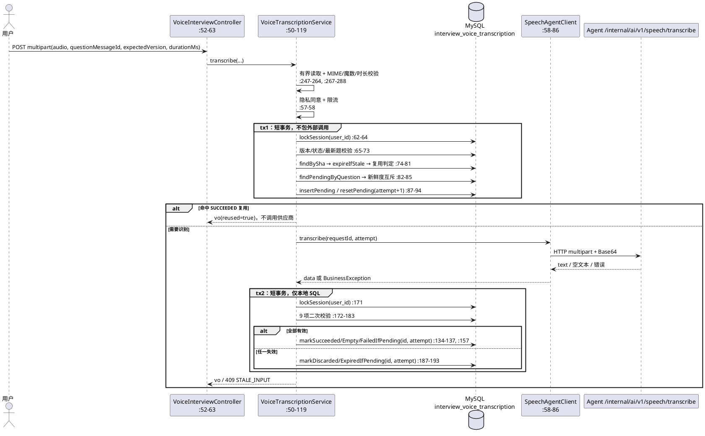

**链路要点（源码核对结论）**

1. `tx1` 与 `tx2` 之间**没有**任何数据库事务处于打开状态（`TransactionTemplate.execute` 已返回），供应商调用在连接池外执行，不会出现"长事务持锁等外部 IO"。
2. **转写链路零正式写入**：全程不触碰 `interview_message`、`interview_session.version`、`ai_task`（`VoiceMapper.java:12-15` 类注释即约束，代码符合）。
3. 前端在转写期间通过 `GET /voice-transcriptions?questionMessageId=` 轮询（`useVoiceAnswer.ts:48-87`），每次轮询返回的 `status` 直接决定页面状态，因此**服务端状态必须是唯一事实源**。

### 9.2.2 状态机（含显式重试自环）

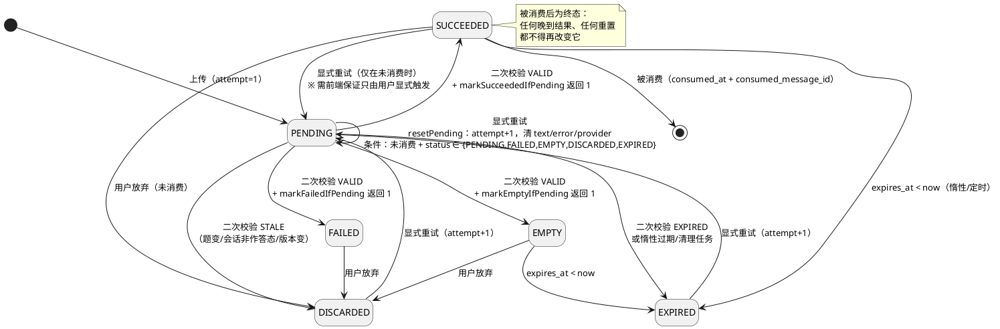

**状态语义与终态约束**

| 状态 | 是否可被晚到结果改变 | 是否可被重置 | 是否可消费 | 说明 |
|------|-------------------|-------------|-----------|------|
| `PENDING` | 是（仅本 `attempt`） | 是（`attempt+1`） | 否 | 唯一可回写的起点状态 |
| `SUCCEEDED` | **否** | 仅未消费时由**用户显式重试**重置 | 是（未过期、未消费） | 晚到结果不得改其文本或状态 |
| `EMPTY` | **否** | 用户显式重试 | 否 | 提示重新录音 |
| `FAILED` | **否** | 用户显式重试 | 否 | 保留音频以便重试 |
| `DISCARDED` | **否** | 用户显式重试 | 否 | 题变/放弃的归宿 |
| `EXPIRED` | **否** | 用户显式重试 | 否 | 过期后不可恢复（`spec.md` 5.4.1-5） |

**关键规则**：`SUCCEEDED → PENDING` 的箭头只在"记录未消费 + 用户显式重试同一音频"时成立。晚到结果**永远**只能触发 `PENDING → {SUCCEEDED, EMPTY, FAILED, DISCARDED, EXPIRED}`，不得触发任何反向箭头。这是 R-LA-3 的图形化表达，也是条件更新只以 `status='PENDING'` 为左值的原因。

### 9.2.3 允许操作矩阵（状态 × 操作）

| 操作 ↓ / 记录状态 → | `PENDING` | `SUCCEEDED` | `EMPTY` | `FAILED` | `DISCARDED` | `EXPIRED` | 已消费（任意状态） |
|---|---|---|---|---|---|---|---|
| 上传前校验（用户/会话/题/版本） | 必做 | 必做 | 必做 | 必做 | 必做 | 必做 | 必做 |
| 同音频复用（不调供应商） | 不适用 | **允许**（未过期、未消费） | 不复用结果（重置为新尝试） | 不复用结果（重置为新尝试） | 不复用结果（重置为新尝试） | 不允许（走显式重试重置） | **不允许**（D-01 收敛点） |
| 同音频进行中互斥（409） | **允许**（新鲜 ≤60s） | 不适用 | 不适用 | 不适用 | 不适用 | 不适用 | 不适用 |
| 显式重试重置 | 允许（僵死接管） | 允许（未消费） | 允许 | 允许 | 允许 | 允许 | **拒绝** |
| 晚到成功回写 | **允许**（本 `attempt`） | 拒绝（0 行） | 拒绝 | 拒绝 | 拒绝 | 拒绝 | 拒绝 |
| 晚到空识别回写 | **允许**（本 `attempt`） | 拒绝 | 拒绝 | 拒绝 | 拒绝 | 拒绝 | 拒绝 |
| 晚到失败回写 | **允许**（本 `attempt`） | 拒绝 | 拒绝 | 拒绝 | 拒绝 | 拒绝 | 拒绝 |
| 用户放弃（V4） | 允许 | 允许（未消费） | 允许 | 允许 | 幂等无副作用 | 不允许改写为 `DISCARDED` | **拒绝 409** |
| 惰性过期 | 允许（`expires_at < now`） | 允许 | 允许 | 不改写 | 不改写 | 不改写 | 不改写 |
| 确认提交消费 | 拒绝 | **允许**（未过期、未消费） | 拒绝 | 拒绝 | 拒绝 | 拒绝 | 重放分支允许（同内容 + 同幂等键） |
| V3 刷新查询返回 | 返回 `PENDING` | 返回文本 | 返回 `EMPTY` | 返回 `null` | 返回 `null` | 返回 `null` | **当前会返回文本（缺口 D-01），设计应为 `null` 或显式不可用** |
| 清理任务删除 | 过期 24h 未消费 | 过期 24h 未消费 | 过期 24h 未消费 | 过期 24h 未消费 | 过期 24h 未消费 | 过期 24h 未消费 | 7 天清文本 / 30 天删除 |

### 9.2.4 旧请求返回时的判定结果表

上传时四项合法（用户、会话、题目、版本），返回时状态可能已变。判定顺序固定（见 9.3.2），结果只有五种 `Guard`：

| 返回时实际状态 | 判定 | 记录落盘 | 对外 HTTP / key / reason | 正式数据变化 |
|---|---|---|---|---|
| 会话仍 `WAITING_ANSWER`、版本一致、当前题一致、记录 `PENDING`、本 `attempt`、未消费、未过期 | `VALID` | 条件回写为 `SUCCEEDED`/`EMPTY`/`FAILED` | 200 + `VoiceTranscriptionVO` | 无 |
| 另一标签页已提交本题并进入下一题（版本 +1、当前题变化） | `STALE` | `DISCARDED`（仅 `PENDING` 且本 `attempt`） | 409 / `STALE_INPUT` / `QUESTION_CHANGED` | 无 |
| 用户结束面试（`ENDING`/`REPORTING`/`COMPLETED`） | `STALE` | `DISCARDED` | 409 / `STALE_INPUT` / `QUESTION_CHANGED`（建议 `SESSION_CLOSED`，D-04） | 无 |
| 用户在另一标签页先提交了**本题**回答（`GENERATING`） | `STALE` | `DISCARDED` | 409 / `STALE_INPUT` / `QUESTION_CHANGED` | 无 |
| 记录已被用户放弃 | `GONE` | **不改写**（保持 `DISCARDED`） | 409 / `STALE_INPUT` / 当前为 `QUESTION_CHANGED`，建议 `TRANSCRIPTION_DISCARDED`（D-04） | 无 |
| 记录已过期 | `EXPIRED` | `EXPIRED`（仅 `PENDING` 且本 `attempt`） | 409 / `STALE_INPUT` / `TRANSCRIPTION_EXPIRED` | 无 |
| 记录已被消费 | `GONE` | **不改写**（保持 `consumed_at`） | 409 / `STALE_INPUT` | 无 |
| 记录已被新尝试接管（`attempt` 更大） | `OLD_ATTEMPT` | **不改写** | 409 / `STALE_INPUT`（建议 `SUPERSEDED`，D-04） | 无 |
| 记录不存在 / 不属于该用户或会话 | `GONE` | **不改写** | 404 或 409（取决于调用点，见 9.3.4） | 无 |
| 回写条件更新返回 0 行（校验后极短窗口内被放弃/过期/新尝试） | `STALE` | 仅 `markDiscardedIfPending` 兜底 | 409 / `STALE_INPUT` | 无 |

**判定结果的落地要求**：上表每一行的"正式数据变化"列必须为"无"。验收时用 `interview_message`（`role='USER'`）、`ai_task`、`interview_session.version` 三个计数/值同时断言，而不是只看转写表。

### 9.2.5 关键不变量（晚到场景下仍必须成立）

| 编号 | 不变量 | 检查点 |
|---|---|---|
| I-1 | 转写不创建 `interview_message`、不创建 `interview_turn_evaluation`、不创建 `ai_task` | `VoiceMapper` 语句边界；`askedQuestions`/`userAnswers`/`taskCount` 断言 |
| I-2 | 转写不改变 `interview_session.version` 与 `status` | `session.version` / `status` 断言 |
| I-3 | 已消费记录是终态 | `markConsumed` 只在 `SUCCEEDED + 未过期 + 未消费` 成立，且行数=1 |
| I-4 | 每条转写最多被一条正式回答消费 | `consumed_message_id` 唯一 + 行数校验 + 同事务 |
| I-5 | 晚到结果不改变已提问数 | `askedQuestions` 前后相等 |
| I-6 | 供应商调用不发生在事务内 | 代码结构审查 + 连接池指标（无长事务） |

---

## 9.3 阶段 2：返回后二次校验

### 9.3.1 事务边界（设计契约）

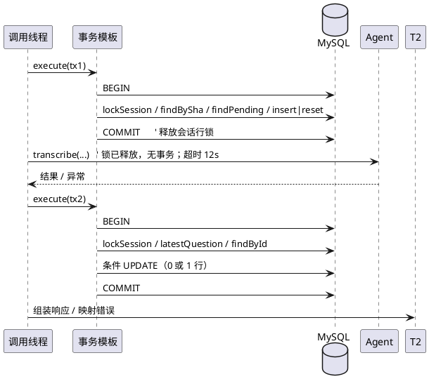

**边界规则（必须逐条满足）**

| 规则 | 依据 | 违反后果 |
|---|---|---|
| `tx1` 只包含"校验 + 记录创建/复用/重置"，不包含供应商调用 | 2.8 并发实现要点；本轮 R-LA-4 | 长事务持会话行锁 12s，阻塞提交与结束 |
| `tx2` 只包含"二次校验 + 条件回写 + 回读"，不包含外部调用 | 同上 | 同上 |
| `tx2` 内**禁止**调用 `InterviewMapper.insertMessage` / `TaskService.create` / `updateTaskStatus` | I-1、I-2 | 晚到结果会写正式数据 |
| 两个事务之间不共享 `EntityManager`/会话缓存，全部以数据库读取为准 | 默认隔离级别下避免读到旧快照 | 二次校验读到过期视图 |
| 锁持有时间的上界 = `lockSession` + `latestQuestion` + `findById` + 1 条 UPDATE + `findById` | 设计目标 ≤ 20ms（本地库） | 超时/锁等待 |

**为什么 `tx2` 还需要 `lockSession`**：`InterviewService.answer` 在提交回答时也持有同一会话行锁。只有两侧都用同一把锁，"仍允许作答"的判定与"插入正式回答"才能串行化，否则会出现"校验时仍可答 → 提交把手插入回答 → 转写回写成功"的窗口，产生一条已进入下一题却仍有候选转写的状态。这是本轮最关键的并发不变量。

### 9.3.2 校验顺序（固定，不得调整）

| 序号 | 校验 | 依据字段 | 失败 `Guard` | 失败语义 |
|---|---|---|---|---|
| 1 | 会话存在且属于当前用户 | `SELECT … WHERE id=? AND user_id=? FOR UPDATE` | `GONE` | 不存在 / 越权（不区分） |
| 2 | 会话仍允许作答 | `status == 'WAITING_ANSWER'` | `STALE` | 已结束/生成中/报告中 |
| 3 | 会话版本未推进 | `session.version == 请求发起时版本` | `STALE` | 另一标签页已提交/结束 |
| 4 | 当前题目未变化 | `latestQuestion.id == questionMessageId` | `STALE` | 已进入下一题 |
| 5 | 记录存在且属于该用户/会话 | `findById(id, userId, interviewId)` | `GONE` | 记录被清理/越权 |
| 6 | 记录仍待处理 | `status == 'PENDING'` | `GONE` | 已放弃/已成功/已过期 |
| 7 | 未被消费 | `consumed_at IS NULL` | `GONE` | 已绑定正式回答 |
| 8 | 尝试标识匹配 | `record.attempt == 本次调用携带 attempt` | `OLD_ATTEMPT` | 已被新尝试取代 |
| 9 | 未过期 | `expires_at > now` | `EXPIRED` | 业务有效期已过 |

**顺序理由**：

1. **先判会话、后判记录**：会话级失效（题变/结束）比记录级失效更常见，先判可减少无意义读取；更重要的是，1–4 步在会话行锁内完成，保证判定与提交互斥。
2. **`GONE` 与 `STALE` 分开**：`GONE` 表示"这条记录本身不该再被动"，**不做任何落盘**；`STALE`/`EXPIRED` 表示"这条记录是本请求创建的，可以落失效态"。若混为一谈，会出现"已放弃记录被晚到结果从 `DISCARDED` 改成别的东西"的复活风险。
3. **第 6 步必须在第 8 步之前**：`attempt` 只在 `PENDING` 上有意义；已终态记录的 `attempt` 不再参与判定。
4. **第 9 步放最后**：过期只影响"能否成功"，不影响"属于本尝试"的判定；这样过期场景能准确落 `EXPIRED` 而不是 `DISCARDED`。

### 9.3.3 每个 `Guard` 的落盘动作（白名单）

| `Guard` | 允许的落盘动作 | 禁止的动作 |
|---|---|---|
| `VALID` | `markSucceededIfPending` / `markEmptyIfPending` / `markFailedIfPending`（`id + attempt + PENDING + 未消费 + 未过期`） | 任何非条件更新 |
| `STALE` | `markDiscardedIfPending(id, attempt)` | 改 `SUCCEEDED`、改会话、写消息 |
| `EXPIRED` | `markExpiredIfPending(id, attempt)` | 改 `SUCCEEDED`、恢复 `text` |
| `OLD_ATTEMPT` | **无** | 任何写入（含 `DISCARDED`） |
| `GONE` | **无** | 任何写入 |

**说明**：`OLD_ATTEMPT` 与 `GONE` 不落盘，是为了遵守"旧尝试的请求不得产生任何可观察副作用"。旧尝试的 `PENDING` 状态会由**新尝试**的后续转移或过期清理来处理，不会被旧请求"顺手"改成 `DISCARDED`——否则新尝试还在进行中，记录却已被旧请求标成放弃，前端会看到一个自相矛盾的状态。

### 9.3.4 对外错误码与状态约定

| 场景 | HTTP | `error.key` | `details.reason` | 前端动作 |
|---|---|---|---|---|
| 会话/题目/版本已变 | 409 | `STALE_INPUT` | `QUESTION_CHANGED` | 提示未生效，刷新会话，不覆盖编辑区 |
| 会话已结束 | 409 | `STALE_INPUT` | `QUESTION_CHANGED`（建议 `SESSION_CLOSED`） | 刷新后进入结束/报告页 |
| 记录过期 | 409 | `STALE_INPUT` | `TRANSCRIPTION_EXPIRED` | 保留录音，提示重新录音或重试 |
| 记录被放弃/消费 | 409 | `STALE_INPUT` | `TRANSCRIPTION_DISCARDED` / `TRANSCRIPTION_CONSUMED` | 不覆盖编辑区 |
| 旧尝试被取代 | 409 | `STALE_INPUT` | 建议 `SUPERSEDED` | 静默（新请求会给出结果） |
| 相同音频仍在识别 | 409 | `TASK_IN_PROGRESS` | `details.recordId` | 轮询 V3，不重复上传 |
| 供应商不可用/超时 | 503 / 504 | `DEPENDENCY_UNAVAILABLE` | 供应商原因 | 保留录音 + 重试 / 改文字 |
| 空识别 | 200 | — | `status=EMPTY` | 提示重新录音 |
| 记录不存在（越权/被清理） | 404 | `RESOURCE_NOT_FOUND` | — | 不猜测 |

**一致性要求**：`details.reason` 的取值集合必须在 `VoiceTranscriptionService`、`InterviewService`、前端提示映射三处使用同一套常量语义；当前三者存在不一致（D-11）。

### 9.3.5 "不写正式回答、不改变题数"的验收落点

| 断言 | SQL 口径 | 期望 |
|---|---|---|
| 无用户消息 | `COUNT(*) FROM interview_message WHERE interview_id=? AND role='USER'` | 与请求前相同（晚到场景为 0） |
| 无新提问 | `COUNT(*) … role='ASSISTANT'` | 与请求前相同 |
| 无新任务 | `COUNT(*) FROM ai_task WHERE resource_id=? AND operation='INTERVIEW_TURN'` | 与请求前相同 |
| 会话未推进 | `SELECT version,status FROM interview_session WHERE id=?` | `version` 不变；`status` 只在"另一标签页结束"场景中被**对方**改变，转写自身不得改 |
| 无评价 | `COUNT(*) FROM interview_turn_evaluation WHERE interview_id=?` | 不变 |

---

## 9.4 阶段 3：防旧覆盖新

### 9.4.1 为什么"记录 ID"与"PENDING"都不够

| 判据 | 反例 | 结论 |
|---|---|---|
| 记录 ID | 显式重试复用同一条记录（`resetPending` 不换 ID），新旧两次调用拿到同一个 ID | 不能区分 |
| `status='PENDING'` | 旧请求返回时，新请求刚把记录重置为 `PENDING` 且尚未返回；此时旧请求看到 `PENDING` 会误判为"自己的记录仍可写" | 不能区分 |
| `updated_at` | 只能表达"最近被改过"，无法表达"被哪一次改过"；且依赖时钟精度 | 不能区分 |
| 请求时间/幂等键 | 数据库没有保存，无法在条件更新中比较 | 不能区分 |

因此必须**持久化识别尝试标识**（R-LA-1），并让**每一条回写**都携带它。

### 9.4.2 `attempt` 迁移设计（`V17`，已存在，本轮固化语义）

| 项 | 设计 | 现状 |
|---|---|---|
| 列定义 | `attempt INT UNSIGNED NOT NULL DEFAULT 1`，位于 `status` 之后 | 已实现 |
| 约束 | `CHECK (attempt >= 1)` | 已实现 |
| 历史数据 | 默认值 1，无需回填（`V15` 已上线，历史行语义为"第一次尝试"） | 已实现 |
| 新插入 | `insertPending` 不写该列，由默认值给出 1 | 已实现 |
| 显式重试 | `attempt = attempt + 1`，同时清 `text/error_key/provider`、重置 `interview_version`/`expires_at` | 已实现 |
| 回写 | 三条路径都带 `id + attempt` | 成功/空已带；失败需补 `expires_at`（D-03） |
| 对外字段 | `VoiceTranscriptionVO.attempt`（可选） | 已实现，前端类型已加可选字段 |
| 不修改已执行迁移 | 不改 `V15`，`V17` 只加列 + CHECK | 已遵守 |

**为什么用 `attempt` 而不是"记录版本号"**：`attempt` 语义单一（一次供应商调用），不与记录内容版本混淆；递增只发生在"用户显式重试"这一处，写入点唯一，便于静态审查。若用通用的 `row_version`，任何一次文本/状态更新都要递增，晚到请求反而更难判断。

### 9.4.3 条件更新语义（设计契约，不列出实现代码）

所有对转写记录的状态写入都必须满足"左值状态 + 右值目标 + 本尝试 + 未消费 (+ 未过期)"四要素，并检查受影响行数。

| 语句（语义名） | SET 目标 | WHERE 必须包含 | 期望行数 | 0 行含义 | 调用方处理 |
|---|---|---|---|---|---|
| `insertPending` | `status='PENDING'`，`attempt` 取默认 1 | 唯一键 `(interview_id, question_message_id, audio_sha256)` 兜底 | 1（或唯一键冲突） | 并发插入冲突 | 回读既有记录并按状态返回（409 或复用） |
| `resetPending` | `status='PENDING'`，`attempt=attempt+1`，清文本/错误/供应商，刷新版本与过期时间 | `id` + `consumed_at IS NULL` + `status IN (PENDING,FAILED,EMPTY,DISCARDED,EXPIRED)` | 1 | 记录已消费或状态不允许 | 409 `STALE_INPUT`（`TRANSCRIPTION_CONSUMED`） |
| `markSucceededIfPending` | `status='SUCCEEDED'`，写文本/供应商，刷新 `expires_at` | `id` + `attempt` + `status='PENDING'` + `consumed_at IS NULL` + `expires_at > now` | 1 | 本尝试已失效 | 落 `DISCARDED` 兜底并返回 409 |
| `markEmptyIfPending` | `status='EMPTY'`，`text=NULL`，写供应商 | 同上 | 1 | 同上 | 同上 |
| `markFailedIfPending` | `status='FAILED'`，`text=NULL`，写 `error_key` | `id` + `attempt` + `status='PENDING'` + `consumed_at IS NULL` + **`expires_at > now`（待补）** | 1 | 同上 | 同上 |
| `markDiscardedIfPending` | `status='DISCARDED'`，`text=NULL` | `id` + `attempt` + `status='PENDING'` + `consumed_at IS NULL` | 1 或 0 | 已是终态或新尝试 | 忽略结果（不重试） |
| `markExpiredIfPending` | `status='EXPIRED'`，`text=NULL` | `id` + `attempt` + `status='PENDING'` + `consumed_at IS NULL` | 1 或 0 | 同上 | 忽略结果 |
| `markDiscarded`（用户放弃） | `status='DISCARDED'`，`text=NULL` | `id` + `consumed_at IS NULL` + `status IN (PENDING,SUCCEEDED,EMPTY,FAILED)` | 1 | 已消费/已过期 | 已消费 → 409；已过期 → 不改写 |
| `expireIfStale`（惰性/定时） | `status='EXPIRED'`，`text=NULL` | `id`（或全表）+ `status IN (PENDING,SUCCEEDED,EMPTY)` + `expires_at < now` | 0..n | 非可过期状态 | 忽略 |
| `markConsumed` | `consumed_at`，`consumed_message_id` | `id` + `consumed_at IS NULL` + `status='SUCCEEDED'` + `expires_at > now` | 1（必须） | 已被消费/已过期/非成功 | 抛 `STALE_INPUT` 并回滚整个提交事务 |

**为什么 `markDiscarded` 不限制 `attempt`**：用户放弃针对的是"这条记录"，不是"这一次尝试"；但它的条件是"未消费 + 未处于 `EXPIRED`/`DISCARDED`"，因此放弃不会把过期记录改写为放弃（保留"过期"这一更准确的原因）。

### 9.4.4 受影响行数的统一处理规则

| 行数 | 处理 | 禁止 |
|---|---|---|
| `1` | 视为本次写入生效，继续返回结果或回读记录 | — |
| `0` | 视为"本尝试已失效"，**不重试写入**、不回滚为成功、不改会话 | 用 `UPDATE` 再试一次；用 `INSERT … ON DUPLICATE` 补写；把 0 行当作成功 |
| `>1` | 视为数据异常（主键/唯一键被破坏），记录告警并返回 500 | 静默忽略 |

**0 行的二次判定**：不直接映射为固定错误，而是回读记录后判定 `Guard`：
1. 记录 `status='EXPIRED'` → `TRANSCRIPTION_EXPIRED`；
2. 记录 `consumed_at != null` → `TRANSCRIPTION_CONSUMED`；
3. 记录 `attempt` 已更大 → `SUPERSEDED`；
4. 其余 → `QUESTION_CHANGED`。

这样对外错误码与真实原因一致，前端提示不会误导。

### 9.4.5 三条回写路径的统一条件表（缺口 D-03）

| 条件 | 成功 | 空识别 | 失败 | 结论 |
|---|---|---|---|---|
| `id = ?` | ✓ | ✓ | ✓ | 一致 |
| `attempt = ?` | ✓ | ✓ | ✓ | 一致 |
| `status = 'PENDING'` | ✓ | ✓ | ✓ | 一致 |
| `consumed_at IS NULL` | ✓ | ✓ | ✓ | 一致 |
| `expires_at > now` | ✓ | ✓ | **✗** | **需补齐** |
| 检查行数 | ✓ | ✓ | ✓ | 一致 |

**补齐理由**：失败回写同样改变对外可见状态（`PENDING → FAILED`）。若记录已过期，正确归宿是 `EXPIRED`；允许失败回写会把"过期"改写成"失败"，虽然两者都不可消费，但会污染"过期原因"的统计与用户提示（用户看到"识别失败"而不是"结果已过期"），并使三条路径无法用同一断言覆盖。补齐后，任何"过期后到达的结果（无论成功/空/失败）"都只会落 `EXPIRED`。

### 9.4.6 迁移与兼容

| 项 | 设计 |
|---|---|
| 迁移文件 | `V17__add_voice_transcription_attempt.sql`（已执行，不改） |
| 前向兼容 | 旧客户端不读 `attempt`，新增字段为附加信息，不影响响应解析 |
| 回滚风险 | **应用回滚到不识别 `attempt` 的旧版本时，旧代码的条件更新会覆盖新尝试**。因此回滚前置条件：`app.voice.asr-enabled=false`（或关闭语音入口）并等待在途转写排空，再回滚应用；不允许"只回滚应用、继续开语音" |
| 数据库回滚 | 不删除列（保留默认值 1，旧版本 `SELECT *` 能正常工作）；如需删除，必须先完成上述前置条件 |
| 正式库 | 本轮不迁移；仅在专用测试库演练 |

### 9.4.7 同题多 `PENDING` 的收敛（缺口 D-06/D-02）

现状：上传阶段只拦截"新鲜（`updated_at` 60 秒内）的 `PENDING`"。超过 60 秒的僵死 `PENDING` 不拦截，于是同题可能并存两条 `PENDING`（不同 `audio_sha256`）。两条都在 `VALID` 条件下各自回写成功，产生两条 `SUCCEEDED`；`V3` 用 `created_at DESC` 取最新，可能取到旧尝试或错误记录。

| 收敛动作 | 位置 | 条件 | 效果 |
|---|---|---|---|
| 落陈旧 `PENDING` | `tx1` 会话锁内，插入/重置之前 | 同 `interview_id + question_message_id`、`status='PENDING'`、`id != 本次记录`、`updated_at` 超过新鲜窗口 | 把僵死尝试置为 `DISCARDED`；其晚到结果因 `status` 非 `PENDING` 而 `GONE`，不产生第二条 `SUCCEEDED` |
| 修正查询排序 | `findLatestByQuestion` / `findPendingByQuestion` | `ORDER BY updated_at DESC, attempt DESC` | 重试复用记录（`created_at` 不变）仍能被正确识别为最新 |
| 索引评估 | 可选 `V18` | 若 `EXPLAIN` 显示 filesort 或全表扫描 | 增加 `(interview_id, question_message_id, status, updated_at)` 复合索引；小数据量下先用现有 `idx_voice_question` |

**为什么不选"回写时用子查询比较"**：条件更新里加入"不存在更新的 `PENDING`"子查询会把每一条回写变成范围扫描 + 额外锁，且与 `attempt` 语义重复；在会话行锁内收敛是单点、可测、可回滚的做法。
---

## 9.5 阶段 4：幂等与重试语义分层

> 结论先行：本系统提供的是**分层幂等**，不是跨网络的 exactly-once。没有供应商侧幂等键时，任何"绝对只调用一次"的承诺都是不成立的（R-LA-5）。

### 9.5.1 四层语义

| 层 | 场景 | 判据 | 行为 | 是否调用供应商 | 是否新建记录 | 是否改题数 |
|---|---|---|---|---|---|---|
| **L1 成功复用** | 同一会话、同一题、同一音频（`sha256` 相同），记录 `SUCCEEDED`、未消费、未过期 | 唯一键 + 状态条件 | 直接返回既有文本（`reused=true`） | 否 | 否 | 否 |
| **L2 进行中互斥** | 同一音频仍在识别，`PENDING` 且 `updated_at` 在新窗口内（60 秒） | 同 sha + `PENDING` + 新鲜 | 409 `TASK_IN_PROGRESS`（带既有记录 ID） | 否 | 否 | 否 |
| **L3 显式重试** | 用户点击"重试识别"，或刷新后重新上传同一音频 | 记录非 `SUCCEEDED` 可复用，或已僵死 | 复用记录并 `attempt+1`，回到 `PENDING` | **是**（新尝试） | 否（同 sha）/ 是（新 sha） | 否 |
| **L4 结果未知（超时/网络中断）** | 请求超时或连接中断，但供应商可能已完成 | 无法判定 | 若 `tx2` 校验有效则落 `FAILED`；否则保持原状态 | 已发生 | — | 否 |

### 9.5.2 各层边界与明确承诺

| 承诺 | 是否成立 | 依据与限制 |
|---|---|---|
| 相同音频成功后重复上传不重复调用供应商 | **成立** | 唯一键 + `SUCCEEDED` 复用（需补"未消费"条件，D-01） |
| 进行中的相同音频不重复调用供应商 | **成立（60 秒窗口内）** | `PENDING` 新鲜度互斥；超过窗口视为僵死，允许接管（设计选择，非缺陷） |
| 显式重试允许创建新识别尝试 | **成立** | `attempt+1`；旧尝试晚到被拒 |
| 旧尝试的成功/失败不覆盖新尝试 | **成立** | 条件更新含 `attempt` |
| 跨网络故障"绝对只调用一次" | **不成立** | 供应商无幂等键；网络在"供应商已受理但响应丢失"时无法判定；重复调用最多多计费一次 |
| 超时后自动重试供应商 | **不做** | 自动重试会放大重复计费风险；只允许用户显式重试 |

**超时但结果未知的重试策略（设计决策）**：

1. `SpeechAgentClient` 超时（12s）后，`VoiceTranscriptionService` 在 `tx2` 中按正常失败路径处理：校验仍有效 → 落 `FAILED` + `error_key`；返回 504（`retryable=true`）。
2. 若记录已失效（题变/结束/过期/新尝试）→ 不改写，返回 `STALE_INPUT`。
3. 用户重试 → 走 L3（`attempt+1`）。若供应商实际上已处理第一次，会产生第二次调用与计费，这是在"无幂等键"前提下的可接受代价；**不得**通过自动重试或轮询补偿来掩盖这一点。
4. 该策略必须写入对外错误文案的语义：提示"识别失败，可重试"，而不是"已保证只处理一次"。

### 9.5.3 审计与排障标识

| 标识 | 现状 | 设计建议 | 理由 |
|---|---|---|---|
| `requestId`（Java → Agent） | `nameUUID("voice:" + recordId)`（`VoiceTranscriptionService.java:359-361`） | 派生键加入 `attempt`（D-05） | 同一记录多次尝试在 Agent 日志中可区分；不影响 JWT `taskIds` 声明结构 |
| 日志字段 | `interview`、`question`、`sha8`、`bytes`、`duration_ms`、`outcome` | 增加 `attempt`（不含文本） | 排障时无需读转写全文 |
| 错误码 | `error_key` 落库 | 增加失败尝试号到结构化日志 | 区分"首次失败"与"重试仍失败" |

**日志红线（不得违反）**：不记录音频字节、不记录转写全文、不记录 `Idempotency-Key` 原文、不记录语音服务密钥与内部 JWT 原文（`spec.md` 4.3-5）。

### 9.5.4 重复确认提交的幂等语义

| 场景 | 防线 | 结果 | 验收断言 |
|---|---|---|---|
| 同一幂等键重复提交 | `tasks.replay` | 返回同一任务，不重复写消息 | `USER` 消息数不变、`ai_task` 数不变 |
| **不同幂等键**、同一 `questionMessageId`、并发提交 | 会话行锁 + `answerByQuestion` + `markConsumed` 行数=1 | 一个成功；另一个 409（`INVALID_STATE`/`TASK_IN_PROGRESS`/`STALE_INPUT`），整个事务回滚 | `USER` 消息恰 1 条、`ai_task` 恰 1 个、`consumed_message_id` 唯一且指向该消息 |
| 已消费转写被再次绑定 | `consumed_message_id` 校验 + `markConsumed` 0 行 | 409 `STALE_INPUT`（`TRANSCRIPTION_CONSUMED`） | 不产生第二条消息 |
| 并发时后到者已插入消息但 `markConsumed` 0 行 | 同事务回滚 | 消息与任务一起回滚 | 断言回滚后 `ai_task` 计数不增加 |

**关键点**：`markConsumed` 的 0 行必须在**同一事务内**抛出并触发回滚，否则会留下"一条没有消费转写的正式回答"。当前实现已满足（`InterviewService.java:218-221`），但缺少并发用例证明（9.7 LA-09b）。

---

## 9.6 阶段 5：前端处理

### 9.6.1 请求令牌设计（已实现，本轮固化）

| 要素 | 设计 |
|---|---|
| 令牌载体 | `useVoiceAnswer` 内部单调递增整数（`requestToken`），不进入全局状态 |
| 递增时机 | 发起转写、发起恢复轮询、`reset()`（切题/重录/放弃）、组件卸载 |
| 返回校验 | `token === requestToken` **且** `question.id === 发起时题目 ID` |
| 失效处理 | 不修改编辑区、不修改 `transcriptionId`、写 `notice`；组件若已卸载则直接丢弃 |
| 组件级兜底 | `VoiceAnswerPanel` 以 `interviewId:questionId` 为 `key`，切题强制重建并 `reset()` |

**为什么需要"令牌 + 题目 ID"双判**：令牌能挡住"同题内的旧请求"，题目 ID 能挡住"跨题的旧请求"。只靠题目 ID 无法区分同一题上两次识别（重试）的先后；只靠令牌在组件被复用（无 `key`）时可能因 `reset()` 顺序问题漏判。

### 9.6.2 前端提示与状态矩阵

| 后端结果 | 前端状态 | 提示 | 编辑区 | 录音 | 可执行动作 |
|---|---|---|---|---|---|
| 200 `SUCCEEDED`（当前题） | `EDITING` | "识别结果需确认" | 回填 | 保留 | 编辑 / 提交 / 重录 |
| 200 `EMPTY`（当前题） | `ANSWERABLE` | "没有识别到语音，请重新录音" | 清空 | 保留 | 重录 / 改文字 |
| 200 `SUCCEEDED`（旧题/令牌失效） | 不变 | **"题目已变化，本次识别未生效"**（warning） | **不覆盖** | 若仍属当前题则保留 | 继续当前题 |
| 409 `STALE_INPUT / QUESTION_CHANGED` | `ANSWERABLE` | 同上 | 不覆盖 | 保留 | 刷新会话（父组件已处理 409） |
| 409 `TRANSCRIPTION_EXPIRED` | `ANSWERABLE` | "识别结果已过期，请重新录音" | 不覆盖 | 保留 | 重试识别 / 重录 / 改文字 |
| 409 `TASK_IN_PROGRESS` | `TRANSCRIBING` | 静默 + 轮询 V3 | 不覆盖 | 保留 | 等待 |
| 409 `SUPERSEDED`（建议新增） | 不变 | 静默（新请求会给出结果） | 不覆盖 | 保留 | 等待新结果 |
| 503/504 `DEPENDENCY_UNAVAILABLE` | `ANSWERABLE` | "语音识别失败，录音已保留，可重试识别或改用文字" | 不覆盖 | **保留** | 重试识别 / 改文字 |
| 415 / 413 / 400 | `ANSWERABLE` | 对应格式/大小/时长提示 | 不覆盖 | 保留（415/413 需重录） | 重录 |

### 9.6.3 编辑区不被覆盖的三道防线（+1 条建议）

| 防线 | 实现位置 | 拦截的失败模式 |
|---|---|---|
| 1 请求令牌 | `useVoiceAnswer.ts:31-33,95,111,126` | 同题内旧请求晚到 |
| 2 题目 ID 复核 | 同上 `stillCurrent()` | 跨题晚到 |
| 3 组件 `key` 重建 + `reset()` | `InterviewView.vue:690-696`；`VoiceAnswerPanel.vue:48-57` | 题目变化时的状态残留 |
| 4 版本快照（建议，P2） | `transcribe` 记录发起时的 `interview.version`，返回时比较 | 同题但会话版本已变（另一标签页提交失败/重试） |

**关于第 4 条**：后端已经会用 409 拦截版本变化，因此第 4 条是**体验增强**而非正确性必需。若实现，必须仍然以后端结果为准，不得用前端版本判断替代 409 处理。

### 9.6.4 `TEXT` / `VOICE` 来源传递

| 场景 | `answerSource` | `voiceTranscriptionId` | 约束 |
|---|---|---|---|
| 语音模式提交 | `VOICE` | 必须非空 | 为空时前端禁用提交（`canSubmit`） |
| 语音转文字模式 | `TEXT` | **不得携带**（父组件按来源条件展开） | 携带会被后端 400 |
| 文字模式原生输入 | `TEXT` | 不携带 | 同现状 |
| 提交失败重试 | 沿用首次的 `answerSource` + `voiceTranscriptionId` + 相同 `content` | 同左 | `spec.md` 5.5.1-2；后端 `answerByQuestion` 要求内容一致 |
| 识别失败后重试 | 重新走一次转写，成功后得到**同一或新的** `transcriptionId` | 新结果为准 | 重试不得增加题数 |
| 切文字后切回语音 | `VOICE` | 仅当存在未消费的 `SUCCEEDED` 转写 | 否则回到 `ANSWERABLE`（`backToVoice()`） |

**不变量**：前端任何本地的"来源"切换都不改变后端题数与正式回答数；来源只影响消息的 `answer_source` 字段。

### 9.6.5 题数一致性

1. 前端不维护任何本地题数计数器，只展示后端返回的 `askedCount` / `remainingQuestions` / `questionCountRule`。
2. 转写、重试、放弃、刷新、切文字均不触发任何"增加题数"的乐观更新。
3. 唯一的题数变化来源是 `INTERVIEW_TURN` 成功后的会话刷新（既有 `useTask` 流程）。
4. 验收时以数据库 `COUNT(*)` 为准，不以页面文案为准。

---

## 9.7 阶段 6：真实数据库测试矩阵

### 9.7.1 测试基础设施设计

| 要素 | 设计 | 现状 |
|---|---|---|
| 专用库 | `career_business_test`（`VOICE_TEST_DB_URL` 可覆盖，默认 3307），Flyway 执行到 `V17` | 已具备 |
| 禁止触碰正式库 | 只读正式库不允许；测试库名必须显式含 `_test`；脚本启动前断言 `SHOW DATABASES LIKE '%\_test'` | 已具备（需在用例中显式断言） |
| 受控供应商替身 | `@MockitoBean SpeechAgentClient`，`BlockingQueue<Call>`，`Call.started` / `Call.release` 双 `CountDownLatch` | 已具备（`VoiceLateArrivalIntegrationTest.java:69-78`） |
| 延迟制造 | `Call.release.await(30s)`：测试未放行前供应商阻塞 | 已具备 |
| 乱序制造 | 两个 `Call` 分别放行：先放行后发起的请求，再放行先发起的请求 | 已具备（LA-07/LA-08） |
| 故障注入 | `Call.failure` 赋 `BusinessException`（504/503） | 已具备（LA-08） |
| 独立事务 | 参与者全部通过 `service` 方法各自的 `TransactionTemplate` 开户；测试线程不手动开启事务 | 已具备 |
| 同步屏障 | 测试必须在"状态变更提交之后"才 `release`，否则测的是"供应商未返回"而非"结果晚到" | 已具备但需显式化 |
| 断言方式 | `JdbcTemplate` 直查业务表；断言会话、消息、任务、转写四张表 | 部分具备（缺 `ai_task` 与 `status` 全面断言） |
| 隔离 | 每个用例随机 UUID 用户/会话/题目，断言按本会话 ID 限定，不依赖清库 | 已具备 |
| 付费调用 | 0 次；替身不发起 HTTP | 已具备 |

**同步屏障的精确要求（本轮新增设计约束）**：

1. `started` 屏障：保证"供应商调用已进入"之后，测试线程再执行状态变更（提交回答/结束面试/放弃/过期）。否则状态变更可能发生在 `PENDING` 插入之前，测到的是"上传前被拒"而非"晚到被拒"。
2. `release` 屏障：保证"状态变更事务已提交"之后，才让供应商返回。否则回写可能先赢锁，测到的是"正常成功"。
3. 两个屏障缺一不可；只有 `CountDownLatch` 但顺序颠倒，用例会"通过"却什么都没验证。

### 9.7.2 用例矩阵

> 现状列：**已实现** = `VoiceLateArrivalIntegrationTest` 中已有；**部分** = 存在但制造方式不足以作为真实证据；**缺失** = 本轮必须新增。既有 9 项**不能**当作全矩阵覆盖证据。

| 编号 | 场景 | 制造方式 | 同步屏障 | 核心断言 | 对应需求 | 现状 |
|---|---|---|---|---|---|---|
| LA-01 | 正常识别返回保存一次 | 1 次上传，放行返回文本 | started→release | `status=SUCCEEDED`、`text` 正确、`attempt=1`、`asked=1`、`USER=0`、`version` 不变 | R-LA-2 | 已实现 |
| LA-02 | 相同音频并发上传不重复调用供应商 | 第 1 请求阻塞中，第 2 请求同 sha | 第 2 请求在 started 后发起 | 第 2 返回 409 `TASK_IN_PROGRESS`；`calls` 队列无第 2 项；记录数=1 | R-LA-5 | 已实现 |
| LA-03 | 转写期间另一标签页提交回答，旧结果不能用于下一题 | **真实** `interviewService.answer(...)` + 任务回调推进版本与当前题 | started → answer 提交 → release | 回写 409 `QUESTION_CHANGED`；记录 `DISCARDED`；`USER=1`；`asked=2`；`version=2` | R-LA-3/4 | **部分**（现用 SQL 直插，未过真实锁竞争） |
| LA-04 | 转写期间结束面试，不恢复已结束会话 | **真实** `interviewService.end(...)`（或 `reportTask`） | started → end → release | 回写 409；记录 `DISCARDED`；会话仍 `ENDING`；`USER=0`；无新 `ai_task` | R-LA-3/4 | **部分**（现用 SQL 改 status） |
| LA-05 | 放弃后结果返回不恢复为成功 | 上传中 → `discard()` → 放行成功结果 | started → discard → release | 回写 409；记录保持 `DISCARDED`；`text IS NULL`；记录数=1 | R-LA-3 | 已实现 |
| LA-06 | 过期后结果返回保持失效 | 上传中 → DB 把 `expires_at` 置为过去 → 放行 | started → 过期 → release | 回写 409 `TRANSCRIPTION_EXPIRED`；记录 `EXPIRED`；`text IS NULL` | R-LA-3 | 已实现 |
| LA-07 | 重试后旧成功结果晚到不覆盖新尝试 | 上传①阻塞 → 置 `updated_at` 超窗 → 上传②同 sha（`attempt=2`）→ 先放行① | 两次 started；① release 在 ② 发起后 | ① 返回 409；记录仍 `PENDING`、`attempt=2`、`text NULL`；② 放行后 `SUCCEEDED` 且文本=② | R-LA-1/2 | 已实现（用回拨时间模拟超窗，可保留但需注明"非真实等待"） |
| LA-08 | 旧失败结果晚到不覆盖新成功 | 同 LA-07，先放行 ② 成功，再放行 ① 失败 | 同上 | ① 返回 409；记录保持 `SUCCEEDED`、`error_key IS NULL`、`attempt=2` | R-LA-3 | 已实现 |
| LA-09a | 同一幂等键重复确认提交只保存一条 | 串行两次同 `key` | — | `USER=1`、`ai_task=1`、`asked` 不变 | R-LA-5 | 已实现 |
| **LA-09b** | **不同幂等键并发确认提交同一转写** | 两线程各自 `interviewService.answer`，同 `questionMessageId` 不同 `key` | `CyclicBarrier` 同时发起 | `USER=1`、`ai_task=1`、`consumed_message_id` 唯一；另一请求 409；无残留任务 | R-LA-2/5 | **缺失** |
| **LA-10** | 空识别结果晚到（题变） | 上传中 → 另一标签页提交 → 放行空文本 | started → answer → release | 回写 409 `QUESTION_CHANGED`；记录 `DISCARDED`（非 `EMPTY`）；`text NULL` | R-LA-2/3 | **缺失** |
| **LA-11** | 晚到回写与提交回答真实争会话行锁 | 上传阻塞 → 线程 A 执行 `answer` 并在锁内停住（用可观测点/短延时）→ 放行供应商 | started + 提交已进入 | 结果只可能是：要么回写在 answer 之前成功并被随后提交消费；要么回写被拒并 `DISCARDED`；**不得**出现"回答已提交 + 转写 `SUCCEEDED` 属于旧题" | R-LA-4 | **缺失**（核心） |
| **LA-12** | 放弃后同一音频显式重试 | 上传① → discard → 同 sha 再上传 | started/discard/started | 记录 `attempt=2` 且转回 `PENDING`；① 晚到不改写；② 成功 | 9.2.2 自环 | **缺失** |
| **LA-13** | 已消费记录的相同音频重传 | 提交 VOICE 回答消费 → 同 sha 再上传 | — | 不得复用已消费记录返回 `text`；应 409 或返回不可用态（按 D-01 收敛） | R-LA-3/5 | **缺失** |
| **LA-14** | 同题双 `PENDING` 收敛 | 上传① → 超窗 → 上传②（**不同 sha**） | 两次 started | ① 被置 `DISCARDED`；① 晚到 `GONE`；记录中至多 1 条 `PENDING`；最终 `SUCCEEDED` 记录唯一 | 9.4.7 | **缺失** |
| **LA-15** | 越权用户结果返回 | 用另一用户调用 `transcribe` | — | 404；不创建记录；不读取他人记录 | 4.3-1 | **缺失** |
| **LA-16** | `V17` 迁移与历史兼容 | 建库→V15→插历史行→V17 | — | 历史行 `attempt=1`；`CHECK (attempt>=1)` 拒绝 0；列类型/默认值正确；重复执行由 Flyway 拒绝 | R-LA-1 | **缺失** |
| **LA-17** | 三条回写路径条件一致性 | 分别构造过期记录 + 成功/空/失败结果 | — | 三者都不得从 `EXPIRED` 改写；成功/空/失败的 WHERE 集合一致 | R-LA-2 | **缺失**（D-03 收敛后） |
| **LA-18** | V3 刷新查询排序正确 | 重试复用记录（`created_at` 旧）+ 另一条新记录 | — | 返回 `updated_at/attempt` 最新的一条；不返回旧尝试 | 9.4.7 | **缺失** |

### 9.7.3 不得采用的验证方式（反模式清单）

| 反模式 | 为什么不算证据 |
|---|---|
| 只用 Mock 顺序调用 | 无法暴露事务边界、行锁、快照与真实竞态 |
| 用 SQL 直接改 `status/version` 冒充"另一标签页提交" | 绕过了 `InterviewService` 的锁与校验；只能证明"回写会重新读库"，不能证明"与真实提交串行化" |
| 用 9 项既有测试数量代表覆盖 | 缺少并发提交、空识别、双 `PENDING`、已消费复用、越权、迁移 |
| 只断言返回值，不断言数据库 | 无法发现"返回 409 但记录被改写"或"多了一条消息" |
| 用 `Thread.sleep` 代替屏障 | 时序不稳定，可能在 CI 上偶发通过 |
| 在生产库或含业务数据的库上跑 | 违反"专用测试库、保留原业务数据" |

### 9.7.4 运行与证据要求

| 项 | 要求 |
|---|---|
| 命令 | `mvn -o -Dintegration-tests=true -Djacoco.skip=true -Dsurefire.useManifestOnlyJar=false -Dtest=Voice*IntegrationTest test`（`BUDGET_TEST_DB_URL`/`VOICE_TEST_DB_URL` 指向专用库） |
| 前置 | 测试库已升级到 `V17`；`app.voice.consent-required=false`；Agent 调度关闭 |
| 证据 | 保留 surefire 报告与日志；记录"断言数/用例数"，不写"全部通过"而没有输出 |
| 付费调用 | 0 次；不得设置真实 `DASHSCOPE_API_KEY` 运行该组测试 |
| 失败处理 | 失败用例保留，不删除不跳过；修复后重新运行并记录两次结果 |

---

## 9.8 阶段 7：浏览器回归

> 前置：后端 + Agent（Fake 或真实 ASR）+ 前端运行在专用环境；数据库为**专用浏览器测试库**（沿用既有 `career_voice_browser_test`）。真实 ASR 只做必要次数（建议 ≤ 10 次），其余用 Fake。

| 编号 | 步骤 | 断言 | 数据核对 |
|---|---|---|---|
| BR-01 | 正常：录音 → 停止 → 转写 → 编辑 → 确认提交 | 文本回填、来源 `VOICE`、进入"生成中" | 1 条 USER（`answer_source='VOICE'`）、1 条转写 `consumed_at` 非空 |
| BR-02 | 转写期间另一标签页（B）提交本题 | A 提示"题目已变化，本次识别未生效"；A 编辑区**不被覆盖**；A 刷新后显示新题 | `USER=1`（仅 B）、`asked` 只 +1、无多余 `ai_task` |
| BR-03 | 转写期间另一标签页结束面试 | A 提示未生效；刷新进入结束/报告；不出现新题 | 会话 `ENDING/REPORTING/COMPLETED`；`USER` 不增加 |
| BR-04 | 失败后重试（供应商 503/超时） | 录音保留；"重试识别"可点；成功后文本回填；无重复计费（Fake 计数） | 记录 `attempt=2`；只 1 条最终 `SUCCEEDED` 语义 |
| BR-05 | 刷新恢复（PENDING） | 显示"仍在识别中"，禁止重复上传；识别完成后回填 | 无重复记录 |
| BR-06 | 刷新恢复（SUCCEEDED） | 回填候选文本并标"需确认" | 无新增记录 |
| BR-07 | 切换文字 | 已识别文本保留；提交来源为 `TEXT`；不携带转写 ID | 消息 `answer_source='TEXT'`；无 400 |
| BR-08 | 题数与正式回答 | 全程结束后 | 提问数 = 预算内实际创建数；USER 数 = 有效回答数；报告 1 份 |
| BR-09 | 日志抽查 | 不含音频/Base64/转写全文/密钥/JWT | 采样日志 |
| BR-10 | 权限拒绝 / 短录音 | 提示可执行；不产生记录 | 转写记录数不增加 |

**平台与限制**：Chrome、Edge 各执行 BR-01～BR-08；物理麦克风、噪声、回声、Safari 与真实长录音仍不覆盖（沿用既有结论，不得把虚拟麦克风成功写成"真人物理麦克风验收通过"）。

---

## 9.9 现有代码与设计的差异清单

> 本节是本轮最重要的核对结果。**以下均为设计结论，本轮不修改代码**。优先级：P0 影响正确性，P1 影响语义/可维护性，P2 体验/可观察性。

| 编号 | 位置 | 现状 | 设计期望 | 影响 | 建议 | 优先级 |
|---|---|---|---|---|---|---|
| **D-01** | `VoiceMapper.findBySha` + `VoiceTranscriptionService:74-81` | `SUCCEEDED` 即 `_cached=true` 返回，未排除 `consumed_at` | 复用条件加"未消费 + 未过期" | 已消费记录会被当作可用结果返回给前端，提交时才 409；用户看到"可提交"但必然失败 | 复用前检查 `consumed_at`；已消费返回 409 `TRANSCRIPTION_CONSUMED` 或标记不可用 | **P0** |
| **D-02** | `VoiceMapper.findLatestByQuestion` / `findPendingByQuestion` | `ORDER BY created_at DESC` | `ORDER BY updated_at DESC, attempt DESC` | 重试复用的记录 `created_at` 不变，刷新恢复可能取到旧尝试/旧 sha | 改排序；LA-18 覆盖 | **P0** |
| **D-03** | `VoiceMapper.markFailedIfPending` | 缺 `expires_at > UTC_TIMESTAMP(3)` | 与成功/空识别一致 | 过期记录可能被改写为 `FAILED`，污染过期原因与用户提示 | 补条件；LA-17 覆盖 | P1 |
| **D-04** | `VoiceTranscriptionService.stale(...)` | 旧尝试/题变/结束统一 `QUESTION_CHANGED`；前端统一提示"题目已变化" | 区分 `SUPERSEDED`、`SESSION_CLOSED` | 用户被误导（自己重试后看到"题目已变化"） | 增加子原因；前端对 `SUPERSEDED` 静默 | P1 |
| **D-05** | `VoiceTranscriptionService.auditRequestId` | 只由记录 ID 派生 | 加入 `attempt` | 多次尝试在 Agent 日志中不可区分 | 派生键改为 `voice:{id}:{attempt}` | P2 |
| **D-06** | `VoiceTranscriptionService:82-85` | 只拦截新鲜 `PENDING`；超窗后允许并存 | 会话锁内把陈旧 `PENDING` 落 `DISCARDED` | 同题可产生两条 `SUCCEEDED`；`V3` 可能取错 | 收敛 + LA-14 | **P0** |
| **D-07** | `VoiceTranscriptionService.evaluate:174` | 用方法参数 `version` 与会话比较 | 用记录 `interview_version`（或显式说明二者等价） | 当前等价（上传时已校验），但语义隐晦，后续改动易出错 | 改用记录字段或加注释说明等价性 | P2 |
| **D-08** | `VoiceMapper.markDiscarded` | 不限定 `attempt`（合理），但 WHERE 含 `EXPIRED`？否（`IN PENDING,SUCCEEDED,EMPTY,FAILED`） | 保持 | 正确：过期不被改写为放弃 | 保留，补注释 | — |
| **D-09** | `resetPending` 允许重置 `DISCARDED/EXPIRED` | 服务端无法区分"用户放弃后自动重试"与"显式重试" | 只由用户显式重试触发 | 若前端在 `discard()` 后自动重试，会复活已放弃记录 | 前端禁止自动重试；服务端记录 `reason` 埋点 | P1 |
| **D-10** | `applyFailure` 0 行时对外 `STALE_INPUT` | 覆盖原 503/504 | 可接受：失效优先于失败 | 语义正确但需登记 | 错误映射表登记 | P2 |
| **D-11** | `InterviewService:164-166` vs 2.2.2 | 动态生成 `TRANSCRIPTION_` + `status`（如 `TRANSCRIPTION_FAILED`、`TRANSCRIPTION_PENDING`） | 固定枚举（`EXPIRED/CONSUMED/DISCARDED/NOT_FOUND`） | 前端映射遗漏未知值 → 回落到通用错误 | 收敛为固定 reason 枚举 | P1 |
| **D-12** | `useVoiceAnswer.stillCurrent` | 只比较令牌与题目 ID | 可选比较版本 | 同题版本变化时依赖后端 409 | P2 增强 | P2 |
| **D-13** | `VoiceLateArrivalIntegrationTest` LA-03/LA-04 | 用 SQL 直插消息 / 直改状态 | 真实 `answer`/`end` 路径 | 不能证明与真实提交事务串行化 | 新增/改造用例 | **P0** |
| **D-14** | design 2.8「同题只允许一个 PENDING」 | 与实现（允许超窗接管）不一致 | 明确"同 sha 唯一 + 超窗可接管 + 陈旧落 DISCARDED" | 设计文档与代码口径不一致 | 更新 2.8 表述（本轮 9.4.7 已给出准确口径） | P1 |
| **D-15** | design 2.3.2 | 未登记 `attempt` 列 | 登记 | 数据模型文档缺列 | 本轮 9.4.2 已补 | P1 |
| **D-16** | 回滚场景 | 未定义 | 回滚应用前必须关闭语音入口 | 旧版本回写会覆盖新尝试 | 写入上线检查单 | **P0** |
| **D-17** | `VoiceTranscriptionService.expired()` | 用 JVM 时间判断，SQL 用 `UTC_TIMESTAMP(3)` | 以数据库时间为准 | 时钟偏差会导致"校验 VALID 但更新 0 行"，进而把过期落成 `DISCARDED` | 去掉/弱化 JVM 判断，以 0 行 + 回读判定为准（见 D-18 合并处理） | P1 |
| **D-18** | `expired()` 与条件更新结论可能不一致 | 见 D-17 | 统一时间源 | 过期原因可能被降级为 `QUESTION_CHANGED` | 保留 SQL 为唯一裁决；JVM 判断仅作快速失败并需注释 | P1 |

**差异的收敛顺序建议**：D-01/D-02/D-06（读路径与状态收敛）→ D-13（真实并发证据）→ D-16（发布约束）→ D-03/D-09/D-11（语义一致性）→ D-04/D-17/D-18（错误原因精确化）→ D-05/D-07/D-12（可维护性）。

---

## 9.10 文件级改动清单

> 本节只登记改动点，**本轮不执行**。路径相对仓库根 `AI-JOB/`。

### 9.10.1 已存在文件（需调整）

| 文件 | 改动要点 | 对应阶段/差异 |
|---|---|---|
| `project/backend/src/main/java/com/aijob/backend/interview/voice/VoiceMapper.java` | 复用查询排除已消费；`latest`/`pending` 排序改 `updated_at, attempt`；`markFailedIfPending` 补 `expires_at`；新增"同题陈旧 `PENDING` 落 `DISCARDED`"语句 | 9.4.7、D-01/02/03/06 |
| `project/backend/src/main/java/com/aijob/backend/interview/voice/VoiceTranscriptionService.java` | 复用分支校验 `consumed_at`；陈旧 `PENDING` 收敛调用；`Guard` 增加 `SUPERSEDED` 子原因；`requestId` 加入 `attempt`；过期判定以 SQL 为准 | 9.3、9.4、D-01/04/05/06/17/18 |
| `project/backend/src/main/java/com/aijob/backend/interview/InterviewService.java` | 转写失效 `reason` 收敛为固定枚举；保持 `markConsumed` 行数校验与同事务回滚 | 9.5.4、D-11 |
| `project/frontend/src/composables/voice/useVoiceAnswer.ts` | 按 `reason` 分流提示（含 `SUPERSEDED` 静默）；可选版本快照；禁止 `discard` 后自动重试 | 9.6、D-04/12 |
| `project/frontend/src/views/interview/components/VoiceAnswerPanel.vue` | 提示文案表落地；重试入口保持"保留录音" | 9.6.2 |
| `project/frontend/src/api/types.ts` | `attempt?` 已有；如需补 `reason` 联合类型 | 9.6 |
| `project/backend/src/test/java/com/aijob/backend/interview/voice/VoiceLateArrivalIntegrationTest.java` | 补 LA-10/12/13/14/15/17/18；LA-07 注明"回拨时间模拟" | 9.7.2 |
| `.codeartsdoer/specs/voice_interview/design.md` | 本轮第九章；同步修订 2.3.2（attempt 列）、2.8（同题 `PENDING` 口径）、3.2（F17 引用 9.2.4） | 本文 |
| `.codeartsdoer/specs/voice_interview/tasks.md` | 新增 R-LA 任务组（由 `spec-task-agent` 负责） | 不在本阶段 |
| `docs/功能资料/09-模拟面试/语音模拟面试_process.md` | 追加本轮设计过程记录 | AGENTS.md |

### 9.10.2 待新增文件

| 文件 | 用途 | 关键内容 |
|---|---|---|
| `project/backend/src/test/java/com/aijob/backend/interview/voice/VoiceLateArrivalConcurrencyIntegrationTest.java` | 真实 `answer`/`end` 并发矩阵 | LA-03、LA-04、LA-09b、LA-11：`CyclicBarrier` + 受控供应商 + 真实事务 |
| `project/backend/src/test/java/com/aijob/backend/interview/voice/VoiceAttemptMigrationIntegrationTest.java` | `V17` 迁移与历史兼容 | LA-16：V15→插历史→V17；默认值、CHECK、列类型、Flyway 拒绝重复执行 |
| `project/backend/src/test/java/com/aijob/backend/interview/voice/VoiceRetrySemanticsIntegrationTest.java`（可选，也可并入上表） | 幂等四层 | LA-12、LA-13、LA-18 |
| `project/backend/src/main/resources/db/migration/V18__add_voice_question_activity_index.sql`（**条件新增**） | 支撑 `updated_at` 排序 | 仅当 LA-18 的 `EXPLAIN` 显示 filesort/全表扫描时新增；否则不加 |
| `project/frontend/src/composables/voice/__tests__/useVoiceAnswer.spec.ts`（**条件新增**） | 前端令牌与提示单测 | 仅在引入 Vitest 后新增；当前无测试框架，本轮不引入 |

**关于"是否新增 `V18`"的决策规则**：数据模型层面 `attempt` 已足够，不需要新增语义列。索引只在有 `EXPLAIN` 证据时新增，避免"为设计而设计"的无意义迁移。若新增，必须遵循"不修改已执行迁移"的约束。

### 9.10.3 明确不改动的文件

| 文件/模块 | 原因 |
|---|---|
| `V15__add_voice_interview.sql`、`V16__…`、`V17__…` | 已执行迁移不可修改 |
| `SpeechAgentClient.java`（除 requestId 派生点外） | 超时/错误映射不属于本轮晚到保护范围 |
| `QuestionSpeechService.java`、`VoiceCapabilityService.java`、`VoiceRateLimiter.java` | TTS/能力/限流与晚到无直接关系 |
| `InterviewResultHandler.java`、报告与评分链 | `spec.md` 1.4-2：不改评分口径 |
| `useVoiceRecorder.ts`、`QuestionAudioPlayer.vue` | 采集与播报状态机不受影响 |

---

## 9.11 验收判定

> **重要**：既有 `VoiceLateArrivalIntegrationTest` 的 9 项通过，只覆盖 9.7.2 中标注"已实现"的行，**不构成本次完整验收证据**。

| 编号 | 判定项 | 证据 | 通过标准 | 当前状态 |
|---|---|---|---|---|
| AC-01 | 正常结果只保存一次 | LA-01 | `SUCCEEDED` + 文本正确 + `attempt=1` + 正式数据不变 | 已具备 |
| AC-02 | 相同音频并发不重复调用 | LA-02 | 供应商调用次数=1；记录数=1 | 已具备 |
| AC-03 | 转写期间另一标签页提交 | LA-03（真实提交） | 409 `QUESTION_CHANGED` + `DISCARDED` + `USER=1` + `asked=2` | 待补 |
| AC-04 | 转写期间结束面试 | LA-04（真实结束） | 409 + `DISCARDED` + 会话仍结束态 + 无新任务 | 待补 |
| AC-05 | 放弃后不复活 | LA-05 | 保持 `DISCARDED`、`text NULL` | 已具备 |
| AC-06 | 过期后保持失效 | LA-06、LA-17 | 保持 `EXPIRED`；三条回写均不得改写 | 部分 |
| AC-07 | 旧成功不覆盖新尝试 | LA-07 | `attempt=2`，旧结果 409，新结果生效 | 已具备 |
| AC-08 | 旧失败不覆盖新成功 | LA-08 | 保持 `SUCCEEDED`、`error_key NULL` | 已具备 |
| AC-09 | 重复确认提交单条 | LA-09a/09b | `USER=1`、`ai_task=1`、消费唯一 | 部分 |
| AC-10 | 空识别晚到 | LA-10 | `DISCARDED` 而非 `EMPTY` | 待补 |
| AC-11 | 回写与提交串行化 | LA-11 | 无"提交成功 + 旧题转写成功"并存 | 待补 |
| AC-12 | 已消费记录不复用 | LA-13 | 不复用文本；提交不可二次消费 | 待补 |
| AC-13 | 同题多 `PENDING` 收敛 | LA-14 | 至多 1 条活跃 `PENDING`，`SUCCEEDED` 唯一 | 待补 |
| AC-14 | 越权 | LA-15 | 404，无记录，无读取 | 待补 |
| AC-15 | 迁移 | LA-16 | 历史 `attempt=1`；CHECK 生效 | 待补 |
| AC-16 | 前端不覆盖编辑区 | BR-02/04/05 | 提示正确、文本不覆盖、录音保留 | 待补 |
| AC-17 | 来源传递正确 | BR-01/07 | `VOICE` 带 ID、`TEXT` 不带 ID，无 400 | 待补（既有曾修复过该缺陷） |
| AC-18 | 题数与正式回答不重复 | BR-02/08 + SQL | `asked`/`USER`/`ai_task` 与操作次数一致 | 待补 |
| AC-19 | 日志合规 | BR-09 | 无音频/全文/密钥 | 待补（抽查） |
| AC-20 | 付费调用次数受控 | 测试配置 | 自动化=0；浏览器真实 ASR ≤ 10 | 待确认 |

**判定规则**：AC-01～AC-15 全部通过 + AC-16～AC-19 浏览器/日志通过，才可声称"结果晚到保护完成"。AC-20 需提供调用次数记录。任一 AC 只有 Mock 证据，不得标记通过。

---

## 9.12 未覆盖风险与待确认项

| 编号 | 风险/待确认 | 影响 | 处置建议 |
|---|---|---|---|
| R-01 | 供应商无幂等键，跨网络故障可能重复调用一次 | 可能多计费 | 明确不承诺 exactly-once；文案与文档同步（9.5.2） |
| R-02 | 应用回滚到不带 `attempt` 的版本会覆盖新尝试 | 数据一致性 | 回滚前置关闭语音入口（D-16） |
| R-03 | `expired()` 用 JVM 时钟，与 DB 时钟可能偏差 | 过期原因被降级 | 以 SQL 条件为唯一裁决（D-17/18） |
| R-04 | 60 秒新鲜窗口与 12 秒供应商超时的关系 | DB 抖动时可能误判僵死并接管 | 保留 60 秒（远大于 12 秒）；若未来提高超时需同步放大窗口 |
| R-05 | 同题多 `PENDING` 收敛会主动改旧记录状态 | 若旧请求此时恰好返回，会被拒 | 符合设计（旧请求不得复活）；需 LA-14 证明 |
| R-06 | `SUCCEEDED → PENDING` 依赖前端"只由用户显式重试" | 若前端自动重试，会复活已成功记录 | 前后端契约写入 9.6.4；D-09 |
| R-07 | 多实例部署下的"新鲜窗口"依赖 DB 时间 | 各实例时钟不一致 | 全部用 `UTC_TIMESTAMP(3)`，不用 JVM 时间做窗口判断 |
| R-08 | `spec.md` 尚未收录 `R-LA-1..5` | 需求追溯断链 | 由 `spec-requirement-agent` 增补；本设计以用户请求为依据 |
| R-09 | 前端无单测框架 | 令牌逻辑只能手工回归 | 可引入 Vitest（仅 devDependency）；本轮不引入则不承诺自动化覆盖 |
| R-10 | 物理麦克风/噪声/回声未验收 | 真实录音质量结论缺失 | 保持既有结论边界，不可外推 |
| R-11 | `V18` 索引是否有必要 | 过早优化 | 以 `EXPLAIN` 证据决定（9.10.2） |
| R-12 | 空识别、失败、过期三者前端文案是否足够区分 | 用户困惑 | 按 9.6.2 矩阵落实 |

### 待确认项（需产品/架构确认）

1. `SUPERSEDED`、`SESSION_CLOSED` 是否作为新的 `details.reason` 对外暴露，还是仅内部日志区分（影响前端文案与契约稳定性）。
2. 已消费记录被同音频重传时，返回 409 还是返回"结果已使用"的 200 语义（D-01）。
3. 60 秒新鲜窗口是否作为可配置项（当前为常量）。
4. 浏览器真实 ASR 的次数上限与验收账号（AC-20）。
5. 是否为前端引入 Vitest（R-09）。

---

## 9.13 关键设计决策汇总

| 决策 | 选择 | 备选与放弃理由 |
|---|---|---|
| D-LA-1 区分新旧尝试的标识 | 持久化 `attempt`（整数，单调递增） | 记录 ID（重试复用）、`PENDING`（无法区分）、`updated_at`（时钟精度）均不可靠 |
| D-LA-2 回写机制 | 三条路径统一条件更新 + 受影响行数=1 | 先查后改（TOCTOU）、应用层锁（多实例失效） |
| D-LA-3 事务边界 | 供应商调用在事务外；`tx1`+`tx2` 两段短事务 | 单事务包裹（长事务持锁 12s） |
| D-LA-4 二次校验顺序 | 会话归属 → 状态 → 版本 → 当前题 → 记录 → 尝试 → 过期 | 先记录后会话（会读到无锁快照） |
| D-LA-5 失效落盘策略 | `STALE/EXPIRED` 仅对本尝试 `PENDING` 落终态；`GONE/OLD_ATTEMPT` 不写 | 全部落 `DISCARDED`（会把已放弃/已消费改写） |
| D-LA-6 幂等承诺 | 分层（复用/互斥/显式重试/结果未知），不承诺 exactly-once | 自动重试（放大计费）、供应商幂等（暂无支持） |
| D-LA-7 前端防线 | 令牌 + 题目 ID + 组件 key 重建（+ 可选版本） | 仅令牌（跨题漏判）、仅题目 ID（同题重试漏判） |
| D-LA-8 测试策略 | 真实 MySQL + 真实事务 + 受控供应商 + 双屏障 + 乱序 | 顺序 Mock（无法证明并发）、SQL 直改状态（无法证明锁竞争） |
| D-LA-9 同题 `PENDING` | 会话锁内收敛 + `updated_at` 排序 | 回写子查询（范围扫描 + 锁放大） |
| D-LA-10 迁移策略 | 只加列不改既有迁移；回滚需先关语音 | 重建表（风险高）、删列回滚（旧数据丢失） |

**一句话结论**：本轮的落地重点是"**把晚到保护从一条异常分支收敛为一套可证明的状态规则**"——尝试号负责"是谁的"，条件更新负责"能不能写"，会话行锁负责"和提交谁先谁后"，真实数据库矩阵负责"有没有证据"。
