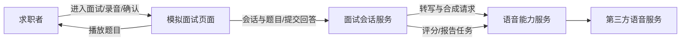

# 语音模拟面试 - 需求规格说明

> 本文件仅描述"做什么"，不包含技术实现方案。
> 关联原型：`docs/功能资料/09-模拟面试/21-语音模拟面试.png`
> 关联资料：`docs/功能资料/09-模拟面试/模拟面试后端接口示例.md`、`Agent接口示例.md`、`docs/项目架构.md`、`docs/AI-JOB问题整改验收标准_2026-11-14.md`（U13）
> 参考仓库：https://github.com/Snailclimb/interview-guide
> 核查基线：`feature/job-dashboard` @ `24482ac`

---

# 1. 组件定位

## 1.1 核心职责

本组件在既有文字模拟面试的会话主链路上，增加"逐题语音回答"能力：用户听取或阅读题目后录音作答，系统将录音转写为文本，用户确认或修改文本后提交，后续追问、下一题、结束与报告继续复用现有文字面试流程。

## 1.2 核心输入

1. **语音面试请求**：已登录求职者从模拟面试页进入，携带当前会话与题目上下文。
2. **题目播报请求**：语音页在用户开始或继续面试后自动播报新题，也支持手动播放；内容为当前面试题目文本。
3. **录音数据**：浏览器麦克风采集的音频段，包含音频字节、格式、时长与所属题目标识。
4. **转写确认结果**：用户对转写文本的确认、修改或放弃操作。
5. **面试会话与题目上下文**：会话状态、当前最新题目、题目消息标识、会话版本号。
6. **语音服务结果**：第三方语音识别（ASR）与语音合成（TTS）返回的文本或音频。

## 1.3 核心输出

1. **题目播报**：可播放、可暂停、可重播的题目音频。
2. **录音与转写界面**：录音状态、计时、试听、重录、转写文本编辑与确认提交。
3. **语音回答消息**：确认后的文本作为正式回答进入会话，附带"语音来源"标记。
4. **追问或下一题**：沿用现有追问与出题规则继续会话。
5. **面试报告**：沿用现有报告生成、评分与成长证据规则。
6. **失败提示与降级通道**：语音能力不可用时可切换为文字作答，不阻塞主链路。

## 1.4 职责边界

本组件**不负责**：

1. 不改变现有面试会话状态机、追问次数上限、题目上限与结束规则。
2. 不改变逐轮评分算法、评分输入语义、报告维度与成长证据规则。
3. 不持久化原始录音音频；首版仅保存用户确认后的文本。
4. 不提供实时流式语音对话、服务端 VAD、实时字幕、打断播报与回声消除（属于后续阶段，按指标决策）。
5. 不提供历史回答的语音回放。
6. 不负责第三方语音服务的账号开通、计费结算与合规审批。
7. 不修改旧文字面试记录的数据语义。

---

# 2. 领域术语

**语音面试**
: 以录音作答、经转写并由用户确认文本后提交的模拟面试方式。首版为"逐题整段录音"，非流式。

**题目播报（TTS）**
: 将当前题目文本合成为完整音频并播放的能力。语音页在用户开始或继续面试后自动播报首题、追问与后续主问题。

**转写（ASR）**
: 将一段录音识别为文本的过程。转写结果在用户确认前不属于正式回答。

**转写记录**
: 一次录音转写产生的临时结果，包含状态、文本、音频元信息与过期时间。未被确认的转写记录是临时数据。

**确认提交**
: 用户检查并（可选）修改转写文本后，以该文本作为正式回答提交的动作。

**回答来源**
: 标识一条用户回答来自文字输入还是语音转写，取值为 `TEXT` 或 `VOICE`；历史记录视为 `TEXT`。

**会话模式**
: 标识一次面试会话的作答方式，取值为 `TEXT` 或 `VOICE`；历史会话视为 `TEXT`。

**静音/空识别**
: 录音存在但未识别出有效文本，或文本为空、仅含无意义填充。

**旧题晚到**
: 用户已提交某题或题目已变化后，该题此前发起的转写结果才返回。

**降级为文字**
: 在语音链路的任一环节失败时，用户改用文字输入完成本题作答。

---

# 3. 角色与边界

## 3.1 核心角色

1. **求职者（用户）**：发起语音或文字作答，确认转写文本，决定重录或切换文字。
2. **面试会话服务**：维护会话状态、题目归属、版本与幂等，接收正式回答并推进追问/下一题。
3. **语音能力服务**：提供语音识别与语音合成，返回文本或音频，不感知业务会话状态。
4. **运营/合规人员**：确认隐私告知文案、第三方处理范围与数据留存策略。

## 3.2 外部系统

1. **浏览器媒体能力**：麦克风采集、音频编码、音频播放与语音合成降级能力。
2. **第三方语音服务**：语音识别与语音合成供应商，处理录音与题目文本。
3. **任务与通知通道**：沿用现有异步任务、进度推送（SSE）与失败重试机制。

## 3.3 交互上下文

---

# 4. DFX 约束

## 4.1 性能

1. 单段录音转写从"停止录音"到"文本可编辑"的 P95 目标 ≤ 8 秒。
2. 题目播报首字节目标 ≤ 2 秒；合成失败时必须能快速降级。
3. 转写与合成不得占用现有面试评分任务的并发额度，不得阻塞回答提交链路。
4. 重复上传同一段音频必须返回既有结果，不产生重复计费与重复记录。

## 4.2 可靠性

1. 任一语音环节失败，用户都能重试或切换文字，面试会话状态不被破坏。
2. 页面刷新、断网重连后，已保存的回答与当前题目必须可恢复。
3. 未确认的转写结果必须有明确有效期，过期后给出可执行提示。
4. 转写不得改变会话版本，不得产生正式消息。

## 4.3 安全性

1. 所有语音相关请求必须经过身份认证，并校验会话与题目归属。
2. 录音文件必须做格式与大小校验，拒绝非音频内容与超限内容。
3. 语音服务密钥不得出现在前端、Java 服务配置或日志中。
4. 录音前必须明确告知第三方处理与音频不长期保存；用户同意后方可采集。
5. 日志不得记录音频字节、转写全文、密钥与幂等键原文。

## 4.4 可维护性

1. 语音能力以可替换的提供方抽象接入，支持离线 Fake 模式用于测试。
2. 语音失败必须映射为既有错误码体系，便于统一提示与统计。
3. 首版需具备可观测指标：转写耗时、失败率、重录率、编辑率、静音失败占比。

## 4.5 兼容性

1. 旧文字面试会话、消息、评分与报告展示不受影响。
2. 前端在语音不可用或用户拒绝授权时，文字作答功能完全可用。
3. 接口新增字段必须向后兼容，未携带新字段的既有客户端行为不变。

---

# 5. 核心能力

## 5.1 语音/文字模式选择

### 5.1.1 业务规则

1. 用户在开始或进行面试时可以选择语音作答或文字作答。
2. 单次面试默认允许逐题在语音与文字之间切换，切换不改变会话状态与版本。
3. 历史文字会话打开时按文字模式展示，不出现语音相关控件与标记。
4. 语音会话中，未作答题目均可使用语音；已提交回答只展示最终文本。

### 5.1.2 交互流程

1. 用户进入面试页，页面展示当前题目与作答方式入口。
2. 用户选择语音作答，页面进入语音作答状态。
3. 用户可在本题内切换为文字作答，已输入/已转写文本保留在同一编辑区。

### 5.1.3 异常场景

1. 浏览器不支持录音能力：隐藏或禁用语音入口并说明原因，保留文字作答。
2. 非安全上下文（非 HTTPS 且非本机地址）：提示无法使用麦克风，引导使用文字。
3. 旧版客户端不支持新字段：按文字模式正常工作。

## 5.2 题目播报

### 5.2.1 业务规则

1. 语音页在用户点击开始或继续面试后，对每个新题消息自动播报一次；文字页保留手动播放。浏览器拦截时提供点击播放入口。
2. 播报内容为当前题目的完整文本，支持暂停、继续与重播。
3. 用户开始录音时，必须立即停止播报并复位播放进度。
4. 服务端合成失败时，允许降级为浏览器本地语音合成；仍失败则仅展示文字。
5. 请求麦克风和录音期间禁用播放、重播及继续播报，切换文字或离开页面后，失效的麦克风请求返回时立即释放音轨。

### 5.2.2 交互流程

1. 用户点击开始或继续语音面试，或手动点击"播放题目"。
2. 系统获取题目音频并播放，展示播放状态。
3. 用户可暂停、重播，或直接开始录音。
4. 回答经用户确认提交后，新生成的追问或主问题自动播报。同题刷新保持当前播放状态，重新打开会话后由用户点击继续。

### 5.2.3 异常场景

1. 合成服务超时或失败：提示"语音播报暂不可用"，题目文字仍可见。
2. 自动播放被浏览器拦截：提示用户点击播放按钮。
3. 用户快速重复点击播放：不产生并发的多路播放。

## 5.3 录音采集

### 5.3.1 业务规则

1. 首次录音前必须展示一次性隐私告知，用户同意后才申请麦克风权限。
2. 录音前必须停用题目播报，避免播报声音被录入。
3. 录音过程展示计时与录音状态，超过产品设定的硬上限自动停止。
4. 录音停止后可试听；重录必须释放上一段音频并清空未确认转写。
5. 离开页面、切换路由、标签页隐藏或切换为文字作答时，必须停止录音并释放麦克风。
6. 录音格式按浏览器能力从高到低协商，服务端以实际格式校验。

### 5.3.2 交互流程

1. 用户点击"开始录音"。
2. 系统停止播报，申请并获取麦克风，开始计时。
3. 用户点击"停止录音"或达到上限自动停止。
4. 页面展示录音时长与试听、重录、转写三个操作。

### 5.3.3 异常场景

1. 用户拒绝授权：展示可执行引导（重新授权、检查浏览器设置），提供切换文字。
2. 无可用麦克风或被其他程序占用：区分提示并允许重试。
3. 录音过短或静音：提示"没有识别到语音"，允许重录。
4. 录音超过时长上限：自动停止并提示已达上限。
5. 页面在录音中关闭：麦克风必须被释放，不得残留占用。

## 5.4 转写与确认

### 5.4.1 业务规则

1. 转写结果只是候选文本，必须经用户确认后才可提交。
2. 转写文本可编辑；提交内容以用户最终确认的文本为准。
3. 转写不创建正式回答消息，不改变会话状态与版本号。
4. 同一段音频重复上传必须返回同一转写结果。
5. 未确认的转写结果必须在有效期内可恢复；过期后需重新录音。
6. 提交时若题目已变化或会话版本不一致，转写结果不得写入会话。

### 5.4.2 交互流程

1. 用户停止录音后点击"转写"。
2. 系统上传音频并返回识别文本，填入可编辑区，标注"识别结果需确认"。
3. 用户检查、修改文本。
4. 用户点击"确认并提交"，进入现有回答提交流程。

### 5.4.3 异常场景

1. 转写服务超时或失败：提示可重试或改用文字，音频保留在当前页面以便重试。
2. 录音格式不支持或文件过大：明确提示并允许重录。
3. 转写期间用户刷新页面：刷新后若结果仍在有效期内，可回填候选文本。
4. 用户提交其他题目后旧转写才返回：丢弃该结果并提示"该题已提交，本次识别结果未生效"。
5. 用户放弃转写：清理临时记录，不产生任何会话数据。

## 5.5 提交回答与推进

### 5.5.1 业务规则

1. 确认提交必须复用现有回答提交规则：回答当前最新题、状态为等待回答、版本一致。
2. 重复提交、双击或网络重发不得产生重复回答消息。
3. 评分输入为最终提交的文本，语音与文字不做评分口径区分。
4. 语音回答与文字回答在成长证据规则上完全一致。
5. 提交成功后按现有规则生成追问或下一题；达到上限后结束并生成报告。

### 5.5.2 交互流程

1. 用户确认提交，系统提交回答并返回受理结果。
2. 页面展示处理中状态，任务完成后展示追问或下一题。
3. 若有追问，用户可继续语音作答或切换文字。

### 5.5.3 异常场景

1. 版本冲突：提示状态已变化，刷新后由用户再次确认提交，不自动重发。
2. 该题已有回答：按现有规则区分"任务进行中/失败可重试/内容冲突"。
3. 异步任务失败：允许以相同内容重试，不影响会话。
4. 等待结果时断网：恢复后自动恢复进度，或提供手动刷新。

## 5.6 结束与报告

### 5.6.1 业务规则

1. 结束面试与报告生成完全复用现有流程。
2. 语音会话的报告需体现回答来源分布，但不影响评分口径。
3. 无有效回答时的报告提示规则保持不变。

### 5.6.2 交互流程

1. 用户点击结束面试并确认。
2. 系统进入结束中状态并异步生成报告。
3. 报告完成后展示评分、差距与成长证据提示。

### 5.6.3 异常场景

1. 报告生成失败：沿用现有失败提示与重试方式。
2. 会话非等待回答状态：不允许结束，提示当前状态。

## 5.7 隐私与数据最小化

### 5.7.1 业务规则

1. 录音前告知：录音将发送第三方语音服务用于转写，识别完成后删除音频，仅保存用户确认的文本。
2. 首版不保存原始音频，不提供音频回放。
3. 未确认转写文本设置有效期并自动清理。
4. 关闭语音入口不影响文字面试使用。

### 5.7.2 交互流程

1. 首次使用语音时展示告知并收集同意。
2. 用户同意后进入录音流程；拒绝则停留在文字模式。

### 5.7.3 异常场景

1. 用户撤回同意：后续不再采集，已提交文本不受影响。
2. 临时数据清理失败：需有兜底清理机制，不无限期保留。

## 5.8 语音服务不可用时的降级

### 5.8.1 业务规则

1. 语音服务异常必须给出可读提示与明确出口：重试、重录、切换文字。
2. 降级不清空用户已输入或已转写的文本。
3. 语音故障不得导致面试会话卡死或数据不一致。

### 5.8.2 交互流程

1. 语音环节失败，页面展示失败原因与可选操作。
2. 用户选择重试或切换文字继续作答。

### 5.8.3 异常场景

1. 限流触发：提示稍后重试，不重复计费。
2. 供应商持续不可用：默认推荐切换文字，保证面试可完成。

---

# 6. 数据约束

## 6.1 会话

1. 会话需可标识作答模式：文字或语音；历史数据默认文字。
2. 会话状态、题目上限、当前题号、追问次数与版本语义保持不变。

## 6.2 消息

1. 每条用户回答可标识来源：文字或语音；历史数据视为文字。
2. 消息内容为确认后的最终文本，长度限制沿用现有约束。
3. 语音来源消息不额外保存音频引用。

## 6.3 转写记录（临时）

1. 记录需包含：所属会话、所属题目、用户、状态、识别文本、音频格式、字节数、时长、音频摘要、错误码、过期时间、消费时间。
2. 状态至少覆盖：待处理、成功、失败、已丢弃（旧题晚到）、已过期。
3. 同一会话同一题目的同一音频只允许一条记录。
4. 转写记录不得作为评分或报告的数据来源。

## 6.4 报告与成长证据

1. 报告与证据仅基于正式回答消息，不读取转写记录。
2. 来源标记不参与评分计算。

---

# 7. 待确认决策

1. 语音供应商、账号、地域、额度与音色选择。
2. 是否同时持久化"会话模式"与"单条回答来源"（建议均保存）。
3. 单段录音时长上限、文件大小上限、每日次数与时长配额。
4. 未确认转写结果有效期（建议 30 分钟）。
5. 是否允许同一会话内逐题语音/文字混用（建议允许）。
6. 生产环境 HTTPS 提供方。
7. 是否接受第三方语音服务的音频留存政策。
8. 第二阶段（流式音频、服务端 VAD、实时字幕、分句播报、打断、回声控制、断线恢复）的投入指标与阈值。

---

# 8. 验收基线

1. 首题、追问与后续主问题在语音页自动播报，可暂停、继续、重播；录音可转写、修改并确认提交，全部作答后生成报告。
2. 权限拒绝、静音、超长、超限、断网、语音服务失败、重复提交、旧题晚到均有明确处理。
3. 可随时切换文字作答并完成面试。
4. 文字面试全链路回归通过，历史记录展示不变。
5. 日志与数据中不出现音频字节、转写全文与密钥。
