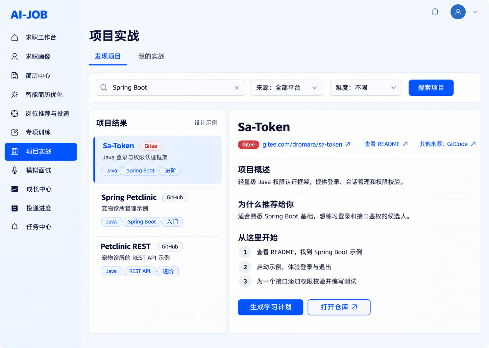
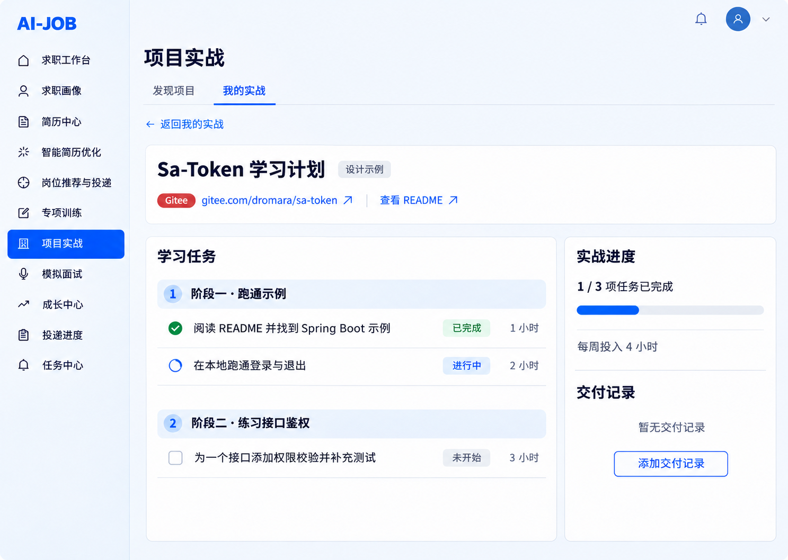

# 项目实战 UI 与交互说明

2026-11-16 确认方案。候选人可以按关键词搜索，也可以根据求职方向获取推荐。发现项目后，先查看仓库和学习资料，再决定是否生成学习计划。

接口字段和状态见 [项目实战后端接口](项目实战后端接口示例.md)。

## 发现项目

1. **搜索。** 输入项目名或技术栈，选择来源和难度，点击「搜索项目」。来源默认「全部平台」，也可只查 GitHub、Gitee 或 GitCode。难度默认「不限」，可选入门、进阶、高级。关键词留空时按当前求职画像、所选技能或有效岗位匹配推荐。
2. **浏览结果。** 左栏显示项目名称、一句话概述、来源、技术栈和难度，默认选中首条。点击其他结果时在右栏切换详情。跨平台的同一项目合并为一条结果，详情显示其他可用仓库。以 Gitee 筛选时，选中项目的主入口显示 Gitee。
3. **查看详情。** 右栏将仓库地址、README 和其他来源放在项目标题下。下方依次展示「项目概述」「为什么推荐给你」「从这里开始」。项目概述来自仓库资料，推荐理由和入门步骤是学习建议。
4. **开始学习。** 「打开仓库」在新标签打开当前项目的主仓库。「生成学习计划」弹出每周投入时长，支持 1–40 小时。生成期间显示任务状态，完成后进入「我的实战」查看计划。README 地址缺失时隐藏该入口，仓库仍可访问。

窄屏使用单栏，先展示搜索与结果。选中后进入同页详情，用户可返回结果且保留关键词、筛选和选中项目。

| 状态 | 界面表现 |
| --- | --- |
| 搜索中 | 显示「正在搜索开源项目」，当前提交处理中禁用重复提交 |
| 有结果 | 展示列表并打开首条详情。没有其他来源时省略「其他来源」 |
| 搜索成功但无结果 | 显示「没找到符合条件的开源项目」，提示换关键词、放宽难度或选择全部平台 |
| 部分来源失败 | 显示失败的平台名称，并保留成功平台的结果和重试入口。成功平台无命中时同时提示当前结果为空 |
| 搜索失败 | 显示可读的失败提示和「重试搜索」 |
| 从历史链接打开旧推荐 | 标明「历史练习建议」，保留旧内容和可继续使用的计划入口。新版开源项目搜索只展示有仓库来源的结果 |

页面只显示用户需要的状态和操作。批次 ID、任务 ID 用于查询与联调。

## 我的实战

- 在计划顶部看到项目名称、创建计划时选定的仓库和可用的 README。历史计划仍可查询和维护，来源缺失时省略链接区。
- 在线性任务列表按里程碑查看学习步骤、预计工时与任务状态，支持「未开始」「进行中」「已完成」。进度按已完成任务数和总任务数展示。
- 在「交付记录」里添加与任务关联的项目链接或备注，比如运行说明、代码提交或测试记录。交付记录和任务状态分别保存。

两张图均为设计示例。计划图承接发现页的 Sa-Token，任务状态和工时用于说明交互。
