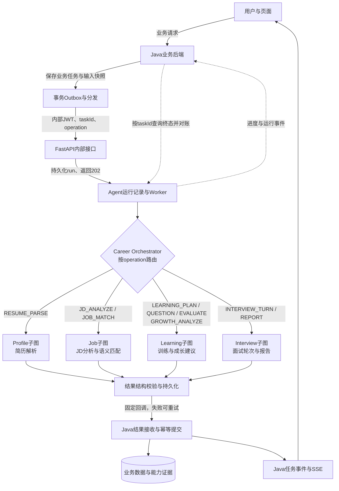
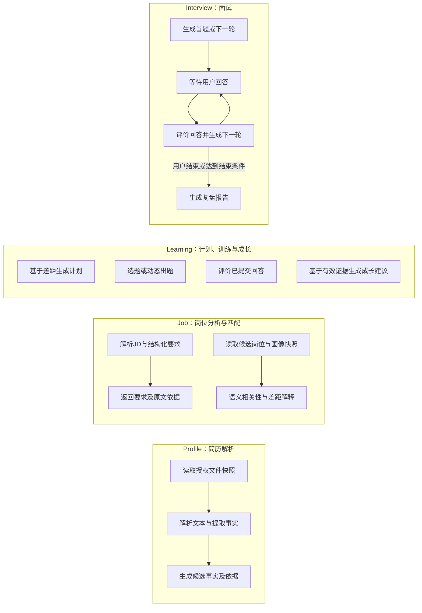

# AI-JOB Agent架构与工作流

本文依据[设计总览](../接口设计/00-设计总览.md)、[Agent完整接口](../接口设计/02-Agent模块接口文档.md)、[公共联调约定](数据模型、数据库设计与联调约定.md)及[原始工作流图](../agent工作流图.png)整理，属于**设计方案**，不代表节点已经实现或完成联调。图中细分节点是根据接口职责归纳的逻辑步骤，并非已确认的 LangGraph 函数名。实际部署、节点粒度和条件边需要在实现时确定。

## 总体编排

| 节点 | 职责与边界 |
| --- | --- |
| 用户与页面 | 发起业务请求、展示任务状态和结果；前端只调用 Java，不直接调用 Agent。 |
| Java业务后端 | 鉴权、固化输入版本、创建业务任务；掌握业务数据和最终状态。 |
| 事务Outbox与分发 | 在业务事务中记录待分发事件，由 worker 带租约发送，支持幂等重试。 |
| FastAPI内部接口 | 校验服务身份、授权和固定操作，创建或重用运行记录并快速返回 202。 |
| Agent运行记录与Worker | 持久化运行、领取与续租、执行子图、记录运行事件；内部失败和取消遵循运行状态约定。 |
| Career Orchestrator | 按 Java 提供的明确 operation 路由到子图；不接受调用方指定任意 Agent、模型、工具、提示词或 SQL。 |
| 各业务子图 | 使用授权输入快照执行具体 AI 任务，返回对应的结构化候选结果；不直接写业务表。 |
| 结果结构校验与持久化 | 校验 operation 对应的结果结构并保存；失败遵循原契约的修复、错误与重试限制。 |
| Java结果接收与幂等提交 | 验证回调与任务状态，执行业务规则并事务落库；重复回调和主动对账共用幂等提交逻辑。 |
| 业务数据与能力证据 | Java 是业务库写入方；能力分依据有效证据计算，简历自述不直接成为能力得分。 |
| Java任务事件与SSE | 业务提交后发布对外结果；Agent 的 `result_ready` 仅表示内部结果已就绪，不表示 Java 已提交。 |

异步链路中，Java 和 Agent 分别维护任务及运行状态。Java 可按 taskId 对账；迟到结果是否接纳以 Java 任务状态为准。事件断线重连、幂等、超时与取消细节以公共联调约定为准。

## 子图逻辑节点

下图将现有接口拆为便于理解的逻辑节点。不同 operation 是独立任务，用户操作、Java 数据提交和后续请求可能发生在它们之间；不表示一次模型调用会自动执行完整业务闭环。

| 子图/节点 | 对应 operation | 输入、输出和职责 |
| --- | --- | --- |
| Profile：文件读取、事实提取 | `RESUME_PARSE` | 根据授权简历文件生成 `AIParseResult`，包含候选事实及依据；用户确认和画像更新由 Java 处理。 |
| Job：JD解析 | `JD_ANALYZE` | 从 JD 文本提取结构化要求和原文依据，输出 `AIJDResult`；缺少依据的硬性字段不能编造。 |
| Job：语义匹配 | `JOB_MATCH` | 根据固定画像和候选岗位快照输出 `AIMatchResult`，包含语义组件与解释。资格核验和最终算分由 Java 执行。 |
| Learning：训练计划 | `LEARNING_PLAN` | 根据固定的匹配差距生成 `AIPlanResult`；Java 保存计划及计划项。 |
| Learning：题目准备 | `LEARNING_QUESTION` | 选题或动态出题，返回 `AIQuestionResult`；重练时遵守原题和答案隐藏约束。P0 一次训练会话对应一道题。 |
| Learning：回答评价 | `LEARNING_EVALUATE` | 按题目和回答生成 `AIEvaluateResult`；Java 保存评价、符合条件的错题及能力证据。 |
| Learning：成长建议 | `GROWTH_ANALYZE` | 基于有效证据快照输出 `AIGrowthResult`；建议本身不直接修改能力分。 |
| Interview：面试轮次 | `INTERVIEW_TURN` | 基于固定输入和当前会话生成首题或评价后续回答、生成下一轮，返回 `AIInterviewTurnResult`。用户回答通过独立请求进入下一轮。 |
| Interview：复盘报告 | `INTERVIEW_REPORT` | 结束面试后生成 `AIInterviewReportResult`；Java 提交报告并更新会话状态。 |

## 页面与接口位置

| 功能 | Agent接口示例 | 说明 |
| --- | --- | --- |
| 简历管理与解析 | [Agent接口示例](04-简历管理与解析/Agent接口示例.md) | 简历解析及结果示例。 |
| 岗位匹配与收藏 | [Agent接口示例](06-岗位匹配与收藏/Agent接口示例.md) | JD分析、语义匹配及结果示例。 |
| 专项训练 | [Agent接口示例](07-专项训练/Agent接口示例.md) | 训练计划、出题、评价及结果示例。 |
| 模拟面试 | [Agent接口示例](09-模拟面试/Agent接口示例.md) | 文字面试轮次、报告及结果示例；语音为 P1 概念。 |
| 能力成长 | [Agent接口示例](10-能力成长/Agent接口示例.md) | 成长建议及结果示例。 |
| 任务中心 | [Agent接口示例](12-任务中心/Agent接口示例.md) | Java 内部使用的运行查询、取消和事件接口。 |

登录注册、工作台和求职画像等没有各自的专属 Agent 操作；求职画像所需的简历解析接口见简历管理模块。项目实战的 Project Agent 以及简历定向优化、语音面试、投递进度均属于 P1 概念，现有 P0 契约未定义这些专属接口。

## 运行基础设施

- Agent 运行记录、事件和检查点属于 AI 运行管理；业务数据由 Java 管理。知识或岗位索引维护使用专门的内部操作，详见 [Agent公共接口与调用规范](../接口设计/02-Agent模块接口文档.md)。
- 内部调用使用限定 audience、scope 和 taskId 的服务凭据；Agent 根据授权快照处理，不能持有业务库写入权限，也不能用用户 JWT 调用内部接口。
- LangGraph、模型、检索和检查点属于设计中的技术支撑；原始图中的共享状态及读写是逻辑关系，不意味着 Agent 可以直接读写 Java 业务数据库。
