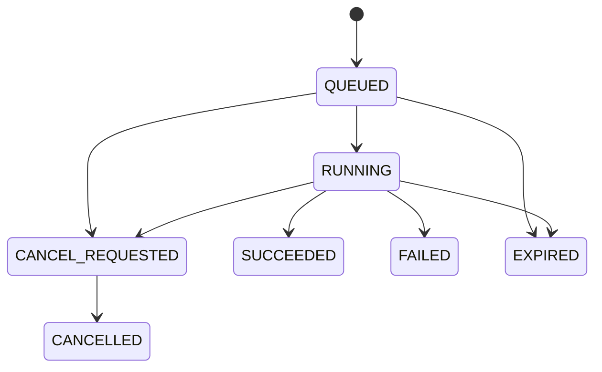
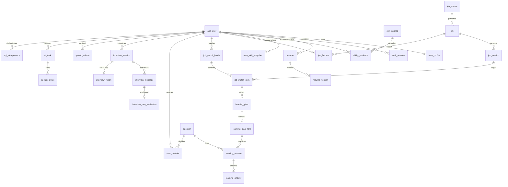

# 数据模型、数据库设计与联调约定

本文合并原有公共数据模型与联调约定、数据库设计文档；分别说明服务间数据契约和数据持久化设计。内容属于设计方案。

---

# AI-JOB 公共数据模型与联调约定

**版本**：V1.0.0-design　**日期**：2026-10-27　**适用**：Vue → Java、Java → Agent、Agent → Java。

[TOC]

## 1. 编码、类型与公共返回

- UTF-8 JSON，字段camelCase；数据库snake_case由各服务映射。Schema中的`uuid`是36字符UUID字符串；`datetime`是UTC ISO 8601；`uri`仅允许http/https。所有示例域名example.invalid只用于演示。
- `T?`允许显式null；`T[]`为数组，空时[]。`是否必须=false`才允许省略。PUT按完整替换语义处理；PATCH缺省字段保持不变。未定义字段在内部AI请求和AI结果中拒绝，前端不得提交只读字段。
- 分页`{total,records,current,size}`，current从1开始、size默认20最大100，稳定排序createdAt DESC,id DESC。GET无body；DELETE不依赖JSON body。
- 时间在MySQL用UTC DATETIME(3)，页面以Asia/Shanghai格式化。薪资统一税前月薪、人民币整数分；原始JD无法归一化时null并保留原文，不把日薪/年薪静默当月薪。
- 标识中的资源类型不由UUID推断；必须访问正确资源路径。前端不能传userId、模型名、API Key、role或callbackUrl决定权限。

普通返回格式与VITA参考一致，增加traceId，并保持真实HTTP状态：

```json
{"code":200,"msg":"操作成功","data":{},"traceId":"demo-trace-20261027"}
```

HTTP 202用code=202；创建AI任务均返回TaskVO。普通空成功使用data=true。错误使用下表结构，HTTP错误不能伪装200：

```json
{
  "code":40901,
  "msg":"数据版本已变化，请刷新后重试",
  "data":null,
  "traceId":"demo-trace-20261027",
  "error":{"key":"VERSION_CONFLICT","retryable":false,"details":{"currentVersion":4}}
}
```

| HTTP | code | key | 处理 |
| --- | --- | --- | --- |
| 400 | 40001 | VALIDATION_ERROR | details.fields=[{field,message}]，修正参数 |
| 401 | 40101 | UNAUTHENTICATED | 最多刷新一次令牌；失败回登录 |
| 403 | 40301 | FORBIDDEN | 权限不足；不自动重复 |
| 404 | 40401 | RESOURCE_NOT_FOUND | 不存在或不属于当前用户 |
| 409 | 40901 | VERSION_CONFLICT | 刷新版本，用户确认后重交 |
| 409 | 40902 | TASK_IN_PROGRESS | details.taskId，可打开已有任务 |
| 409 | 40903 | IDEMPOTENCY_CONFLICT | 同键异体，禁止盲目重试 |
| 409 | 40904 | INVALID_STATE | 当前状态不能执行该操作 |
| 409 | 40905 | STALE_INPUT | 画像/JD变化，先刷新匹配 |
| 409 | 40906 | REPORT_NOT_READY | details.taskId，查询/订阅任务 |
| 410 | 41001 | EVENT_CURSOR_EXPIRED | 查任务后重建订阅或读取结果 |
| 410 | 41002 | RESULT_PURGED | Agent敏感载荷已清理；Java查已提交的业务结果，禁止据此重跑模型 |
| 413 | 41301 | PAYLOAD_TOO_LARGE | 文件/载荷超限 |
| 415 | 41501 | UNSUPPORTED_FILE_TYPE | 更换受支持文件 |
| 422 | 42201 | AI_SCHEMA_INVALID | AI结果未通过校验，不得写业务数据 |
| 429 | 42901 | RATE_LIMITED | 遵循Retry-After |
| 500 | 50001 | INTERNAL_ERROR | 仅提供traceId，不回传堆栈 |
| 503 | 50301 | DEPENDENCY_UNAVAILABLE | 服务不可用；带幂等键有限重试 |

任务失败的TaskVO.error与SSE error采用`{code:string,message:string,retryable:boolean}`。可用code：MODEL_TIMEOUT、MODEL_RATE_LIMIT、MODEL_UNAVAILABLE、AI_SCHEMA_INVALID、FILE_UNREADABLE、INPUT_INVALID、CONTENT_UNSUPPORTED、PERSISTENCE_FAILED、DEADLINE_EXCEEDED。HTTP transport错误不必都变成AI任务错误；例如提交前鉴权失败不创建任务。

## 2. 鉴权、隐私与限额

用户accessToken仅在内存保存，设计有效期15分钟；刷新token仅HttpOnly、Secure、SameSite=Lax Cookie保存，设计7天，服务端只存摘要与令牌家族。登录响应头额外提供X-CSRF-Token；跨页刷新时先GET /api/v1/auth/csrf领取与Cookie会话绑定的新值，该端点不返回访问令牌。所有Cookie认证写接口校验Origin与CSRF。清除过期会话和撤销的jti；用户JWT不能调用/internal。服务JWT与用户JWT使用不同签名密钥、audience及scope。

前端用fetch请求SSE并加Authorization，不把token放URL。用户原始简历、邮箱、回答不得出现在公开日志、trace、向量共享payload或错误堆栈；向模型发送最小必要脱敏事实，不将用户数据用于训练。

P0默认限制（配置项、未经压测）：登录账号/IP每分钟5次；每人同时2个普通AI任务、1个活动面试、单会话1个进行中任务；每个用户最多3条SSE连接。任务请求体≤2MiB，简历≤10MiB，训练和面试答案≤10000字符；超限在入队前拒绝。对模型供应商设置全局并发上限和截止时间；具体QPS须压测后配置，不能据此宣称生产容量。

## 3. 异步任务、状态机与业务映射

| type / operation | Java预建资源 | 成功result.resourceType | resourceId |
| --- | --- | --- | --- |
| RESUME_PARSE | resume_version | RESUME_VERSION | versionId |
| JD_ANALYZE | job_version | JOB | jobId |
| JOB_MATCH | job_match_batch | JOB_MATCH | matchId |
| LEARNING_PLAN | learning_plan | LEARNING_PLAN | planId |
| LEARNING_QUESTION | learning_session | LEARNING_SESSION | sessionId |
| LEARNING_EVALUATE | learning_answer | LEARNING_ANSWER | answerId |
| INTERVIEW_TURN | interview_session / 已保存用户消息 | INTERVIEW | interviewId |
| INTERVIEW_REPORT | interview_session | INTERVIEW_REPORT | interviewId |
| GROWTH_ANALYZE | growth_advice | GROWTH | adviceId |
| JOB_UPDATE_LOCAL | job | JOB | jobId；仅Java本地任务 |
| INDEX_SYNC | knowledge_document / job | INDEX | 原知识/岗位ID；业务源已提交后才同步 |

JOB_UPDATE_LOCAL不分发Agent。TaskVO.resourceId是上述预建资源；成功result固定为`{resourceType,resourceId,version}`，version为该结果资源版本，不能用taskId冒充业务ID。失败保留原resourceId供排查。更新后的业务资源必须先提交再对外done。



终态不可覆盖。CANCEL_REQUESTED一旦提交，迟到成功不再接纳；Java进行取消清理后提交CANCELLED，不等待不可中断的供应商调用永远完成。超过deadlineAt的未终态任务由扫描器置EXPIRED；CANCEL_REQUESTED超时直接完成取消。Agent内部状态没有EXPIRED，超时为FAILED/DEADLINE_EXCEEDED；最终Java状态以自身deadline为准。

业务状态转换：

| 资源 | 主状态转换 | 失败/取消处理 |
| --- | --- | --- |
| 简历版本 | UPLOADED → PARSING → PARSED → CONFIRMED | 解析失败/取消后FAILED，可再次解析同文件；删除后DELETED |
| 岗位 | DRAFT → ANALYZING → ACTIVE → CLOSED | 私有JD分析成功也可ACTIVE，但source仍UNVERIFIED；失败FAILED |
| 匹配批次 | GENERATING → READY | 失败/取消为FAILED，不能显示“0个岗位推荐成功” |
| 学习计划 | GENERATING → ACTIVE → COMPLETED | 生成失败/取消FAILED；所有计划项完成后COMPLETED |
| 训练会话 | PREPARING → ACTIVE → EVALUATING → COMPLETED | 准备失败FAILED；评价失败回ACTIVE，原answer为FAILED；重试只能原content |
| 面试 | PREPARING → WAITING_ANSWER → GENERATING → WAITING_ANSWER | 首题失败FAILED；下一轮失败恢复WAITING_ANSWER，可重试该轮原content |
| 面试结束 | WAITING_ANSWER → ENDING → COMPLETED | 报告失败恢复WAITING_ANSWER，允许end重试且不能再回答已答题 |

取消中的会话不立即解锁；任务取消完成后才执行对应失败恢复。对于已保存USER回答，失败恢复必须保留questionMessageId与answer内容，下一次同轮请求复用同一USER消息，不追加重复消息。修改回答须结束当前面试重新开始。正常达到主问题上限时由Java原子进入ENDING并创建报告任务；不依赖前端另发end。

### 3.1 持久分发和结果提交

1. Java事务写业务占位、ai_task、outbox_event、api_idempotency；提交后才返回202。
2. Outbox worker领取带租约的记录，调用对应内部POST；发送丢失时重发同一taskId/幂等键。Agent事务保存ai_run后返回runId。
3. Agent worker执行子图，持久保存最终结果，向固定Java回调路径投递。供应商成功而回调失败时只重试回调，不重跑LLM。
4. Java验证operation、runId、输入版本、JSON Schema、资源所有者、引用与数值。一个事务保存结果、状态、证据/错题/画像版本和终态事件。
5. Java每30秒扫描RUNNING任务，必要时按taskId查Agent并拉取终态结果，走同一结果提交函数。回调与对账共用唯一约束，不能各写一次。
6. MySQL为权威状态。Redis丢失不能丢任务；Outbox可能重复投递，所以不能宣称跨服务“恰好一次”。

用户画像在运行期间更新：结果仍可作为固定输入版本的历史结果保存，isStale=true；不把旧简历确认事实覆盖回当前画像。训练/面试新证据写入时锁定当前profile版本再增量重算，无需把整个旧profile快照回写。Agent回调inputVersions应等于任务记录，而不是必须等于当前最新画像。

### 3.2 幂等与重试

- API写任务的幂等键作用域为(userId,HTTP方法,规范路由,Idempotency-Key)。规范路由包含实际路径ID，避免两个资源误碰；摘要包含请求体和文件SHA256。同键不同请求409。
- 同键同体24小时返回首次HTTP状态和响应；原响应可能仍QUEUED，客户端应随后GET任务看当前状态。保留处理中记录直至终态，不因24小时到期而删除；终态后至少24小时可重放。
- 请求键过期不等于允许重复业务副作用：简历确认、收藏、单次训练评价、面试当前题回答和报告仍受业务唯一约束。
- Java→Agent传输最多3次退避重试（1、2、4秒加随机抖动，受deadline约束）；429按Retry-After。内部运行重试和传输重试分别记录attempt，不重复创建run。
- Agent终态回调可在7天结果保留期内重试；Java对账作为补偿。人工重试失败任务用新taskId并保留retryOfTaskId。模型输入变了也必须新任务，不能篡改旧任务快照。

## 4. SSE协议与重连

成功建流响应：Content-Type=text/event-stream;charset=utf-8；Cache-Control=no-cache；X-Accel-Buffering=no。每15秒发送注释`: heartbeat`。网关关闭缓冲、设置大于心跳间隔的读超时。客户端断开只取消订阅，不取消业务任务。

| event | payload | 含义 |
| --- | --- | --- |
| accepted | {type,resourceId} | 任务已创建 |
| stage | {name,progress} | 进度；progress无法估算则null |
| delta | {text} | 面试题目文本暂存，不保证已落库 |
| done | {resourceType,resourceId,version} | Java已完成事务提交，客户端随后GET权威详情 |
| error | {code,message,retryable} | 任务已FAILED或EXPIRED，停止当前流 |
| cancelled | {} | 任务已CANCELLED |

每个持久事件的`id`是任务内seq，从1递增；`data={taskId,seq,payload}`。客户端按(taskId,seq)去重，发送Last-Event-ID重放更大的事件。不能将同一delta多次追加到文本。Agent流映射为Java事件时保存源(runId,seq)去重键。

事件保留24小时；已过期游标建流前返回410，前端先GET任务。已成功直接加载业务结果；仍运行则从当前lastEventId开启新订阅，并用已持久化会话替换临时片段。游标大于当前最大seq返回400，不无限等待。终态无历史事件时直接查询任务结果，不要求重新生成。

令牌到期时服务关闭流；客户端只尝试一次刷新再携带旧游标重连。流建立后不能更改HTTP状态，网络中断与业务error事件必须区分。done丢失时GET任务仍能恢复，不能因没收到done重复创建面试。

## 5. 资格、匹配指数与能力评分

### 5.1 确定性资格核验（Java）

只核验JD明确硬性要求且用户确认的事实：学历顺序HIGH_SCHOOL<ASSOCIATE<BACHELOR<MASTER<DOCTOR；毕业年份用JD明确闭区间；全职experienceMonths与明确要求比较。实习不自动算全职。

用户缺事实、JD存在未解析/有歧义要求、技能熟练度等不能确定的硬条件，均列UNKNOWN；没有明确约束的字段可标记PASS并说明“未设要求”。主观技能满足程度属于差距估计，不以LLM自述裁定资格。FAIL不得被高匹配分覆盖。PASS只表示对已识别的明确规则未发现冲突，不能宣称符合企业全部招聘条件。

### 5.2 站内匹配指数 match-v1-trial（未业务校准）

Java固定三个分项：

- skill = |确认简历技能 ∩ JD标准技能| / |JD标准技能|，JD技能集合为空则null；这是文本覆盖，不是能力。
- semantic = Agent按固定模型、Prompt和量表给出的0..1语义相关性，无法可靠评价返回null；不得对候选池做Min-Max。
- preference = (roleFit + cityFit)/2；roleFit为目标方向与Java维护的岗位方向映射一致时1，否则0；cityFit为岗位城市属于偏好城市时1，否则0；缺任一值则null。岗位方向由结构化映射获得并保存在job_version.role_code。

`matchScore = roundHalfUp(100 × (0.60×skill + 0.25×semantic + 0.15×preference), 0)`。任何一项null时总分null，不重分配权重。示例0.8、0.9、1 → 100×(0.48+0.225+0.15)=85.5 → 86。分项需保留原值、权重、来源与版本。

Java排序：PASS组优先，UNKNOWN组其次；组内有效分降序、null最后、并列按jobId稳定排序。FAIL只保留核验明细，不作为推荐条目展示。无jobIds的默认候选来自已审核岗位；显式个人JD可匹配但始终标未核验。

该指数仅辅助排序，不是录用概率，没有经过真实就业结果校准。来源失效、岗位关闭、画像/JD变更时旧批次标记isStale，禁止直接用旧批次创建新计划。

### 5.3 评价与能力证据 ability-v1-trial（未验证）

训练与面试回答按technical-answer-v1量表：正确性0.50、完整性0.30、表达0.20，每维0..100，Java校验并重新计算加权分。overallScore保留一位小数。INSUFFICIENT/INVALID不入计分证据；不能把无法评价当0分。

每条计分证据对应一个独立回答+技能+量表版本。简历自述保留source与quote，score=null，不参与得分。面试报告聚合现有逐轮评价，不能再作为一份新样本重复加分。

技能分取该技能最近20条VALID、量表同版本且sourceType为LEARNING_ANSWER或INTERVIEW_ANSWER的独立评分的算术平均，保留一位小数；sampleCount为本次参与聚合的条数；0条则score=null。1..2条LIMITED、≥3条SUFFICIENT只是产品展示阈值，不是统计置信结论；无证据为MISSING。

差距：targetScore仅在已定义技能要求量表映射中产生，否则null；currentScore与targetScore均有效时gap=max(0,target-current)，否则null并提示“证据不足”。同一内容反复练习可留下学习轨迹，但不会被描述成独立生产经验；后续评测应评估重复题目偏差。

## 6. 跨服务联调验收场景

| 场景 | 预期结果 |
| --- | --- |
| 同上传请求重复发送、Java返回丢失 | 同幂等键返回同一resume/version，不重复上传记录 |
| Java提交任务后重启 | Outbox恢复投递，不丢任务 |
| Agent接收成功但202丢失 | 按taskId找到原run，传输重试不重跑LLM |
| 回调与对账同时提交评价 | 唯一约束+同一提交事务只生成一组证据 |
| 面试双击发送或两个标签页作答 | 一份USER消息；另一个请求原键重放或409 |
| 面试评价失败后重试 | 原content/消息复用；不重复追加回答 |
| SSE断线、重复delta、done丢失 | 游标续传去重，最终GET恢复权威状态 |
| 已取消任务收到成功回调 | accepted=false，无新问题/证据写入 |
| 简历没有毕业年、JD要求应届 | UNKNOWN，不能判PASS |
| 有高语义分但学历不满足 | FAIL，不能进推荐主列表 |
| 只有简历自述技能 | 能力分null，展示自述证据，不展示高能力分 |
| 画像在任务运行中变更 | 历史结果带旧版本；不覆盖最新事实 |
| 私有JD链接指向内网地址 | 仅存线索不抓取；Agent文件下载域名白名单 |
| 前端提交其他用户taskId/runId | 外部404；内部scope/任务绑定不匹配拒绝 |
| 模型输出不存在的skillCode/证据ID | Schema或引用校验失败，不落库 |
| 数据库提交失败而Agent成功 | 不发done；回调重试/对账后恢复 |

## 7. Schema字段字典

以下为接口中使用的共享模型；模型字段默认在响应中存在，可空值用?。请求仅复用明确可写字段；UserVO、TaskVO、JobVO等返回模型不允许直接作为任意更新入参。

### UserVO

用户公开资料。

| 参数名称 | 参数说明 | 是否必须 | 数据类型 | schema |
| --- | --- | --- | --- | --- |
| id | 用户ID | true | uuid | — |
| email | 邮箱 | true | string | — |
| nickname | 昵称 | true | string | — |
| role | USER/ADMIN | true | string | — |
| createdAt | UTC时间 | true | datetime | — |

### TokenVO

刷新令牌只在HttpOnly Cookie中返回。

| 参数名称 | 参数说明 | 是否必须 | 数据类型 | schema |
| --- | --- | --- | --- | --- |
| accessToken | 用户Bearer令牌 | true | string | — |
| expiresIn | 有效秒数 | true | integer | — |
| user | 用户 | true | UserVO | UserVO |

### SkillFact

提取事实与原文证据。

| 参数名称 | 参数说明 | 是否必须 | 数据类型 | schema |
| --- | --- | --- | --- | --- |
| skillCode | 必须属于技能目录 | true | string | — |
| claim | 自述内容 | true | string | — |
| quote | 原文片段 | true | string | — |
| location | 页/段位置 | true | string | — |
| confirmed | 经过用户确认 | true | boolean | — |

### ResumeFacts

未知事实为null，不推测。

| 参数名称 | 参数说明 | 是否必须 | 数据类型 | schema |
| --- | --- | --- | --- | --- |
| education | HIGH_SCHOOL/ASSOCIATE/BACHELOR/MASTER/DOCTOR或null | true | string? | — |
| graduationYear | 1900..当前年+10 | true | integer? | — |
| experienceMonths | 全职月数0..600，实习不计 | true | integer? | — |
| major | 专业 | true | string? | — |
| skills | 技能事实 | true | SkillFact[] | SkillFact |
| warnings | 警告 | true | string[] | — |

### ProfileVO

用户事实和偏好，与AI建议分开。

| 参数名称 | 参数说明 | 是否必须 | 数据类型 | schema |
| --- | --- | --- | --- | --- |
| userId | 用户ID | true | uuid | — |
| profileVersion | 画像版本/乐观锁 | true | integer | — |
| targetRole | 预设岗位名称或自定义岗位名称，≤32字符 | true | string | — |
| candidateType | INTERNSHIP/CAMPUS/EXPERIENCED | true | string | — |
| cities | 行政区划编码，≤5 | true | string[] | — |
| minMonthlySalaryCents | 税前月薪下限，人民币分 | true | integer? | — |
| maxMonthlySalaryCents | 税前月薪上限 | true | integer? | — |
| facts | 已确认事实 | true | ResumeFacts | ResumeFacts |
| activeResumeVersionId | 生效简历版本 | true | uuid? | — |
| updatedAt | UTC时间 | true | datetime | — |

### ResumeVersionVO

文件版本不可变。

| 参数名称 | 参数说明 | 是否必须 | 数据类型 | schema |
| --- | --- | --- | --- | --- |
| id | 版本ID | true | uuid | — |
| resumeId | 简历ID | true | uuid | — |
| versionNo | 简历内序号 | true | integer | — |
| fileName | 文件名 | true | string | — |
| mimeType | PDF或DOCX | true | string | — |
| sizeBytes | 字节 | true | integer | — |
| status | UPLOADED/PARSING/PARSED/CONFIRMED/FAILED/DELETED | true | string | — |
| facts | 无解析为null | true | ResumeFacts? | ResumeFacts |
| createdAt | UTC时间 | true | datetime | — |

### ResumeVO

简历容器。

| 参数名称 | 参数说明 | 是否必须 | 数据类型 | schema |
| --- | --- | --- | --- | --- |
| id | 简历ID | true | uuid | — |
| title | 标题 | true | string | — |
| latestVersion | 最新文件版本 | true | ResumeVersionVO | ResumeVersionVO |

### DownloadVO

私有文件下载。

| 参数名称 | 参数说明 | 是否必须 | 数据类型 | schema |
| --- | --- | --- | --- | --- |
| url | 签名URL；演示域名不可访问 | true | uri | — |
| expiresAt | 默认60秒有效 | true | datetime | — |

### TaskVO

Java权威任务状态。

| 参数名称 | 参数说明 | 是否必须 | 数据类型 | schema |
| --- | --- | --- | --- | --- |
| id | 任务ID | true | uuid | — |
| type | 见任务类型枚举 | true | string | — |
| status | 见任务状态机 | true | string | — |
| stage | 展示阶段 | true | string? | — |
| progress | 0..100，未知为null | true | integer? | — |
| resourceId | 关联资源 | true | uuid? | — |
| result | 成功时{resourceType,resourceId,version}，其他null | true | object? | — |
| error | 失败时{code,message,retryable}，其他null | true | object? | — |
| inputVersions | 固定输入版本 | true | object | — |
| lastEventId | 任务内事件序号 | true | integer | — |
| createdAt | UTC时间 | true | datetime | — |
| finishedAt | 终态时间 | true | datetime? | — |

### JobSourceVO

来源审核信息。

| 参数名称 | 参数说明 | 是否必须 | 数据类型 | schema |
| --- | --- | --- | --- | --- |
| id | 来源ID | true | uuid | — |
| name | 名称 | true | string | — |
| type | OFFICIAL/AUTHORIZED/USER_INPUT | true | string | — |
| baseUrl | 登记域名 | true | uri? | — |
| verificationStatus | VERIFIED/UNVERIFIED/DISABLED | true | string | — |
| verifiedAt | 最近校验 | true | datetime? | — |

### RequirementVO

JD结构化要求。

| 参数名称 | 参数说明 | 是否必须 | 数据类型 | schema |
| --- | --- | --- | --- | --- |
| educationMin | 最低学历 | true | string? | — |
| graduationYearMin | 毕业年下限 | true | integer? | — |
| graduationYearMax | 毕业年上限 | true | integer? | — |
| experienceMonthsMin | 全职月数下限 | true | integer? | — |
| skills | 标准技能编码 | true | string[] | — |
| requiredSkillLevels | 编码到0..100；仅有量表依据才填 | true | object | — |
| quotes | 字段到原文片段 | true | object | — |

### JobVO

岗位当前版本。

| 参数名称 | 参数说明 | 是否必须 | 数据类型 | schema |
| --- | --- | --- | --- | --- |
| id | 岗位ID | true | uuid | — |
| jobVersion | JD版本 | true | integer | — |
| title | 职位 | true | string | — |
| companyName | 公司；示例虚构 | true | string | — |
| cityCode | 行政编码 | true | string? | — |
| candidateType | 岗位类别 | true | string | — |
| minMonthlySalaryCents | 税前月薪下限，人民币分 | true | integer? | — |
| maxMonthlySalaryCents | 上限 | true | integer? | — |
| jdText | 纯文本JD | true | string | — |
| source | 来源 | true | JobSourceVO | JobSourceVO |
| sourceUrl | 原始URL，仅http/https | true | uri? | — |
| status | DRAFT/ANALYZING/ACTIVE/CLOSED/FAILED | true | string | — |
| verifiedAt | 岗位校验时间 | true | datetime? | — |
| requirements | 未分析为null | true | RequirementVO? | RequirementVO |
| isFavorite | 当前用户收藏 | true | boolean | — |

### EligibilityCheckVO

确定性资格逐项核验。

| 参数名称 | 参数说明 | 是否必须 | 数据类型 | schema |
| --- | --- | --- | --- | --- |
| field | 核验字段 | true | string | — |
| result | PASS/FAIL/UNKNOWN | true | string | — |
| actual | 已确认事实 | true | string? | — |
| expected | 岗位要求 | true | string? | — |
| reason | 规则说明 | true | string | — |
| sourceQuote | JD原句 | true | string? | — |

### EligibilityVO

资格独立于分数。

| 参数名称 | 参数说明 | 是否必须 | 数据类型 | schema |
| --- | --- | --- | --- | --- |
| status | 任一FAIL=>FAIL；无FAIL但有UNKNOWN=>UNKNOWN；否则PASS | true | string | — |
| ruleVersion | 规则版本 | true | string | — |
| checks | 逐项结果 | true | EligibilityCheckVO[] | EligibilityCheckVO |

### ScoreComponentVO

固定权重归一化分项。

| 参数名称 | 参数说明 | 是否必须 | 数据类型 | schema |
| --- | --- | --- | --- | --- |
| key | skill/semantic/preference | true | string | — |
| value | 0..1；不可计算为null | true | number? | — |
| weight | 固定权重 | true | number | — |
| provenance | 计算来源/版本 | true | string | — |

### GapVO

差距估计。

| 参数名称 | 参数说明 | 是否必须 | 数据类型 | schema |
| --- | --- | --- | --- | --- |
| skillCode | 技能编码 | true | string | — |
| currentScore | 0..100，未评估为null | true | number? | — |
| targetScore | 0..100，无依据为null | true | number? | — |
| gap | 两分有效时max(0,target-current)，否则null | true | number? | — |
| evidenceStatus | MISSING/LIMITED/SUFFICIENT | true | string | — |
| evidenceIds | 已保存证据 | true | uuid[] | — |
| suggestion | 建议 | true | string | — |

### MatchItemVO

岗位匹配条目快照。

| 参数名称 | 参数说明 | 是否必须 | 数据类型 | schema |
| --- | --- | --- | --- | --- |
| id | 条目ID | true | uuid | — |
| jobId | 岗位ID | true | uuid | — |
| jobVersion | JD版本 | true | integer | — |
| title | 标题快照 | true | string | — |
| eligibility | Java最终资格 | true | EligibilityVO | EligibilityVO |
| matchScore | 0..100，非录用概率 | true | number? | — |
| scoreVersion | 试行公式 | true | string | — |
| components | 三个分项 | true | ScoreComponentVO[] | ScoreComponentVO |
| gaps | 差距 | true | GapVO[] | GapVO |
| reasons | 有据解释 | true | string[] | — |
| source | 来源快照 | true | JobSourceVO | JobSourceVO |
| sourceUrl | 原始岗位URL | true | uri? | — |
| verifiedAt | 岗位校验时间 | true | datetime? | — |

### MatchBatchVO

批次输入固定，历史不覆盖。

| 参数名称 | 参数说明 | 是否必须 | 数据类型 | schema |
| --- | --- | --- | --- | --- |
| id | 批次ID | true | uuid | — |
| taskId | 任务ID | true | uuid | — |
| profileVersion | 输入画像版本 | true | integer | — |
| status | GENERATING/READY/FAILED | true | string | — |
| isStale | 输入是否已过期 | true | boolean | — |
| items | 资格分组后排序 | true | MatchItemVO[] | MatchItemVO |
| createdAt | UTC时间 | true | datetime | — |

### SkillVO

技能目录。

| 参数名称 | 参数说明 | 是否必须 | 数据类型 | schema |
| --- | --- | --- | --- | --- |
| code | 目录主键 | true | string | — |
| name | 展示名 | true | string | — |
| parentCode | 父编码 | true | string? | — |
| enabled | 可用 | true | boolean | — |

### PlanItemVO

计划项。

| 参数名称 | 参数说明 | 是否必须 | 数据类型 | schema |
| --- | --- | --- | --- | --- |
| id | 计划项ID | true | uuid | — |
| skillCode | 技能 | true | string | — |
| title | 任务 | true | string | — |
| kind | READING/PRACTICE/INTERVIEW | true | string | — |
| estimatedMinutes | 5..120 | true | integer | — |
| status | PENDING/IN_PROGRESS/COMPLETED | true | string | — |
| resourceRefs | 经Java验证的知识引用 | true | object[] | — |

### LearningPlanVO

个性化计划。

| 参数名称 | 参数说明 | 是否必须 | 数据类型 | schema |
| --- | --- | --- | --- | --- |
| id | 计划ID | true | uuid | — |
| matchItemId | 目标条目 | true | uuid | — |
| profileVersion | 输入版本 | true | integer | — |
| status | GENERATING/ACTIVE/COMPLETED/FAILED | true | string | — |
| title | 标题 | true | string | — |
| items | ≤20项 | true | PlanItemVO[] | PlanItemVO |

### QuestionVO

公开题目不含参考答案或评分量表。

| 参数名称 | 参数说明 | 是否必须 | 数据类型 | schema |
| --- | --- | --- | --- | --- |
| id | 题目ID | true | uuid | — |
| skillCodes | 技能 | true | string[] | — |
| difficulty | EASY/MEDIUM/HARD | true | string | — |
| type | TEXT_SCENARIO/TEXT_KNOWLEDGE | true | string | — |
| stem | 题干 | true | string | — |
| sourceType | CURATED/GENERATED | true | string | — |
| sourceTitle | 知识来源标题 | true | string? | — |
| questionVersion | 题目版本 | true | integer | — |

### LearningSessionVO

训练会话。

| 参数名称 | 参数说明 | 是否必须 | 数据类型 | schema |
| --- | --- | --- | --- | --- |
| id | 会话ID | true | uuid | — |
| planId | 计划ID | true | uuid | — |
| planItemId | 计划项 | true | uuid | — |
| status | PREPARING/ACTIVE/EVALUATING/COMPLETED/FAILED | true | string | — |
| question | 准备中为null | true | QuestionVO? | QuestionVO |
| lastAnswerId | 最近回答ID | true | uuid? | — |
| version | 并发版本 | true | integer | — |

### DimensionVO

量表维度。

| 参数名称 | 参数说明 | 是否必须 | 数据类型 | schema |
| --- | --- | --- | --- | --- |
| key | 维度 | true | string | — |
| score | 0..100 | true | number | — |
| weight | 权重；各项和1 | true | number | — |
| comment | 可展示依据，不含思维链 | true | string | — |

### EvaluationVO

模型评价，学习辅助。

| 参数名称 | 参数说明 | 是否必须 | 数据类型 | schema |
| --- | --- | --- | --- | --- |
| overallScore | 0..100；无效时null | true | number? | — |
| dimensions | 正确性0.5、完整性0.3、表达0.2 | true | DimensionVO[] | DimensionVO |
| strengths | 优点 | true | string[] | — |
| improvements | 不足 | true | string[] | — |
| referenceAnswer | 作答后公开 | true | string? | — |
| rubricVersion | 量表版本 | true | string | — |
| modelVersion | 部署配置模型快照 | true | string | — |
| promptVersion | 提示词版本 | true | string | — |
| evidenceStatus | VALID/INSUFFICIENT/INVALID | true | string | — |

### LearningAnswerVO

回答及评价。

| 参数名称 | 参数说明 | 是否必须 | 数据类型 | schema |
| --- | --- | --- | --- | --- |
| id | 回答ID | true | uuid | — |
| sessionId | 训练会话 | true | uuid | — |
| content | 用户回答 | true | string | — |
| status | EVALUATING/EVALUATED/FAILED | true | string | — |
| taskId | 任务 | true | uuid | — |
| evaluation | 处理中为null | true | EvaluationVO? | EvaluationVO |

### MistakeVO

错题由已保存评价派生。

| 参数名称 | 参数说明 | 是否必须 | 数据类型 | schema |
| --- | --- | --- | --- | --- |
| id | 错题ID | true | uuid | — |
| question | 题目 | true | QuestionVO | QuestionVO |
| lastAnswerId | 最近低分回答 | true | uuid | — |
| wrongCount | 低于60的有效评价次数 | true | integer | — |
| resolved | 后续同版本题有效得分≥60 | true | boolean | — |

### MessageVO

面试持久化消息。

| 参数名称 | 参数说明 | 是否必须 | 数据类型 | schema |
| --- | --- | --- | --- | --- |
| id | 消息ID | true | uuid | — |
| seq | 会话内递增序号 | true | integer | — |
| role | ASSISTANT/USER | true | string | — |
| content | 纯文本 | true | string | — |
| questionNo | 主问题号；追问不增加 | true | integer | — |
| followUpNo | 本问题追问次数0..2 | true | integer | — |
| createdAt | 保存时间 | true | datetime | — |

### InterviewVO

面试会话；输入固定。

| 参数名称 | 参数说明 | 是否必须 | 数据类型 | schema |
| --- | --- | --- | --- | --- |
| id | 会话ID | true | uuid | — |
| jobId | 岗位ID | true | uuid | — |
| resumeVersionId | 简历版本 | true | uuid | — |
| status | PREPARING/WAITING_ANSWER/GENERATING/ENDING/COMPLETED/FAILED | true | string | — |
| questionLimit | 主问题数3..10 | true | integer | — |
| version | 并发版本 | true | integer | — |
| pendingTaskId | 最近/正在处理任务（失败后保留供重试） | true | uuid? | — |
| messages | seq升序；最多62条 | true | MessageVO[] | MessageVO |
| createdAt | 创建时间 | true | datetime | — |

### InterviewReportVO

P0每次面试一份报告。

| 参数名称 | 参数说明 | 是否必须 | 数据类型 | schema |
| --- | --- | --- | --- | --- |
| interviewId | 会话ID | true | uuid | — |
| reportVersion | 报告版本 | true | integer | — |
| evaluation | 综合评价 | true | EvaluationVO | EvaluationVO |
| gaps | 差距 | true | GapVO[] | GapVO |
| evidenceIds | Java已提交证据 | true | uuid[] | — |
| answeredQuestionCount | 有回答主问题数 | true | integer | — |
| completionType | NORMAL/EARLY_END/NO_VALID_ANSWER | true | string | — |

### EvidenceVO

追加式证据。

| 参数名称 | 参数说明 | 是否必须 | 数据类型 | schema |
| --- | --- | --- | --- | --- |
| id | 证据ID | true | uuid | — |
| skillCode | 技能 | true | string | — |
| sourceType | RESUME_CLAIM/LEARNING_ANSWER/INTERVIEW_ANSWER | true | string | — |
| sourceId | 源简历版本/回答/面试用户消息 | true | uuid | — |
| score | 0..100，自述为null | true | number? | — |
| confidence | 0..1模型自报，不是准确率 | true | number | — |
| status | VALID/REVOKED | true | string | — |
| rubricVersion | 量表版本 | true | string? | — |
| createdAt | 保存时间 | true | datetime | — |

### SkillSnapshotVO

Java从有效证据重算。

| 参数名称 | 参数说明 | 是否必须 | 数据类型 | schema |
| --- | --- | --- | --- | --- |
| skillCode | 技能 | true | string | — |
| score | 有效评价均值；无样本null | true | number? | — |
| sampleCount | 独立有效样本数 | true | integer | — |
| evidenceStatus | MISSING/LIMITED/SUFFICIENT | true | string | — |
| formulaVersion | 试行版本 | true | string | — |
| updatedAt | 更新 | true | datetime | — |

### GrowthVO

P0成长摘要。

| 参数名称 | 参数说明 | 是否必须 | 数据类型 | schema |
| --- | --- | --- | --- | --- |
| profileVersion | 当前版本 | true | integer | — |
| skills | 技能与样本量 | true | SkillSnapshotVO[] | SkillSnapshotVO |
| recentEvidence | 最近10条证据 | true | EvidenceVO[] | EvidenceVO |
| suggestions | 无建议时空数组 | true | string[] | — |
| suggestionTaskId | 最近建议任务 | true | uuid? | — |

### AIRunVO

AI执行成功不等于业务提交成功。

| 参数名称 | 参数说明 | 是否必须 | 数据类型 | schema |
| --- | --- | --- | --- | --- |
| runId | 运行ID | true | uuid | — |
| taskId | Java任务 | true | uuid | — |
| operation | 任务操作 | true | string | — |
| status | QUEUED/RUNNING/SUCCEEDED/FAILED/CANCEL_REQUESTED/CANCELLED | true | string | — |
| attempt | 重试尝试次数 | true | integer | — |
| result | 按operation区分的结果 | true | object? | — |
| error | code/message/retryable | true | object? | — |
| lastEventId | 运行事件号 | true | integer | — |
| createdAt | 接收时间 | true | datetime | — |

### AIParseResult

简历提取候选，Java和用户确认后生效。

| 参数名称 | 参数说明 | 是否必须 | 数据类型 | schema |
| --- | --- | --- | --- | --- |
| facts | 提取事实，不得写confirmed=true | true | ResumeFacts | ResumeFacts |
| textHash | 文件抽取文本SHA256 | true | string | — |
| unmappedSkills | 未映射的技能文本 | true | string[] | — |

### AIJDResult

JD提取候选，不返回资格结论。

| 参数名称 | 参数说明 | 是否必须 | 数据类型 | schema |
| --- | --- | --- | --- | --- |
| requirements | 明确事实与引用 | true | RequirementVO | RequirementVO |
| salary | 月薪明确才填{minMonthlySalaryCents,maxMonthlySalaryCents,currency}，否则null | true | object? | — |
| warnings | 歧义和未知项 | true | string[] | — |

### AIMatchCandidate

Agent只返回语义组件与可追溯解释。

| 参数名称 | 参数说明 | 是否必须 | 数据类型 | schema |
| --- | --- | --- | --- | --- |
| jobId | 固定候选ID | true | uuid | — |
| jobVersion | 输入版本 | true | integer | — |
| semanticScore | 0..1，可比较模型输出；无效null | true | number? | — |
| semanticVersion | 模型/提示词组合版本 | true | string | — |
| reasons | 引用输入证据，不新增事实 | true | string[] | — |
| gaps | 仅建议，不写业务证据 | true | GapVO[] | GapVO |

### AIMatchResult

候选必须与输入集合一致，不能自造岗位。

| 参数名称 | 参数说明 | 是否必须 | 数据类型 | schema |
| --- | --- | --- | --- | --- |
| items | 逐个输入候选的结果 | true | AIMatchCandidate[] | AIMatchCandidate |

### AIPlanResult

不含业务ID，由Java分配计划项ID。

| 参数名称 | 参数说明 | 是否必须 | 数据类型 | schema |
| --- | --- | --- | --- | --- |
| title | 计划标题 | true | string | — |
| items | 每项{skillCode,title,kind,estimatedMinutes,resourceRefs}，≤20 | true | object[] | — |

### AIQuestionResult

仅对Java返回完整题目及隐藏量表。

| 参数名称 | 参数说明 | 是否必须 | 数据类型 | schema |
| --- | --- | --- | --- | --- |
| stem | 题干 | true | string | — |
| skillCodes | 目录编码 | true | string[] | — |
| difficulty | EASY/MEDIUM/HARD | true | string | — |
| type | 题型 | true | string | — |
| sourceType | CURATED/GENERATED | true | string | — |
| sourceQuestionId | 复用库题时为输入候选ID，否则null | true | uuid? | — |
| referenceAnswer | 参考答案 | true | string | — |
| rubric | 版本及评分维度 | true | object | — |
| citations | 仅来自输入/检索白名单；{documentId,chunkId,quote} | true | object[] | — |

### AIEvaluateResult

评价候选；Java重算overallScore并校验来源。

| 参数名称 | 参数说明 | 是否必须 | 数据类型 | schema |
| --- | --- | --- | --- | --- |
| evaluation | 模型评分与点评 | true | EvaluationVO | EvaluationVO |
| skillScores | 每项{skillCode,score,confidence,sourceId}；仅输入技能和回答ID | true | object[] | — |

### AIInterviewTurnResult

当前回答评价+下一步决策。

| 参数名称 | 参数说明 | 是否必须 | 数据类型 | schema |
| --- | --- | --- | --- | --- |
| action | ASK/FOLLOW_UP/FINISH | true | string | — |
| question | 非FINISH必填{content,questionNo,followUpNo,skillCodes}，否则null | true | object? | — |
| answerEvaluation | 首题无回答时null | true | AIEvaluateResult? | AIEvaluateResult |
| stopReason | FINISH时LIMIT_REACHED/NO_MORE_QUESTIONS，否则null | true | string? | — |

### AIInterviewReportResult

汇总逐轮评价，不生成新的能力样本。

| 参数名称 | 参数说明 | 是否必须 | 数据类型 | schema |
| --- | --- | --- | --- | --- |
| evaluation | 综合点评；无有效回答时overallScore=null | true | EvaluationVO | EvaluationVO |
| gaps | 差距建议 | true | GapVO[] | GapVO |
| answeredQuestionCount | 有效回答主问题数 | true | integer | — |
| completionType | NORMAL/EARLY_END/NO_VALID_ANSWER | true | string | — |

### AIGrowthResult

下一步建议不改变能力分。

| 参数名称 | 参数说明 | 是否必须 | 数据类型 | schema |
| --- | --- | --- | --- | --- |
| suggestions | 1..5项 | true | string[] | — |
| citedEvidenceIds | 仅输入中存在的证据ID | true | uuid[] | — |

### IndexSyncResult

索引同步结果：resourceId:uuid、resourceVersion:integer、action:UPSERT/DELETE、indexStatus:READY、pointCount:integer≥0、embeddingVersion:string。失败时run.error非空，result=null。知识源与题库的权威内容在Java；Qdrant仅保存可重建的公共片段。

## 8. object类型的固定结构补充

| 使用位置 | 固定字段/约束 |
| --- | --- |
| AI请求inputVersions / task.inputVersions | profileVersion?:integer、resumeVersionId?:uuid、jobVersion?:integer、questionVersion?:integer、interviewVersion?:integer、resourceVersion?:integer；每任务必须包含其使用的版本 |
| AI请求payload.document | versionId:uuid、fileName:string、mimeType:string、sizeBytes:integer、downloadUrl:uri；仅允许可信存储域名 |
| AI请求payload.latestAnswer | messageId:uuid、questionMessageId:uuid、content:string；首题为null |
| AI请求candidateQuestions[] | id:uuid、version:integer、stem:string、skillCodes:string[]、referenceAnswer:string、rubric:Rubric；不得把参考答案发浏览器 |
| AI出题payload.mode | SELECT_OR_GENERATE（默认）或REUSE_ONLY；错题重练必须REUSE_ONLY且只有一个原题候选 |
| Rubric | version:string、dimensions:[{key:string,weight:number,description?:string}]；本版三个固定key及权重 |
| AIQuestionResult.citations / PlanItem.resourceRefs | documentId:uuid、documentVersion:integer、chunkId:string、quote:string≤1000；引用由Java验证文档授权、可用版本与片段存在性 |
| AIPlanResult.items[] | skillCode:string、title:string≤200、kind:READING/PRACTICE/INTERVIEW、estimatedMinutes:5..120、resourceRefs:Citation[] |
| AIEvaluateResult.skillScores[] | skillCode:string、score:0..100、confidence:0..1、sourceId:uuid；sourceId必须等于当前回答ID或用户消息ID |
| AIInterviewTurnResult.question | content:string≤3000、questionNo:integer、followUpNo:0..2、skillCodes:string[]；FINISH时null |
| Java回调请求 | runId:uuid、operation:string、status:SUCCEEDED/FAILED/CANCELLED、inputVersions:版本对象、result:对应操作结果或null、error:任务错误或null |
| Java回调响应data | accepted:boolean、taskId:uuid、status:Java任务状态；迟到结果accepted=false |
| CSRF响应data | csrfToken:string；仅有效Cookie会话可获取 |
| INDEX_SYNC请求payload | resourceType:JOB/KNOWLEDGE、resourceId:uuid、resourceVersion:integer、action:UPSERT/DELETE、visibility:PUBLIC、content:string、chunks:[{chunkId,offsetStart,offsetEnd,text}]、metadata:白名单来源/技能/角色/城市/状态、embeddingVersion:string；DELETE可省略content/chunks |
| 来源审核请求 | name:string、type:OFFICIAL/AUTHORIZED、baseUrl:uri、verificationNote:string；仅ADMIN |
| Knowledge响应data | resourceId:uuid、indexStatus:PENDING/READY/FAILED |
| RequirementVO.requiredSkillLevels | skillCode到0..100的映射；skill必须属于skills，映射值由固定量表确认，不能由LLM任意创造 |

接口字段与存储映射：ResumeVersionVO.facts在CONFIRMED时取confirmed_facts_json，否则取parsed_facts_json；前者技能confirmed=true，后者false。ProfileVO.facts只取当前确认事实。InterviewVO.pendingTaskId指最近或正在处理的轮次任务，失败后保留供重试；是否允许提交由会话status/version决定，不单看指针是否为空。

内部scope按用途分配：ai:run用于AI执行/状态/事件；ai:index用于索引维护；ai:callback用于Java结果接收；ai:file用于任务绑定文件重签；ai:erase仅用于终态运行的敏感载荷清理。各接口同时校验taskId授权，不能因持有一种scope就访问全部内部能力。

响应中的模型版本必须保存实际部署标识、Prompt版本和量表版本，示例configured-qwen-model不作为生产模型名称。模型自报confidence只用于诊断，不能直接当准确率或业务通过阈值。

---

# AI-JOB 数据库设计文档

**版本**：V1.0.0-design　**日期**：2026-10-27　**数据库**：MySQL 8、Redis、Qdrant。

**性质**：待实现设计。本文未连接或修改数据库，DDL片段为迁移示例，不能等同建库完成。业务接口见[01业务后端](业务后端接口文档.md)，AI契约见[02Agent模块](../接口设计/02-Agent模块接口文档.md)，评分及事务协议见[03公共约定](数据模型、数据库设计与联调约定.md)。

[TOC]

## 1. 物理分库与写入权限

| 存储 | 读写所有者 | 数据 | 边界 |
| --- | --- | --- | --- |
| career_business（MySQL） | Java | 31张业务表 | Agent不持有该库写账号，前端不能直连 |
| career_ai（独立逻辑MySQL库） | Python | ai_run、ai_run_event、graph_checkpoint | 可以与业务库共MySQL实例；账号独立，不跨库事务或外键 |
| Redis业务命名空间 | Java | 限流、撤销JWT、短期缓存、连接计数 | 任务与证据权威数据在MySQL |
| Qdrant | Python索引/检索工具 | 已审核公共岗位和许可知识片段 | 不写用户简历/回答；从MySQL源重建 |
| 私有文件存储 | Java管理，Agent按任务短期只读 | PDF/DOCX | 数据库存storage_key，不存永久签名URL |

LangGraph检查点为技术状态，不是业务事实源。跨服务不共用事务，依靠Outbox、唯一约束、回调和对账达到最终一致；MySQL与Qdrant不能假设原子双写。

## 2. 命名、类型、通用字段

- 业务表InnoDB，字符集utf8mb4；文字排序可采用utf8mb4_0900_ai_ci。UUID单独CHAR(36) CHARACTER SET ascii COLLATE ascii_bin，代码、摘要、键字段使用大小写明确的ASCII比较。
- 本文UUID是SQL类型简写，实际迁移展开为上述CHAR(36)；由资源所有服务生成UUIDv4并以小写保存。Python runId自己生成，业务ID由Java生成。P0优先可读性，规模上升后再评估BINARY(16)。
- standard表都包含下列通用列，字段字典不重复；noid表仅使用其声明的自然/组合主键，并仍含created_at、updated_at。追加式事件/日志的updated_at可等于created_at。

| 字段 | MySQL类型 | 可空 | 默认 | 说明 |
| --- | --- | --- | --- | --- |
| id | UUID | 否 | 无，由应用生成 | standard表主键 |
| created_at | DATETIME(3) | 否 | CURRENT_TIMESTAMP(3) | UTC创建时间 |
| updated_at | DATETIME(3) | 否 | CURRENT_TIMESTAMP(3) | 每次更新显式更新；不可变记录不变 |

- 金额非负整数分；分数DECIMAL(5,1)约束0..100；权重/置信度必须0..1；年龄等不自行从姓名/照片推测。业务枚举VARCHAR加CHECK，不用不可扩展的数据库ENUM。
- JSON仅用于快照、复杂评分与出处，不能替代需要筛选/排序/唯一约束的标量。所有JSON经Java/Pydantic Schema校验；MySQL只保证JSON语法，不能自动保证业务正确。
- 真实外键在同库内使用RESTRICT，无级联删除关键历史。多态source_id/resource_id、版本指针等逻辑外键由Java在事务内校验。外键不能替代所有权校验；所有涉及user_id资源的请求必须验证同一所有者。
- 禁止“给每张表都加deleted字段”。简历/用户有明确删除状态，收藏关系可删除，证据用撤销，任务/评价/历史版本保留不可变语义。

## 3. 实体关系



图中版本关联需使用实际(job_id,version_no)；关系图未画所有跨模块逻辑引用，下面字段字典和约束为准。knowledge_document、question.citations通过文档版本/chunkId逻辑关联；outbox_event/audit_log是通用资源引用。

## 4. 表清单

| 表 | 用途 | 主键 |
| --- | --- | --- |
| app_user | 登录用户 | id |
| auth_session | 刷新令牌会话及家族 | id |
| user_profile | 确认事实、求职偏好和当前版本 | PK(user_id) |
| skill_catalog | 受控技能目录 | PK(code) |
| resume | 简历容器 | id |
| resume_version | 不可变文件与解析候选/确认事实 | id |
| ability_evidence | 可追溯能力证据 | id |
| user_skill_snapshot | 可重算技能能力摘要 | PK(user_id,skill_code,formula_version) |
| job_source | 审核后的公共来源及系统个人输入来源 | id |
| job | 职位容器、可见性和当前JD版本 | id |
| job_version | 不可变JD快照和结构化要求 | id |
| job_favorite | 收藏意向 | id |
| job_match_batch | 一次匹配的固定输入 | id |
| job_match_item | 资格、分数和差距可追溯条目 | id |
| knowledge_document | 人工审核、获许可的知识片段 | id |
| question | 不可变题目版本及隐藏答案量表 | id |
| learning_plan | 固定匹配目标的学习计划 | id |
| learning_plan_item | 计划内行动 | id |
| learning_session | 一道题的一次训练 | id |
| learning_answer | 先存回答，再生成评价 | id |
| user_mistake | 错题投影 | id |
| interview_session | 文字面试状态与固定输入 | id |
| interview_message | 仅保存可展示的有序对话 | id |
| interview_turn_evaluation | 逐轮回答评价 | id |
| interview_report | 每次面试一份复盘报告 | id |
| growth_advice | 固定画像版本的成长建议 | id |
| ai_task | Java权威任务和固定输入 | id |
| ai_task_event | Java持久SSE事件 | id |
| outbox_event | 事务后可恢复投递 | id |
| api_idempotency | 业务请求响应重放 | id |
| audit_log | 管理审核和关键隐私操作审计 | id |

## 5. 业务表字段与索引

### 5.1 app_user — 登录用户

通用列：id、created_at、updated_at。

| 字段 | 类型 | 可空 | 默认值 | 说明 |
| --- | --- | --- | --- | --- |
| email | VARCHAR(254) | 否 | 无 | 小写规范化邮箱 |
| password_hash | VARCHAR(255) | 否 | 无 | Argon2id或BCrypt哈希，算法参数随摘要保存 |
| nickname | VARCHAR(30) | 否 | 无 | 昵称 |
| role | VARCHAR(16) | 否 | USER | USER/ADMIN |
| status | VARCHAR(16) | 否 | ACTIVE | ACTIVE/DISABLED/DELETED |
| token_version | INT UNSIGNED | 否 | 0 | 撤销全用户令牌的版本 |
| deleted_at | DATETIME(3) | 是 | NULL | 注销时间；P0无自助注销界面 |

**约束与索引**：`UK(email)`；`INDEX(status,created_at,id)`。

**外键**：无物理外键，通用资源引用由业务校验。

**规则**：邮箱唯一且注销不自动释放；若后续允许重注册，先定义脱敏/回收流程。

### 5.2 auth_session — 刷新令牌会话及家族

通用列：id、created_at、updated_at。

| 字段 | 类型 | 可空 | 默认值 | 说明 |
| --- | --- | --- | --- | --- |
| user_id | UUID | 否 | 无 | 用户 |
| family_id | UUID | 否 | 无 | 轮换家族 |
| token_hash | BINARY(32) | 否 | 无 | refreshToken的SHA256 |
| csrf_hash | BINARY(32) | 否 | 无 | CSRF值摘要 |
| parent_id | UUID | 是 | NULL | 上一个会话令牌 |
| status | VARCHAR(16) | 否 | ACTIVE | ACTIVE/ROTATED/REVOKED/EXPIRED |
| expires_at | DATETIME(3) | 否 | 无 | 过期 |
| rotated_at | DATETIME(3) | 是 | NULL | 轮换时间 |
| revoked_at | DATETIME(3) | 是 | NULL | 撤销时间 |

**约束与索引**：`UK(token_hash)`；`INDEX(user_id,status,expires_at)`；`INDEX(family_id,status)`。

**外键**：user_id → app_user.id；parent_id → auth_session.id。

**规则**：重用ROTATED令牌撤销整个family；轮换必须锁定旧会话、原子标记并创建新会话。

### 5.3 user_profile — 确认事实、求职偏好和当前版本

通用列：created_at、updated_at；无通用id列。

| 字段 | 类型 | 可空 | 默认值 | 说明 |
| --- | --- | --- | --- | --- |
| user_id | UUID | 否 | 无 | 主键且外键 |
| profile_version | BIGINT UNSIGNED | 否 | 0 | 每次事实/偏好/能力有效更新递增 |
| target_role | VARCHAR(32) | 是 | NULL | 标准岗位方向 |
| candidate_type | VARCHAR(16) | 是 | NULL | INTERNSHIP/CAMPUS/EXPERIENCED |
| cities_json | JSON | 否 | 应用写[] | 最多5个城市编码 |
| min_monthly_salary_cents | INT UNSIGNED | 是 | NULL | 税前人民币月薪分 |
| max_monthly_salary_cents | INT UNSIGNED | 是 | NULL | 不得小于下限 |
| confirmed_facts_json | JSON | 否 | 应用写空事实 | ResumeFacts |
| active_resume_version_id | UUID | 是 | NULL | 生效版本；必须本人CONFIRMED |

**约束与索引**：`PK(user_id)`。

**外键**：user_id → app_user.id；active_resume_version_id → resume_version.id。

**规则**：无独立id列；初始事实各标量null、skills=[]。确认接口和评价落库锁定该行并递增版本。

### 5.4 skill_catalog — 受控技能目录

通用列：created_at、updated_at；无通用id列。

| 字段 | 类型 | 可空 | 默认值 | 说明 |
| --- | --- | --- | --- | --- |
| code | VARCHAR(64) ASCII | 否 | 无 | 稳定主键，java/redis等 |
| name | VARCHAR(100) | 否 | 无 | 展示名 |
| parent_code | VARCHAR(64) ASCII | 是 | NULL | 父级编码 |
| enabled | TINYINT(1) | 否 | 1 | 是否启用 |

**约束与索引**：`PK(code)`；`INDEX(parent_code,enabled)`。

**外键**：parent_code → skill_catalog.code。

**规则**：目录由种子迁移初始化；前端不接受任意拼写作为新技能。

### 5.5 resume — 简历容器

通用列：id、created_at、updated_at。

| 字段 | 类型 | 可空 | 默认值 | 说明 |
| --- | --- | --- | --- | --- |
| user_id | UUID | 否 | 无 | 所有者 |
| title | VARCHAR(100) | 否 | 无 | 标题 |
| latest_version_id | UUID | 是 | NULL | 最新文件版本 |
| deleted_at | DATETIME(3) | 是 | NULL | 逻辑删除 |

**约束与索引**：`INDEX(user_id,deleted_at,created_at,id)`。

**外键**：user_id → app_user.id；latest_version_id → resume_version.id。

**规则**：新建容器latest_version_id=null，版本插入后同事务更新指针。

### 5.6 resume_version — 不可变文件与解析候选/确认事实

通用列：id、created_at、updated_at。

| 字段 | 类型 | 可空 | 默认值 | 说明 |
| --- | --- | --- | --- | --- |
| resume_id | UUID | 否 | 无 | 简历容器 |
| user_id | UUID | 否 | 无 | 所有者冗余用于权限查询 |
| version_no | INT UNSIGNED | 否 | 无 | 简历内递增 |
| file_name | VARCHAR(255) | 否 | 无 | 文件名 |
| storage_key | VARCHAR(512) | 否 | 无 | 私有存储键，不存永久公网URL |
| mime_type | VARCHAR(100) | 否 | 无 | 实际检测MIME |
| size_bytes | BIGINT UNSIGNED | 否 | 无 | ≤10485760 |
| sha256 | BINARY(32) | 否 | 无 | 原文件摘要 |
| status | VARCHAR(16) | 否 | UPLOADED | 版本状态机 |
| parsed_facts_json | JSON | 是 | NULL | Agent原始解析候选 |
| confirmed_facts_json | JSON | 是 | NULL | 用户校正后事实 |
| parse_meta_json | JSON | 是 | NULL | 模型/Prompt/文本摘要/警告 |
| confirmed_at | DATETIME(3) | 是 | NULL | 用户确认时间 |
| deleted_at | DATETIME(3) | 是 | NULL | 逻辑删除 |

**约束与索引**：`UK(resume_id,version_no)`；`INDEX(user_id,status,created_at)`；`INDEX(user_id,sha256)`。

**外键**：resume_id → resume.id；user_id → app_user.id。

**规则**：文件内容不可变；确认一次后如改事实需新版本。sha256不是全局唯一，不能跨用户泄露去重命中。

### 5.7 ability_evidence — 可追溯能力证据

通用列：id、created_at、updated_at。

| 字段 | 类型 | 可空 | 默认值 | 说明 |
| --- | --- | --- | --- | --- |
| user_id | UUID | 否 | 无 | 所有者 |
| skill_code | VARCHAR(64) ASCII | 否 | 无 | 目录技能 |
| source_type | VARCHAR(32) | 否 | 无 | RESUME_CLAIM/LEARNING_ANSWER/INTERVIEW_ANSWER |
| source_id | UUID | 否 | 无 | 多态源：版本/回答/面试用户消息 |
| source_version | INT UNSIGNED | 否 | 1 | 源版本 |
| score | DECIMAL(5,1) | 是 | NULL | 0..100，自述必须NULL |
| confidence | DECIMAL(4,3) | 否 | 0 | 0..1，模型自报诊断值 |
| quote | TEXT | 是 | NULL | 脱敏证据/回答片段 |
| rubric_version | VARCHAR(64) | 否 | 无 | 自述用claim-v1，评价用量表版本 |
| model_version | VARCHAR(100) | 是 | NULL | 实际模型标识 |
| prompt_version | VARCHAR(64) | 是 | NULL | 提示词版本 |
| task_id | UUID | 是 | NULL | 产生此证据的任务 |
| status | VARCHAR(16) | 否 | VALID | VALID/REVOKED |
| revoked_at | DATETIME(3) | 是 | NULL | 撤销时间 |

**约束与索引**：`UK(user_id,skill_code,source_type,source_id,rubric_version)`；`INDEX(user_id,skill_code,status,created_at,id)`；`INDEX(task_id)`。

**外键**：user_id → app_user.id；skill_code → skill_catalog.code；task_id → ai_task.id。

**规则**：source_id为多态逻辑外键，Java必须验证源存在且属于本人。自述重确认/删除仅撤销证据，不能反复加分。source_version由原始资源固定，P0同源同量表最多一份。

### 5.8 user_skill_snapshot — 可重算技能能力摘要

通用列：created_at、updated_at；无通用id列。

| 字段 | 类型 | 可空 | 默认值 | 说明 |
| --- | --- | --- | --- | --- |
| user_id | UUID | 否 | 无 | 用户 |
| skill_code | VARCHAR(64) ASCII | 否 | 无 | 技能 |
| formula_version | VARCHAR(64) | 否 | ability-v1-trial | 聚合版本 |
| score | DECIMAL(5,1) | 是 | NULL | 0..100 |
| sample_count | INT UNSIGNED | 否 | 0 | 最近20个有效独立样本数 |
| evidence_status | VARCHAR(16) | 否 | MISSING | MISSING/LIMITED/SUFFICIENT |
| last_evidence_at | DATETIME(3) | 是 | NULL | 最近有效证据时间 |

**约束与索引**：`PK(user_id,skill_code,formula_version)`。

**外键**：user_id → app_user.id；skill_code → skill_catalog.code。

**规则**：快照不是第二份事实源；可删除后从ability_evidence重建。

### 5.9 job_source — 审核后的公共来源及系统个人输入来源

通用列：id、created_at、updated_at。

| 字段 | 类型 | 可空 | 默认值 | 说明 |
| --- | --- | --- | --- | --- |
| name | VARCHAR(100) | 否 | 无 | 来源名称 |
| type | VARCHAR(16) | 否 | 无 | OFFICIAL/AUTHORIZED/USER_INPUT |
| base_url | VARCHAR(1000) | 是 | NULL | 登记http/https域名 |
| verification_status | VARCHAR(16) | 否 | UNVERIFIED | VERIFIED/UNVERIFIED/DISABLED |
| verification_note | TEXT | 是 | NULL | 许可与人工审核依据 |
| verified_at | DATETIME(3) | 是 | NULL | 审核时间 |
| verified_by | UUID | 是 | NULL | 管理员 |

**约束与索引**：`INDEX(verification_status,type)`。

**外键**：verified_by → app_user.id。

**规则**：USER_INPUT为系统种子记录，永不VERIFIED。公共来源失效要立即退出默认推荐候选。

### 5.10 job — 职位容器、可见性和当前JD版本

通用列：id、created_at、updated_at。

| 字段 | 类型 | 可空 | 默认值 | 说明 |
| --- | --- | --- | --- | --- |
| source_id | UUID | 否 | 无 | 来源 |
| owner_user_id | UUID | 是 | NULL | 个人JD的所有者；公共为NULL |
| visibility | VARCHAR(16) | 否 | PRIVATE | PUBLIC/PRIVATE |
| current_version | INT UNSIGNED | 否 | 1 | 当前版本序号 |
| status | VARCHAR(16) | 否 | DRAFT | DRAFT/ANALYZING/ACTIVE/CLOSED/FAILED |
| source_url | VARCHAR(2000) | 是 | NULL | 岗位原始链接；不自动抓取 |
| verified_at | DATETIME(3) | 是 | NULL | 本岗位最近核验 |
| closed_at | DATETIME(3) | 是 | NULL | 关闭时间 |

**约束与索引**：`INDEX(visibility,status,verified_at,id)`；`INDEX(owner_user_id,status,created_at,id)`。

**外键**：source_id → job_source.id；owner_user_id → app_user.id；(id,current_version) → job_version(job_id,version_no)，逻辑校验避免循环插入。

**规则**：PUBLIC要求owner为NULL且source VERIFIED；PRIVATE要求owner非NULL；收藏不改变可见性。

### 5.11 job_version — 不可变JD快照和结构化要求

通用列：id、created_at、updated_at。

| 字段 | 类型 | 可空 | 默认值 | 说明 |
| --- | --- | --- | --- | --- |
| job_id | UUID | 否 | 无 | 岗位 |
| version_no | INT UNSIGNED | 否 | 无 | 版本 |
| title | VARCHAR(100) | 否 | 无 | 职位 |
| company_name | VARCHAR(100) | 否 | 无 | 公司 |
| city_code | VARCHAR(12) ASCII | 是 | NULL | 行政编码 |
| role_code | VARCHAR(32) ASCII | 是 | NULL | Java受控职位方向映射 |
| candidate_type | VARCHAR(16) | 否 | 无 | 岗位类型 |
| min_monthly_salary_cents | INT UNSIGNED | 是 | NULL | 月薪下限 |
| max_monthly_salary_cents | INT UNSIGNED | 是 | NULL | 月薪上限 |
| currency | CHAR(3) ASCII | 否 | CNY | 人民币 |
| jd_text | MEDIUMTEXT | 否 | 无 | 原始纯文本JD |
| content_hash | BINARY(32) | 否 | 无 | JD摘要 |
| requirements_json | JSON | 是 | NULL | RequirementVO |
| analysis_meta_json | JSON | 是 | NULL | 模型/Prompt/歧义/技能映射版本 |

**约束与索引**：`UK(job_id,version_no)`；`INDEX(city_code,candidate_type,role_code,created_at,id)`。

**外键**：job_id → job.id。

**规则**：JD结果回调写当前待分析版本；旧版本不可覆盖。资格规则使用版本快照，不在Agent保存资格结论。

### 5.12 job_favorite — 收藏意向

通用列：id、created_at、updated_at。

| 字段 | 类型 | 可空 | 默认值 | 说明 |
| --- | --- | --- | --- | --- |
| user_id | UUID | 否 | 无 | 用户 |
| job_id | UUID | 否 | 无 | 岗位 |

**约束与索引**：`UK(user_id,job_id)`；`INDEX(user_id,created_at,id)`。

**外键**：user_id → app_user.id；job_id → job.id。

**规则**：取消收藏物理删除此关联；重复PUT/DELETE幂等，不保存投递状态。

### 5.13 job_match_batch — 一次匹配的固定输入

通用列：id、created_at、updated_at。

| 字段 | 类型 | 可空 | 默认值 | 说明 |
| --- | --- | --- | --- | --- |
| user_id | UUID | 否 | 无 | 所有者 |
| task_id | UUID | 否 | 无 | 生成任务 |
| profile_version | BIGINT UNSIGNED | 否 | 无 | 输入画像版本 |
| resume_version_id | UUID | 否 | 无 | 输入简历 |
| status | VARCHAR(16) | 否 | GENERATING | GENERATING/READY/FAILED |
| input_snapshot_json | JSON | 否 | 无 | 脱敏画像、候选jobId/version、includeUnknown |
| score_version | VARCHAR(64) | 否 | match-v1-trial | 试行公式 |

**约束与索引**：`UK(task_id)`；`INDEX(user_id,created_at,id)`。

**外键**：user_id → app_user.id；task_id → ai_task.id；resume_version_id → resume_version.id。

**规则**：isStale根据当前profileVersion、候选jobVersion和来源状态动态比较，不因变化重写历史评分。

### 5.14 job_match_item — 资格、分数和差距可追溯条目

通用列：id、created_at、updated_at。

| 字段 | 类型 | 可空 | 默认值 | 说明 |
| --- | --- | --- | --- | --- |
| batch_id | UUID | 否 | 无 | 批次 |
| job_id | UUID | 否 | 无 | 岗位 |
| job_version | INT UNSIGNED | 否 | 无 | 固定版本 |
| rank_no | INT UNSIGNED | 否 | 无 | 批次顺序 |
| eligibility_status | VARCHAR(16) | 否 | 无 | PASS/FAIL/UNKNOWN |
| eligibility_json | JSON | 否 | 无 | 逐项核验及ruleVersion |
| match_score | DECIMAL(5,1) | 是 | NULL | 0..100，试行版整数落入decimal |
| components_json | JSON | 否 | 无 | 3项原值、权重、来源、scoreVersion |
| gaps_json | JSON | 否 | 应用写[] | GapVO[] |
| reasons_json | JSON | 否 | 应用写[] | 理由 |
| source_snapshot_json | JSON | 否 | 无 | 来源、URL、校验时间和标题快照 |

**约束与索引**：`UK(batch_id,job_id)`；`INDEX(batch_id,eligibility_status,rank_no)`。

**外键**：batch_id → job_match_batch.id；(job_id,job_version) → job_version(job_id,version_no)。

**规则**：FAIL可保存审计但不进入MatchBatchVO推荐items；排序不得临时Min-Max。

### 5.15 knowledge_document — 人工审核、获许可的知识片段

通用列：id、created_at、updated_at。

| 字段 | 类型 | 可空 | 默认值 | 说明 |
| --- | --- | --- | --- | --- |
| title | VARCHAR(200) | 否 | 无 | 标题 |
| content | MEDIUMTEXT | 否 | 无 | 纯文本 |
| document_version | INT UNSIGNED | 否 | 1 | 索引版本 |
| skill_codes_json | JSON | 否 | 无 | 目录技能 |
| source_url | VARCHAR(2000) | 是 | NULL | 原始来源 |
| license_note | VARCHAR(1000) | 否 | 无 | 许可/原创说明 |
| status | VARCHAR(16) | 否 | ACTIVE | ACTIVE/ARCHIVED |
| index_status | VARCHAR(16) | 否 | PENDING | PENDING/READY/FAILED |
| created_by | UUID | 否 | 无 | 管理员 |

**约束与索引**：`INDEX(status,index_status,updated_at,id)`。

**外键**：created_by → app_user.id。

**规则**：内容是权威知识源；Qdrant只作可重建索引。P0知识片段由Java按固定段长分片并保留chunkId、offset。

### 5.16 question — 不可变题目版本及隐藏答案量表

通用列：id、created_at、updated_at。

| 字段 | 类型 | 可空 | 默认值 | 说明 |
| --- | --- | --- | --- | --- |
| root_question_id | UUID | 否 | 无 | 题目版本组，首次等于自身id |
| question_version | INT UNSIGNED | 否 | 1 | 版本号 |
| stem | TEXT | 否 | 无 | 题干 |
| type | VARCHAR(32) | 否 | TEXT_SCENARIO | TEXT_SCENARIO/TEXT_KNOWLEDGE |
| skill_codes_json | JSON | 否 | 无 | 题目技能 |
| difficulty | VARCHAR(16) | 否 | MEDIUM | EASY/MEDIUM/HARD |
| source_type | VARCHAR(16) | 否 | CURATED | CURATED/GENERATED |
| reference_answer | TEXT | 否 | 无 | 隐藏参考答案 |
| rubric_json | JSON | 否 | 无 | 隐藏评分量表 |
| citations_json | JSON | 否 | 应用写[] | 文档版本、chunkId、原文引用 |
| status | VARCHAR(16) | 否 | ACTIVE | ACTIVE/ARCHIVED |
| generated_task_id | UUID | 是 | NULL | AI生成来源 |
| created_by | UUID | 是 | NULL | 管理员，AI生成时NULL |

**约束与索引**：`UK(root_question_id,question_version)`；`INDEX(status,difficulty,source_type,created_at,id)`；`UK(generated_task_id)`。

**外键**：generated_task_id → ai_task.id；created_by → app_user.id。

**规则**：前端题目DTO必须白名单序列化，禁止把reference_answer/rubric_json整个实体直接返回。JSON技能检索P0数据量小，扩大后再拆question_skill表。

### 5.17 learning_plan — 固定匹配目标的学习计划

通用列：id、created_at、updated_at。

| 字段 | 类型 | 可空 | 默认值 | 说明 |
| --- | --- | --- | --- | --- |
| user_id | UUID | 否 | 无 | 所有者 |
| match_item_id | UUID | 否 | 无 | 目标条目 |
| task_id | UUID | 否 | 无 | 任务 |
| profile_version | BIGINT UNSIGNED | 否 | 无 | 输入版本 |
| title | VARCHAR(200) | 是 | NULL | 生成完成后标题 |
| daily_minutes | INT UNSIGNED | 否 | 无 | 10..120 |
| days | INT UNSIGNED | 否 | 无 | 1..14 |
| status | VARCHAR(16) | 否 | GENERATING | GENERATING/ACTIVE/COMPLETED/FAILED |

**约束与索引**：`UK(task_id)`；`INDEX(user_id,status,created_at,id)`。

**外键**：user_id → app_user.id；match_item_id → job_match_item.id；task_id → ai_task.id。

### 5.18 learning_plan_item — 计划内行动

通用列：id、created_at、updated_at。

| 字段 | 类型 | 可空 | 默认值 | 说明 |
| --- | --- | --- | --- | --- |
| plan_id | UUID | 否 | 无 | 计划 |
| seq | INT UNSIGNED | 否 | 无 | 顺序 |
| skill_code | VARCHAR(64) ASCII | 否 | 无 | 目标技能 |
| title | VARCHAR(200) | 否 | 无 | 任务名 |
| kind | VARCHAR(16) | 否 | 无 | READING/PRACTICE/INTERVIEW |
| estimated_minutes | INT UNSIGNED | 否 | 无 | 5..120 |
| resource_refs_json | JSON | 否 | 应用写[] | 经验证的知识引用 |
| status | VARCHAR(16) | 否 | PENDING | PENDING/IN_PROGRESS/COMPLETED |
| completed_at | DATETIME(3) | 是 | NULL | 完成时间 |

**约束与索引**：`UK(plan_id,seq)`；`INDEX(plan_id,status,seq)`。

**外键**：plan_id → learning_plan.id；skill_code → skill_catalog.code。

**规则**：READING可用户确认；PRACTICE/INTERVIEW由有效完成记录驱动。

### 5.19 learning_session — 一道题的一次训练

通用列：id、created_at、updated_at。

| 字段 | 类型 | 可空 | 默认值 | 说明 |
| --- | --- | --- | --- | --- |
| user_id | UUID | 否 | 无 | 所有者 |
| plan_id | UUID | 否 | 无 | 计划 |
| plan_item_id | UUID | 否 | 无 | 计划项 |
| question_id | UUID | 是 | NULL | 准备完成后绑定不可变题目 |
| question_version | INT UNSIGNED | 是 | NULL | 固定题目版本 |
| status | VARCHAR(16) | 否 | PREPARING | PREPARING/ACTIVE/EVALUATING/COMPLETED/FAILED |
| version | INT UNSIGNED | 否 | 1 | 乐观锁 |
| last_answer_id | UUID | 是 | NULL | 最近回答 |

**约束与索引**：`INDEX(user_id,status,created_at,id)`；`INDEX(plan_item_id,status)`。

**外键**：user_id → app_user.id；plan_id → learning_plan.id；plan_item_id → learning_plan_item.id；question_id → question.id。

**规则**：创建时锁定计划项，确保同项只有一个非终态会话；相同用户不能并发创建两份训练。last_answer_id逻辑外键避免循环写入。

### 5.20 learning_answer — 先存回答，再生成评价

通用列：id、created_at、updated_at。

| 字段 | 类型 | 可空 | 默认值 | 说明 |
| --- | --- | --- | --- | --- |
| session_id | UUID | 否 | 无 | 每会话一份回答 |
| user_id | UUID | 否 | 无 | 所有者 |
| content | TEXT | 否 | 无 | ≤10000字符 |
| content_hash | BINARY(32) | 否 | 无 | 失败重试须相同内容 |
| status | VARCHAR(16) | 否 | EVALUATING | EVALUATING/EVALUATED/FAILED |
| task_id | UUID | 否 | 无 | 最近评价任务 |
| evaluation_json | JSON | 是 | NULL | EvaluationVO |
| evaluated_at | DATETIME(3) | 是 | NULL | 评价提交时间 |

**约束与索引**：`UK(session_id)`；`INDEX(task_id)`；`INDEX(user_id,created_at,id)`。

**外键**：session_id → learning_session.id；user_id → app_user.id；task_id → ai_task.id。

**规则**：失败任务换taskId重试，回答ID保持不变；成功后不可编辑；重新练习创建新会话。

### 5.21 user_mistake — 错题投影

通用列：id、created_at、updated_at。

| 字段 | 类型 | 可空 | 默认值 | 说明 |
| --- | --- | --- | --- | --- |
| user_id | UUID | 否 | 无 | 用户 |
| question_id | UUID | 否 | 无 | 不可变题目版本行 |
| last_answer_id | UUID | 否 | 无 | 最近低分回答 |
| wrong_count | INT UNSIGNED | 否 | 1 | 有效低分累计 |
| resolved | TINYINT(1) | 否 | 0 | 同版本题后续有效评分≥60 |

**约束与索引**：`UK(user_id,question_id)`；`INDEX(user_id,resolved,updated_at,id)`。

**外键**：user_id → app_user.id；question_id → question.id；last_answer_id → learning_answer.id。

**规则**：与评价同一事务upsert，不因回调重试重复wrong_count。

### 5.22 interview_session — 文字面试状态与固定输入

通用列：id、created_at、updated_at。

| 字段 | 类型 | 可空 | 默认值 | 说明 |
| --- | --- | --- | --- | --- |
| user_id | UUID | 否 | 无 | 所有者 |
| job_id | UUID | 否 | 无 | 目标岗位 |
| job_version | INT UNSIGNED | 否 | 无 | 固定JD |
| resume_version_id | UUID | 否 | 无 | 固定确认简历 |
| profile_version | BIGINT UNSIGNED | 否 | 无 | 输入画像版本 |
| input_snapshot_json | JSON | 否 | 无 | 脱敏面试输入 |
| status | VARCHAR(24) | 否 | PREPARING | 面试状态机 |
| question_limit | INT UNSIGNED | 否 | 5 | 3..10 |
| current_question_no | INT UNSIGNED | 否 | 0 | 主问题号 |
| current_follow_up_no | INT UNSIGNED | 否 | 0 | 0..2 |
| last_seq | INT UNSIGNED | 否 | 0 | 消息序号 |
| version | INT UNSIGNED | 否 | 1 | 乐观锁 |
| pending_task_id | UUID | 是 | NULL | 唯一当前任务 |
| plan_item_id | UUID | 是 | NULL | 从INTERVIEW计划项发起可关联 |
| ended_at | DATETIME(3) | 是 | NULL | 结束 |

**约束与索引**：`INDEX(user_id,status,created_at,id)`；`INDEX(pending_task_id)`。

**外键**：user_id → app_user.id；(job_id,job_version) → job_version(job_id,version_no)；resume_version_id → resume_version.id；pending_task_id → ai_task.id；plan_item_id → learning_plan_item.id。

**规则**：创建面试锁定user_profile确保每用户一个活动会话；每轮锁定此行，避免多问、多答和提前结束冲突。

### 5.23 interview_message — 仅保存可展示的有序对话

通用列：id、created_at、updated_at。

| 字段 | 类型 | 可空 | 默认值 | 说明 |
| --- | --- | --- | --- | --- |
| interview_id | UUID | 否 | 无 | 会话 |
| seq | INT UNSIGNED | 否 | 无 | 会话内序号 |
| role | VARCHAR(16) | 否 | 无 | ASSISTANT/USER |
| content | TEXT | 否 | 无 | 题目≤3000，回答≤10000 |
| question_no | INT UNSIGNED | 否 | 无 | 主问题号 |
| follow_up_no | INT UNSIGNED | 否 | 0 | 追问号0..2 |
| question_message_id | UUID | 是 | NULL | USER回答对应ASSISTANT题目 |
| skill_codes_json | JSON | 否 | 应用写[] | 题目技能 |
| task_id | UUID | 是 | NULL | 生成/处理此消息的任务 |

**约束与索引**：`UK(interview_id,seq)`；`UK(question_message_id)`；`INDEX(interview_id,role,seq)`。

**外键**：interview_id → interview_session.id；question_message_id → interview_message.id；task_id → ai_task.id。

**规则**：ASSISTANT的question_message_id=NULL；MySQL允许多个NULL。USER引用唯一，保证一道问题仅一个回答。模型思维链不存此表。

### 5.24 interview_turn_evaluation — 逐轮回答评价

通用列：id、created_at、updated_at。

| 字段 | 类型 | 可空 | 默认值 | 说明 |
| --- | --- | --- | --- | --- |
| interview_id | UUID | 否 | 无 | 会话 |
| answer_message_id | UUID | 否 | 无 | 对应USER消息 |
| task_id | UUID | 否 | 无 | 成功任务 |
| evaluation_json | JSON | 否 | 无 | EvaluationVO与逐技能评分 |
| rubric_version | VARCHAR(64) | 否 | 无 | 量表 |
| overall_score | DECIMAL(5,1) | 是 | NULL | Java重算 |

**约束与索引**：`UK(answer_message_id)`；`UK(task_id)`；`INDEX(interview_id,created_at,id)`。

**外键**：interview_id → interview_session.id；answer_message_id → interview_message.id；task_id → ai_task.id。

**规则**：逐轮结果是能力证据源，报告汇总不再次插证据。

### 5.25 interview_report — 每次面试一份复盘报告

通用列：id、created_at、updated_at。

| 字段 | 类型 | 可空 | 默认值 | 说明 |
| --- | --- | --- | --- | --- |
| interview_id | UUID | 否 | 无 | 会话 |
| task_id | UUID | 否 | 无 | 报告任务 |
| report_version | INT UNSIGNED | 否 | 1 | P0一份 |
| report_json | JSON | 否 | 无 | InterviewReportVO |
| overall_score | DECIMAL(5,1) | 是 | NULL | 有效逐轮分数均值，无样本null |
| completion_type | VARCHAR(24) | 否 | 无 | NORMAL/EARLY_END/NO_VALID_ANSWER |

**约束与索引**：`UK(interview_id)`；`UK(task_id)`。

**外键**：interview_id → interview_session.id；task_id → ai_task.id。

### 5.26 growth_advice — 固定画像版本的成长建议

通用列：id、created_at、updated_at。

| 字段 | 类型 | 可空 | 默认值 | 说明 |
| --- | --- | --- | --- | --- |
| user_id | UUID | 否 | 无 | 所有者 |
| profile_version | BIGINT UNSIGNED | 否 | 无 | 输入版本 |
| task_id | UUID | 否 | 无 | 生成任务 |
| status | VARCHAR(16) | 否 | GENERATING | GENERATING/READY/FAILED |
| suggestions_json | JSON | 是 | NULL | 1..5条 |
| cited_evidence_ids_json | JSON | 否 | 应用写[] | 引用证据ID |

**约束与索引**：`UK(task_id)`；`INDEX(user_id,profile_version,created_at,id)`。

**外键**：user_id → app_user.id；task_id → ai_task.id。

**规则**：GrowthVO只取当前profileVersion匹配的最近READY建议；过期建议可留历史，不当成当前建议。

### 5.27 ai_task — Java权威任务和固定输入

通用列：id、created_at、updated_at。

| 字段 | 类型 | 可空 | 默认值 | 说明 |
| --- | --- | --- | --- | --- |
| user_id | UUID | 否 | 无 | 所有者/发起管理员 |
| operation | VARCHAR(32) | 否 | 无 | 任务类型 |
| resource_type | VARCHAR(32) | 否 | 无 | 关联业务类型 |
| resource_id | UUID | 否 | 无 | 业务占位资源 |
| status | VARCHAR(24) | 否 | QUEUED | 任务状态机 |
| idempotency_key | CHAR(36) ASCII | 否 | 无 | 内部转发幂等键 |
| input_versions_json | JSON | 否 | 无 | 固定版本 |
| input_snapshot_json | JSON | 否 | 无 | 最小必要授权快照，敏感字段加密 |
| agent_run_id | UUID | 是 | NULL | Agent接收后绑定 |
| retry_of_task_id | UUID | 是 | NULL | 人工重试来源 |
| result_ref_json | JSON | 是 | NULL | 成功resourceType/resourceId/version |
| result_digest | BINARY(32) | 是 | NULL | Java对标准化已校验结果生成摘要用于去重 |
| error_json | JSON | 是 | NULL | 脱敏失败原因 |
| stage | VARCHAR(100) | 是 | NULL | 当前阶段 |
| progress | TINYINT UNSIGNED | 是 | NULL | 0..100或null |
| last_event_seq | BIGINT UNSIGNED | 否 | 0 | SSE最新序号 |
| deadline_at | DATETIME(3) | 否 | 无 | 超时扫描依据 |
| finished_at | DATETIME(3) | 是 | NULL | 终态 |
| version | INT UNSIGNED | 否 | 1 | 状态并发锁 |

**约束与索引**：`UK(agent_run_id)`；`UK(idempotency_key)`；`INDEX(user_id,status,created_at,id)`；`INDEX(status,deadline_at,id)`；`INDEX(resource_type,resource_id,created_at)`。

**外键**：user_id → app_user.id；retry_of_task_id → ai_task.id。

**规则**：多态resource_id逻辑外键。runId可空，多NULL不冲突。Java生成摘要需规定稳定标准化，不能用字段顺序不同的原始JSON判冲突；保存后结构化比较兜底。

### 5.28 ai_task_event — Java持久SSE事件

通用列：id、created_at、updated_at。

| 字段 | 类型 | 可空 | 默认值 | 说明 |
| --- | --- | --- | --- | --- |
| task_id | UUID | 否 | 无 | 任务 |
| seq | BIGINT UNSIGNED | 否 | 无 | 任务内序号 |
| event_type | VARCHAR(24) | 否 | 无 | accepted/stage/delta/done/error/cancelled |
| payload_json | JSON | 否 | 无 | 只含前端可见数据 |
| agent_run_id | UUID | 是 | NULL | 源运行 |
| agent_seq | BIGINT UNSIGNED | 是 | NULL | 源事件号 |
| expires_at | DATETIME(3) | 否 | 无 | 24小时清理 |

**约束与索引**：`UK(task_id,seq)`；`UK(agent_run_id,agent_seq)`；`INDEX(expires_at)`。

**外键**：task_id → ai_task.id。

**规则**：Java任务行锁分配seq；终态事件与业务结果同事务。每秒可合并小delta减少写放大，但不丢终态。

### 5.29 outbox_event — 事务后可恢复投递

通用列：id、created_at、updated_at。

| 字段 | 类型 | 可空 | 默认值 | 说明 |
| --- | --- | --- | --- | --- |
| topic | VARCHAR(32) | 否 | 无 | AI_DISPATCH/AI_CANCEL/INDEX_SYNC/FILE_DELETE/AI_ERASE |
| aggregate_id | UUID | 否 | 无 | 任务/知识/文件资源 |
| dedupe_key | VARCHAR(200) ASCII | 否 | 无 | topic:resource:version |
| payload_json | JSON | 否 | 无 | 最小投递参数/任务引用 |
| status | VARCHAR(16) | 否 | PENDING | PENDING/PROCESSING/DONE/DEAD |
| attempts | INT UNSIGNED | 否 | 0 | 次数 |
| next_attempt_at | DATETIME(3) | 否 | 无 | 下次重试 |
| lease_owner | VARCHAR(100) | 是 | NULL | worker实例 |
| lease_until | DATETIME(3) | 是 | NULL | 崩溃回收租约 |
| last_error | VARCHAR(1000) | 是 | NULL | 脱敏错误 |

**约束与索引**：`UK(dedupe_key)`；`INDEX(status,next_attempt_at,id)`；`INDEX(status,lease_until)`。

**外键**：无物理外键，通用资源引用由业务校验。

**规则**：worker短事务领取，HTTP不放在长事务里。租约过期可重领；DEAD必须告警且可重放，不静默删除。

### 5.30 api_idempotency — 业务请求响应重放

通用列：id、created_at、updated_at。

| 字段 | 类型 | 可空 | 默认值 | 说明 |
| --- | --- | --- | --- | --- |
| user_id | UUID | 否 | 无 | 调用用户 |
| http_method | VARCHAR(8) ASCII | 否 | 无 | HTTP方法 |
| route_key | VARCHAR(255) ASCII | 否 | 无 | 含实际资源ID的规范路由 |
| request_key | CHAR(36) ASCII | 否 | 无 | Idempotency-Key |
| request_digest | BINARY(32) | 否 | 无 | 规范请求/文件摘要 |
| task_id | UUID | 是 | NULL | 关联任务 |
| http_status | SMALLINT UNSIGNED | 是 | NULL | 首次响应状态 |
| response_json | JSON | 是 | NULL | 首次业务响应 |
| status | VARCHAR(16) | 否 | PROCESSING | PROCESSING/COMPLETED |
| expires_at | DATETIME(3) | 否 | 无 | 重放保留期限 |

**约束与索引**：`UK(user_id,http_method,route_key,request_key)`；`INDEX(expires_at,status)`。

**外键**：user_id → app_user.id；task_id → ai_task.id。

**规则**：数据库唯一键而非Redis SETNX保证幂等；处理中不提前回收。

### 5.31 audit_log — 管理审核和关键隐私操作审计

通用列：id、created_at、updated_at。

| 字段 | 类型 | 可空 | 默认值 | 说明 |
| --- | --- | --- | --- | --- |
| actor_id | UUID | 是 | NULL | 操作者 |
| action | VARCHAR(64) ASCII | 否 | 无 | SOURCE_VERIFY/JOB_CLOSE/RESUME_DELETE等 |
| resource_type | VARCHAR(32) | 否 | 无 | 资源类型 |
| resource_id | UUID | 是 | NULL | 资源ID |
| trace_id | VARCHAR(64) ASCII | 否 | 无 | 链路ID |
| details_json | JSON | 否 | 应用写{} | 只存必要摘要，不含简历正文、密码或答案 |

**约束与索引**：`INDEX(actor_id,created_at,id)`；`INDEX(resource_type,resource_id,created_at)`。

**外键**：actor_id → app_user.id。

**规则**：追加式记录，应用角色不授予任意修改历史审计的接口。

## 6. AI运行库（Python独占）

这三张表不被Java ORM映射；Java只通过内部API读取运行结果。表名及字段是拟定的应用存储结构，不声称LangGraph原生自动创建这些MySQL表。实现时须验证所选Checkpointer是否支持MySQL；没有适配器时实现BaseCheckpointSaver适配并测试，不能把checkpoint_json随意当作框架可恢复状态。

### 6.1 ai_run

包含通用id（对外runId）、created_at、updated_at。

| 字段 | 类型 | 可空/默认 | 说明 |
| --- | --- | --- | --- |
| task_id | UUID | 否 | Java任务ID，无跨库外键 |
| user_id | UUID | 否 | Java提供的可信所有者 |
| operation | VARCHAR(32) | 否 | 固定操作枚举 |
| idempotency_key | CHAR(36) ASCII | 否 | Java传入固定键 |
| request_digest | BINARY(32) | 否 | 规范化请求摘要 |
| input_versions_json | JSON | 否 | 固定输入版本 |
| payload_encrypted | LONGBLOB | 否 | 任务输入加密，密钥外置 |
| status | VARCHAR(24) | QUEUED | AI运行状态 |
| attempt | INT UNSIGNED | 0 | worker实际执行次数 |
| lease_owner | VARCHAR(100) | 是 | worker实例 |
| lease_until | DATETIME(3) | 是 | 崩溃恢复租约 |
| result_json | JSON | 是 | operation对应结构化结果；敏感字段加密应用封装 |
| error_json | JSON | 是 | 脱敏错误 |
| model_meta_json | JSON | 是 | 模型/Prompt/Embedding版本、耗时与token用量 |
| last_event_seq | BIGINT UNSIGNED | 0 | 运行内游标 |
| callback_status | VARCHAR(16) | PENDING | PENDING/DELIVERED/REJECTED |
| callback_attempts | INT UNSIGNED | 0 | 只重试回调，不重跑模型 |
| callback_next_at | DATETIME(3) | 是 | 回调退避 |
| deadline_at | DATETIME(3) | 否 | Java截止时间 |
| finished_at | DATETIME(3) | 是 | 终态 |
| purge_at | DATETIME(3) | 是 | 结果最少保留7天，之后去除敏感载荷 |

约束：UK(task_id,operation)、UK(idempotency_key)；INDEX(status,lease_until)、INDEX(callback_status,callback_next_at)、INDEX(purge_at)。taskId与operation唯一性不能只放Redis。过期清载荷后至少保留不含个人内容的task/run/请求摘要幂等墓碑30天，避免迟到分发重跑。

### 6.2 ai_run_event

| 字段 | 类型 | 可空/默认 | 说明 |
| --- | --- | --- | --- |
| id | UUID | 否 | 主键 |
| run_id | UUID | 否 | ai_run.id物理外键 |
| seq | BIGINT UNSIGNED | 否 | 运行内递增 |
| event_type | VARCHAR(24) | 否 | accepted/stage/delta/result_ready/error/cancelled |
| payload_json | JSON | 否 | 仅可展示的阶段/题目文本 |
| created_at | DATETIME(3) | 否 | UTC |
| expires_at | DATETIME(3) | 否 | 24小时后可清理 |

约束：UK(run_id,seq)、INDEX(expires_at)。流式事件不是最终结果来源；断线后必须可从ai_run.result_json取得完整结果。

### 6.3 graph_checkpoint

| 字段 | 类型 | 可空/默认 | 说明 |
| --- | --- | --- | --- |
| thread_id | VARCHAR(128) ASCII | 否 | 仅来源于受信任runId/会话映射 |
| checkpoint_ns | VARCHAR(128) ASCII | 否/空字符串 | LangGraph命名空间 |
| checkpoint_id | VARCHAR(128) ASCII | 否 | 检查点ID |
| parent_checkpoint_id | VARCHAR(128) ASCII | 是 | 父节点 |
| run_id | UUID | 否 | ai_run.id外键 |
| serializer_version | VARCHAR(64) | 否 | 序列化协议版本 |
| checkpoint_blob | LONGBLOB | 否 | 加密的完整序列化状态、通道版本和pending writes |
| metadata_json | JSON | 否 | 脱敏元数据 |
| created_at | DATETIME(3) | 否 | 创建 |
| expires_at | DATETIME(3) | 否 | 最长7天，业务结果已提交后可提前清理 |

主键(thread_id,checkpoint_ns,checkpoint_id)，INDEX(run_id,created_at)、INDEX(expires_at)。本表是适配器设计容器，pending writes可能需配套表，开发时必须以选定LangGraph序列化协议验证并迁移，不凭一张JSON表宣称具备崩溃恢复。跨轮面试以Java保存的完整消息为事实源；新run可从Java快照重建上下文。

## 7. Redis设计

| Key模式 | 值 | TTL设计 | 所有者/说明 |
| --- | --- | --- | --- |
| career:auth:revoked:{jti} | 1 | 该accessToken剩余寿命 | Java；撤销失败时登出写操作应报错，不能假称完全退出 |
| career:rate:{scope}:{subjectHash}:{window} | 计数 | 窗口+缓冲 | Java；IP/邮箱使用摘要，不存原始身份 |
| career:profile:{userId}:{profileVersion} | 脱敏DTO | 5分钟 | 先提交数据库，再失效/换版本 |
| career:job:{jobId}:{jobVersion} | 公共岗位DTO | 5分钟 | 岗位关闭/来源失效时删缓存并从权威状态校验 |
| career:sse:connections:{userId} | 带连接租约的集合 | 每项60秒续租 | Java；不只用INCR而不恢复僵尸连接 |
| career:lock:{resourceType}:{resourceId} | 可选短租约 | 30秒且唯一持有token | 只作减压；数据库行锁/版本号才保证并发正确 |

refreshToken与幂等/任务权威记录不只存Redis。Redis不可用时读取可回源；鉴权撤销检查和限流按配置拒绝敏感操作，不能无条件放行。缓存命中也必须先执行用户身份/所有权校验。不上Redis Stream/RabbitMQ，不代表任务可用FastAPI内存BackgroundTasks代替持久worker。

## 8. Qdrant集合与索引同步

| 集合 | 用途 | Payload | 过滤 |
| --- | --- | --- | --- |
| career_jobs_v1 | 仅已审核公共JD语义召回 | resourceId、jobId、jobVersion、chunkId、contentHash、sourceId、status、roleCode、cityCode、candidateType、embeddingVersion | PUBLIC + ACTIVE，版本/来源回Java再次校验 |
| career_knowledge_v1 | 技术知识RAG | resourceId/documentId、documentVersion、chunkId、offsetStart、offsetEnd、skillCodes、status、licenseRef、embeddingVersion | ACTIVE + 授权范围 + 技能 |

向量维度从所选Embedding实际输出确定，建集合前校验；距离类型Cosine。本文不随意固定1536等维度。切换模型/维度创建新集合和版本，重建验证后切换alias，不混用向量。Point ID采用对(resourceType,resourceId,version,chunkId,embeddingVersion)稳定派生的UUID，重复索引覆盖同一point。

Java先提交知识/岗位源数据和INDEX_SYNC Outbox，再调用Agent索引接口；Agent写Qdrant后回调，Java更新index_status。索引失败不回滚业务源，页面可提示知识“索引处理中”；检索仅用READY文档，必要时走Java题库规则降级。关闭岗位立即被Java权威状态排除，即使Qdrant删除滞后也不能推荐。

P0不将用户简历、私有JD或回答写入共享向量库；私有JD匹配使用当前任务快照。向量分数只作召回，不直接充当最终匹配指数。引用返回documentId/documentVersion/chunkId/quote，Java根据原文offset验证，不能展示LLM编造的来源。分片offset以Unicode代码点计数、区间左闭右开；Java须按codePoint方式映射，不把UTF-16 char下标直接传给Python。

## 9. 关键事务与约束

| 场景 | 同一Java事务内的写入 | 并发/去重保证 |
| --- | --- | --- |
| 创建AI业务 | 业务占位 + ai_task + outbox_event + api_idempotency | 幂等UK，提交后返回202 |
| 确认简历 | 锁user_profile，确认版本，撤销旧自述，插新自述，更新active版本与profile_version | 版本锁；同版相同确认幂等 |
| 提交训练回答 | 锁learning_session，创建/复用learning_answer，任务/Outbox，转EVALUATING | UK(session_id)，expectedVersion |
| 训练评价完成 | 任务终态、answer评价、错题、证据、技能快照、画像版本、done事件 | task终态行锁，证据UK，错题只更新一次 |
| 面试回答 | 锁interview_session，插USER消息、任务/Outbox，转GENERATING | UK(question_message_id)、会话version |
| 面试下一轮完成 | 逐轮评价/证据，下一条ASSISTANT消息或报告任务，状态/version，原任务done | message seq UK、answer评价UK |
| 面试报告完成 | report、会话COMPLETED、计划项完成、任务done | UK(interview_id)；不额外生成能力证据 |
| 取消与迟到回调 | 同一ai_task状态行锁；取消清理会话占位 | CANCEL_REQUESTED后不接纳成功副作用 |
| 删除简历 | 逻辑删除、证据撤销、技能重算、FILE_DELETE/AI_ERASE Outbox、审计；若为生效版本，同步清空active_resume_version_id和confirmed_facts_json并增加profile_version | 活动引用409；删除可重试 |

报告汇总和训练结束要同步更新对应计划项；所有计划项COMPLETED后计划COMPLETED。INTERVIEW计划项关联需要创建面试接口的可选planItemId，Java验证它确属该用户计划且kind=INTERVIEW。锁的顺序统一：user_profile → 业务会话 → ai_task；多任务完成涉及同一用户时也采用该顺序，避免死锁，死锁异常在幂等边界内有限重试。

JSON结果校验、引用校验可以在事务前预计算；事务内重新验证所有者、输入快照/任务绑定和状态。HTTP、LLM、Embedding调用不得放入持有业务行锁的数据库事务。

## 10. 约束与迁移DDL示例

下面展示关键唯一约束和范围约束的迁移写法；完整建表应由字段字典生成版本化Flyway迁移，先建独立主表、后建关联表、最后补循环指针外键。示例未在数据库执行。

```sql
ALTER TABLE learning_answer
  ADD CONSTRAINT uk_learning_answer_session UNIQUE (session_id);

ALTER TABLE interview_message
  ADD CONSTRAINT uk_interview_message_seq UNIQUE (interview_id, seq),
  ADD CONSTRAINT uk_interview_question_answer UNIQUE (question_message_id);

ALTER TABLE ability_evidence
  ADD CONSTRAINT uk_evidence_source UNIQUE
    (user_id, skill_code, source_type, source_id, rubric_version),
  ADD CONSTRAINT ck_evidence_score
    CHECK (score IS NULL OR (score >= 0 AND score <= 100)),
  ADD CONSTRAINT ck_evidence_confidence
    CHECK (confidence >= 0 AND confidence <= 1),
  ADD CONSTRAINT ck_resume_claim_unscored
    CHECK (source_type <> 'RESUME_CLAIM' OR score IS NULL);

ALTER TABLE job_match_item
  ADD CONSTRAINT uk_match_batch_job UNIQUE (batch_id, job_id),
  ADD CONSTRAINT ck_match_score
    CHECK (match_score IS NULL OR (match_score >= 0 AND match_score <= 100));

ALTER TABLE api_idempotency
  ADD CONSTRAINT uk_api_request
    UNIQUE (user_id, http_method, route_key, request_key);

ALTER TABLE ai_task_event
  ADD CONSTRAINT uk_task_event_seq UNIQUE (task_id, seq),
  ADD CONSTRAINT uk_task_event_agent UNIQUE (agent_run_id, agent_seq);
```

若建表语句已包含这些约束，不再重复执行ALTER。所有枚举字段生成CHECK；JSON复杂条件由应用验证；当前使用的MySQL小版本必须在集成环境确认CHECK会实际执行。简历version_no分配在锁定resume后取下一序号，不能用无锁MAX+1。所有用户输入均为参数绑定，不能拼接进SQL排序/JSON Path。

## 11. 主要查询与性能边界

- 工作台：按user_id取当前画像、最近一批匹配、活动计划和面试；避免对所有历史记录做COUNT后再渲染。
- 岗位：先按job可见性/状态/校验时间，再关联当前job_version的城市/方向；小规模可JOIN，后续依据EXPLAIN再决定冗余筛选字段。不得在Java内把全库岗位加载后做分页。
- 训练、面试、匹配历史：user_id + created_at,id稳定索引；P0 offset分页，深页性能需要时升级游标，不提前引入搜索引擎。
- 能力重算：按user_id,skill_code,status,created_at,id取最近20条；证据量表同版过滤，必要时根据EXPLAIN补rubric_version复合索引。
- 任务扫描/Outbox：分别使用status+deadline_at、status+next_attempt_at索引；短事务分页领取，租约过期可回收。
- Qdrant返回的候选必须批量回Java校验，而非每条额外查询形成N+1。题库JSON技能过滤仅适合P0小规模，后续真实慢查询出现时再拆关联表。

本文没有压测、EXPLAIN或真实数据量证据，不能承诺QPS或响应时延。

## 12. 数据生命周期、备份与删除

| 数据 | 默认保留设计 | 清理方式 |
| --- | --- | --- |
| ai_task_event / ai_run_event | 24小时 | 分批按expires_at删除；终态任务记录继续可查 |
| API幂等响应 | 终态后至少24小时 | 处理中不删除 |
| Agent输入、结果、检查点 | 终态后7天 | 删除敏感载荷和临时下载URL；保留30天最小幂等墓碑 |
| 业务任务输入快照 | 终态后30天 | 清除可重建敏感快照；保留任务摘要、引用和结果版本 |
| 原始简历文件 | 用户保留期间 | 删除后24小时内通过Outbox清文件，运行中引用先409 |
| 业务简历/面试/训练记录 | 用户使用期间 | 未来账户删除需级联逻辑撤销与物理清理，不无限保留敏感正文 |
| 已删除简历的解析事实/引用 | 主动删除后24小时内 | 清正文/quote及AI副本；保留去标识任务摘要，历史结果显示“原简历已删除” |
| 审计摘要 | 默认180天 | 不保存完整个人内容，按业务需要调整 |
| MySQL备份 | 默认30天 | 加密备份、恢复演练；删除数据随备份轮换自然过期，访问受限 |

删除简历会影响历史面试中的简历快照：清理器应去除姓名/联系方式/原简历正文，保留必要技术对话与去标识版本引用；不能仅删对象文件便声称所有个人信息已清除。Java清理业务侧数据与缓存，同时通过AI_ERASE Outbox调用DELETE /internal/ai/v1/runs/{runId}/sensitive-data擦除关联终态运行，Agent清理自己的结果/事件/检查点，Java不能跨库直接删除。Agent仅保留taskId/runId/operation/请求摘要等30天幂等墓碑，查询已擦除载荷返回410 RESULT_PURGED。P0无自助注销API不等于不能人工处理用户删除要求，处理流程应留审计。

数据库服务账号分权；生产不把数据库密码、文件签名密钥、模型密钥写进文档或源码。备份恢复后须重跑Outbox/任务对账和索引版本校验，验证恢复不会重复记能力分。

## 13. P1扩展边界

定向简历优化/导出、ASR/TTS语音资产、project_resource/project_task、application_record投递记录、成长历史图表不在P0建表清单内。后续通过迁移增加，不能把投递和项目数据塞入ability_evidence的无类型JSON。投递记录的待实现接口设计见[投递进度接口](11-投递进度/投递进度后端接口示例.md)。P0已留追加式证据与评分版本，足以支持未来按时间重建成长趋势。
