AI-JOB 功能体验与改进建议

体验日期：2026-11-12 至 2026-11-13
环境：本机 localhost，前端 5173，后端 8080，Agent 8100。

本轮结论
主要模块已完成一轮功能体验，项目推荐、计划生成、成长建议、文字面试和投递进度的主要操作能够运行。仍存在会话刷新未恢复、历史训练任务重试失败、岗位来源不可用、JD 地点提取遗漏，以及版本提示、表单和空态文案等问题。

补测结果一览
| 模块 | 本轮实际操作 | 结果 |
| --- | --- | --- |
| 模拟面试 | 创建三题会话、首题生成、提交测试回答、追问、提前结束、报告恢复、历史报告读取 | 流程走通；测试回答未获得有效评分，也未新增能力证据 |
| 成长中心 | 摘要刷新、MySQL 筛选、时间线联动、生成成长建议 | 正常；无评分证据不按 0 分绘图 |
| 项目实战 | 技能选择、推荐生成、选候选生成计划、任务勾选与恢复、交付标题必填验证 | 正常；生成了新计划，勾选恢复后为 0/8 |
| 任务中心 | 状态筛选、第二页、实时详情、结果跳转、历史失败任务重试 | 列表和跳转正常；该重试任务仍失败 |
| 投递进度 | 空表单校验、新增、详情、备注修改、状态修改、备注清空、筛选、删除、统计复核 | 主要操作正常；测试记录已按授权删除，原有 1 条记录保留 |
| 登录恢复 | 登录后刷新投递页面并点击重试 | 本机环境未恢复登录，需要重新登录 |

────────────────────────────────

# 一、全局视觉与求职工作台

我的原始意见

1、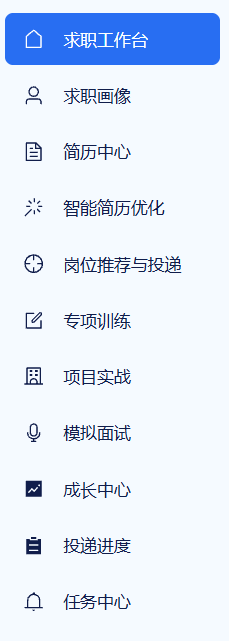 左侧logo图标美术不一致

AI补充的体验分析

1.1 “演示数据”在真实体验中造成误解（P1）

当前问题：已登录后，求职画像页顶部仍展示“演示数据”。这会让用户怀疑自己刚填写/保存的信息是否真实生效。
预期效果：真实账号环境只展示“最近更新于 ……”；演示模式才展示明显的环境标识。
建议方案：通过环境变量或数据来源标记控制 Banner；演示环境使用固定色条并说明“数据将在重置后清除”。
验收口径：正式/本地真实账号不出现“演示数据”；演示环境中所有可修改页均出现一致标记。

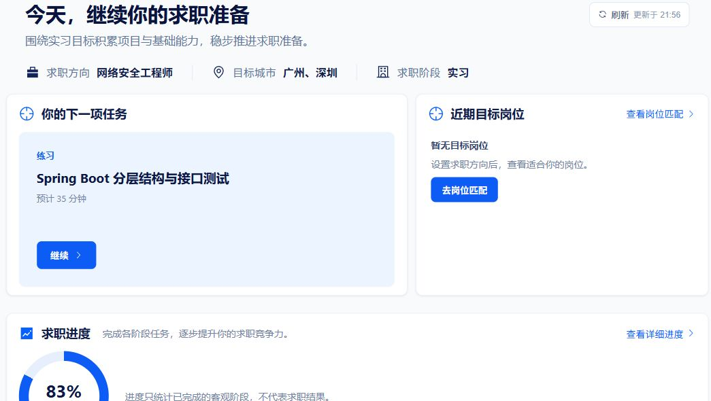

1.2 数据版本不一致时缺少提示（P1）

当前问题：工作台已显示目标为“网络安全工程师（广州、深圳）”，但专项训练仍是“测试工程师”方向的旧计划，任务也集中在 Java、Spring、MySQL、Redis。
预期效果：用户能一眼知道当前计划依据的是哪一版画像/简历，并能选择保留历史计划或生成新计划。
建议方案：在工作台、训练页展示“画像 v5 / 简历 v1 / 训练计划基于画像 v4”；目标变更后显示黄色“建议更新”卡片，提供“更新训练计划”和“保留旧计划”两个明确操作。
验收口径：修改求职方向后，旧计划必须显示过期标识；新计划生成后标识消失且任务技能与当前目标相关。

1.3 视觉资产风格不一致（P2）

当前问题：左侧 Logo 图标与页面中蓝色线性图标、卡片风格不完全一致。
预期效果：品牌图形、导航图标、空态插画遵循同一套线条粗细、圆角和色板。
建议方案：建立简短的视觉 Token（主蓝、辅助绿、警告橙、描边色、圆角、阴影）并统一导出 SVG 图标。

---

────────────────────────────────

二、登录与账户设置

我的原始意见

1、登陆状态容易失效，刷新整个网页就容易失效，就必须回到登录页面重新登录。

AI补充的体验分析

2.1 登录状态容易失效，刷新整页后必须重新登录（P1，用户反馈且已复现）
当前问题：用户反馈登录状态容易失效，尤其刷新整个网页后，经常需要回到登录页面重新登录。本轮实测已登录并完成页面操作后，刷新 /application，昵称恢复成“用户”，列表和统计均提示“未登录或登录已过期”；点击重试仍未恢复。重新登录后原有记录正常出现。该现象会打断用户在各模块之间的连续操作。
预期效果：刷新页面时先完成会话恢复，再请求受保护数据；无法恢复时跳转登录并保留返回地址。
解决方案：联合检查应用启动认证恢复、refresh Cookie 的 Path、SameSite、Secure、localhost/127.0.0.1 一致性、代理及 CSRF/Origin 配置。访问令牌继续放内存，由刷新会话恢复，不建议为此改成长期 localStorage。
验收：登录后刷新任意业务页仍可使用；真正失效时只显示一次登录提示并返回原页面。
范围说明：这是当前本机环境的复现结果，尚未定位为特定代码或配置根因。

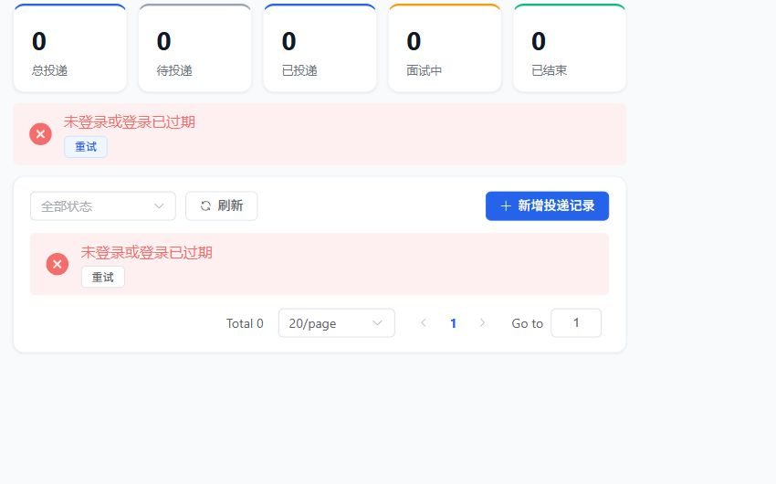

2.2 账户设置入口
“个人设置”原始意见保留在求职画像模块；建议将账户信息、安全操作与求职偏好分开。登录页“访问令牌仅保存在当前页面内存中”属于技术实现说明，可放帮助说明，主页面更适合显示会话与安全使用提示。

2.3 调整后的页面设计：账户与安全

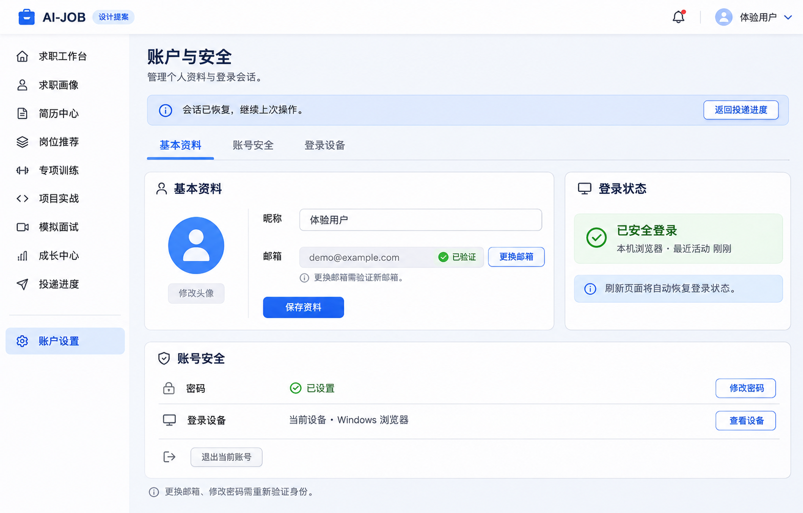

调整说明：将基本资料、账户安全、登录设备放在独立页面，个人设置不再跳入求职画像。昵称可编辑，邮箱变更进入验证流程。
交互规则：页面启动时先尝试恢复会话；成功后继续原操作，真正失效才跳转登录，登录成功返回原页面。图中的“已恢复”是预期效果示意，当前登录失效问题仍需修复后验证。
验收要点：刷新后昵称和业务数据恢复；账户设置与求职画像路由分开；更换邮箱或密码需要重新验证身份。

────────────────────────────────

三、求职画像

我的原始意见（原文保留）

1、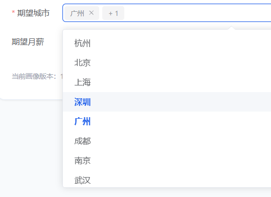 这个+1能不能改成已经选择的地名，而且期望城市能不能加上搜索框，期望城市和已选城市不能同时出现，只能选择一个

2、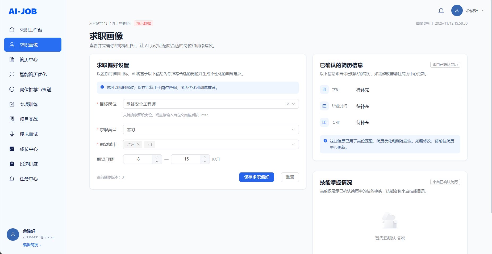求职画像填完之后看看能不能自动跳转到求职工作台页面

3、点击右上角个人设置跳转到了求职画像页面，是不是应该跳转到个人设置页面比较好，用户名和邮箱是不是没办法修改了，是不是最好加一个个人设置页面，这样可以修改账号信息

补充体验分析

3.1 期望城市多选不透明，缺少搜索（P2）

当前问题：已选择的城市只显示“广州 +1”，用户无法直接看到另一项；下拉面板没有搜索，也把已选项与可选项混在一起显示。
预期效果：已选城市清晰可见、可一键移除；城市多时能搜索；下拉项有明确的已选状态。
建议方案：输入框中最多展示两个城市 Chip（如“广州 ×”“深圳 ×”），其余才显示“+N”；下拉顶部放搜索框，已选项可置顶并以勾选态区分，不应与普通候选项视觉等权。
验收口径：选中 2 个城市时两项名称都可见；输入“深”只保留深圳相关选项；取消选择后 Chip 与下拉勾选同步更新。

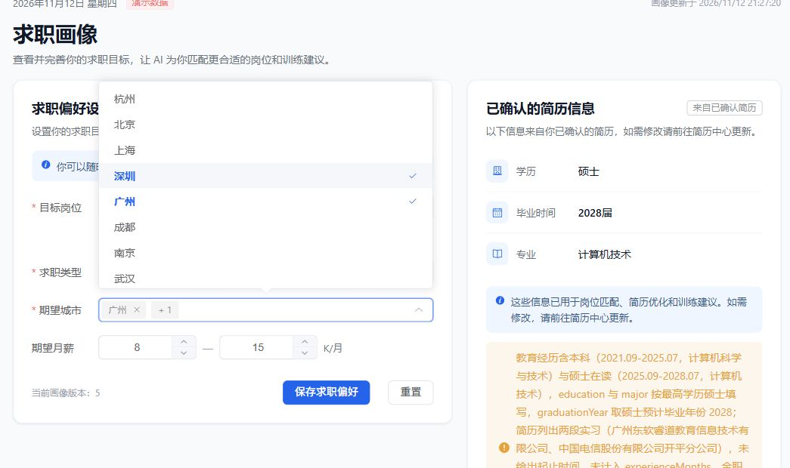

3.2 保存画像后缺少明确的下一步（P2）

当前问题：填完/保存求职画像后，用户仍停留在表单页，不清楚下一步应去岗位匹配还是工作台。
预期效果：保存成功后给出连续任务的入口，而不是强制替用户跳转。
建议方案：保存成功 Toast 中提供“去求职工作台”和“查看岗位匹配”按钮；首次完成时可默认跳转工作台，非首次保存则留在当前页。

3.3 “个人设置”实际跳至求职画像（P2）

当前问题：右上角菜单“个人设置”跳转到 `/profile`，语义与“求职画像”重复；用户名、邮箱、密码、退出设备等没有独立入口。
预期效果：求职偏好与账号设置分离，用户能理解哪些信息会影响匹配、哪些属于账户安全。
建议方案：新建“账户与安全”页（昵称、邮箱展示/验证、修改密码、登录设备、注销）；菜单中明确区分“求职画像”和“账户设置”。

---

3.4 调整后的页面设计：城市选择与保存反馈

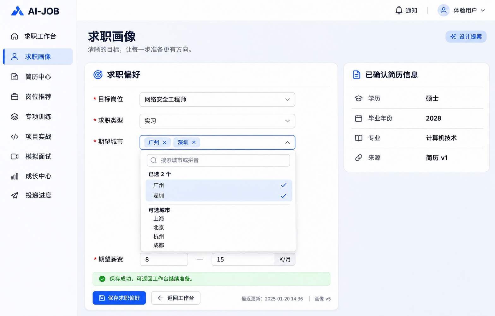

调整说明：直接显示“广州、深圳”两个已选标签，提供城市名/拼音搜索。下拉分为已选与可选两个区域，已选城市不重复出现在可选区域。
交互规则：点击标签关闭图标移除城市；搜索只改变候选列表，不清空已选项；保存成功后提供“返回工作台”。
验收要点：两座城市均可见，不用“+1”代替；输入城市名能筛选；保存后可继续返回工作台。图中日期、学历等为示例数据。

────────────────────────────────

四、简历中心

我的原始意见

1、简历中心的简历解析能力还是不足，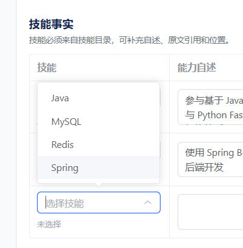，技能事实的技能选择缺少其它技术和编程语言，手动输入创建却显示找不到相关技术。实习经历、获奖等都被忽略掉了。

AI补充的体验分析

4.1 确认后无法纠正单项解析错误（P1）

当前问题：简历确认后进入只读状态；即使学历、经验月数、技能事实有单项提取错误，也只能上传一个新版本。页面同时出现“全职经验（月）= 1”，而解析提示又说“未计入 experienceMonths，全职经验月数记为 0”，容易失去信任。
预期效果：用户可以对 AI 提取的结构化事实做受控纠错，并保留来源和审计记录。
建议方案：新增“纠正事实”草稿层：允许编辑字段、标记为“用户纠正”、填写依据；重新确认后生成新事实版本，不覆盖原始解析结果。对相互矛盾的字段做一致性校验。
验收口径：用户修正一个技能或经验月数后，不必重新上传 PDF；页面能同时查看“原解析 / 用户修正 / 原文证据”。

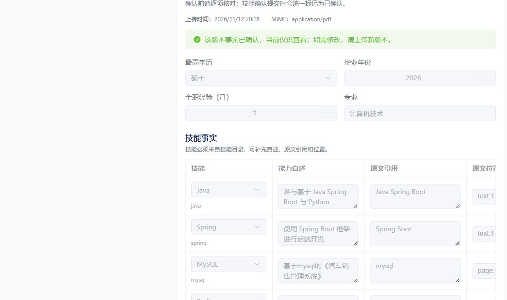

4.2 技能目录覆盖不足，不能自然补充新技术（P1）

当前问题：技能事实的选择项主要是 Java、Spring、MySQL、Redis 等；用户输入其他语言或技术时提示找不到，无法自然创建。
预期效果：不常见技术也能被记录，同时避免重复、错拼和不规范命名污染公共目录。
建议方案：支持“自定义技能（待规范化）”，后台用别名映射和人工/AI 归一化合并到技能目录；显示技术分类（语言、框架、数据库、安全、工具）。

────────────────────────────────

五、智能简历优化

5.1 简历优化历史直接展示 UUID（P2）

当前问题：历史诊断/任务记录使用长 UUID 作为主要标题，用户无法识别是哪份简历、针对哪个岗位、何时生成。
预期效果：历史列表可被普通用户浏览与复用。
建议方案：主标题改为“简历文件名 · v1 · 诊断时间”，副标题显示关联岗位或目标方向；UUID 收入“技术详情/复制 ID”。

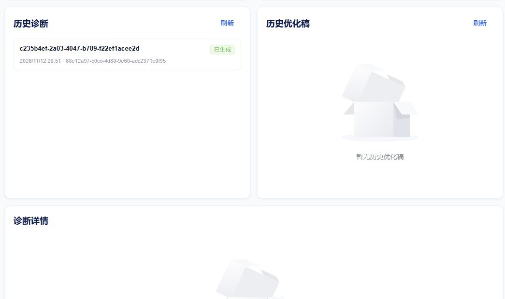

---

────────────────────────────────

六、岗位推荐、个人 JD 与匹配

我的原始意见（原文保留）

1、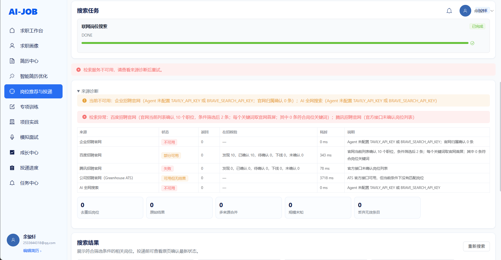，岗位推荐搜索，我搜索网络安全工程师，竟然搜不到任何东西，而且已经是ai联网搜素了，而且返回的几个企业招聘网站的结果是0。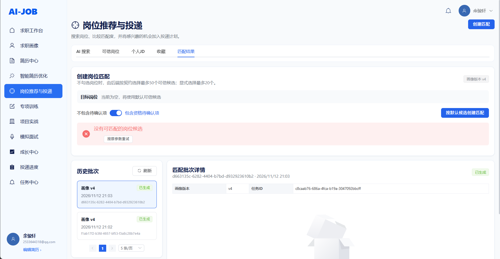匹配结果显示没有可匹配的岗位候选。这个模块感觉很多问题。

补充体验分析

6.1 联网搜索失败的根因虽可诊断，但对用户不可恢复（P0）

当前问题：搜索“网络安全工程师”后没有结果。来源诊断明确显示：AI 全网搜索和企业招聘官网因未配置 `TAVILY_API_KEY` 或 `BRAVE_SEARCH_API_KEY` 不可用；腾讯招聘接口失败、Greenhouse 超时；百度源部分可用但与关键词不匹配。
预期效果：用户在提交前或结果页即可知道“数据源能力不足”，并有可行动的下一步。
建议方案：
  1. 搜索页顶部显示来源健康状态与最后检测时间；
  2. 后端未配置搜索 Provider 时，禁用“AI 全网搜索”标签或明确标为“暂不可用”；
  3. 结果为 0 时区分“没有匹配岗位 / 搜索源不可用 / 过滤条件过严”；
  4. 提供“放宽城市或类型”“导入个人 JD”“稍后重试”按钮；
  5. 对超时源实施重试、熔断和缓存，避免每次用户点击都等待失败。
验收口径：缺少 Provider Key 时不再把系统故障包装成“0 个岗位”；来源恢复后，用户可看到来源数、抓取数、过滤数与匹配数的变化。

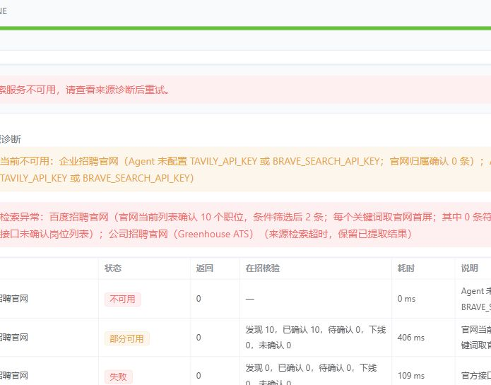

6.2 JD 原文与结构化字段矛盾（P0）

当前问题：个人 JD 详情的字段显示“城市：未明确”，但同一页原文第一行写明“工作地点：广州”。同时 JD 中出现 Spring Boot、FastAPI、Vue、车联网安全、ISO 21434 等信息，而结构化技能呈现过少。
预期效果：关键字段应有原文证据；低置信度结果应允许用户纠正，不应静默进入匹配链路。
建议方案：抽取字段旁展示证据片段/行号和置信度；提供“纠正提取结果”；对地点、公司、职位、技能做规则 + LLM 双通道校验，冲突时标记“待确认”。
验收口径：这份 JD 可正确识别“广州”；每个展示的字段至少能回溯到一段原文；用户修正后匹配会使用已确认字段。

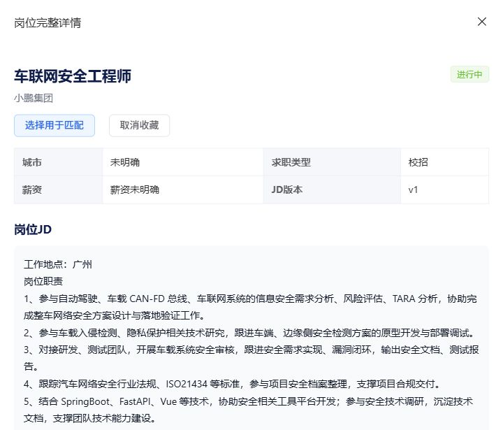

6.3 匹配空态需要解释与引导（P1）

当前问题：匹配结果“没有可匹配的岗位候选”与搜索源故障同时发生，用户难以判断是画像不完整、没有岗位，还是系统没拿到岗位数据。
预期效果：空态反映真实原因并提供恢复路径。
建议方案：空态使用原因型文案，例如“当前没有可用岗位数据，尚未开始匹配”；按钮改为“查看来源诊断”“导入 JD”“调整筛选”。

---

6.4 调整后的页面设计：来源状态与 JD 纠错

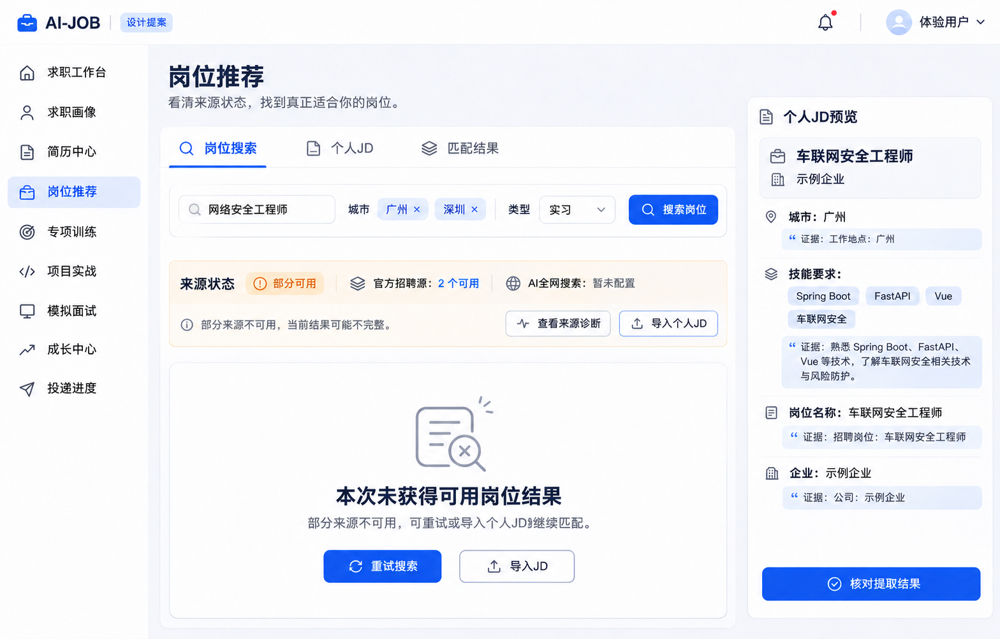

调整说明：搜索条件下方先展示来源健康状态；来源不可用与真正无岗位结果使用不同提示。导入个人 JD 是可执行的替代路径。
交互规则：来源诊断按需展开；个人 JD 预览展示城市与原文证据，点击“核对提取结果”进入人工确认。只有确认后的字段才进入匹配。
验收要点：缺少搜索服务配置时不表现成“没有合适岗位”；JD 原文写广州时，预览可显示广州并可追溯证据；不向普通用户暴露 Provider Key 或技术参数。

────────────────────────────────

七、专项训练

我的原始意见

1、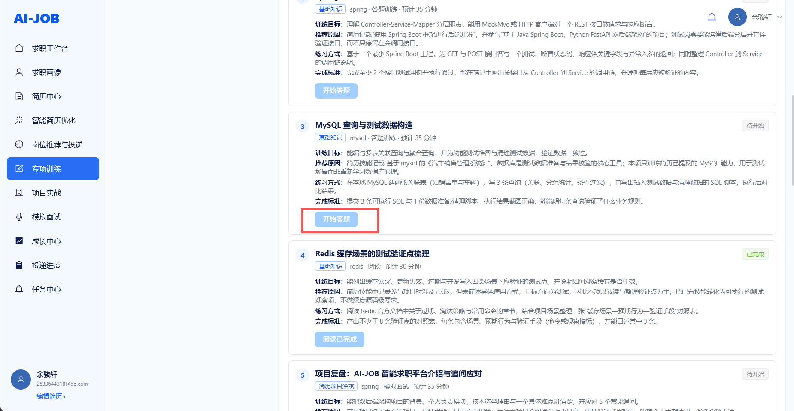，专项训练里面，按了开始答题按钮之后没有跳转任何其它网页，后来才发现原来题目在网页底部，建议是按了按钮之后能自动跳转到题目位置。完成阅读按钮也是有问题，按了按钮之后也没有跳转任何网页，刷新页面之后按钮恢复了，但是仍然没有跳转任何网页。难道只是阅读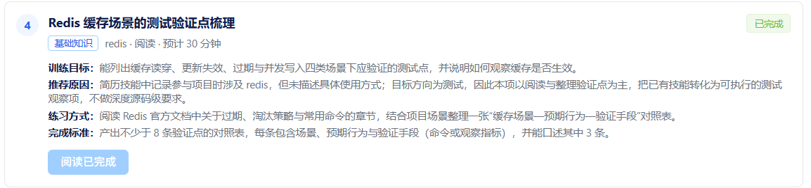摘要里面的内容吗。而且根据简历生成的答题和阅读内容跟简历个人能力有部分出入，缺少了部分技术的题目和阅读内容。

AI补充的体验分析

7.1 “开始答题”不自动定位到题目（P1）

当前问题：点击“开始答题”后仍停在训练计划顶部；题目和答题区域实际出现在页面很下方，用户会误以为按钮无效。
预期效果：启动/恢复会话后能立即看到当前题目与输入框。
建议方案：创建或恢复会话后使用锚点平滑滚动到“当前答题会话”；窄屏改为固定底部按钮或抽屉；按钮文案区分“开始答题”和“继续答题”。
验收口径：点击后 1 秒内题目标题进入可视区，键盘焦点落在答题框。

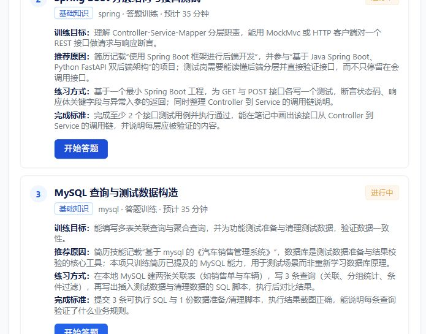

7.2 代码题未按代码块呈现（P2）

当前问题：题干中的代码围栏标记（例如 `java`）直接以普通文本显示，降低可读性，也不利于代码题作答。
预期效果：代码具备等宽字体、语法高亮、复制按钮和足够的横向滚动空间。
建议方案：统一 Markdown 渲染管线，启用 fenced code block 与 Java 高亮；代码块保留“复制”与“展开”。

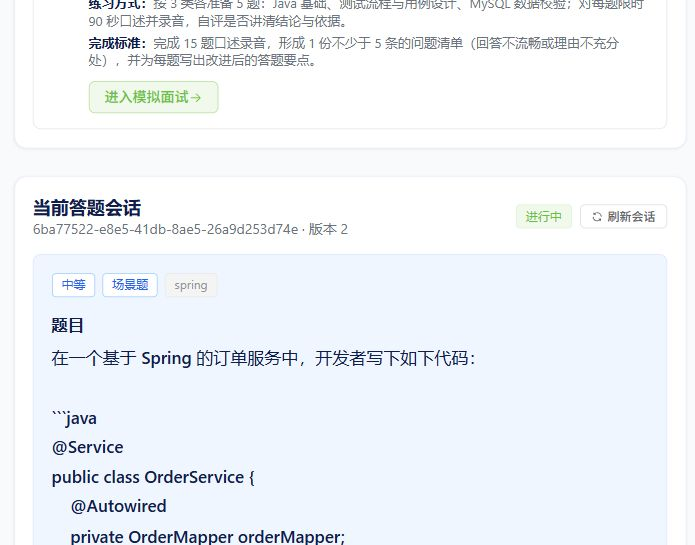

7.3 阅读任务的完成语义不清（P1）

当前问题：用户点击“完成阅读”后没有打开资料或解释完成依据；刷新后按钮状态也容易让人怀疑是否成功。用户不清楚是阅读摘要、跳转外部资料，还是仅手动确认。
预期效果：阅读目标、资料链接、完成条件和保存结果可见。
建议方案：将流程拆为“打开资料 → 返回确认已阅读 → 显示完成时间”；若仅为自我声明，应明确写“我已阅读（自评）”，并展示完成状态持久化反馈。

7.4 训练内容应基于当前目标而非旧简历快照（P1）

当前问题：当前求职方向是网络安全工程师，训练主题却偏 Java/Spring 基础；如果这是历史计划，页面没有提醒。
预期效果：训练计划明确说明来源版本，能覆盖目标岗位关键技能与短板。
建议方案：用“目标岗位要求 − 已确认技能”生成能力差距；按安全基础、车联网/网络安全、后端工程能力分层；计划更新时可对比新增/移除题目。

7.5 早期训练工作区提案（保留供对照）

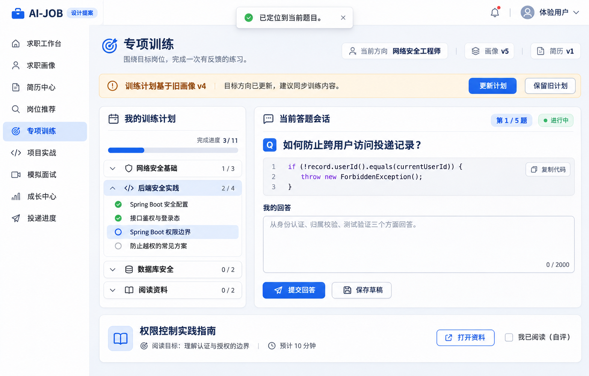

调整说明：左侧是计划与里程碑，右侧集中展示当前题目、格式化代码和答题框。顶部提醒旧画像计划，并提供更新入口。
交互规则：点击开始/继续答题后立即切换并定位当前题目，答题草稿保留；阅读任务区分“打开资料”和“我已阅读（自评）”，完成状态需后端保存。
验收要点：题目和输入框不藏在长页面底部；代码块可复制；旧计划基于哪个版本可见；阅读完成后刷新仍保留状态。图中的“保存草稿”等属于新增设计建议。

7.6 Product Design 专项训练主推方案与备选

本次沿用现有视觉风格，改变信息组织和学习方式。用户已于 2026-11-13 选择方案 1“专注答题模式”作为报告中的主推方案；方案 2、3 保留为备选，编号与本轮聊天图片实际显示顺序一致。

方案 1：专注答题模式（已选，主推）

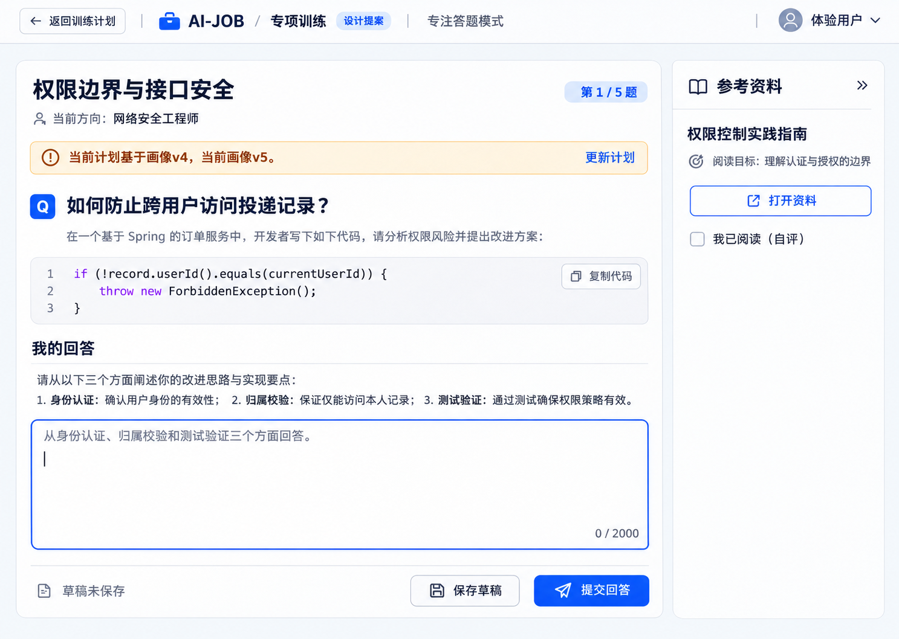

适用场景：进入答题后减少干扰，优先看题、写答案、提交评价。全局导航收为返回入口，参考资料在侧边按需查看。
取舍：作答更专注，但查看整体训练计划需要返回或展开目录。应保留草稿与返回位置，避免切换丢失输入。

落地规则：进入答题后优先呈现当前题目、代码与输入框；“提交回答”作为主要操作，“保存草稿”作为辅助操作。返回计划前保存或提示处理未保存内容，回到该题时恢复输入与位置。参考资料可收起，窄屏改为抽屉；“打开资料”与“我已阅读（自评）”分别操作。旧画像提醒保留，但不能遮挡答题；更新计划前需明确处理当前会话与草稿。

方案 2：分步学习引导（备选）

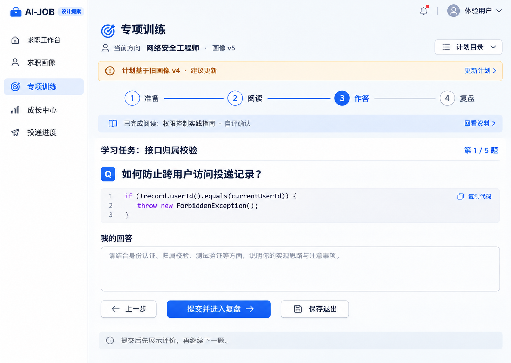

适用场景：首次使用或需要明确学习顺序的用户，按准备、阅读、作答、复盘逐步完成。
取舍：流程清楚，但熟练用户可能不想逐步走完。阅读任务与练习原本独立时，不能强制将所有练习都绑定阅读；需提供跳过可选步骤并说明原因。

方案 3：并排训练工作区（备选）

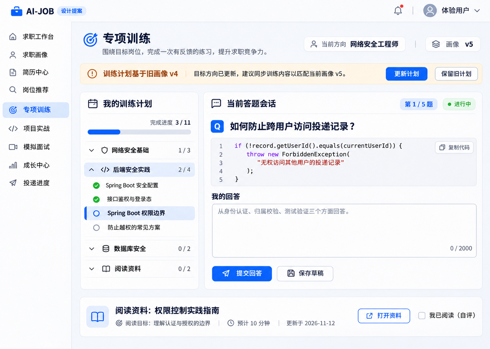

适用场景：需要在多个技能与题目之间切换，左侧保留计划进度，右侧固定当前题目与答题区。
取舍：与当前产品结构衔接较自然，但桌面信息更多，窄屏需将计划折叠为目录；正文、输入框与提交按钮应优先展示。

共同要求：旧画像提示明确、当前题目立即可见、代码可复制、阅读和自评分离。主推方案实现后仍需验证键盘焦点、读屏标签、文本对比度、移动端布局和会话恢复；当前选择属于设计评审结论，静态图片不代表这些交互已实现或已验收。

────────────────────────────────

八、模拟面试

我的原始意见

1、模拟面试暂时还不支持语音面试。

AI补充的体验分析

本轮测试结果
1. 读取原有五题面试的完整对话和报告，评分、能力维度、优点和建议均可展示。
2. 创建新的三题面试会话，首题可正常生成，空回答时提交按钮禁用。
3. 提交明确标注“功能测试，不代表本人经历或实际能力”的回答后，回答得到保存，系统生成针对性追问。
4. 通过任务中心“查看结果”返回同一个会话，对话与版本可恢复。
5. 提前结束后生成报告；报告显示“无有效评分”“有效回答主问题数 0”“不新增能力证据”。
6. 再次进入成长中心，Java 仍为原来的 1 条有效样本、86 分，总证据仍为 5 条，未看到本轮测试增加的有效能力证据。

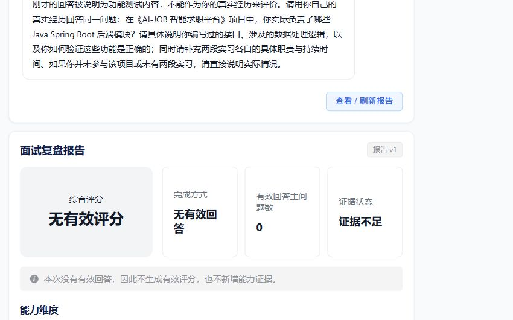

8.1 语音面试属于后续能力建设（P2）
当前情况：页面已有“当前仅支持文字面试”提示，也有“新建文字面试”按钮。原始“不支持语音”的反馈保留为功能期望，不能再表述成页面未说明。
预期效果：后续支持语音输入、语音追问及表达反馈。
解决方案：语音识别、TTS、录音状态、用户授权和文字降级统一设计；先明确用户是否需要语音，再安排实现。

8.2 历史标题和结束状态不够直观（P2，已观察）
当前问题：历史记录标题为“面试 + 短 ID”；本轮只回答了一个测试问题并提前结束，历史仍显示“已完成 · 3 个主问题”，容易被理解为已完成三题；报告里才显示有效回答 0。
预期效果：列表直接说明岗位、日期、结束方式和实际答题数。
解决方案：标题使用“车联网安全工程师 · 日期”；区分“正常完成 / 提前结束 / 无有效回答”，数量展示“有效回答 0 / 计划主问题 3”。
验收：未答完的测试会话不会与正常完成会话呈现为相同结果。

本轮新会话覆盖提前结束路径；正常答完多题路径通过既有五题历史报告核对，本轮未重新作答全部三题。

────────────────────────────────

九、项目实战与项目推荐

本轮测试结果
选择 MySQL、进阶、最长 4 周，生成“安全审计与权限加固”和“注入风险检测与防护”两个候选；内容结合当前安全方向。选择前者、每周 10 小时后，成功生成 3 周、8 项任务、合计 30 小时的计划。
在新计划里勾选一项，进度从 0% 变为 12%，再取消勾选恢复 0%；原有项目未改变。
空交付标题提交后出现“请输入交付标题”。未向真实项目新增交付记录。

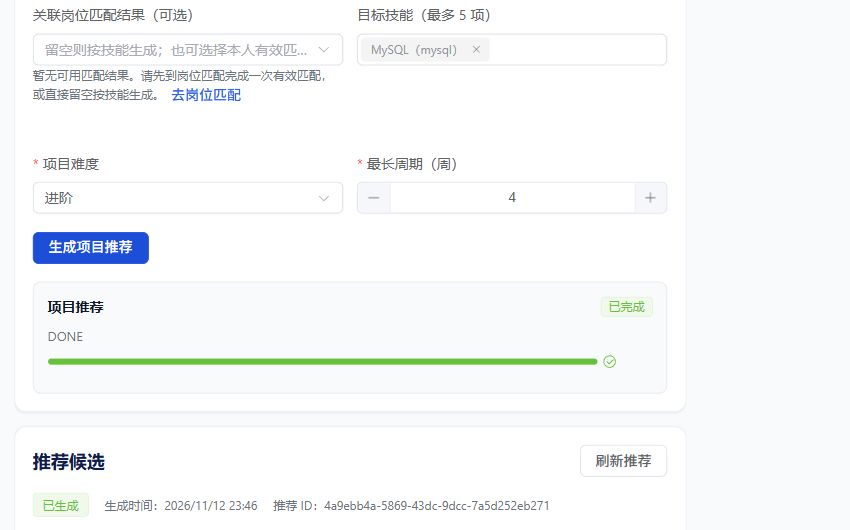
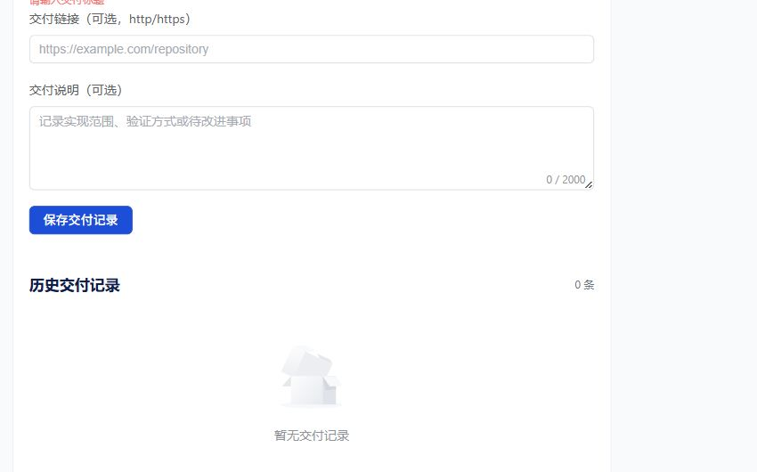

9.1 推荐理由包含内部字段（P2，已观察）
当前问题：推荐理由中出现“allowedSkillCodes 仅包含 mysql”等提示词/数据结构术语；页面还直接展示推荐 ID、DONE。
预期效果：推荐理由解释“为什么适合我”，技术字段留给排查。
解决方案：结果增加面向用户的文案校验，将字段名转换为“本次选择的技能是 MySQL”；ID 和任务阶段收进“技术详情”。
验收：普通推荐理由不再出现内部参数名。

9.2 项目详情页面较长，缺少快捷定位（P2，产品建议）
当前情况：列表、计划、8～10 个任务、交付表单与历史记录纵向堆叠。
预期效果：能快速找到下一项任务、当前里程碑和交付入口。
解决方案：列表与详情分栏，顶部固定进度与“继续下一任务”，里程碑可折叠；交付任务默认绑定当前任务。
验收：从项目卡片进入后能直接看到当前任务，而不必反复滚动。

9.3 缺少测试/练习项目的归档入口（P2，产品建议）
当前情况：本轮生成的新计划会保留在“我的项目”，页面没有明显归档入口。
预期效果：试生成、不准备继续的计划可以收起，不干扰正式项目。
解决方案：增加归档和恢复，明确区分“AI 计划”与“已有真实项目经历”，未验收交付不自动进入简历经历。

────────────────────────────────

十、成长中心

本轮测试结果
摘要、时间线和最近证据可读取；Java 有 1 条有效评分证据为 86 分。选择 MySQL 后，证据列表为 1 条简历自述，时间线显示“有效评分证据不足”，没有把未评分资料画成 0 分。
重新生成成长建议成功，建议包括补充各技能可验证证据，以及补充目标岗位 JD。测试面试未新增能力证据。

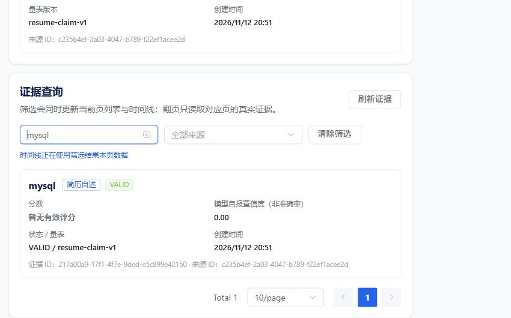
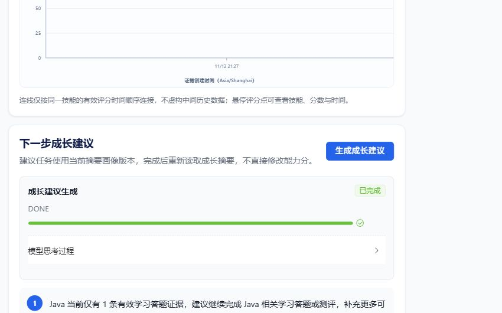

10.1 面向普通用户的主页面技术信息过多（P2，已观察）
当前问题：LIMITED、MISSING、VALID、ability-v1-trial、量表版本、证据 ID 和来源 ID 分散显示，主要成长信息不够突出。
预期效果：先看到当前能力、证据数量和下一步，必要时再查看计算说明。
解决方案：用中文“样本不足 / 暂无测评”作为主标签；保留严谨解释，但把公式、量表、ID 收进可折叠详情。
验收：不理解英文状态的用户也能看懂现状与下一步。

10.2 建议缺少可直接执行的入口（P2，已观察）
当前问题：建议是纯文字列表，如“完成 MySQL 测评”，用户需要自己再寻找训练模块。
预期效果：从建议能直接开始对应技能的训练。
解决方案：每条建议加“去专项训练 / 查看对应项目 / 补充岗位 JD”，导航携带技能与来源，不直接修改能力分。
验收：点击 MySQL 建议后进入 MySQL 对应训练准备页，并保留返回成长中心入口。

────────────────────────────────

十一、投递进度

本轮测试结果
新增前原有 1 条“已投递”记录。使用专用公司名“功能体验测试-20261112”创建一条测试记录，验证：
1. 空表单会提示公司名称和岗位名称必填。
2. 新增后总数 2、待投递 1、已投递 1；详情显示手动录入、v1。
3. 备注从非空修改为另一个值，重开表单确认保存成功。
4. 状态改为面试中后，总数 2、已投递 1、面试中 1；日期保持原值。
5. 清空备注后，详情显示空值、版本 v3。
6. 筛选面试中只出现测试记录，顶部统计仍为全部记录统计。
7. 经用户明确授权删除测试记录后，总数恢复 1，面试中为 0。重新登录再进入，原有记录仍存在且字段未变。
本轮没有制造双客户端 409，也没有大量造数据重测多页删尾；先前验收证据不替代本轮未覆盖项。

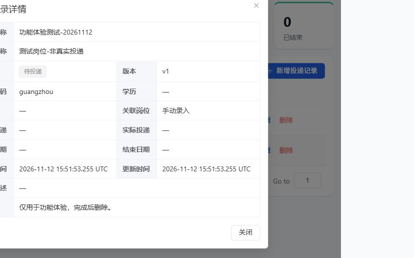
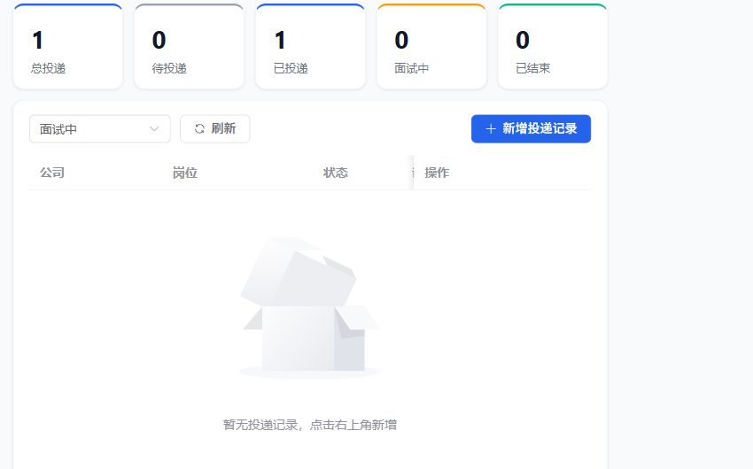

11.1 城市编码不适合让普通用户输入（P2，已复现）
当前问题：新增/编辑和详情均直接显示“城市编码”，本轮可输入 guangzhou；用户需要猜编码规则。
预期效果：填写城市名称即可，前后端内部完成编码映射。
解决方案：复用统一城市字典与可搜索选择框，详情显示“广州”；必要时技术详情再显示代码。
验收：用户不需知道 guangzhou 或城市编号也能填写成功。

11.2 更新时间直接展示 UTC 和毫秒（P2，已复现）
当前问题：本地晚间新增，页面显示“2026-11-12 15:51:53.255 UTC”，与用户当地时间相差 8 小时。
预期效果：统一显示浏览器当地时间，必要时明确时区。
解决方案：时间戳按 Asia/Shanghai 或浏览器时区格式化为“2026-11-12 23:51”；日期型字段仍按 YYYY-MM-DD 原样处理，不做时区转换。
验收：创建和更新时间与当地时间一致，计划投递日期不因时区转换前移/后移一天。

11.3 筛选空态误导为完全没有记录（P2，已复现）
当前问题：删掉唯一面试中记录后，顶部总数仍为 1，列表却写“暂无投递记录，点击右上角新增”，没有说明当前是筛选无结果。
预期效果：区分账户从未有记录与筛选无结果。
解决方案：筛选空态改为“当前没有面试中的记录”，提供“清除筛选”；下拉增加明确的“全部状态”选项，同时说明统计卡是全部记录。
验收：切换状态筛选后，空态文案准确，用户可直接回到全部记录。

11.4 删除确认文案和上下文可改进（P2，产品建议）
当前情况：删除弹窗直接使用“物理删除”。详情已有“手动录入/关联岗位”，不应再把“完全没有来源字段”作为缺陷。
预期效果：用户理解不可恢复的后果，记录可以追溯投递材料。
解决方案：文案用“永久删除，无法恢复”；后续增加使用简历版本、跟进提醒等信息，作为增强功能。

11.5 调整后的页面设计：投递列表与编辑面板

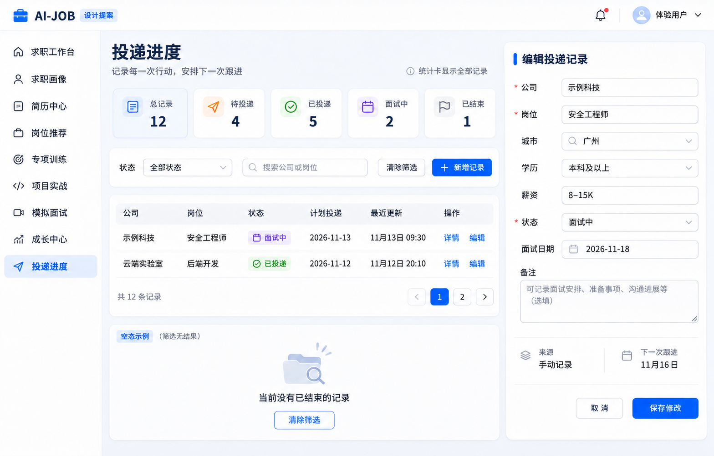

调整说明：保留统计卡与分页表格，表单使用城市名称选择、本地时间展示；编辑面板可查看来源与跟进日期。筛选空态提供清除筛选入口。
交互规则：统计卡始终对应全部记录，列表随筛选变化；保存时只提交变更字段，清空可空项提交 null，冲突时保留输入并提示重新加载；删除继续执行二次确认。
验收要点：用户不用输入城市代码；更新时间不直接显示 UTC 与毫秒；无筛选结果时写“当前没有该状态的记录”。图中记录数量、公司和跟进提醒均为设计示例，跟进提醒属于增强项。

────────────────────────────────

十二、任务中心

本轮测试结果
全部/失败筛选可用，列表可翻至第 2 页；实时详情显示状态和固定输入版本；查看结果能回到对应面试会话。
重试历史“准备训练题”失败任务后创建了新任务 91277e6d，几秒后仍失败，显示“Agent 暂不可用”。同轮项目推荐、项目计划、面试和成长建议均已成功，因此不能据此认定整个 Agent 不可用。
本轮尝试取消该新任务时它已结束，取消按钮消失，未实际完成“运行中取消”验证。

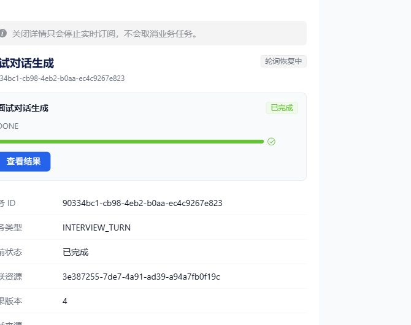
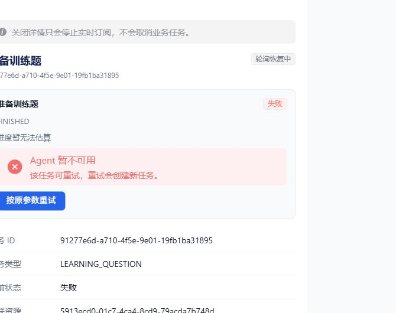

12.1 失败提示不能支持用户恢复（P1，已复现）
当前问题：同一训练任务重试仍报泛化的“Agent 暂不可用”；详情显示固定画像版本 4，而当前画像已是版本 5。
预期效果：分清服务不可用、旧输入失效、业务冲突、上游超时等原因，告诉用户是原参数重试还是重新生成。
解决方案：后端记录并返回适合展示的错误分类与 traceId；前端提醒“将按旧画像版本重试”，必要时引导用最新画像重新发起。不能直接认定旧版本就是失败根因，需要日志核实。
验收：重试后能关联原任务；重复失败有明确原因和恢复路径，避免无限重试。

12.2 任务执行完成不代表业务结果可用（P1，已观察）
当前问题：之前来源不可用的联网搜索任务，在任务列表仍是“已完成 / DONE / 100% / 错误 —”，用户容易理解为已搜到有效岗位。
预期效果：保留任务执行状态，同时展示结果摘要。
解决方案：增加“完成但无可用结果 / 部分来源失败 / 需配置来源”等业务标签；结果摘要显示岗位数量及来源健康，不必把所有无结果任务改为执行失败。
验收：用户不打开详情也能区分任务完成和结果可用。

12.3 同时显示中文状态和 DONE/FINISHED（P2，已观察）
当前问题：状态列已是中文，阶段列继续展示英文内部状态，普通用户难以区分。
预期效果：主表使用有意义的业务阶段，诊断值按需展开。
解决方案：阶段映射为“正在生成题目 / 正在校验结果 / 已完成”，ID 和输入字段放技术详情。

────────────────────────────────

十三、UI 调整方向

此前补充的 5 张完整页面效果图继续保留，分别放在对应模块，供团队评审和前端实现参考。Product Design 现已安装；本次按其设计探索流程，为专项训练新增 3 个独立布局方向，并附上原页面截图与既有方案作为图像参考。设计沿用项目现有蓝白配色、220 像素侧栏及 14～16 像素正文规范。所有图均为尚未实现的设计提案，不是当前系统截图。图中文字和交互以本报告说明为准，示例数据不代表真实记录。

| 设计页面 | 对应问题 | 设计文件 |
| --- | --- | --- |
| 账户与安全 | 个人设置入口、刷新会话恢复 | [查看设计图](ui-design/02-账户设置与会话恢复.png) |
| 求职画像 | 城市搜索、已选标签、保存反馈 | [查看设计图](ui-design/01-求职画像与城市选择.png) |
| 专项训练 | 当前题目定位、代码渲染、旧计划提醒 | [查看设计图](ui-design/03-专项训练工作区.png) |
| 专项训练主推方案（已选） | 专注答题、参考资料侧栏、草稿与返回流程 | [查看方案 1](ui-design/product-design/01-专注答题模式.png) |
| 岗位搜索 | 来源可用性、失败恢复、JD 证据核对 | [查看设计图](ui-design/04-岗位搜索与JD纠错.png) |
| 投递进度 | 城市选择、本地时间、筛选空态 | [查看设计图](ui-design/05-投递进度列表与表单.png) |

前五张图的生成要求和修订记录：[查看生成提示词](ui-design/生成提示词.json)。Product Design 三个方向的参考来源、提示词和显示顺序：[查看生成记录](ui-design/product-design/生成记录.json)。开发时以各模块的交互规则与既有接口契约为准。

总体逻辑草图（保留早期布局说明）

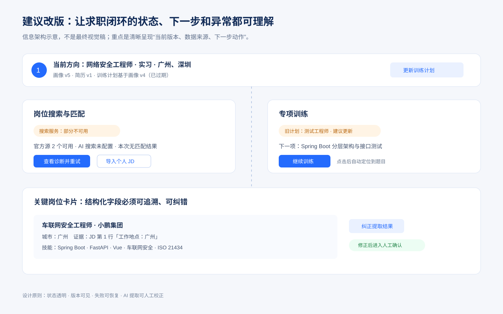

设计原则

1. 状态透明：来源是否可用、任务是否过期、数据来自哪一版都要可见。
2. 版本可见：画像、简历、训练、匹配之间标明依赖关系，而不是让用户猜为什么内容不一致。
3. 失败可恢复：把“无结果”拆成数据源故障、过滤过严、确无结果三种，并给下一步按钮。
4. AI 可校正：所有结构化提取都应带原文证据、置信度和用户确认入口。
5. 操作有反馈：点击开始、完成、保存后，应定位、反馈、持久化可见，而非只改变后台状态。

建议的落地顺序

1. 第一轮（可靠性）：搜索 Provider 配置检查、来源状态、JD 地点提取与人工纠正、训练计划版本提醒。
2. 第二轮（闭环）：训练自动定位、阅读完成流程、简历事实纠正、匹配空态引导。
3. 第三轮（易用性）：城市搜索/Chip、账户设置页、历史记录命名、代码渲染、统一视觉资产。

────────────────────────────────

十四、测试数据与回归说明

本轮新增内容
1. 投递记录“功能体验测试-20261112”已按授权永久删除，仅删除这一条。原有投递记录保留。
2. 新增项目推荐 4a9ebb4a，以及“MySQL 安全审计与权限加固实践项目计划”（项目 c7d5679b）。新计划测试勾选已撤回，当前 0/8；未修改原项目。
3. 新增测试面试 3e387255，已提前结束，报告无有效评分；测试回答明确标注不代表本人经历或能力。历史中会保留该测试会话。
4. 新增一条历史训练题重试任务 91277e6d，结果为失败。
5. 重新生成过成长建议。前一轮的搜索任务和截图继续保留。
没有修改源代码、简历文件和已确认事实，没有更改真实投递内容，没有提交训练答案或标记阅读完成。建议后续提供体验模式和测试数据归档功能。

建议修复后回归
登录：业务页刷新后恢复会话；失效时可返回登录并回到原页面。
岗位：来源异常与无匹配分开展示；广州地点提取正确并有证据。
训练：当前画像变化后旧计划有提示；开始答题自动定位；阅读完成可持久化。
项目：生成、进度、交付校验保持正常，推荐理由不出现内部变量。
面试：区分正常完成与提前结束；测试或无有效回答不增加能力证据。
成长：筛选、时间线、建议入口联动，未评分不画成 0。
投递：城市选择、当地时间、筛选空态优化；后续单独补做双客户端 409 与多页删尾。
任务：补测真正运行中的取消；核查历史训练重试失败根因。

完成状态
已完成原先剩余五个模块的一轮主要功能体验，已记录成功结果和失败场景。未覆盖项已在对应模块注明，不能据此宣称全项目所有功能和边界均验收通过。
